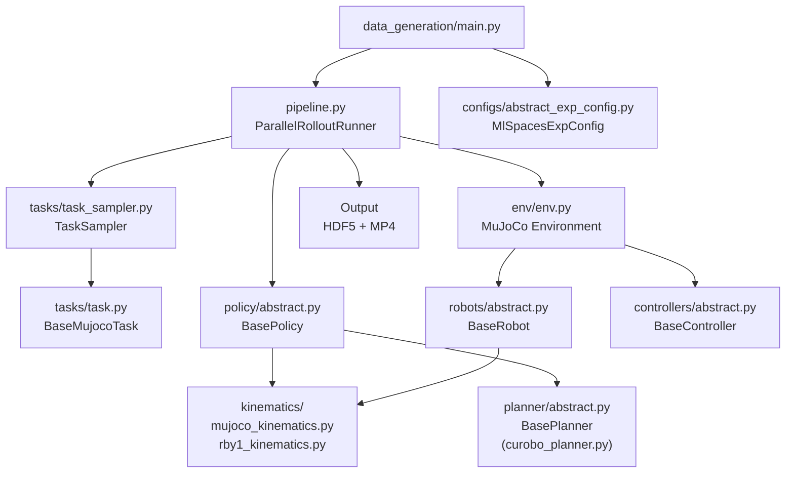
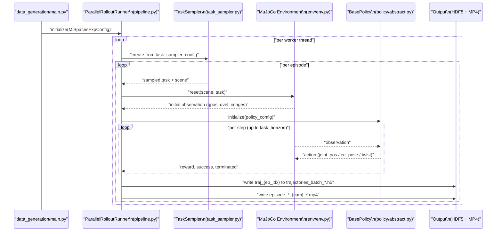

<!-- source: DeepWiki mcp.deepwiki.com · repo allenai/molmospaces · page 5.1 Pipeline Architecture · fetched 2026-10-26 -->

# Pipeline Architecture

<details>
<summary>Relevant source files</summary>

The following files were used as context for generating this wiki page:

- [docs/code_structure.md](docs/code_structure.md)
- [molmo_spaces/configs/abstract_exp_config.py](molmo_spaces/configs/abstract_exp_config.py)

</details>


This page covers the internal architecture of the data generation pipeline: the entry point in `main.py`, the `ParallelRolloutRunner` in `pipeline.py`, and how tasks, policies, and environments are wired together at runtime. For the types of tasks the pipeline executes, see [Task Types](#5.2). For the HDF5 output schema produced by the pipeline, see [Data Format](#5.3). For the postprocessing steps that run after the pipeline completes, see [Data Postprocessing](#5.4). For the configuration classes that parameterize the pipeline, see [Configuration System](#4).

---

## Entry Point: `data_generation/main.py`

The pipeline is launched via:

```
python -m molmo_spaces.data_generation.main <config_path> <ConfigClassName>
```

`main.py` is responsible for:

1. Loading a concrete `MlSpacesExpConfig` subclass from the specified file path and class name.
2. Validating the config (Pydantic validates field types and the `model_post_init` assertions on timing ratios).
3. Instantiating a `ParallelRolloutRunner` from `pipeline.py`.
4. Handing control to the runner, which manages all worker threads and episode collection.

The config class name is passed as a string argument so that a single config file can hold multiple config variants. The `register_config` decorator (see [Task Configurations](#4.2)) makes these classes discoverable by name.

**Example invocation** (from `docs/code_structure.md`):

```bash
export PYTHONPATH=${PYTHONPATH}:.
export MUJOCO_GL=egl
export PYOPENGL_PLATFORM=egl

python -m molmo_spaces.data_generation.main \
    molmo_spaces/data_generation/config/rby1_door_opening_config.py \
    DoorOpeningDataGenConfig
```

Sources: [docs/code_structure.md:83-95](), [molmo_spaces/configs/abstract_exp_config.py:33-115]()

---

## Module Dependency Graph

The pipeline draws from six major subsystems. Each has a well-defined role and communicates with adjacent modules through abstract base classes.

**Diagram: Module Dependency Graph**



Sources: [docs/code_structure.md:1-44]()

---

## `ParallelRolloutRunner`: Core Execution Engine

`ParallelRolloutRunner` in `molmo_spaces/data_generation/pipeline.py` is the central orchestrator. It implements episode-level parallelism using worker threads, each of which owns an independent MuJoCo environment and interacts with a `TaskSampler`.

### Parallelism Model

| Parameter | Config Field | Description |
|---|---|---|
| Worker threads | `num_workers` | Number of parallel rollout threads; each runs its own env + sampler |
| Batched envs | `num_envs` | Vectorized physics envs per worker (for `CPUMujocoEnv`) |
| Max steps/episode | `task_horizon` | Episode truncation limit; `None` means no limit |
| Random seed | `seed` | If `None`, a random seed is generated at startup |

Sources: [molmo_spaces/configs/abstract_exp_config.py:40-55]()

### Worker Thread Responsibilities

Each worker thread performs the following loop:

1. Instantiate a `TaskSampler` from `task_sampler_config`.
2. Call `TaskSampler.sample()` to get a concrete task + scene.
3. Reset the MuJoCo environment with the sampled scene.
4. Initialize the `Policy` from `policy_config`.
5. Step the environment up to `task_horizon` times, collecting observations and actions.
6. Evaluate success and write the trajectory to an HDF5 file.
7. Optionally write per-camera MP4 files.
8. Repeat from step 2.

The timing relationship between the three clock rates is enforced at config construction time:

- `policy_dt_ms` must be an integer multiple of `ctrl_dt_ms`
- `ctrl_dt_ms` must be an integer multiple of `sim_dt_ms`

[molmo_spaces/configs/abstract_exp_config.py:99-106]()

---

## Episode Lifecycle

**Diagram: Episode Lifecycle Sequence**



Sources: [docs/code_structure.md:49-63](), [molmo_spaces/configs/abstract_exp_config.py:33-115]()

---

## Key Abstractions and Their Roles

**Diagram: Core Abstract Classes and Their Subclass Hierarchies**

```mermaid
classDiagram
    direction TB

    class "MlSpacesExpConfig" {
        +num_workers: int
        +num_envs: int
        +task_horizon: int
        +policy_dt_ms: float
        +ctrl_dt_ms: float
        +sim_dt_ms: float
        +scene_dataset: str
        +camera_config: CameraSystemConfig
        +robot_config: BaseRobotConfig
        +task_sampler_config: BaseMujocoTaskSamplerConfig
        +task_config: AllTaskConfigs
        +policy_config: BasePolicyConfig
        +freeze_task_config()
        +save_config()
        +load_config()
    }

    class "BaseMujocoTask" {
        +env: MuJoCo Environment
        +config: MlSpacesExpConfig
    }

    class "BasePolicy" {
        +initialize(policy_config)
        +act(observation)
    }

    class "BasePlanner" {
        +plan(start, goal)
    }

    class "BaseRobot" {
        +kinematics
        +controller
    }

    class "BaseController" {
        +step(command)
    }

    "MlSpacesExpConfig" --> "BaseMujocoTask" : "task_config"
    "MlSpacesExpConfig" --> "BasePolicy" : "policy_config"
    "MlSpacesExpConfig" --> "BaseRobot" : "robot_config"
    "BasePolicy" --> "BasePlanner" : "uses"
    "BaseRobot" --> "BaseController" : "uses"

    class "PickPlannerPolicy" 
    class "AStarNavToObjPolicy"
    class "TeleopPolicy"
    class "LearnedPolicy"

    "BasePolicy" <|-- "PickPlannerPolicy"
    "BasePolicy" <|-- "AStarNavToObjPolicy"
    "BasePolicy" <|-- "TeleopPolicy"
    "BasePolicy" <|-- "LearnedPolicy"
```

Sources: [docs/code_structure.md:64-71](), [molmo_spaces/configs/abstract_exp_config.py:33-100]()

---

## Timing and Clock Rates

The pipeline operates on three nested clock rates, all expressed in milliseconds:

| Clock | Field | Typical Role |
|---|---|---|
| Simulation | `sim_dt_ms` | MuJoCo physics step |
| Control | `ctrl_dt_ms` | Robot controller update; integer multiple of `sim_dt_ms` |
| Policy | `policy_dt_ms` | Policy query rate; integer multiple of `ctrl_dt_ms` |

The derived `fps` property on `MlSpacesExpConfig` is `1000.0 / policy_dt_ms` and represents the data collection frame rate stored in the output HDF5.

[molmo_spaces/configs/abstract_exp_config.py:61-63]()

---

## Episode State Freezing and Replay

`MlSpacesExpConfig.freeze_task_config()` serializes a complete episode snapshot into a `SavedEpisode` object (a nested `Config` class), which is then base64-encoded and stored alongside the trajectory. This snapshot captures:

- **Robot state**: `init_qpos` from the post-reset observation; noise ranges removed.
- **Camera state**: Random camera placements resolved to fixed `FixedExocentricCameraConfig` or `RobotMountedCameraConfig` instances.
- **Object poses**: A `{name: pose_7d}` dict for all mobile objects in the scene.
- **Task class**: Module-qualified class name string for dynamic re-instantiation.

This mechanism enables deterministic episode replay from a stored benchmark without re-running the task sampler. It underpins the benchmark episode format used by `eval_main.py` (see [Evaluation & Benchmarking](#6)).

[molmo_spaces/configs/abstract_exp_config.py:142-216]()

---

## Directory Layout (Pipeline-Relevant Files)

```
molmo_spaces/
├── data_generation/
│   ├── main.py              # CLI entry point
│   ├── pipeline.py          # ParallelRolloutRunner
│   └── config/              # Concrete experiment config files
│       └── rby1_door_opening_config.py
├── env/
│   ├── env.py               # MuJoCo environment wrapper
│   └── data_views.py        # Data view utilities
├── tasks/
│   ├── task.py              # BaseMujocoTask
│   └── task_sampler.py      # TaskSampler
├── policy/
│   ├── abstract.py          # BasePolicy
│   ├── planner_policy/      # Planning-based policies
│   ├── teleop_policy/       # Teleoperation policies
│   └── learned_policy/      # Learned policies
├── robots/
│   ├── abstract.py          # BaseRobot
│   └── rby1.py
├── controllers/
│   ├── abstract.py          # BaseController
│   ├── joint_pos.py
│   ├── joint_vel.py
│   └── base_pose.py
├── kinematics/
│   ├── mujoco_kinematics.py
│   └── rby1_kinematics.py
└── planner/
    ├── abstract.py
    └── curobo_planner.py
```

Sources: [docs/code_structure.md:7-44]()

---

