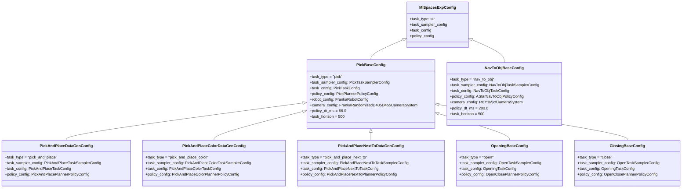

<!-- source: DeepWiki mcp.deepwiki.com · repo allenai/molmospaces · page 5.2 Task Types · fetched 2026-10-26 -->

# Task Types

Relevant source files

The following files were used as context for generating this wiki page:

- [docs/code_structure.md](docs/code_structure.md)
- [molmo_spaces/configs/base_nav_to_obj_config.py](molmo_spaces/configs/base_nav_to_obj_config.py)
- [molmo_spaces/configs/base_open_task_configs.py](molmo_spaces/configs/base_open_task_configs.py)
- [molmo_spaces/configs/base_pick_and_place_color_configs.py](molmo_spaces/configs/base_pick_and_place_color_configs.py)
- [molmo_spaces/configs/base_pick_and_place_configs.py](molmo_spaces/configs/base_pick_and_place_configs.py)
- [molmo_spaces/configs/base_pick_and_place_next_to_configs.py](molmo_spaces/configs/base_pick_and_place_next_to_configs.py)
- [molmo_spaces/configs/base_pick_config.py](molmo_spaces/configs/base_pick_config.py)

This page describes the seven task types supported in the MolmoSpaces data generation pipeline. For each task type it documents the config class, task sampler, task class, success criteria, and default policy. For information on how these task types are composed into experiment configs, see [4.2](#4.2). For how the pipeline executes tasks at runtime, see [5.1](#5.1).

---

## Overview

Each task type is defined by a chain of four cooperating classes: a **config subclass**, a **task sampler**, a **task**, and a **policy config**. The `task_type` string field on the config is the identifier used by the pipeline to distinguish task types at runtime.

**Task type to config class mapping:**

| `task_type` | Config Class | Source File |
|---|---|---|
| `pick` | `PickBaseConfig` | `molmo_spaces/configs/base_pick_config.py` |
| `pick_and_place` | `PickAndPlaceDataGenConfig` | `molmo_spaces/configs/base_pick_and_place_configs.py` |
| `pick_and_place_color` | `PickAndPlaceColorDataGenConfig` | `molmo_spaces/configs/base_pick_and_place_color_configs.py` |
| `pick_and_place_next_to` | `PickAndPlaceNextToDataGenConfig` | `molmo_spaces/configs/base_pick_and_place_next_to_configs.py` |
| `open` | `OpeningBaseConfig` | `molmo_spaces/configs/base_open_task_configs.py` |
| `close` | `ClosingBaseConfig` | `molmo_spaces/configs/base_open_task_configs.py` |
| `nav_to_obj` | `NavToObjBaseConfig` | `molmo_spaces/configs/base_nav_to_obj_config.py` |

Sources: `molmo_spaces/configs/base_pick_config.py`, `molmo_spaces/configs/base_pick_and_place_configs.py`, `molmo_spaces/configs/base_pick_and_place_color_configs.py`, `molmo_spaces/configs/base_pick_and_place_next_to_configs.py`, `molmo_spaces/configs/base_open_task_configs.py`, `molmo_spaces/configs/base_nav_to_obj_config.py`

---

## Class Hierarchy

All Franka-arm task types inherit from `PickBaseConfig`. The navigation task type has its own parallel hierarchy rooted in `NavToObjBaseConfig`. Both inherit from `MlSpacesExpConfig`.

**Config class inheritance and task wiring diagram:**

Sources: `molmo_spaces/configs/base_pick_config.py`, `molmo_spaces/configs/base_nav_to_obj_config.py`, `molmo_spaces/configs/base_pick_and_place_configs.py`, `molmo_spaces/configs/base_pick_and_place_color_configs.py`, `molmo_spaces/configs/base_pick_and_place_next_to_configs.py`, `molmo_spaces/configs/base_open_task_configs.py`

---

## Task Sampler and Task Class Wiring

Each config class instantiates its sampler and task via typed config objects. This diagram shows the runtime class relationships.

**Task sampler and task class wiring diagram:**

```mermaid
graph TD
    subgraph "pick"
        PBC["PickBaseConfig"] --> PTS["PickTaskSamplerConfig\n(task_sampler_class=PickTaskSampler)"]
        PBC --> PTC["PickTaskConfig\n(task_cls=PickTask)"]
        PBC --> PP["PickPlannerPolicyConfig"]
    end

    subgraph "pick_and_place"
        PAPC["PickAndPlaceDataGenConfig"] --> PAPTS["PickAndPlaceTaskSamplerConfig\n(task_sampler_class=PickAndPlaceTaskSampler)\nsamples_per_house=20"]
        PAPC --> PAPTC["PickAndPlaceTaskConfig\n(task_cls=PickAndPlaceTask)"]
        PAPC --> PAPP["PickAndPlacePlannerPolicyConfig"]
    end

    subgraph "pick_and_place_color"
        PAPCC["PickAndPlaceColorDataGenConfig"] --> PAPCTS["PickAndPlaceColorTaskSamplerConfig\n(task_sampler_class=PickAndPlaceColorTaskSampler)\nsamples_per_house=20"]
        PAPCC --> PAPCTC["PickAndPlaceColorTaskConfig\n(task_cls=PickAndPlaceColorTask)"]
        PAPCC --> PAPCP["PickAndPlaceColorPlannerPolicyConfig"]
    end

    subgraph "pick_and_place_next_to"
        PAPNTC["PickAndPlaceNextToDataGenConfig"] --> PAPNTTS["PickAndPlaceNextToTaskSamplerConfig\n(task_sampler_class=PickAndPlaceNextToTaskSampler)\nsamples_per_house=20"]
        PAPNTC --> PAPNTTC["PickAndPlaceNextToTaskConfig\n(task_cls=PickAndPlaceNextToTask)"]
        PAPNTC --> PAPNTP["PickAndPlaceNextToPlannerPolicyConfig"]
    end

    subgraph "open and close"
        OBC["OpeningBaseConfig"] --> OTS["OpenTaskSamplerConfig\n(task_sampler_class=OpenTaskSampler)\ntarget_initial_state_open_percentage=0"]
        OBC --> OTC["OpeningTaskConfig\n(task_cls=OpeningTask)\ntask_success_threshold=0.15\nany_inst_of_category=True"]
        OBC --> OCP["OpenClosePlannerPolicyConfig"]

        CBC["ClosingBaseConfig"] --> CTS["OpenTaskSamplerConfig\n(task_sampler_class=OpenTaskSampler)\ntarget_initial_state_open_percentage=0.5"]
        CBC --> CTC["OpeningTaskConfig\n(task_cls=OpeningTask)\ntask_success_threshold=0.85\nany_inst_of_category=False"]
        CBC --> CCP["OpenClosePlannerPolicyConfig"]
    end

    subgraph "nav_to_obj"
        NTBC["NavToObjBaseConfig"] --> NTTS["NavToObjTaskSamplerConfig\n(task_sampler_class=NavToObjTaskSampler)"]
        NTBC --> NTTC["NavToObjTaskConfig\n(task_cls=NavToObjTask)"]
        NTBC --> NTP["AStarNavToObjPolicyConfig"]
    end
```

Sources: `molmo_spaces/configs/base_pick_config.py`, `molmo_spaces/configs/base_pick_and_place_configs.py`, `molmo_spaces/configs/base_pick_and_place_color_configs.py`, `molmo_spaces/configs/base_pick_and_place_next_to_configs.py`, `molmo_spaces/configs/base_open_task_configs.py`, `molmo_spaces/configs/base_nav_to_obj_config.py`

---

## Per-Task Reference

### pick

**Config class:** `PickBaseConfig` — [molmo_spaces/configs/base_pick_config.py:24-114]()

`PickBaseConfig` is the root config for all Franka-arm manipulation tasks. It is not intended for direct use; subclasses are expected to override `task_type` and associated configs.

| Field | Value |
|---|---|
| `task_type` | `"pick"` |
| `task_sampler_config` | `PickTaskSamplerConfig(task_sampler_class=PickTaskSampler)` |
| `task_config` | `PickTaskConfig(task_cls=PickTask)` |
| `policy_config` | `PickPlannerPolicyConfig()` |
| `robot_config` | `FrankaRobotConfig` (default) |
| `camera_config` | `FrankaRandomizedD405D455CameraSystem` |
| `scene_dataset` | `"procthor-10k"` |
| `policy_dt_ms` | `66.0` (~15 Hz) |
| `task_horizon` | `500` steps |

The `tag` property returns `"franka_pick_datagen"`. A `SavedEpisode` inner class records `camera_config`, `robot_config`, `task_config`, and `task_cls_str` for reproducible replay.

Sources: [molmo_spaces/configs/base_pick_config.py:24-114]()

---

### pick_and_place

**Config class:** `PickAndPlaceDataGenConfig` — [molmo_spaces/configs/base_pick_and_place_configs.py:13-28]()

The robot picks up an object and places it on a target surface. Inherits all Franka defaults from `PickBaseConfig`.

| Field | Value |
|---|---|
| `task_type` | `"pick_and_place"` |
| `task_sampler_config` | `PickAndPlaceTaskSamplerConfig(task_sampler_class=PickAndPlaceTaskSampler, pickup_types=PICK_AND_PLACE_OBJECTS, samples_per_house=20)` |
| `task_config` | `PickAndPlaceTaskConfig(task_cls=PickAndPlaceTask)` |
| `policy_config` | `PickAndPlacePlannerPolicyConfig()` |
| `num_workers` | `1` |

The `pickup_types` field is populated from the `PICK_AND_PLACE_OBJECTS` constant defined in `molmo_spaces/utils/constants/object_constants.py`. The `samples_per_house` value of `20` controls how many task instances are sampled per scene.

Sources: [molmo_spaces/configs/base_pick_and_place_configs.py:13-28]()

---

### pick_and_place_color

**Config class:** `PickAndPlaceColorDataGenConfig` — [molmo_spaces/configs/base_pick_and_place_color_configs.py:14-33]()

A variant of `pick_and_place` where the target placement is disambiguated by object color. Registered with `@register_config("PickAndPlaceColorDataGenConfig")`.

| Field | Value |
|---|---|
| `task_type` | `"pick_and_place_color"` |
| `task_sampler_config` | `PickAndPlaceColorTaskSamplerConfig(task_sampler_class=PickAndPlaceColorTaskSampler, pickup_types=PICK_AND_PLACE_OBJECTS, samples_per_house=20)` |
| `task_config` | `PickAndPlaceColorTaskConfig(task_cls=PickAndPlaceColorTask)` |
| `policy_config` | `PickAndPlaceColorPlannerPolicyConfig()` |
| `num_workers` | `1` |
| `output_dir` | `ASSETS_DIR / "experiment_output" / "datagen" / "pick_and_place_color_base_v1"` |
| `wandb_project` | `"molmo-spaces-data-generation"` |

The `tag` property returns `"pick_and_place_color_base_datagen"`.

Sources: [molmo_spaces/configs/base_pick_and_place_color_configs.py:14-33]()

---

### pick_and_place_next_to

**Config class:** `PickAndPlaceNextToDataGenConfig` — [molmo_spaces/configs/base_pick_and_place_next_to_configs.py:13-25]()

A variant of `pick_and_place` where the placement goal is defined as a position next to a reference object. Registered with `@register_config("PickAndPlaceNextToDataGenConfig")`.

| Field | Value |
|---|---|
| `task_type` | `"pick_and_place_next_to"` |
| `task_sampler_config` | `PickAndPlaceNextToTaskSamplerConfig(task_sampler_class=PickAndPlaceNextToTaskSampler, pickup_types=PICK_AND_PLACE_OBJECTS, samples_per_house=20)` |
| `task_config` | `PickAndPlaceNextToTaskConfig(task_cls=PickAndPlaceNextToTask)` |
| `policy_config` | `PickAndPlaceNextToPlannerPolicyConfig()` |
| `robot_config` | `FrankaRobotConfig()` (explicitly set) |
| `num_workers` | `1` |

Sources: [molmo_spaces/configs/base_pick_and_place_next_to_configs.py:13-25]()

---

### open

**Config class:** `OpeningBaseConfig` — [molmo_spaces/configs/base_open_task_configs.py:11-33]()

The robot opens an articulated object (e.g., a cabinet door or drawer). Inherits from `PickBaseConfig`.

| Field | Value |
|---|---|
| `task_type` | `"open"` |
| `task_sampler_config` | `OpenTaskSamplerConfig(task_sampler_class=OpenTaskSampler, target_initial_state_open_percentage=0)` |
| `task_config` | `OpeningTaskConfig(task_cls=OpeningTask, task_success_threshold=0.15, joint_index=0, any_inst_of_category=True)` |
| `policy_config` | `OpenClosePlannerPolicyConfig()` |

**Key config details:**
- `target_initial_state_open_percentage=0`: the object starts fully closed before the episode begins.
- `task_success_threshold=0.15`: the episode is considered successful when the joint is at least 15% open. The comment in source notes this is currently set low due to placement/IK constraints; the target is ~0.66.
- `any_inst_of_category=True`: success is evaluated against any instance of the target object category, not a specific object instance.
- `joint_index=0`: the primary joint used for measuring open/close state.

Sources: [molmo_spaces/configs/base_open_task_configs.py:11-33]()

---

### close

**Config class:** `ClosingBaseConfig` — [molmo_spaces/configs/base_open_task_configs.py:35-56]()

The robot closes an articulated object. Shares the `OpenTaskSampler` and `OpeningTask` classes with the `open` task but uses different threshold values.

| Field | Value |
|---|---|
| `task_type` | `"close"` |
| `task_sampler_config` | `OpenTaskSamplerConfig(task_sampler_class=OpenTaskSampler, target_initial_state_open_percentage=0.5)` |
| `task_config` | `OpeningTaskConfig(task_cls=OpeningTask, task_success_threshold=0.85, joint_index=0, any_inst_of_category=False)` |
| `policy_config` | `OpenClosePlannerPolicyConfig()` |

**Key config details:**
- `target_initial_state_open_percentage=0.5`: the object starts at 50% open.
- `task_success_threshold=0.85`: the episode is successful when the joint is at least 85% closed (i.e., open percentage ≤ 0.15). The comment notes the target is ~0.33.
- `any_inst_of_category=False`: success is evaluated against the specific object instance, not any instance of the category.

Sources: [molmo_spaces/configs/base_open_task_configs.py:35-56]()

---

### nav_to_obj

**Config class:** `NavToObjBaseConfig` — [molmo_spaces/configs/base_nav_to_obj_config.py:23-112]()

The robot navigates to a target object using a whole-body mobile platform (RBY1). This task type uses a separate config hierarchy from the Franka-based tasks.

| Field | Value |
|---|---|
| `task_type` | `"nav_to_obj"` |
| `task_sampler_config` | `NavToObjTaskSamplerConfig(task_sampler_class=NavToObjTaskSampler)` |
| `task_config` | `NavToObjTaskConfig(task_cls=NavToObjTask)` |
| `policy_config` | `AStarNavToObjPolicyConfig()` |
| `camera_config` | `RBY1MjcfCameraSystem` |
| `scene_dataset` | `"procthor-10k"` |
| `policy_dt_ms` | `200.0` (5 Hz) |
| `task_horizon` | `500` steps |
| `num_threads` | `1` |

`NavToObjBaseConfig` notes it should not be used directly — only through concrete subclasses defined elsewhere. The `tag` property returns `"nav_to_obj_datagen"`.

The policy `AStarNavToObjPolicyConfig` uses A\* search for navigation planning, in contrast to the CuRobo-based planner policies used for manipulation tasks.

Sources: [molmo_spaces/configs/base_nav_to_obj_config.py:23-112]()

---

## Comparison Summary

The following table summarizes key differentiating parameters across all task types.

| `task_type` | Robot | Policy | Sampler | `samples_per_house` | `task_success_threshold` | `policy_dt_ms` |
|---|---|---|---|---|---|---|
| `pick` | Franka | `PickPlannerPolicyConfig` | `PickTaskSampler` | — | — | 66.0 |
| `pick_and_place` | Franka | `PickAndPlacePlannerPolicyConfig` | `PickAndPlaceTaskSampler` | 20 | — | 66.0 |
| `pick_and_place_color` | Franka | `PickAndPlaceColorPlannerPolicyConfig` | `PickAndPlaceColorTaskSampler` | 20 | — | 66.0 |
| `pick_and_place_next_to` | Franka | `PickAndPlaceNextToPlannerPolicyConfig` | `PickAndPlaceNextToTaskSampler` | 20 | — | 66.0 |
| `open` | Franka | `OpenClosePlannerPolicyConfig` | `OpenTaskSampler` | — | 0.15 | 66.0 |
| `close` | Franka | `OpenClosePlannerPolicyConfig` | `OpenTaskSampler` | — | 0.85 | 66.0 |
| `nav_to_obj` | RBY1 | `AStarNavToObjPolicyConfig` | `NavToObjTaskSampler` | — | — | 200.0 |

Sources: `molmo_spaces/configs/base_pick_config.py`, `molmo_spaces/configs/base_pick_and_place_configs.py`, `molmo_spaces/configs/base_pick_and_place_color_configs.py`, `molmo_spaces/configs/base_pick_and_place_next_to_configs.py`, `molmo_spaces/configs/base_open_task_configs.py`, `molmo_spaces/configs/base_nav_to_obj_config.py`

---

