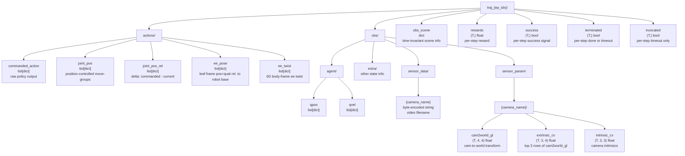
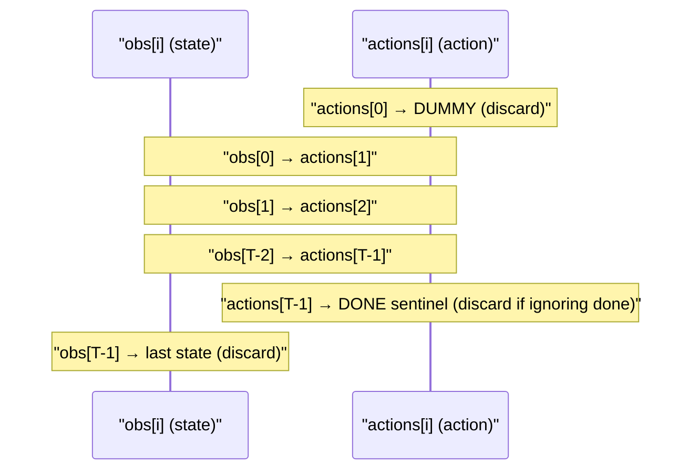

<!-- source: DeepWiki mcp.deepwiki.com · repo allenai/molmospaces · page 5.3 Data Format · fetched 2026-10-26 -->

# Data Format

<details>
<summary>Relevant source files</summary>

The following files were used as context for generating this wiki page:

- [docs/data_format.md](docs/data_format.md)

</details>


This page specifies the complete output schema produced by the data generation pipeline: the on-disk directory layout, file naming conventions, and the full HDF5 trajectory schema. It covers the raw output as written by `ParallelRolloutRunner` and the augmented root structure added by postprocessing.

- For how data is generated, see the [Pipeline Architecture](#5.1) page.
- For the three-stage postprocessing that augments the raw output, see [Data Postprocessing](#5.4).

---

## On-Disk Directory Layout

Data generation writes output into a root directory split into `train/` and `test/` partitions. Within each partition, episodes are grouped by scene (`house_idx`). Each scene directory contains one or more HDF5 files and the corresponding MP4 video files.

```
train/
    house_{house_idx}/
        trajectories_batch_{batch_idx}_of_{n_batches}.h5
        episode_{ep_idx:08d}_{camera_name}_batch_{batch_idx}_of_{n_batches}.mp4
        ...
    ...
test/
    house_{house_idx}/
        ...
```

| Path Component | Description |
|---|---|
| `house_{house_idx}` | One directory per scene. `house_idx` matches the scene index in the task sampler. |
| `trajectories_batch_{batch_idx}_of_{n_batches}.h5` | HDF5 file containing all trajectories for this batch. |
| `episode_{ep_idx:08d}_{camera_name}_batch_{batch_idx}_of_{n_batches}.mp4` | Video file for one camera in one episode. Multiple MP4 files exist per episode — one per camera. |

**Sources:** [docs/data_format.md:1-15]()

---

## HDF5 File Structure

Each `.h5` file contains multiple trajectory groups at the root level. Trajectory groups are keyed as `traj_{ep_idx}`.

### Type Encoding Conventions

Two special type annotations appear throughout the schema:

| Annotation | Encoding |
|---|---|
| `dict` | A `(K,)` `uint8` array containing a byte-encoded, JSON-encoded dictionary, right-padded with `\x00` to `K` bytes. |
| `list[dict]` | A 2D array where each row is a `(K,)` `uint8` array (a serialized `dict`). `K` may differ between values within the same trajectory. |

`T` denotes the number of timesteps in an episode; it will differ between trajectories.

**Sources:** [docs/data_format.md:17-19]()

---

### Trajectory Schema

The following diagram shows the complete tree of HDF5 groups and datasets within a single `traj_{ep_idx}` group.

**HDF5 Trajectory Group Schema**



**Sources:** [docs/data_format.md:21-48]()

---

### Field Reference

#### `actions/`

| Field | Type | Description |
|---|---|---|
| `commanded_action` | `list[dict]` | Raw action returned by the policy (demonstrator). Format depends on policy type; may not be joint positions. |
| `joint_pos` | `list[dict]` | Joint position commands for position-controlled move-groups. |
| `joint_pos_rel` | `list[dict]` | Delta between commanded joint position and current joint position for position-controlled move-groups. |
| `ee_pose` | `list[dict]` | Commanded leaf frame pose (position + quaternion) relative to robot base, for position-controlled move-groups. |
| `ee_twist` | `list[dict]` | Commanded 6D body-frame end-effector twist of the leaf frame, for position-controlled move-groups. |

#### `obs/agent/`

| Field | Type | Description |
|---|---|---|
| `qpos` | `list[dict]` | Generalized joint positions for all joints. |
| `qvel` | `list[dict]` | Generalized joint velocities for all joints. |

#### `obs/sensor_data/`

| Field | Type | Description |
|---|---|---|
| `{camera_name}` | byte-encoded string | Filename (not full path) of the MP4 video for this camera. The video file resides in the same directory as the `.h5` file. |

#### `obs/sensor_param/{camera_name}/`

| Field | Shape | Description |
|---|---|---|
| `cam2world_gl` | `(T, 4, 4)` float | Camera-to-world homogeneous transformation matrix (OpenGL convention). |
| `extrinsic_cv` | `(T, 3, 4)` float | Top 3 rows of `cam2world_gl` (OpenCV convention). |
| `intrinsic_cv` | `(T, 3, 3)` float | Camera intrinsics matrix (OpenCV convention). |

#### Top-level trajectory fields

| Field | Shape / Type | Description |
|---|---|---|
| `obs_scene` | `dict` | Time-invariant, scene-specific metadata (object IDs, layout, etc.). |
| `rewards` | `(T,)` float | Per-step scalar reward. |
| `success` | `(T,)` bool | Per-step success flag. |
| `terminated` | `(T,)` bool | Per-step flag: episode is done (success) or timed out. |
| `truncated` | `(T,)` bool | Per-step flag: episode ended due to timeout only. |

**Sources:** [docs/data_format.md:21-48]()

---

## State/Action Temporal Alignment

The data format uses an off-by-one convention between states and actions that must be handled correctly during training.

> **Rule:** The `i`-th state (observation) corresponds to the `(i+1)`-th action.

Two sentinel actions are introduced by the data generation process:

1. **First action** — a dummy action at position 0. It has no corresponding preceding state and should not be used for supervision.
2. **Last action** — a `done` sentinel action appended at the end of the episode.

**Temporal alignment diagram**



The table below summarizes which indices to keep depending on the supervision goal:

| Supervision Goal | Discard Actions | Discard States |
|---|---|---|
| All actions (including `done`) | `actions[0]` (first, dummy) | `obs[T-1]` (last) |
| Move actions only (excluding `done`) | `actions[0]` (first), `actions[T-1]` (last, done sentinel) | `obs[T-2]`, `obs[T-1]` (last two) |

In all cases, `actions[0]` and `obs[T-1]` should be discarded.

**Sources:** [docs/data_format.md:17-19]()

---

## Augmented HDF5 Root Structure (Post-Postprocessing)

After the three-stage postprocessing pipeline runs, the root of each `.h5` file gains two additional top-level keys. The trajectory groups themselves are not modified.

```
traj_0/           ← original, unchanged
traj_1/
...
traj_N/
valid_traj_mask   ← added by validate_trajectories.py
stats/            ← added by calculate_stats.py
```

| Key | Added By | Description |
|---|---|---|
| `valid_traj_mask` | `validate_trajectories.py` | `(N,)` bool array; `True` if trajectory `i` is valid. |
| `stats/` | `calculate_stats.py` | Mirrors the `traj_{i}/` structure; contains `min`, `max`, `mean`, `var` per field. |

The companion files written alongside the `.h5` files at the dataset root are:

| File | Description |
|---|---|
| `valid_trajectory_index.json` | JSON list of valid trajectory indices across the dataset. |
| `aggregated_statistics.json` | Aggregated statistics across all trajectories. |

For full details on how these are computed, see [Data Postprocessing](#5.4).

**Sources:** [docs/data_format.md:51-66]()

---

