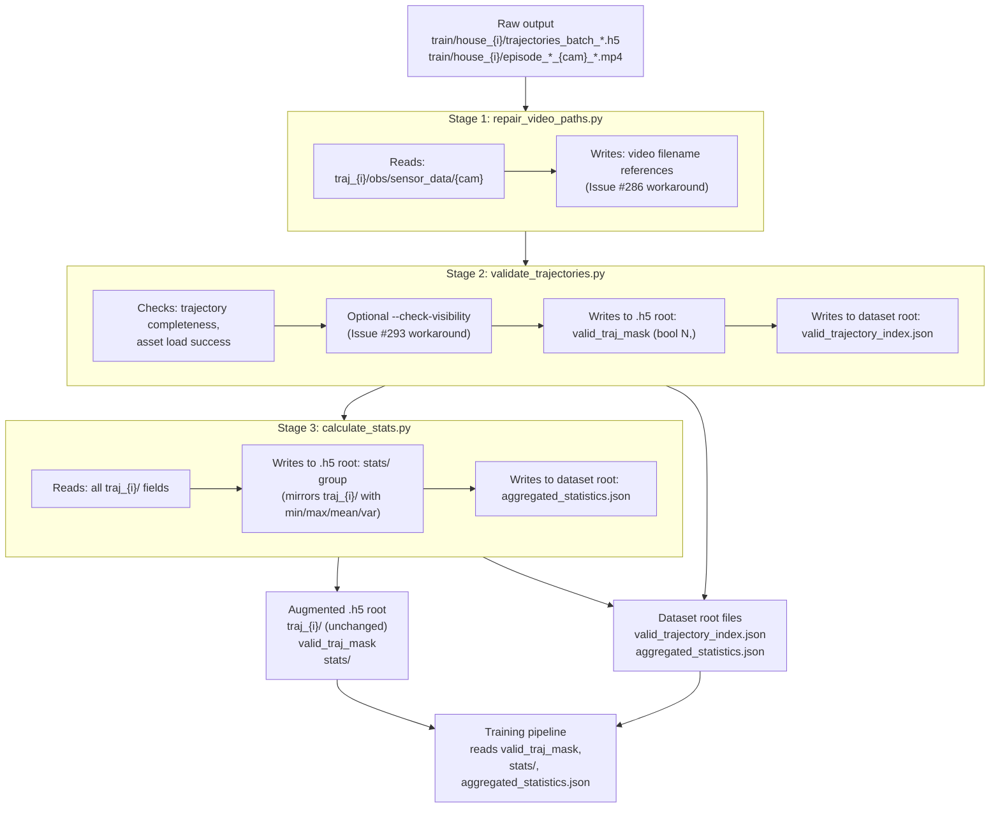
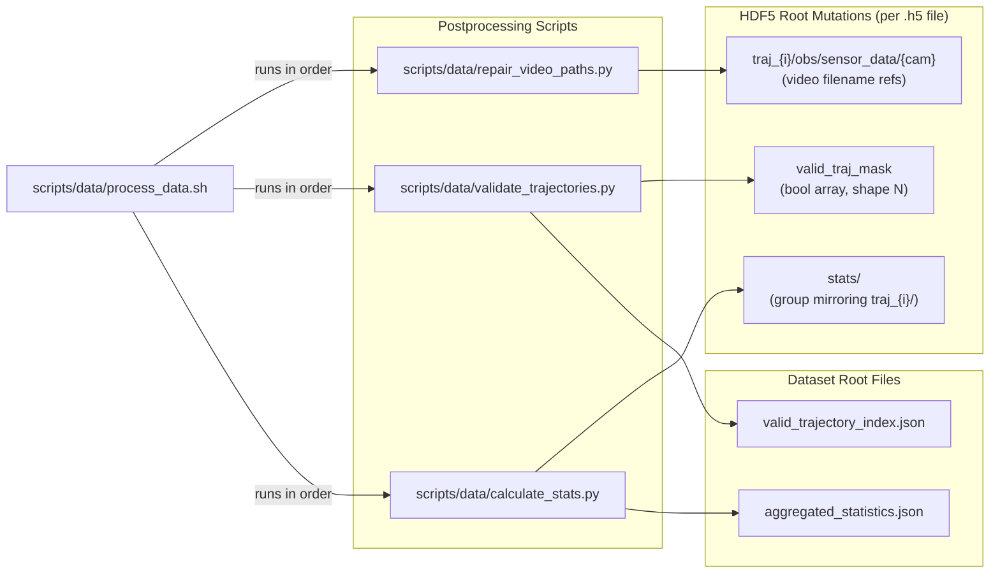

<!-- source: DeepWiki mcp.deepwiki.com · repo allenai/molmospaces · page 5.4 Data Postprocessing · fetched 2026-10-26 -->

# Data Postprocessing

<details>
<summary>Relevant source files</summary>

The following files were used as context for generating this wiki page:

- [docs/data_processing.md](docs/data_processing.md)

</details>


This page documents the three-stage postprocessing pipeline that must be run on raw HDF5 output before it can be used for training. The pipeline repairs known data generation bugs, filters invalid trajectories, and computes normalization statistics.

For context on the raw HDF5 schema produced before postprocessing, see the Data Format page [5.3](#5.3). For details on how the data generation pipeline produces that raw output, see Pipeline Architecture [5.1](#5.1).

---

## Overview

Raw data generated by the `ParallelRolloutRunner` (see [5.1](#5.1)) contains several known deficiencies that must be corrected before training. The postprocessing pipeline is a sequential, three-stage process orchestrated by `scripts/data/process_data.sh`.

**Pipeline stages — in order:**

| Stage | Script | Input | Output Added |
|---|---|---|---|
| 1 | `repair_video_paths.py` | Raw `.h5` files | Populated `traj_{i}/obs/sensor_data/` video filenames |
| 2 | `validate_trajectories.py` | Repaired `.h5` files | `valid_traj_mask` in `.h5` root; `valid_trajectory_index.json` in dataset root |
| 3 | `calculate_stats.py` | Validated `.h5` files | `stats/` group in `.h5` root; `aggregated_statistics.json` in dataset root |

> **Important:** Stages must be run in the order listed. Each stage assumes the previous stage has completed successfully.

Sources: [docs/data_processing.md:1-6]()

---

## Stage 1: Video Path Repair

**Script:** `scripts/data/repair_video_paths.py`

Due to a known bug ([Issue #286](https://github.com/allenai/molmo-spaces/issues/286)), the data generation pipeline does not populate `traj_{i}/obs/sensor_data/{cam}` with the corresponding video filenames at write time. Downstream consumers of camera observations depend on these paths being present.

`repair_video_paths.py` scans the raw `.h5` files and fills in the missing video filename references, making the `sensor_data` entries consistent with the actual `.mp4` files on disk.

This stage does not modify trajectory data — it only repairs missing metadata pointers.

Sources: [docs/data_processing.md:7-10]()

---

## Stage 2: Trajectory Validation

**Script:** `scripts/data/validate_trajectories.py`

Generated episodes can be invalid due to simulation failures, truncated rollouts, or asset loading issues. This stage marks each trajectory as valid or invalid and writes the result back into the `.h5` file.

### `valid_traj_mask`

The script adds a `valid_traj_mask` dataset to the root of each `.h5` file:

- **Shape:** `(N,)` boolean array, where `N` is the number of trajectories in the file
- **Semantics:** `valid_traj_mask[i] == True` means `traj_{i}` is usable

### Visibility Check (`--check-visibility`)

A separate known issue ([Issue #293](https://github.com/allenai/molmo-spaces/issues/293)) causes the data generation pipeline to omit object visibility checks for the exo camera. Trajectories where the target object is not visible in the exo camera should be excluded. Passing `--check-visibility` to `validate_trajectories.py` enables this check and marks affected trajectories invalid.

### `valid_trajectory_index.json`

In addition to modifying the `.h5` files, the validation script writes a `valid_trajectory_index.json` file to the dataset root. This index allows training pipelines to enumerate valid trajectories without opening every `.h5` file.

**Structure:**

```json
{
    "house_{house_id}": {
        "{datafile_path}": {
            "traj_{traj_idx}": "{traj_len}",
            ...
        },
        ...
    },
    ...
}
```

- `{datafile_path}` is relative to the dataset root
- `traj_len` is the full trajectory length and has **not** had dummy actions trimmed
- Houses and datafiles with zero valid trajectories are omitted entirely

Sources: [docs/data_processing.md:11-34]()

---

## Stage 3: Statistics Computation

**Script:** `scripts/data/calculate_stats.py`

Training pipelines commonly normalize inputs using dataset-level statistics. This stage computes per-field statistics and writes them alongside the trajectory data in the `.h5` file.

### `stats/` Group in HDF5

The script adds a `stats/` group to the root of each `.h5` file. The structure mirrors `traj_{i}/` but replaces values with their aggregate statistics:

```
stats/
    traj_{ep_idx}/
        {dict_key}:     list[dict]       ← for dict-valued fields
        {array_key}/
            min
            max
            mean
            var
```

For array-valued fields, a sub-group is created under `stats/` containing `min`, `max`, `mean`, and `var` datasets. For dict-valued fields, statistics are stored as dicts or lists of dicts.

### `aggregated_statistics.json`

The script also writes an `aggregated_statistics.json` file to the dataset root, aggregating statistics across all trajectories and datafiles:

```json
{
    "<key>/<move_group>": {
        "mean": [],
        "std": [],
        "min": [],
        "max": [],
        "count": 0,
        "sum": [],
        "sum_sq": []
    }
}
```

Where `<key>` corresponds to the path `traj_{traj_idx}/{key}` in the HDF5 datafile.

Sources: [docs/data_processing.md:36-71]()

---

## Final Augmented HDF5 Structure

After all three stages complete, the root of each `.h5` file contains:

```
traj_{i}/         ← unchanged trajectory data (from data generation)
...
stats/            ← added by calculate_stats.py
valid_traj_mask   ← added by validate_trajectories.py
```

Postprocessing never modifies or removes existing data; it only appends new groups and datasets to the `.h5` root.

Sources: [docs/data_processing.md:73-83]()

---

## Pipeline Diagram

**Diagram: Postprocessing script flow and HDF5 mutations**



Sources: [docs/data_processing.md:1-83]()

---

## Script-to-Output Mapping

**Diagram: Which script produces which output artifact**



Sources: [docs/data_processing.md:1-6](), [docs/data_processing.md:7-82]()

---

## Reference: Key Flags and Behavior

| Script | Key Flag / Behavior | Notes |
|---|---|---|
| `repair_video_paths.py` | *(no special flags documented)* | Workaround for Issue #286 |
| `validate_trajectories.py` | `--check-visibility` | Filters trajectories where target object is not visible in exo camera (Issue #293) |
| `calculate_stats.py` | *(no special flags documented)* | Reads all trajectory fields; skips `valid_traj_mask` |

Sources: [docs/data_processing.md:11-16]()

---

