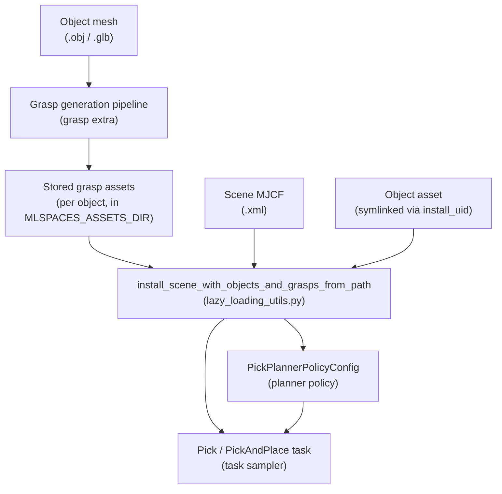
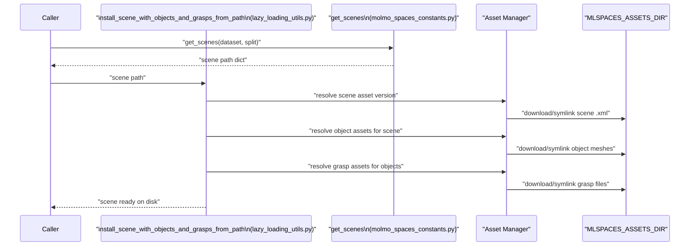

<!-- source: DeepWiki mcp.deepwiki.com · repo allenai/molmospaces · page 5.5 Grasp Generation · fetched 2026-10-26 -->

# Grasp Generation

<details>
<summary>Relevant source files</summary>

The following files were used as context for generating this wiki page:

- [README.md](README.md)
- [docs/images/grasps/grasp_example1.png](docs/images/grasps/grasp_example1.png)
- [docs/images/grasps/grasp_example2.jpg](docs/images/grasps/grasp_example2.jpg)
- [docs/images/grasps/grasp_example4.jpg](docs/images/grasps/grasp_example4.jpg)
- [docs/images/grasps/grasp_example5.png](docs/images/grasps/grasp_example5.png)
- [docs/images/grasps/grasp_example6.jpg](docs/images/grasps/grasp_example6.jpg)

</details>


This page covers the grasp generation pipeline: how it is installed, how grasp data is attached to objects and scenes within the asset system, and how it is consumed at runtime. For a broader description of the asset system and scene/object loading, see [Asset System](#2). For how grasps are used within pick tasks during data generation, see [Task Types](#5.2).

---

## Purpose

Grasps encode valid gripper approach poses for a given object. Each grasp is a 6-DOF pose (position + orientation) of the gripper frame relative to the object's coordinate frame. Pre-generated grasps are distributed as part of the MolmoSpaces asset system and are consumed at runtime by planner policies (e.g., `PickPlannerPolicyConfig`) to determine where a robot should position its gripper when executing a pick task.

The grasp generation code and its dependencies are gated behind the optional `grasp` install extra. Standard usage—loading scenes and running policies—requires only that pre-generated grasp assets are present on disk; regenerating grasps from scratch requires the full `grasp` extra.

---

## Installation

The `grasp` extra installs dependencies for the grasp generation pipeline. It is activated at install time alongside any other extras:

```bash
uv pip install -e .[dev,grasp]
```

The available install groups are summarized below:

| Extra | Purpose |
|---|---|
| `dev` | Code development dependencies |
| `grasp` | Grasp generation pipeline dependencies |
| `housegen` | House generation from iTHOR/ProcTHOR/Holodeck JSONs |

Sources: [README.md:60-66]()

---

## Position in the System

The grasp generation pipeline sits at the boundary between the Asset Layer and the Data Generation Layer. Grasps are computed once per object and stored as asset files. At runtime, the `ParallelRolloutRunner` loads scenes via `install_scene_with_objects_and_grasps_from_path`, which ensures all required object grasps are present on disk before any episode begins.

**Diagram: Grasp Generation in Context**



Sources: [README.md:122-130](), [README.md:60-66]()

---

## Loading API

The primary entry point for loading a scene with its associated object grasps is `install_scene_with_objects_and_grasps_from_path`, located in `molmo_spaces/utils/lazy_loading_utils.py`.

**Typical usage:**

```python
from molmo_spaces.utils.lazy_loading_utils import install_scene_with_objects_and_grasps_from_path
from molmo_spaces.molmo_spaces_constants import get_scenes

install_scene_with_objects_and_grasps_from_path(get_scenes("ithor", "train")["train"][1])
```

This call:
1. Resolves the scene path from `get_scenes`.
2. Downloads and symlinks the scene MJCF and all referenced object assets if they are not already present.
3. Downloads and installs any grasp data files associated with the objects referenced in that scene.

For loading individual object assets without grasps, `install_uid` in `molmo_spaces/utils/lazy_loading_utils.py` can be used instead. For a full description of the lazy loading system, see [Asset System](#2).

**Diagram: install_scene_with_objects_and_grasps_from_path Call Flow**



Sources: [README.md:122-130](), [README.md:104-107]()

---

## Grasp Data Format

Grasps are stored as part of the asset distribution alongside the object mesh files. Each grasp encodes a complete 6-DOF gripper pose relative to the object's local coordinate frame. The following conventions apply (consistent with the robot coordinate system described in [Robots & Coordinate Conventions](#2.2)):

| Axis | Gripper Meaning |
|---|---|
| +z | Forward (approach direction) |
| +y | Finger opening direction |
| +x | Lateral |

Multiple grasps may be stored per object, covering a range of valid approach angles and finger orientations. The planner policy selects among them based on the current scene geometry and the robot's reachability constraints.

At runtime, the pick planner resolves a grasp from the stored set for the target object and uses it as the target end-effector pose for trajectory planning.

---

## Grasp Examples

The `docs/images/grasps/` directory contains reference images illustrating pre-generated gripper configurations on various objects. These show the variety of grasp poses that are generated per object: top-down grasps, side grasps, and angled approaches are all represented.

Example image locations:
- `docs/images/grasps/grasp_example1.png`
- `docs/images/grasps/grasp_example2.jpg`
- `docs/images/grasps/grasp_example4.jpg`

---

## Summary of Key Code Entities

| Code Entity | File | Role |
|---|---|---|
| `install_scene_with_objects_and_grasps_from_path` | `molmo_spaces/utils/lazy_loading_utils.py` | Downloads scene + objects + grasps to `MLSPACES_ASSETS_DIR` |
| `install_uid` | `molmo_spaces/utils/lazy_loading_utils.py` | Downloads a single object asset (no grasps) |
| `get_scenes` | `molmo_spaces/molmo_spaces_constants.py` | Returns scene path dict for a given dataset and split |
| `PickPlannerPolicyConfig` | (policy config) | Selects and executes a grasp pose at runtime |
| `MLSPACES_ASSETS_DIR` | environment variable | Root directory where grasp assets are stored on disk |

Sources: [README.md:60-66](), [README.md:97-102](), [README.md:122-130](), [README.md:136-155]()

---

