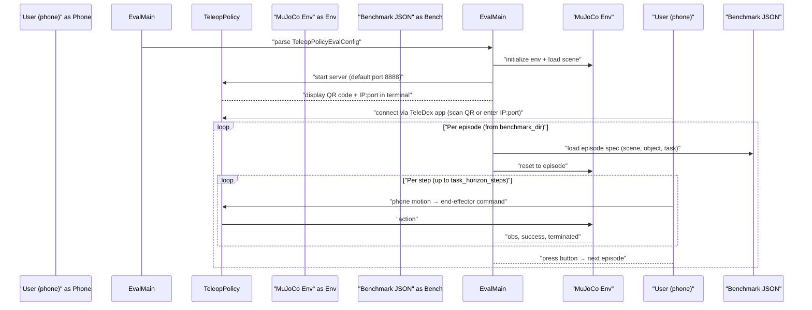
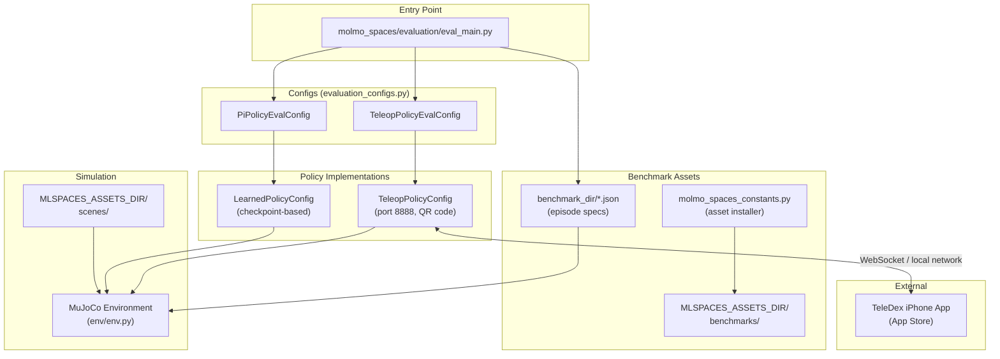

<!-- source: DeepWiki mcp.deepwiki.com · repo allenai/molmospaces · page 6 Evaluation & Benchmarking · fetched 2026-10-26 -->

# Evaluation & Benchmarking

<details>
<summary>Relevant source files</summary>

The following files were used as context for generating this wiki page:

- [README.md](README.md)

</details>


This page covers the MolmoSpaces evaluation infrastructure: the **MS-Bench v1** benchmark, the `eval_main.py` entry point, supported policy evaluation modes, and the teleoperation workflow via the TeleDex iPhone app.

For information about how training data is produced and postprocessed before evaluation, see [Data Generation](#5) and [Data Postprocessing](#5.4). For details on the configuration system underlying eval configs, see [Configuration System](#4).

> **Simulator support note:** Installing and running the benchmark is currently only supported in the **MuJoCo** simulator.

---

## MS-Bench v1

MS-Bench v1 is the base benchmark for **atomic manipulation tasks**. It covers eight tasks drawn from three task categories:

| Category | Tasks |
|----------|-------|
| Pick | `pick` variants |
| Open | `open` variants |
| Close | `close` variants |

Benchmark episodes are defined as JSON files stored in a benchmark directory. Each episode specifies a scene, target object, and task goal. The benchmark is distributed as a versioned asset via the MolmoSpaces asset manager.

> For the full set of task types (including pick-and-place, nav-to-obj, and others used in data generation but not yet in MS-Bench v1), see [Task Types](#5.2).

Sources: [README.md:36-36](), [README.md:117-117](), [README.md:183-185]()

---

## Installing Benchmark Assets

Before running evaluations, benchmark assets must be installed. Set the `MLSPACES_ASSETS_DIR` environment variable and run the asset manager:

```bash
export MLSPACES_ASSETS_DIR=/path/to/symlink/resources
python -m molmo_spaces.molmo_spaces_constants
```

This downloads and symlinks all benchmark-related scene and object assets under `MLSPACES_ASSETS_DIR`. Versioning behavior is controlled by the same environment variables used for all asset types (see [Asset System](#2)):

| Variable | Effect |
|----------|--------|
| `MLSPACES_ASSETS_DIR` | Root directory for downloaded assets |
| `MLSPACES_AUTO_INSTALL` | Download without prompting |
| `MLSPACES_FORCE_INSTALL` | Override existing assets |
| `MLSPACES_PINNED_ASSETS_FILE` | Lock asset versions |

Sources: [README.md:188-192](), [README.md:97-102]()

---

## Running Evaluations

The entry point for all benchmark evaluation is `molmo_spaces/evaluation/eval_main.py`. It is invoked as:

```bash
python molmo_spaces/evaluation/eval_main.py \
    <module_path>:<ConfigClassName> \
    --benchmark_dir <path/to/benchmark/> \
    --task_horizon_steps <N>
```

### Arguments

| Argument | Description |
|----------|-------------|
| positional (config class) | Fully qualified import path to the eval config class, e.g. `molmo_spaces.evaluation.configs.evaluation_configs:PiPolicyEvalConfig` |
| `--benchmark_dir` | Path to the benchmark directory containing episode JSON definitions |
| `--task_horizon_steps` | Maximum number of simulation steps per episode before truncation |

The config class resolves the policy type, camera setup, robot model, and all other experiment parameters. The `--benchmark_dir` and `--task_horizon_steps` arguments override or complement defaults in the config.

Sources: [README.md:196-203](), [README.md:212-217]()

---

## Evaluation Config Classes

Two evaluation-specific config classes are provided under `molmo_spaces/evaluation/configs/evaluation_configs.py`. Both extend the broader `MlSpacesExpConfig` hierarchy.

**Component map:**

```mermaid
classDiagram
    direction TB

    class "MlSpacesExpConfig" {
        +num_envs: int
        +num_workers: int
        +task_horizon: int
        +scene_dataset: str
        +camera_config
        +robot_config
        +policy_config
    }

    class "PiPolicyEvalConfig" {
        +policy_config: LearnedPolicyConfig
        +Use: trained checkpoint
    }

    class "TeleopPolicyEvalConfig" {
        +policy_config: TeleopPolicyConfig
        +Use: TeleDex iPhone app
    }

    class "LearnedPolicyConfig" {
        +checkpoint_path: str
    }

    class "TeleopPolicyConfig" {
        +port: int
    }

    "MlSpacesExpConfig" <|-- "PiPolicyEvalConfig"
    "MlSpacesExpConfig" <|-- "TeleopPolicyEvalConfig"
    "PiPolicyEvalConfig" --> "LearnedPolicyConfig"
    "TeleopPolicyEvalConfig" --> "TeleopPolicyConfig"
```

Sources: [README.md:196-217]()

### `PiPolicyEvalConfig`

Used to evaluate a **learned (Pi) policy** against benchmark episodes. Wraps a `LearnedPolicyConfig` that points to a trained model checkpoint. Invocation:

```bash
python molmo_spaces/evaluation/eval_main.py \
    molmo_spaces.evaluation.configs.evaluation_configs:PiPolicyEvalConfig \
    --benchmark_dir assets/benchmarks/path-to-benchmark/ \
    --task_horizon_steps 500
```

### `TeleopPolicyEvalConfig`

Used to collect **human demonstrations** via phone-based teleoperation, running episodes defined by the same benchmark JSON files. Invocation:

```bash
python molmo_spaces/evaluation/eval_main.py \
    molmo_spaces.evaluation.configs.evaluation_configs:TeleopPolicyEvalConfig \
    --benchmark_dir assets/bench/path-to-benchmark.json \
    --task_horizon_steps 1000
```

A longer `task_horizon_steps` is typical for teleoperation since humans operate more slowly than scripted planners.

Sources: [README.md:196-217]()

---

## Teleoperation Workflow

The teleoperation path uses the **TeleDex iPhone app** to stream motion commands from an iPhone to the simulation environment over a local network.

**Evaluation flow for teleoperation:**



### Setup Steps

1. **Install TeleDex** from the Apple App Store (iPhone only).
2. **Start the evaluation** with `TeleopPolicyEvalConfig` (see command above).
3. **Connect phone and machine** to the same local network.
4. **Scan the QR code** displayed in the terminal, or manually enter the IP address and port shown:

   ```
   TeleDex Session Starting on port 8888...
   Session Started. Details:
   IP Address: xxx.xxx.xx.xxx
   Port: 8888
   Waiting for a device to connect...
   ```

5. **Control the robot** using the TeleDex app:

| Control | Action |
|---------|--------|
| Toggle | Open / close gripper |
| Button | Advance to next episode |

Sources: [README.md:207-228]()

---

## Evaluation System Architecture

The diagram below maps the evaluation subsystem components to their corresponding code entities.



Sources: [README.md:183-228]()

---

## Reference: Benchmark-Related Asset Types

The asset manager treats benchmark definitions as a first-class asset type alongside objects, scenes, and robots. The table below summarizes the benchmark-relevant asset names:

| Asset Type | Code Name | Paper Name | Description |
|------------|-----------|------------|-------------|
| benchmark | *(versioned)* | MS-Bench v1 | Atomic pick/open/close task JSONs |
| scenes | `ithor` | MSCrafted | Used in ithor benchmark episodes |
| scenes | `procthor-10k` | MSProc | Used in procthor benchmark episodes |
| objects | `thor` | — | Hand-crafted objects referenced in episodes |

For more details on scene and object asset types, see [Objects & Scenes](#2.1). For the asset versioning and pinning mechanism, see [Asset System](#2).

Sources: [README.md:109-117](), [README.md:183-192]()

---

