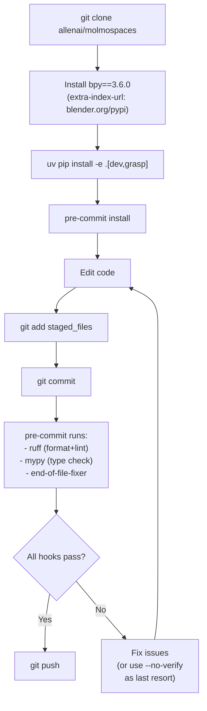
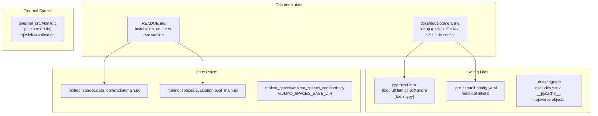

<!-- source: DeepWiki mcp.deepwiki.com · repo allenai/molmospaces · page 7 Development Guide · fetched 2026-10-26 -->

# Development Guide

<details>
<summary>Relevant source files</summary>

The following files were used as context for generating this wiki page:

- [README.md](README.md)
- [docs/development.md](docs/development.md)

</details>


This page is the entry point for contributors to the MolmoSpaces codebase. It summarizes the development toolchain and points to sub-pages covering each area in detail. For installing MolmoSpaces as an end user (not a contributor), see [Installation & Quick Start](#1.1). For information about the asset system, see [Asset System](#2).

---

## Toolchain Overview

MolmoSpaces uses a small, standard set of tools for dependency management, formatting, linting, and pre-commit validation.

| Tool | Role | Config Location |
|---|---|---|
| `conda` | Python environment management (Python 3.10) | — |
| `uv` | Fast package installer (preferred over plain `pip`) | — |
| `ruff` | Linting and code formatting | `pyproject.toml` → `[tool.ruff]` |
| `pre-commit` | Git hook runner; executes `ruff` and `mypy` on staged files | `.pre-commit-config.yaml` |
| `mypy` | Static type checking (planned integration) | `pyproject.toml` |
| `pybind11-stubgen` | Generates type stubs for `mujoco` and `open3d` (for IDE support) | — |

---

## Install Extras Groups

The `pyproject.toml` defines optional dependency groups that are activated at install time. Contributors typically install `dev` at minimum.

| Extra Group | Purpose |
|---|---|
| `dev` | Installs `pre-commit`, `ruff`, `mypy`, and other development tools |
| `grasp` | Installs dependencies for the grasp generation pipeline |
| `housegen` | Installs dependencies for scene generation from iTHOR, ProcTHOR, or Holodeck JSONs |

A typical contributor install (using `uv`):

```
uv pip install -e .[dev,grasp]
```

See [Environment Setup](#7.1) for the complete installation sequence, including the special `bpy==3.6.0` pre-installation step required for the house generation pipeline.

---

## Development Workflow Diagram

**Diagram: Contributor Workflow from Clone to Commit**



Sources: [docs/development.md:1-68](), [README.md:40-67]()

---

## Key Files for Contributors

**Diagram: Developer-Facing File Map**



Sources: [docs/development.md:1-145](), [README.md:233-268]()

---

## Sub-Pages

| Page | Contents |
|---|---|
| [Environment Setup](#7.1) | conda + uv install paths, `bpy==3.6.0` special step, editable install, `dev` extras, VS Code settings |
| [Code Quality Tools](#7.2) | `ruff` select/ignore rules in `pyproject.toml`, `pre-commit install` and `pre-commit run`, `--no-verify` escape hatch, `mypy` integration, VS Code `charliermarsh.ruff` extension |
| [Docker & Containerization](#7.3) | `.dockerignore` exclusion policy (what is kept vs. excluded), building a Docker image |
| [External Dependencies](#7.4) | `external_src/Manifold` submodule, `git submodule update --init --recursive`, `external_src/` and `external_assets/` gitignore policy |

---

## Quick Reference: Common Developer Commands

| Task | Command |
|---|---|
| Format code | `ruff format .` |
| Lint code | `ruff check .` |
| Install pre-commit hooks | `pre-commit install` |
| Run hooks on staged files | `pre-commit run` |
| Run hooks on all files | `pre-commit run --all-files` |
| Bypass hooks (emergency) | `git commit --no-verify` |
| Generate MuJoCo type stubs | `pybind11-stubgen mujoco -o ./typings/` |
| Initialize submodules | `git submodule update --init --recursive` |

Sources: [README.md:233-268](), [docs/development.md:40-68]()

---

