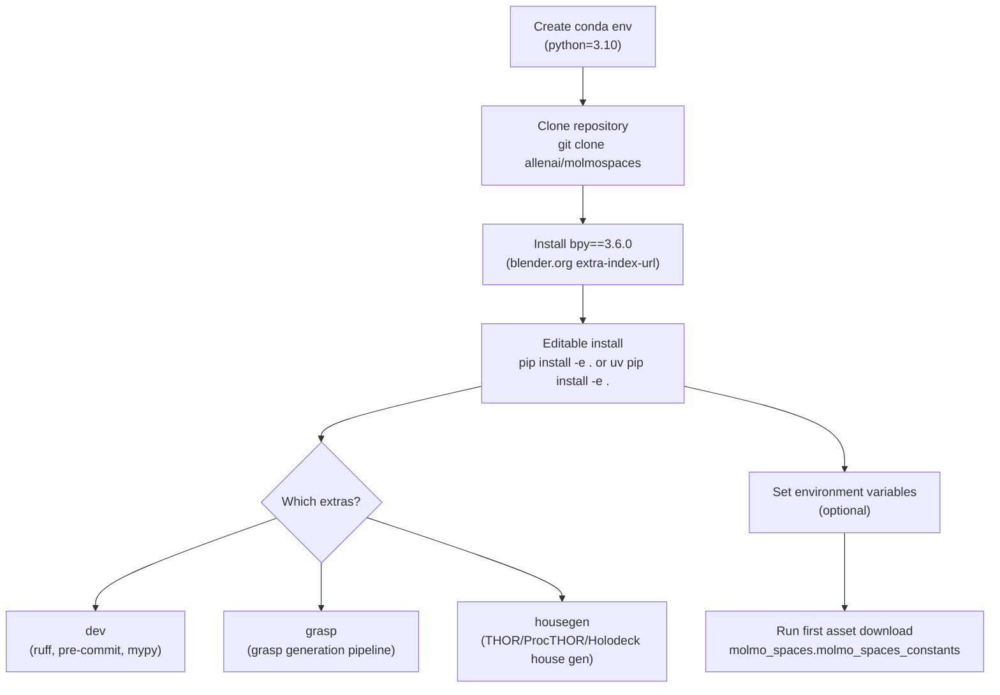
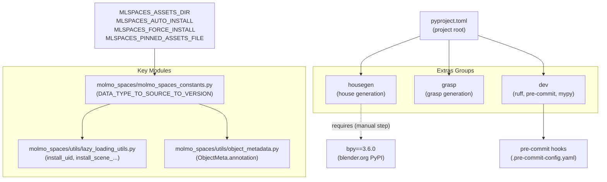
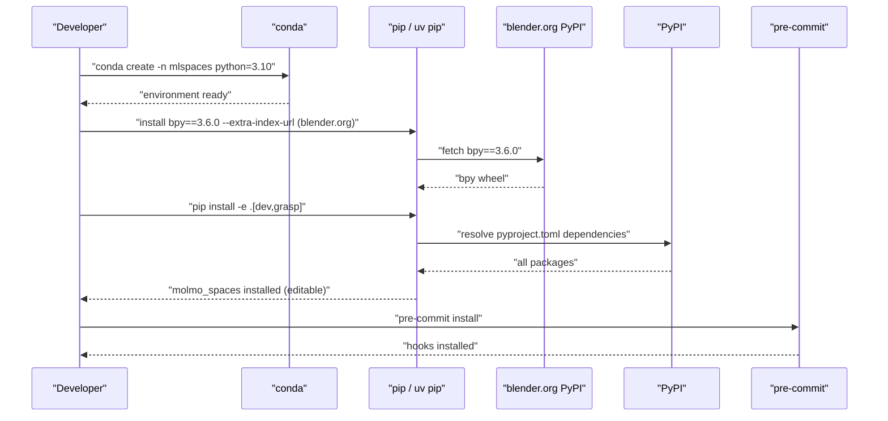

<!-- source: DeepWiki mcp.deepwiki.com · repo allenai/molmospaces · page 7.1 Environment Setup · fetched 2026-10-26 -->

# Environment Setup

<details>
<summary>Relevant source files</summary>

The following files were used as context for generating this wiki page:

- [README.md](README.md)
- [docs/development.md](docs/development.md)

</details>


This page covers the step-by-step process for setting up a working development environment for MolmoSpaces. It includes the full dependency installation sequence, optional extras groups, and recommended IDE configuration.

For information on code quality tools (ruff, pre-commit, mypy) that are enabled after the dev environment is set up, see [Code Quality Tools](#7.2). For Docker-based environment setup, see [Docker & Containerization](#7.3). For managing Git submodules and external dependencies, see [External Dependencies](#7.4).

---

## Prerequisites

- **Python 3.10** is required. The `bpy==3.6.0` package that powers house generation is not available on PyPI for Python 3.10+, so it must be installed from Blender's own package index (see below).
- Either **conda** or **uv** can be used as the package manager. Both paths are documented.
- Git, for cloning the repository.

---

## Installation Path Overview

The following diagram maps the installation steps to their corresponding commands and files in the codebase.

**Installation Step Flow**



Sources: [README.md:40-90](), [docs/development.md:1-40]()

---

## Step 1: Create and Activate a Conda Environment

```bash
conda create -n mlspaces python=3.10
conda activate mlspaces
```

Sources: [README.md:44-49]()

---

## Step 2: Clone the Repository

```bash
git clone git@github.com:allenai/molmospaces.git
cd molmospaces
```

Sources: [README.md:52-57]()

---

## Step 3: Install `bpy` (Special Step)

The `bpy==3.6.0` package is not published on PyPI for Python 3.10, so it must be fetched from Blender's own package index using `--extra-index-url`. This package is required only for the house generation pipeline (`housegen` extras group), but must be installed **before** the main package if you intend to use it — installing it after can cause conflicts.

| Package Manager | Command |
|---|---|
| conda (plain pip) | `pip install bpy==3.6.0 --extra-index-url https://download.blender.org/pypi/` |
| uv | `uv pip install bpy==3.6.0 --extra-index-url https://download.blender.org/pypi/` |

Sources: [docs/development.md:9-19]()

---

## Step 4: Install the `molmo_spaces` Package

Install the package in editable mode using the `pyproject.toml` at the repo root.

| Package Manager | Command |
|---|---|
| conda (plain pip) | `pip install -e .` |
| uv | `uv pip install -e .` |

To include optional extras groups at install time:

| Package Manager | Command |
|---|---|
| conda (plain pip) | `pip install -e .[dev,grasp]` |
| uv | `uv pip install -e .[dev,grasp]` |

Sources: [README.md:59-67](), [docs/development.md:22-38]()

---

## Extras Groups Reference

The following extras groups are defined in `pyproject.toml` and can be combined freely.

| Extras Group | Purpose | Typical Use Case |
|---|---|---|
| `dev` | Code development tools: ruff, pre-commit, mypy stubs | All developers |
| `grasp` | Grasp generation pipeline dependencies | Data generation with grasps |
| `housegen` | House generation from iTHOR, ProcTHOR, or Holodeck JSONs (requires `bpy`) | Scene construction |

Sources: [README.md:62-67]()

---

## Step 5: Set Environment Variables (Optional)

Environment variables with the `MLSPACES_` prefix configure asset download behavior. These do not need to be set for a basic install, but are commonly needed for data generation and evaluation workflows.

| Variable | Default | Effect |
|---|---|---|
| `MLSPACES_ASSETS_DIR` | `../assets` relative to the repo | Directory where downloaded assets are stored |
| `MLSPACES_AUTO_INSTALL` | `True` | Download/update assets without interactive prompts |
| `MLSPACES_FORCE_INSTALL` | `True` | Overwrite existing assets on re-install |
| `MLSPACES_PINNED_ASSETS_FILE` | *(none)* | Path to a `.json` file with pinned asset versions, overriding defaults in `molmo_spaces_constants.py` |

The pinned assets file must follow the same key structure as `DATA_TYPE_TO_SOURCE_TO_VERSION` in [molmo_spaces/molmo_spaces_constants.py](). See [Asset System](#2) for more detail on asset versioning.

Sources: [README.md:92-102]()

---

## Step 6: Install Dev Extras and Configure pre-commit

After installing with `[dev]`, set up the pre-commit hooks so they run automatically on each commit:

```bash
pre-commit install
```

To manually run the hooks against staged files:

```bash
pre-commit run
```

See [Code Quality Tools](#7.2) for full details on ruff rules and pre-commit hook behavior.

Sources: [docs/development.md:42-68]()

---

## Dependency and Package Relationships

The following diagram shows how the install steps, extras groups, and code modules relate to each other.

**Package and Extras Dependency Map**



Sources: [README.md:59-103](), [docs/development.md:9-40]()

---

## VS Code Setup

### Type Stubs for MuJoCo and Open3D

The `mujoco` and `open3d` packages are C extensions that lack bundled type stubs. Generate stubs to enable autocompletion and type checking in VS Code:

```bash
pybind11-stubgen mujoco -o ./typings/
```

This places generated stub files under `./typings/`, which VS Code's Python extension will pick up automatically if `python.analysis.stubPath` is set to `typings`.

### Ruff Extension

Install the `charliermarsh.ruff` extension from the VS Code marketplace. Add the following to your user or workspace settings to use ruff as the default Python formatter:

```json
"[python]": {
    "editor.formatOnSave": false,
    "editor.defaultFormatter": "charliermarsh.ruff"
}
```

Set `formatOnSave` to `true` if you want automatic formatting on every save.

Sources: [README.md:258-268](), [docs/development.md:126-144]()

---

## Full Install Sequence (Summary)



Sources: [README.md:40-90](), [docs/development.md:9-50]()

---

