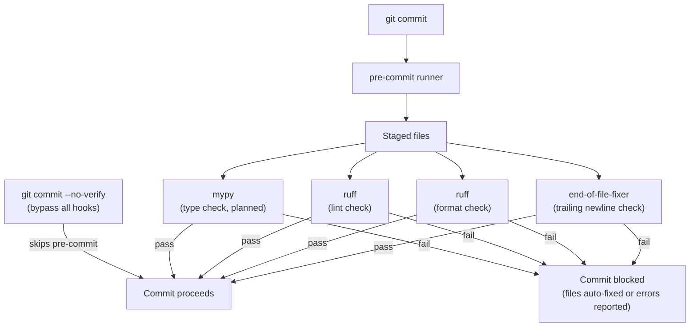
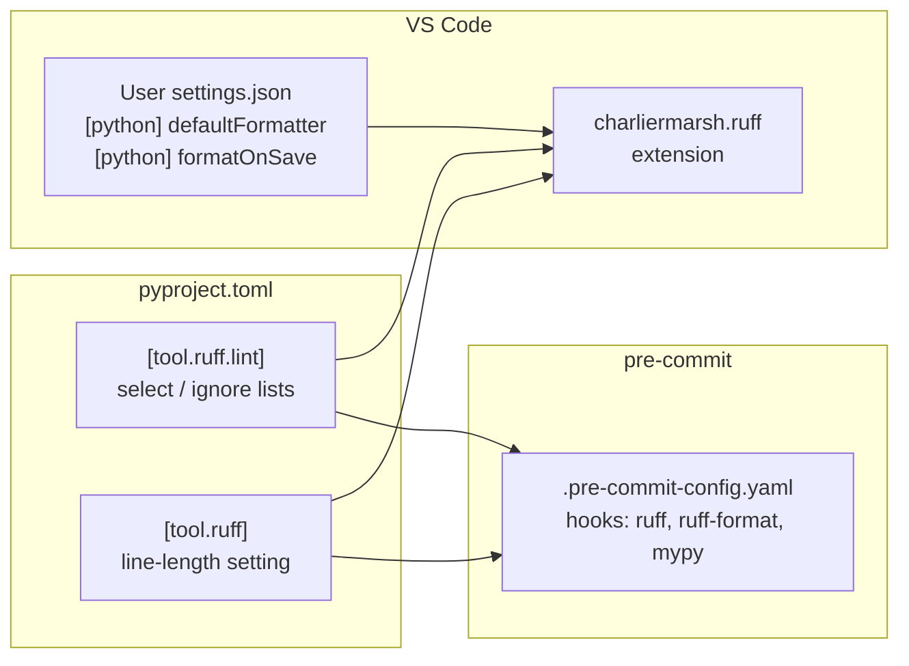
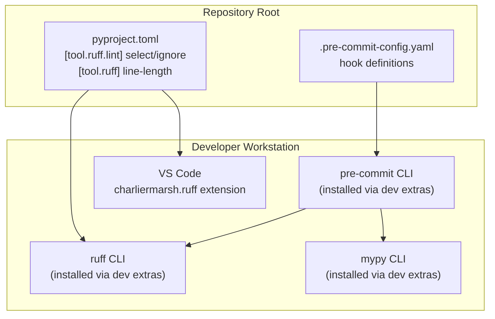

<!-- source: DeepWiki mcp.deepwiki.com · repo allenai/molmospaces · page 7.2 Code Quality Tools · fetched 2026-10-26 -->

# Code Quality Tools

<details>
<summary>Relevant source files</summary>

The following files were used as context for generating this wiki page:

- [docs/development.md](docs/development.md)
- [docs/images/img_doc_pre_commit_sample.png](docs/images/img_doc_pre_commit_sample.png)
- [docs/images/img_docs_ruff_vscode_extension.png](docs/images/img_docs_ruff_vscode_extension.png)
- [docs/images/img_docs_vscode_user_settings.png](docs/images/img_docs_vscode_user_settings.png)

</details>


This page covers the code quality toolchain used for development in MolmoSpaces: the `ruff` linter/formatter, the `pre-commit` hook system, the planned `mypy` type checker, and VS Code integration. For environment setup steps (installing the `dev` extras group) that are a prerequisite for using these tools, see [Environment Setup](#7.1).

---

## Overview

MolmoSpaces uses a layered quality enforcement strategy:

| Layer | Tool | Scope | Trigger |
|---|---|---|---|
| Formatting | `ruff format` | Python files | pre-commit hook / IDE save |
| Linting | `ruff check` | Python files | pre-commit hook / IDE |
| Type checking | `mypy` | Python files | pre-commit hook (planned) |
| Hook orchestration | `pre-commit` | Staged files | `git commit` |

All tool configuration lives in `pyproject.toml`. The `pre-commit` configuration references the same `ruff` binary configured there.

**Sources:** [docs/development.md:40-68]()

---

## Ruff

`ruff` serves as both the **linter** and the **formatter** for the project, replacing `black` (which was used previously only for formatting) and consolidating multiple flake8-style checks into a single tool.

### Enabled Rule Sets

The `[tool.ruff.lint]` section of `pyproject.toml` activates the following rule groups:

| Rule Code | Plugin | What it checks |
|---|---|---|
| `D` | pydocstyle | Docstring conventions |
| `E` | pycodestyle | PEP 8 style errors |
| `F` | Pyflakes | Unused imports, undefined names |
| `UP` | pyupgrade | Outdated Python syntax |
| `B` | flake8-bugbear | Common bug patterns |
| `SIM` | flake8-simplify | Overly complex expressions |
| `I` | isort | Import ordering |
| `W` | pycodestyle | PEP 8 style warnings |
| `ANN` | flake8-annotations | Missing type annotations |

**Sources:** [docs/development.md:74-98]()

### Ignored Rules

Specific rules are suppressed via the `ignore` list in `[tool.ruff.lint]`:

| Rule ID | Reason suppressed |
|---|---|
| `C408` | Allow `dict()` call style |
| `C901` | No complaints about function complexity |
| `E501` | Line length handled by the `line-length` setting, not this rule |
| `B006` | Mutable defaults allowed |
| `UP015` | Redundant `open()` mode arguments are acceptable |
| `SIM117` | Nested `with` statements permitted |
| `SIM102` | Nested `if` statements permitted |
| `SIM114` | Merging `if` branches with `or` not required |

**Sources:** [docs/development.md:100-124]()

### Modifying Lint Rules

To add or remove a rule:

1. Find the rule ID from the ruff documentation (linked from `docs/development.md`) or by hovering over a lint warning in VS Code.
2. Add the ID to the `select` list in `[tool.ruff.lint]` to enable it.
3. Add the ID to the `ignore` list in `[tool.ruff.lint]` to suppress it.

**Configuration location:** `pyproject.toml`, section `[tool.ruff.lint]`

**Sources:** [docs/development.md:70-124]()

---

## Pre-commit Hooks

`pre-commit` orchestrates all quality checks at commit time. It runs only on **staged files**, which limits false positives and keeps commit times short.

### Setup

After installing the `dev` dependency group (see [Environment Setup](#7.1)), install the hooks once per clone:

```
pre-commit install
```

To run the hooks manually against currently staged files:

```
pre-commit run
```

**Sources:** [docs/development.md:40-60]()

### Hook Execution Flow

**Diagram: pre-commit Hook Execution**



**Sources:** [docs/development.md:40-68]()

### Escape Hatch

In exceptional situations where hooks are misconfigured or running incorrectly:

```
git commit --no-verify
```

This bypasses **all** pre-commit hooks. The development guide notes that a CI/CD pipeline is intended to catch issues that slip through this path once fully enabled.

**Sources:** [docs/development.md:63-68]()

---

## Mypy (Planned)

`mypy` for static type checking is listed as a forthcoming addition to the pre-commit hook suite. As of the current state of `docs/development.md`, the hook infrastructure acknowledges that `mypy` is part of the intended chain but has not yet been activated. The development notes describe this as a near-term PR to switch from `black`-only formatting to `ruff` formatting, `ruff` linting, and `mypy` type checking.

**Sources:** [docs/development.md:63-68]()

---

## VS Code Integration

### Ruff Extension

Install the `charliermarsh.ruff` extension from the VS Code Marketplace to get inline lint feedback and format-on-save via the same `ruff` binary used by pre-commit.

**Diagram: Tool-to-Config Mapping**



**Sources:** [docs/development.md:126-144]()

### Recommended User Settings

Add the following to VS Code's user `settings.json` to use `ruff` as the default Python formatter:

```json
"[python]": {
    "editor.formatOnSave": false,
    "editor.defaultFormatter": "charliermarsh.ruff"
}
```

Set `formatOnSave` to `true` to automatically format on every save. The setting shown in `docs/development.md` defaults it to `false` and leaves the choice to the developer.

**Sources:** [docs/development.md:126-144]()

---

## Summary: Configuration Locations

**Diagram: Config and Tool Relationships**



| Config file | Controls |
|---|---|
| `pyproject.toml` `[tool.ruff.lint]` | Enabled rule sets, ignored rule IDs |
| `pyproject.toml` `[tool.ruff]` | Line-length and other formatter settings |
| `.pre-commit-config.yaml` | Which hooks run and in what order |
| VS Code `settings.json` | `formatOnSave`, `defaultFormatter` for Python |

**Sources:** [docs/development.md:40-144]()

---

