# Page: Overview

# Overview

<details>
<summary>Relevant source files</summary>

The following files were used as context for generating this wiki page:

- [LICENSE](LICENSE)
- [README.md](README.md)
- [docs/code_structure.md](docs/code_structure.md)
- [docs/images/MolmoSpacesLogo.png](docs/images/MolmoSpacesLogo.png)

</details>


This page introduces MolmoSpaces at a high level: what it is, who it targets, what problems it solves, and a tour of its major subsystems. For installation steps, see [Installation & Quick Start](#1.1). For directory layout and path conventions, see [Repository Layout](#1.2).

---

## What is MolmoSpaces?

MolmoSpaces (`allenai/molmospaces`) is a large-scale open ecosystem for robot manipulation and navigation research. It provides:

- **A multi-simulator asset library** — 3D objects, indoor scenes, and robot models usable in MuJoCo, Isaac Sim, and ManiSkill.
- **A data generation pipeline** — scripted planners and a parallel rollout runner that produce HDF5 trajectory datasets.
- **A benchmark suite** — MS-Bench v1, a set of atomic pick/open/close tasks for evaluating robot policies.
- **A teleoperation interface** — iPhone-based control via the TeleDex app, feeding into the same evaluation pipeline.

The codebase is licensed under [Apache 2.0](LICENSE). Dataset subsets carry separate licenses: Objaverse subsets use ODC-BY 1.0; all other data subsets use CC BY 4.0.

Sources: [README.md:1-30](), [LICENSE:1-13]()

---

## Major Subsystems

MolmoSpaces is organized into four main layers that interact in a linear flow from assets through data generation to evaluation.

**Ecosystem Topology**

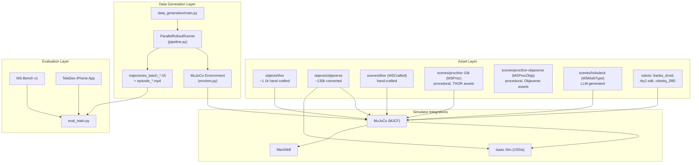

Sources: [README.md:104-203](), [docs/code_structure.md:48-70]()

---

## Subsystem Summaries

### Asset System

MolmoSpaces manages assets (objects, scenes, robots) through a lazy-loading mechanism. Assets are downloaded on demand and versioned via `MLSPACES_ASSETS_DIR` and an optional pinned-assets file.

| Type | Code Name | Paper Name | Description |
|---|---|---|---|
| objects | `thor` | — | ~1.1k hand-crafted kitchen assets |
| objects | `objaverse` | — | ~130k converted Objaverse assets |
| scenes | `ithor` | MSCrafted | Hand-crafted with articulated assets |
| scenes | `procthor-10k` | MSProc | Procedurally generated with THOR assets |
| scenes | `procthor-objaverse` | MSProcObja | Procedurally generated with Objaverse assets |
| scenes | `holodeck` | MSMultiType | LLM-generated with Objaverse assets |
| benchmark | — | MS-Bench v1 | Base benchmark for atomic tasks |

Key API entry points: `get_scenes()` in `molmo_spaces_constants.py`, `install_uid()` and `install_scene_with_objects_and_grasps_from_path()` in `molmo_spaces/utils/lazy_loading_utils.py`.

For full details, see [Asset System](#2), [Objects & Scenes](#2.1), and [Robots & Coordinate Conventions](#2.2).

Sources: [README.md:104-120]()

---

### Simulator Integrations

Assets are cross-simulator compatible:

| Simulator | Format | Entry Point |
|---|---|---|
| MuJoCo | MJCF (`.xml`) | `python -m mujoco.viewer --mjcf <path>` |
| Isaac Sim | USDa | See `molmo_spaces_isaac/README.md` |
| ManiSkill | — | See `molmo_spaces_maniskill/README.md` |

For details, see [Simulator Integrations](#3).

Sources: [README.md:158-167]()

---

### Configuration System

All experiments are defined as Pydantic model subclasses. The hierarchy flows from a shared base down to task-specific configs that compose camera, robot, task-sampler, and policy sub-configs.

**Configuration Class Hierarchy**

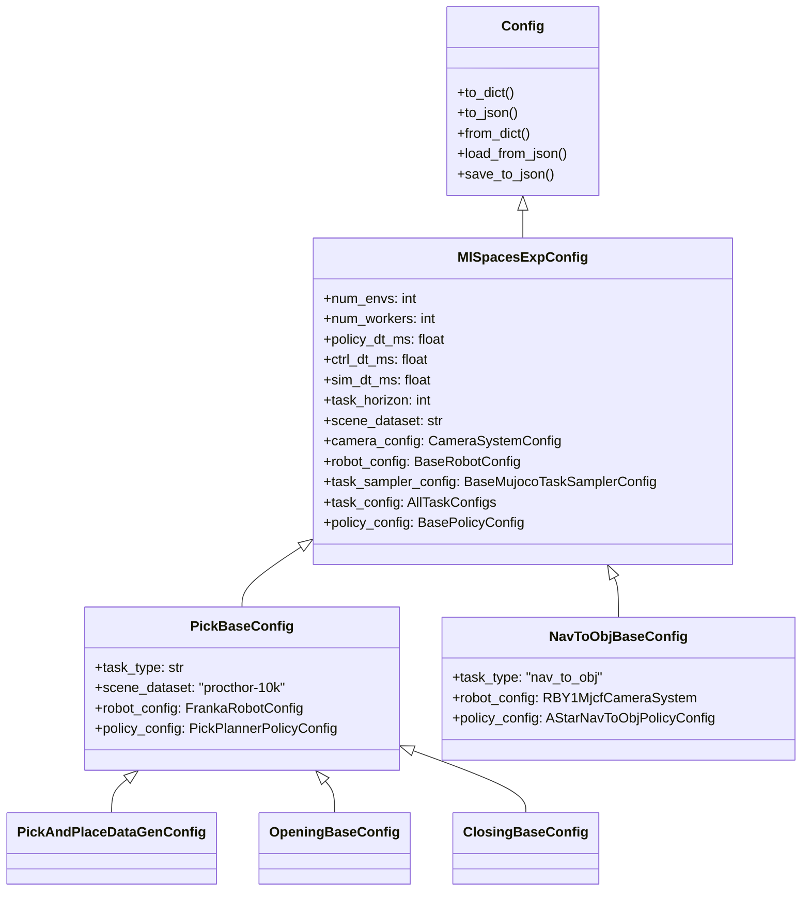

For full details, see [Configuration System](#4) and [Base Configuration Classes](#4.1).

Sources: [docs/code_structure.md:73-82]()

---

### Data Generation Pipeline

The pipeline is invoked from `data_generation/main.py`, which loads a config class and runs `ParallelRolloutRunner` from `data_generation/pipeline.py`. Workers sample tasks, execute rollouts in a MuJoCo environment (`env/env.py`), and write output to `.h5` and `.mp4` files.

**Data Generation: Code Entity Flow**

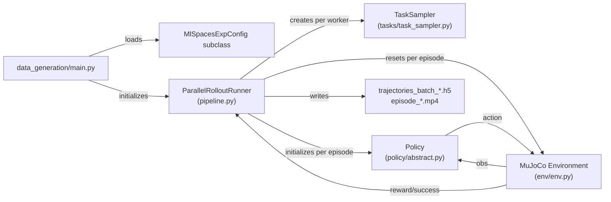

Raw output is then processed by a three-stage postprocessing pipeline (`repair_video_paths.py` → `validate_trajectories.py` → `calculate_stats.py`) before consumption by training pipelines. For details, see [Data Generation](#5) and [Data Postprocessing](#5.4).

Sources: [docs/code_structure.md:48-70](), [README.md:30-38]()

---

### Evaluation & Benchmarking

MS-Bench v1 provides benchmark JSON files for atomic pick, open, and close tasks. The evaluation entry point is `eval_main.py`, which accepts a policy config class and a benchmark directory. Two policy modes are available out of the box:

- `PiPolicyEvalConfig` — runs a learned policy
- `TeleopPolicyEvalConfig` — runs interactive teleoperation via the TeleDex iPhone app

For details, see [Evaluation & Benchmarking](#6).

Sources: [README.md:183-228]()

---

## Supported Robots

| Robot Model | Code Name | Notes |
|---|---|---|
| Franka FR3 + Droid gripper | `franka_droid` | Primary arm; MJCF modified from mujoco_menagerie |
| Robotiq 2F-85 v4 | `robotiq_2f85_v4` | Parallel-jaw gripper |
| Rainbow Robotics RBY1 | `rby1-sdk` | Full-body robot; used for nav tasks |
| CAP Gripper | `cap_gripper` | From NYU GRAIL lab |

**Coordinate convention (all robots):** `+x = forward`, `+y = left`, `+z = up`. Parallel-jaw gripper: `+z = forward`, fingers open along `y`.

For details, see [Robots & Coordinate Conventions](#2.2).

Sources: [README.md:272-279]()

---

## Citing

```
@misc{molmospaces2026,
    title={MolmoSpaces: A Large-Scale Open Ecosystem for Robot Navigation and Manipulation},
    author={Yejin Kim and Wilbert Pumacay and Omar Rayyan and Max Argus and Winson Han and ...},
    year={2026},
}
```

Sources: [README.md:297-303]()

---

# Page: Installation & Quick Start

# Installation & Quick Start

<details>
<summary>Relevant source files</summary>

The following files were used as context for generating this wiki page:

- [README.md](README.md)
- [docs/development.md](docs/development.md)

</details>


This page covers the steps needed to install MolmoSpaces and run a first example: setting up the Python environment, configuring environment variables, downloading your first assets, and opening them in the MuJoCo viewer.

For background on what MolmoSpaces is and the subsystems involved, see the Overview (page [1](#1)). For details on how the asset system works after installation, see [Asset System](#2). For simulator-specific integration details beyond MuJoCo, see [Simulator Integrations](#3).

---

## Prerequisites

| Requirement | Version |
|---|---|
| Python | 3.10 |
| conda | Any recent version |
| uv (recommended) | Latest |
| Git | Any recent version |

---

## Environment Setup

### 1. Create a Conda Environment

```bash
conda create -n mlspaces python=3.10
conda activate mlspaces
```

### 2. Clone the Repository

```bash
git clone git@github.com:allenai/molmospaces.git
cd molmospaces
```

### 3. Install the Package

The recommended approach uses `uv`:

```bash
uv pip install -e .[dev,grasp]
```

Or with plain `pip` (if not using `uv`):

```bash
pip install -e .[dev,grasp]
```

#### Optional Dependency Groups

| Group | Purpose |
|---|---|
| `dev` | Code development tools (ruff, pre-commit, mypy) |
| `grasp` | Grasp generation pipeline |
| `housegen` | House generation from iTHOR, ProcTHOR, or Holodeck JSONs |

> **Note for `housegen`:** The `bpy` package required by house generation is not available on PyPI for Python 3.10. Install it separately before the main install:
>
> ```bash
> uv pip install bpy==3.6.0 --extra-index-url https://download.blender.org/pypi/
> ```

Sources: [README.md:40-90](), [docs/development.md:1-30]()

---

## Environment Variables

All environment variables use the `MLSPACES_` prefix. These are optional but configure critical runtime behavior such as where assets are stored.

| Variable | Effect | Default |
|---|---|---|
| `MLSPACES_ASSETS_DIR` | Directory for downloaded assets | `../assets` relative to the repo root |
| `MLSPACES_AUTO_INSTALL` | Update assets without interactive prompting | `True` |
| `MLSPACES_FORCE_INSTALL` | Override existing assets on re-download | `True` |
| `MLSPACES_PINNED_ASSETS_FILE` | Path to a `.json` file that overrides asset versions | *(unset)* |

Set `MLSPACES_ASSETS_DIR` to a persistent location before running any download or simulation:

```bash
export MLSPACES_ASSETS_DIR=/path/to/your/assets
```

#### Pinned Assets File Format

If you need reproducible asset versions, `MLSPACES_PINNED_ASSETS_FILE` should point to a JSON with the same structure as `DATA_TYPE_TO_SOURCE_TO_VERSION` in `molmo_spaces/molmo_spaces_constants.py`:

```json
{
    "robots": {
        "franka_droid": "20260127"
    },
    "scenes": {
        "ithor": "20251217"
    }
}
```

Sources: [README.md:92-103](), [README.md:170-181]()

---

## MuJoCo Quick Start

The following diagrams show how the key installation-time entry points relate to one another.

**Diagram: MuJoCo Quick Start — Code Entity Flow**

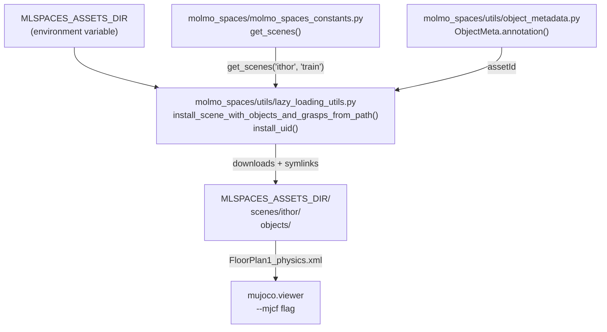

Sources: [README.md:122-156]()

### Downloading and Viewing a Scene

Use `get_scenes` from `molmo_spaces.molmo_spaces_constants` to look up a scene path, then pass it to `install_scene_with_objects_and_grasps_from_path` from `molmo_spaces.utils.lazy_loading_utils`:

```python
from molmo_spaces.utils.lazy_loading_utils import install_scene_with_objects_and_grasps_from_path
from molmo_spaces.molmo_spaces_constants import get_scenes

install_scene_with_objects_and_grasps_from_path(get_scenes("ithor", "train")["train"][1])
```

After the download completes, open the scene in the MuJoCo viewer:

```bash
python -m mujoco.viewer --mjcf $MLSPACES_ASSETS_DIR/scenes/ithor/FloorPlan1_physics.xml
```

### Downloading an Object by Category

`thor` objects are installed automatically when the resource manager is initialized. For `objaverse` objects, use `install_uid` from `molmo_spaces.utils.lazy_loading_utils` with an asset ID retrieved from `ObjectMeta.annotation()`:

```python
import random
from pprint import pprint

from molmo_spaces.utils.object_metadata import ObjectMeta
from molmo_spaces.utils.lazy_loading_utils import install_uid

annotation = ObjectMeta.annotation()

apple_annotations = [
    anno for anno in annotation.values()
    if "apple" in anno["category"].lower() and anno["isObjaverse"]
]
random_apple = random.choice(apple_annotations)

pprint(random_apple)

apple_model_path = install_uid(random_apple["assetId"])
print(f"Object downloaded and symlinked to {apple_model_path}")
```

Sources: [README.md:122-156]()

---

## MuJoCo Viewer Tips

| Tip | Details |
|---|---|
| Red boxes on objects | Toggle `Group Enable > Site groups > Site 0` in the left panel |
| Interact with objects | Double-click an object, then Ctrl + right mouse drag (active viewers only) |
| Keyboard shortcuts | See MuJoCo viewer docs: `mujoco.readthedocs.io` |

Sources: [README.md:265-269]()

---

## Other Simulators

For Isaac Sim and ManiSkill, separate setup instructions are maintained in their respective READMEs:

| Simulator | Instructions |
|---|---|
| Isaac Sim | `molmo_spaces_isaac/README.md` |
| ManiSkill | `molmo_spaces_maniskill/README.md` |

For a conceptual overview of how assets map to each simulator format, see [Simulator Integrations](#3).

Sources: [README.md:159-167]()

---

## Benchmark Quick Start

Installing and running the benchmark is currently supported in MuJoCo only.

**Install benchmark assets:**

```bash
export MLSPACES_ASSETS_DIR=/path/to/symlink/resources
python -m molmo_spaces.molmo_spaces_constants
```

**Run the benchmark:**

```bash
python molmo_spaces/evaluation/eval_main.py \
    molmo_spaces.evaluation.configs.evaluation_configs:PiPolicyEvalConfig \
    --benchmark_dir assets/benchmarks/path-to-benchmark/ \
    --task_horizon_steps 500
```

For full benchmark documentation, including teleoperation mode and benchmark asset structure, see [Evaluation & Benchmarking](#6).

Sources: [README.md:183-203]()

---

## Installation Summary

**Diagram: Installation Decision Flow**

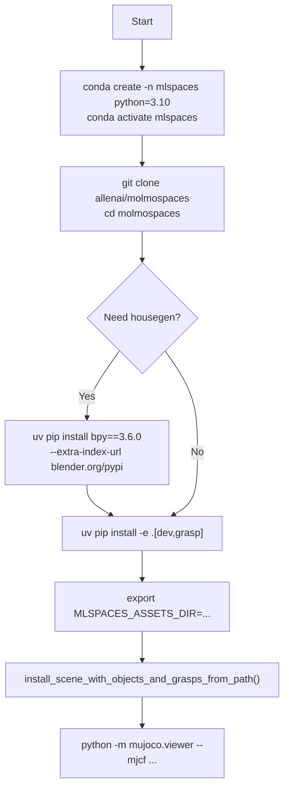

Sources: [README.md:40-90](), [docs/development.md:1-50]()

---

# Page: Repository Layout

# Repository Layout

<details>
<summary>Relevant source files</summary>

The following files were used as context for generating this wiki page:

- [.dockerignore](.dockerignore)
- [.gitignore](.gitignore)
- [.gitmodules](.gitmodules)
- [docs/code_structure.md](docs/code_structure.md)
- [molmo_spaces/__init__.py](molmo_spaces/__init__.py)

</details>


This page describes the physical organization of the `allenai/molmospaces` repository: what lives in each top-level directory, which paths are version-controlled, and how the package locates itself at runtime. It does not cover the *content* of individual subsystems in depth — for that, see the Asset System ([2](#2)), Configuration System ([4](#4)), Data Generation ([5](#5)), or Evaluation ([6](#6)) pages.

---

## Top-Level Directory Structure

**Top-Level Repository Tree**

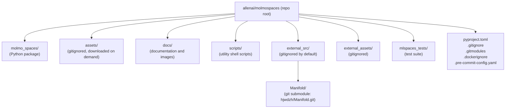

Sources: [.gitignore:1-56](), [.gitmodules:1-4](), [.dockerignore:1-50](), [docs/code_structure.md:1-104]()

---

## Directory Descriptions

| Directory | Tracked in Git | Purpose |
|---|---|---|
| `molmo_spaces/` | ✅ Yes | Main Python package; all importable source code |
| `assets/` | ❌ No (`assets/*`) | Downloaded object meshes, scenes, grasps, robot models |
| `docs/` | ✅ Yes (images via `!docs/**/*.png`) | Documentation markdown files and reference images |
| `scripts/` | ✅ Yes | Shell scripts (e.g., `process_data.sh` for postprocessing) |
| `external_src/` | ❌ No (requires `git add -f`) | External source trees; contains the `Manifold` submodule |
| `external_assets/` | ❌ No | External asset files not part of the main asset pipeline |
| `mlspaces_tests/` | ✅ Yes (test output excluded) | Pytest test suite; test artifacts written to `test_output/` subdirs |

Sources: [.gitignore:1-56](), [.gitmodules:1-4]()

---

## The `molmo_spaces/` Package

The package root is defined by a single path anchor in [molmo_spaces/__init__.py:1-3]():

```python
MOLMO_SPACES_BASE_DIR = Path(__file__).parent
```

`MOLMO_SPACES_BASE_DIR` is a `pathlib.Path` pointing to the `molmo_spaces/` directory. Internal modules use it to resolve asset paths, config files, and other runtime resources relative to the package installation location rather than the working directory.

**`molmo_spaces/` Internal Package Structure**

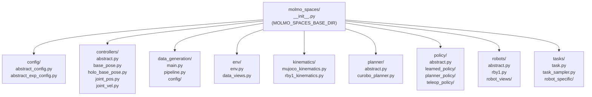

Sources: [docs/code_structure.md:7-44](), [molmo_spaces/__init__.py:1-3]()

| Subpackage | Key Files / Classes | Role |
|---|---|---|
| `config/` | `abstract_config.py`, `abstract_exp_config.py` | Base `Config` and `MlSpacesExpConfig` classes |
| `controllers/` | `joint_pos.py`, `joint_vel.py`, `base_pose.py` | Low-level robot joint and pose control |
| `data_generation/` | `main.py`, `pipeline.py`, `config/` | Entry point and `ParallelRolloutRunner` |
| `env/` | `env.py`, `data_views.py` | MuJoCo environment wrapper and observation types |
| `kinematics/` | `mujoco_kinematics.py`, `rby1_kinematics.py` | Forward/inverse kinematics solvers |
| `planner/` | `abstract.py`, `curobo_planner.py` | Motion planning interface and CuRobo backend |
| `policy/` | `abstract.py`, `planner_policy/`, `teleop_policy/`, `learned_policy/` | Policy implementations |
| `robots/` | `abstract.py`, `rby1.py`, `robot_views/` | Robot model interfaces |
| `tasks/` | `task.py`, `task_sampler.py`, `robot_specific/` | Task definitions and sampling |

Sources: [docs/code_structure.md:7-44]()

---

## The `assets/` Directory

The `assets/` directory is **gitignored in its entirety** ([.gitignore:8]()) and populated at runtime via the asset download system (see [2](#2)). Its expected on-disk layout is:

```
assets/
├── objects/
│   ├── thor/          # ~1,100 hand-crafted MJCF objects
│   └── objaverse/     # ~130,000 converted Objaverse objects
└── scenes/
    ├── refs/          # Scene reference metadata (kept in Docker)
    ├── ithor/         # MSCrafted hand-crafted scenes (kept in Docker)
    ├── procthor-10k/  # MSProc procedural scenes (THOR assets)
    ├── procthor-objaverse/  # MSProcObja procedural scenes (Objaverse assets)
    └── holodeck/      # MSMultiType LLM-generated scenes
```

The environment variable `MLSPACES_ASSETS_DIR` overrides the default asset location. See the Asset System page ([2](#2)) for details on asset versioning and download APIs.

Sources: [.gitignore:8](), [.dockerignore:31-34]()

---

## The `external_src/` Directory and the Manifold Submodule

`external_src/` is gitignored by default. Any file added under it requires an explicit `git add -f`. It currently contains one registered Git submodule:

| Submodule path | Upstream URL |
|---|---|
| `external_src/Manifold` | `https://github.com/hjwdzh/Manifold.git` |

To initialize it after cloning:

```bash
git submodule update --init --recursive
```

Sources: [.gitmodules:1-4](), [.gitignore:13-14]()

---

## Version Control Exclusion Policies

**Git vs. Docker Exclusion Map**

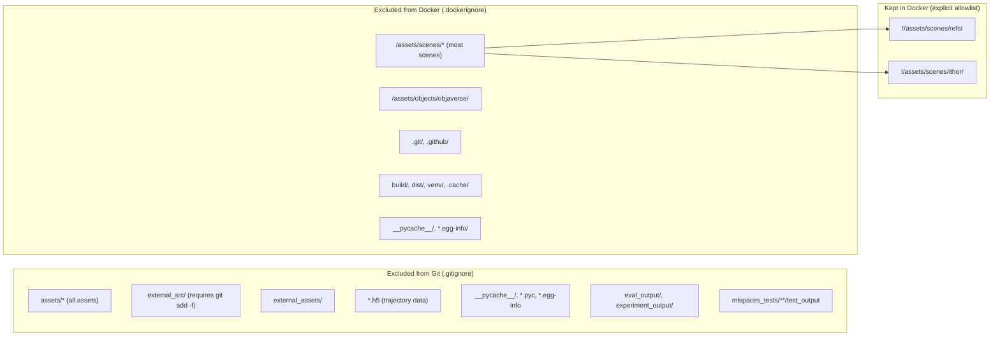

The Docker allowlist preserves `assets/scenes/refs/` (scene reference metadata) and `assets/scenes/ithor/` (hand-crafted scenes) while excluding procedural and Objaverse scenes that are too large to ship in an image.

Sources: [.gitignore:1-56](), [.dockerignore:1-50]()

---

## Runtime Path Resolution

The constant `MOLMO_SPACES_BASE_DIR` in [molmo_spaces/__init__.py:3]() is the single anchor for all in-package path resolution:

```
MOLMO_SPACES_BASE_DIR = Path(__file__).parent
  → resolves to: <install_root>/molmo_spaces/
```

This means that whether the package is installed in editable mode (`pip install -e .`) or as a regular wheel, paths derived from `MOLMO_SPACES_BASE_DIR` always point to the correct location of packaged assets and bundled configs. External assets stored under `assets/` are resolved using the `MLSPACES_ASSETS_DIR` environment variable instead, which decouples large binary data from the package install path.

Sources: [molmo_spaces/__init__.py:1-3]()

---

# Page: Asset System

# Asset System

<details>
<summary>Relevant source files</summary>

The following files were used as context for generating this wiki page:

- [.dockerignore](.dockerignore)
- [README.md](README.md)

</details>


This page explains the MolmoSpaces asset model: what constitutes an asset, how assets are versioned, how they are fetched on demand, and how they are organized on disk. For details on specific asset collections (object sets, scene types), see [Objects & Scenes](#2.1). For robot model details and coordinate conventions, see [Robots & Coordinate Conventions](#2.2).

---

## What Is an Asset?

An **asset** is any file or file bundle that MolmoSpaces loads at runtime but does not store in the repository itself. Assets are fetched from a remote data store and cached locally under `MLSPACES_ASSETS_DIR`. There are four top-level asset categories:

| Category | Examples | Fetched as |
|---|---|---|
| `objects` | `thor`, `objaverse` | Archive → extracted + symlinked |
| `scenes` | `ithor`, `procthor-10k`, `procthor-objaverse`, `holodeck` | Archive → extracted |
| `robots` | `franka_droid`, `rby1-sdk`, `robotiq_2f85_v4` | Archive → extracted |
| `benchmarks` | MS-Bench v1 | Archive → extracted |

Each category maps to a subdirectory under `MLSPACES_ASSETS_DIR` (e.g., `assets/scenes/ithor/`, `assets/objects/thor/`, `assets/robots/franka_droid/`).

Sources: [README.md:104-118]()

---

## Environment Variables

The asset system is configured entirely through environment variables. These must be set before importing any asset-aware module.

| Variable | Default | Effect |
|---|---|---|
| `MLSPACES_ASSETS_DIR` | `../assets` relative to the repo root | Root directory for all downloaded assets |
| `MLSPACES_AUTO_INSTALL` | `True` | Download/update assets without interactive prompts |
| `MLSPACES_FORCE_INSTALL` | `True` | Overwrite existing assets even if already present |
| `MLSPACES_PINNED_ASSETS_FILE` | _(unset)_ | Path to a JSON file that overrides per-asset versions |

Sources: [README.md:92-103]()

---

## Asset Versioning

Each asset has a version string (typically a date stamp such as `"20260127"`). The canonical version table is `DATA_TYPE_TO_SOURCE_TO_VERSION` in `molmo_spaces/molmo_spaces_constants.py`. Its structure is:

```
{
  "<category>": {
    "<source_name>": "<version_string>",
    ...
  },
  ...
}
```

The `MLSPACES_PINNED_ASSETS_FILE` variable accepts a JSON file with the same nested structure. Any key present in that file overrides the version defined in `molmo_spaces_constants.py`, allowing a project or experiment to pin specific asset versions without modifying source code.

**Example pinned assets file:**

```json
{
    "robots": {
         "franka_droid": "20260127"
    },
    "scenes": {
        "ithor": "20251217"
    }
}
```

Sources: [README.md:170-181]()

---

## Lazy-Loading API

Assets are not downloaded at import time. Instead, two primary functions in `molmo_spaces/utils/lazy_loading_utils.py` trigger downloads on demand:

**Asset Lifecycle Diagram**

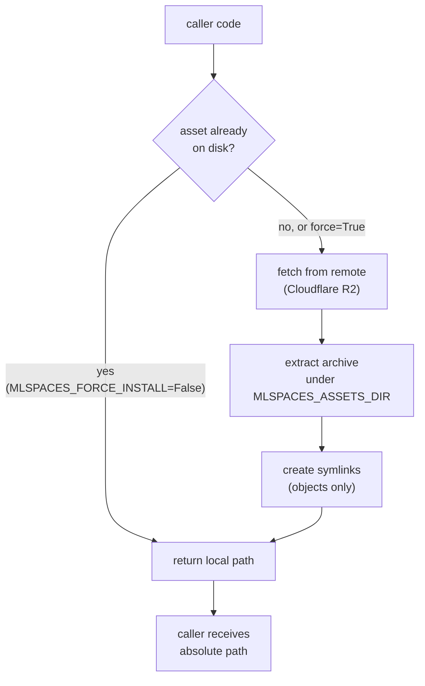

Sources: [README.md:120-156]()

### `install_uid`

Located in `molmo_spaces/utils/lazy_loading_utils.py`. Downloads and symlinks a single object asset identified by its `assetId` string (a UID). Returns the local path to the installed model.

Usage pattern from the README:

```python
from molmo_spaces.utils.lazy_loading_utils import install_uid
apple_model_path = install_uid(random_apple["assetId"])
```

Sources: [README.md:137-155]()

### `install_scene_with_objects_and_grasps_from_path`

Located in `molmo_spaces/utils/lazy_loading_utils.py`. Accepts a scene path descriptor (as returned by `get_scenes()`), then downloads the scene archive, any referenced object assets, and associated grasp data. This is the standard entry point for preparing a scene for simulation.

Usage pattern:

```python
from molmo_spaces.utils.lazy_loading_utils import install_scene_with_objects_and_grasps_from_path
from molmo_spaces.molmo_spaces_constants import get_scenes

install_scene_with_objects_and_grasps_from_path(get_scenes("ithor", "train")["train"][1])
```

Sources: [README.md:123-131]()

### `get_scenes`

Located in `molmo_spaces/molmo_spaces_constants.py`. Returns a dictionary of scene path descriptors for a given scene type (e.g., `"ithor"`, `"procthor-10k"`) and split (e.g., `"train"`, `"test"`). The return value is keyed by split name, with each value being a list of scene descriptor objects.

```python
get_scenes("ithor", "train")["train"][1]
# returns the descriptor for the second ithor training scene
```

Sources: [README.md:128-130]()

### `ObjectMeta.annotation`

Located in `molmo_spaces/utils/object_metadata.py`. Class method on `ObjectMeta` that returns a dictionary keyed by `assetId`, where each value is an annotation dict containing fields such as `"category"`, `"isObjaverse"`, and `"assetId"`. Used to query object metadata before downloading.

Sources: [README.md:145-155]()

---

## Code Entity Map

The following diagram maps the public API surface to the files that implement it.

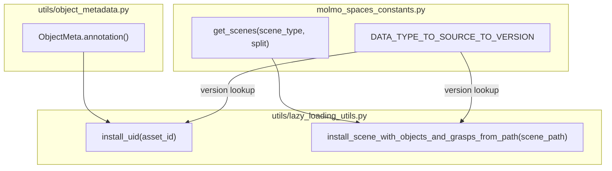

Sources: [README.md:104-156](), [README.md:170-181]()

---

## On-Disk Directory Layout

After assets are downloaded, the directory tree under `MLSPACES_ASSETS_DIR` follows this structure:

```
MLSPACES_ASSETS_DIR/
├── objects/
│   ├── thor/              # ~1.1k hand-crafted kitchen objects
│   │   └── <uid>/
│   └── objaverse/         # ~130k Objaverse-derived objects
│       └── <uid>/         # (symlinks from per-uid archives)
├── scenes/
│   ├── refs/              # reference files (always present)
│   ├── ithor/             # MSCrafted scenes (always present in Docker)
│   ├── procthor-10k/      # MSProc scenes
│   ├── procthor-objaverse/# MSProcObja scenes
│   └── holodeck/          # MSMultiType scenes
├── robots/
│   ├── franka_droid/
│   ├── robotiq_2f85_v4/
│   └── rby1-sdk/
└── benchmarks/
    └── <benchmark_name>/
```

> **Note:** In Docker builds, `assets/objects/objaverse/` and most `assets/scenes/` subdirectories are excluded from the image to reduce size. Only `assets/scenes/refs/` and `assets/scenes/ithor/` are kept. See [Docker & Containerization](#7.3) for details.

Sources: [.dockerignore:31-35](), [README.md:104-118]()

---

## Asset Download Flow (End-to-End)

**Sequence: Scene Download**

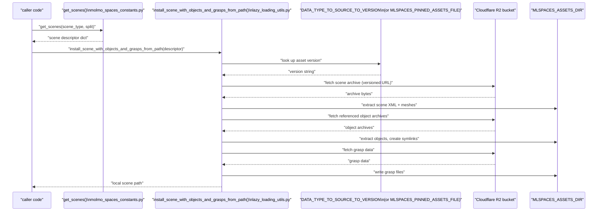

Sources: [README.md:120-131](), [README.md:170-181]()

---

## Bootstrapping All Assets

Running `molmo_spaces_constants.py` as a script installs all assets registered in `DATA_TYPE_TO_SOURCE_TO_VERSION`. This is the recommended first step before running the benchmark or data generation pipeline:

```bash
export MLSPACES_ASSETS_DIR=/path/to/assets
python -m molmo_spaces.molmo_spaces_constants
```

Sources: [README.md:188-192]()

---

# Page: Objects & Scenes

# Objects & Scenes

<details>
<summary>Relevant source files</summary>

The following files were used as context for generating this wiki page:

- [README.md](README.md)
- [docs/images/Multi_Simulator_Pan.jpg](docs/images/Multi_Simulator_Pan.jpg)

</details>


This page documents the two object collections and four scene dataset types available in MolmoSpaces, including their code names, paper names, sizes, sources, and how to retrieve them programmatically. For information on the asset download mechanism and versioning system, see [Asset System](#2). For robot assets, see [Robots & Coordinate Conventions](#2.2).

---

## Asset Name Mapping

MolmoSpaces uses distinct code names (used in configuration and API calls) and paper names (used in the research paper). The table below consolidates all asset types:

| Type | Code Name | Paper Name | Description | Object Source |
|---|---|---|---|---|
| objects | `thor` | — | ~1,100 hand-crafted kitchen assets | AI2-THOR |
| objects | `objaverse` | — | ~130,000 converted assets | Objaverse |
| scenes | `ithor` | MSCrafted | Hand-crafted; many articulated assets | thor |
| scenes | `procthor-10k` | MSProc | Procedurally generated | thor |
| scenes | `procthor-objaverse` | MSProcObja | Procedurally generated | objaverse |
| scenes | `holodeck` | MSMultiType | LLM-generated | objaverse |
| benchmark | — | MS-Bench v1 | Base benchmark for atomic tasks | — |

Sources: [README.md:109-116]()

---

## Object Collections

### `thor` Objects

- Approximately 1,100 hand-crafted assets, primarily kitchen and household objects.
- Sourced from the AI2-THOR simulator asset library.
- All `thor` objects are downloaded, extracted, and symlinked automatically upon instantiation of the resource manager — no explicit per-object installation step is required.
- Used as the object population for `ithor` and `procthor-10k` scenes.

### `objaverse` Objects

- Approximately 130,000 assets converted from the Objaverse dataset.
- Must be explicitly installed on demand via `install_uid()`.
- Used as the object population for `procthor-objaverse` and `holodeck` scenes.
- Licensed under ODC-BY 1.0 (distinct from the CC BY 4.0 license applied to other MolmoSpaces data).

Sources: [README.md:104-118](), [README.md:136-155]()

---

## Scene Datasets

### Scene Type Overview

**Scene type → code name relationship:**

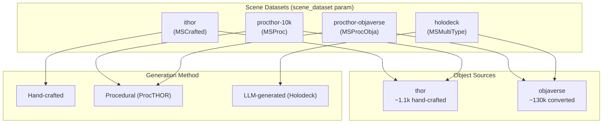

Sources: [README.md:109-116]()

### `ithor` (MSCrafted)

- Fully hand-crafted scenes with detailed articulated assets (e.g., cabinets, drawers, fridges).
- Populated exclusively with `thor` objects.
- Smallest dataset; highest asset fidelity and articulation count.
- Example path pattern after installation: `$MLSPACES_ASSETS_DIR/scenes/ithor/FloorPlan1_physics.xml`

### `procthor-10k` (MSProc)

- 10,000 procedurally generated scenes using the ProcTHOR pipeline.
- Populated with `thor` objects.
- Default scene dataset for pick, pick-and-place, open, and close task configurations (see [Task Configurations](#4.2)).

### `procthor-objaverse` (MSProcObja)

- Procedurally generated scenes using the ProcTHOR pipeline.
- Populated with `objaverse` objects instead of `thor` objects.
- Larger object vocabulary than `procthor-10k`.

### `holodeck` (MSMultiType)

- Scenes generated by the Holodeck LLM-based scene synthesis system.
- Populated with `objaverse` objects.
- Covers a wider variety of room types and semantic contexts than procedural scenes.

Sources: [README.md:109-116]()

---

## Retrieving Scenes

The primary entry point for scene retrieval is `get_scenes()` from `molmo_spaces.molmo_spaces_constants`, combined with `install_scene_with_objects_and_grasps_from_path()` from `molmo_spaces.utils.lazy_loading_utils`.

**Function flow for scene installation:**

```mermaid
sequenceDiagram
    participant "User Code"
    participant "get_scenes()" as GS
    participant "molmo_spaces_constants.py" as CONST
    participant "install_scene_with_objects_and_grasps_from_path()" as INSTALL
    participant "lazy_loading_utils.py" as LLU
    participant "$MLSPACES_ASSETS_DIR/scenes/" as DISK

    "User Code"->>"get_scenes()": "get_scenes(dataset, split)"
    "get_scenes()">>"molmo_spaces_constants.py": "look up dataset registry"
    "molmo_spaces_constants.py"-->>"get_scenes()": "scene path dict"
    "get_scenes()"-->>"User Code": "dict with split keys"
    "User Code"->>"install_scene_with_objects_and_grasps_from_path()": "scene path entry"
    "install_scene_with_objects_and_grasps_from_path()">>"lazy_loading_utils.py": "resolve dependencies"
    "lazy_loading_utils.py">>"$MLSPACES_ASSETS_DIR/scenes/": "download + symlink .xml + objects + grasps"
    "$MLSPACES_ASSETS_DIR/scenes/"-->>"User Code": "local MJCF path ready"
```

**Example usage pattern** (from README):

```python
from molmo_spaces.utils.lazy_loading_utils import install_scene_with_objects_and_grasps_from_path
from molmo_spaces.molmo_spaces_constants import get_scenes

install_scene_with_objects_and_grasps_from_path(get_scenes("ithor", "train")["train"][1])
```

After installation, scenes can be viewed directly:

```bash
python -m mujoco.viewer --mjcf $MLSPACES_ASSETS_DIR/scenes/ithor/FloorPlan1_physics.xml
```

The `get_scenes()` function accepts:
- **`dataset`**: a code name string — one of `"ithor"`, `"procthor-10k"`, `"procthor-objaverse"`, `"holodeck"`.
- **`split`**: a string such as `"train"` or `"test"`.

It returns a dict keyed by split name, where each value is a list of scene path descriptors.

Sources: [README.md:122-135](), [molmo_spaces/molmo_spaces_constants.py](), [molmo_spaces/utils/lazy_loading_utils.py]()

---

## Retrieving Objects

### Object Metadata via `ObjectMeta`

Object annotations are accessible through `ObjectMeta.annotation()` in `molmo_spaces.utils.object_metadata`. This returns a dict mapping asset IDs to annotation dicts. Each annotation includes at minimum:

| Field | Description |
|---|---|
| `assetId` | Unique identifier string for the object |
| `category` | Semantic category label (e.g., `"Apple"`, `"Chair"`) |
| `isObjaverse` | Boolean; `True` for objaverse objects, `False` for thor |

### Installing Individual Objects via `install_uid`

Objects from the `objaverse` collection must be downloaded on demand. The `install_uid()` function in `molmo_spaces.utils.lazy_loading_utils` accepts an `assetId` string and returns the local filesystem path to the installed model.

**Object retrieval flow:**

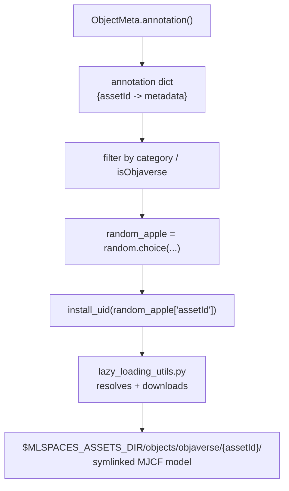

**Example usage pattern** (from README):

```python
from molmo_spaces.utils.object_metadata import ObjectMeta
from molmo_spaces.utils.lazy_loading_utils import install_uid

annotation = ObjectMeta.annotation()

# Filter to objaverse apple objects only
apple_annotations = [
    anno for anno in annotation.values()
    if "apple" in anno["category"].lower() and anno["isObjaverse"]
]

apple_model_path = install_uid(apple_annotations[0]["assetId"])
```

Note: `thor` objects do not require `install_uid()` — they are automatically installed when the resource manager is initialized.

Sources: [README.md:137-155](), [molmo_spaces/utils/object_metadata.py](), [molmo_spaces/utils/lazy_loading_utils.py]()

---

## Configuration Integration

The `scene_dataset` field in `MlSpacesExpConfig` (and all task config subclasses) takes a code name string to select which scene dataset is used during data generation or evaluation. Task-specific config classes set a default:

| Config Class | Default `scene_dataset` |
|---|---|
| `PickBaseConfig` | `"procthor-10k"` |
| `NavToObjBaseConfig` | `"procthor-10k"` |

For full details on how `scene_dataset` integrates into experiment configs, see [Base Configuration Classes](#4.1).

Sources: [README.md:109-116]()

---

## Licensing

| Asset Group | License |
|---|---|
| Objaverse object subsets | [ODC-BY 1.0](https://opendatacommons.org/licenses/by/1-0/) |
| All other data (thor objects, ithor/procthor scenes, etc.) | [CC BY 4.0](https://creativecommons.org/licenses/by/4.0/deed.en) |
| Codebase | Apache 2.0 |

All artifacts are intended for research and educational use per Ai2's Responsible Use Guidelines.

Sources: [README.md:282-286]()

---

# Page: Robots & Coordinate Conventions

# Robots & Coordinate Conventions

<details>
<summary>Relevant source files</summary>

The following files were used as context for generating this wiki page:

- [README.md](README.md)
- [docs/images/robot_axis_conventions.png](docs/images/robot_axis_conventions.png)

</details>


## Purpose & Scope

This page documents the robot models included in MolmoSpaces, how robot assets are versioned and downloaded, the shared coordinate frame conventions used across all robots, and how robot configurations are represented in code.

For how `robot_config` composes into a full experiment configuration, see [Configuration System](#4) and [Base Configuration Classes](#4.1). For how robots interact with the task and policy system at runtime, see [Pipeline Architecture](#5.1). For robot assets in non-MuJoCo simulators, see [Simulator Integrations](#3).

---

## Supported Robot Models

MolmoSpaces includes four robot models. Each is derived from an upstream open-source definition and modified to conform to MolmoSpaces coordinate and asset conventions.

| Asset Key | Common Name | Upstream Source | Primary Role |
|---|---|---|---|
| `franka_droid` | Franka FR3 arm | `mujoco_menagerie/franka_fr3` (Franka Robotics) | Manipulation arm (pick, place, open, close) |
| `robotiq_2f85_v4` | Robotiq 2F-85 | `mujoco_menagerie/robotiq_2f85_v4` (ROS-Industrial) | Parallel-jaw end-effector |
| `rby1-sdk` | Rainbow Robotics RBY1 | `RainbowRobotics/rby1-sdk` | Mobile manipulation / navigation |
| `cap_gripper` | CAP Gripper | `jeffacce/cap-policy` (NYU GRAIL) | Alternative end-effector |

Sources: [README.md:290-295]()

---

## Robot Asset Versioning

Robots are managed by the same asset system as scenes and objects. They are registered under the `"robots"` key in `DATA_TYPE_TO_SOURCE_TO_VERSION` inside `molmo_spaces/molmo_spaces_constants.py`.

To pin a robot to a specific asset version, add an entry to the `MLSPACES_PINNED_ASSETS_FILE` JSON:

```json
{
    "robots": {
        "franka_droid": "20260127"
    }
}
```

See [Asset System](#2) for the full asset versioning and lazy-loading API.

Sources: [README.md:170-181]()

---

## Coordinate Conventions

All robot models use a unified coordinate convention enforced consistently across MuJoCo (MJCF), Isaac Sim (USDa), and ManiSkill. The convention is defined for two distinct frames: the **robot base frame** and the **gripper tool frame**.

### Robot Base Frame

| Axis | Assignment |
|---|---|
| `+x` | Forward (in front of the robot) |
| `+y` | Left |
| `+z` | Up |

### Parallel-Jaw Gripper Frame

| Axis | Assignment |
|---|---|
| `+z` | Forward — the tool approach direction (pointing out from the gripper face) |
| `+y` | Finger spread axis (fingers open along +y and −y) |
| `+x` | Lateral (derived by right-hand rule from z and y) |

The reference diagram is at `docs/images/robot_axis_conventions.png`.

Sources: [README.md:272-278]()

---

**Diagram: Robot Base Frame and Gripper Frame Conventions**

```mermaid
graph LR
  subgraph "Robot Base Frame"
    xB[""+x  =  Forward""]
    yB[""+y  =  Left""]
    zB[""+z  =  Up""]
  end

  subgraph "Parallel-Jaw Gripper Frame"
    zG[""+z  =  Tool Approach (forward)""]
    yG[""+y  =  Finger Spread Axis""]
    xG[""+x  =  Lateral (right-hand rule)""]
  end

  RobotOrigin["Robot Base Origin"] --> xB
  RobotOrigin --> yB
  RobotOrigin --> zB

  GripperOrigin["Gripper Tool Origin"] --> zG
  GripperOrigin --> yG
  GripperOrigin --> xG
```

Sources: [README.md:272-278]()

---

## Robot Models and Configuration Classes

Each robot model maps to a configuration class derived from `BaseRobotConfig` (which is a field of `MlSpacesExpConfig`). Task-specific experiment configs set the `robot_config` field to the appropriate robot subclass.

**Diagram: Robot Asset → Config Class → Task Type Mapping**

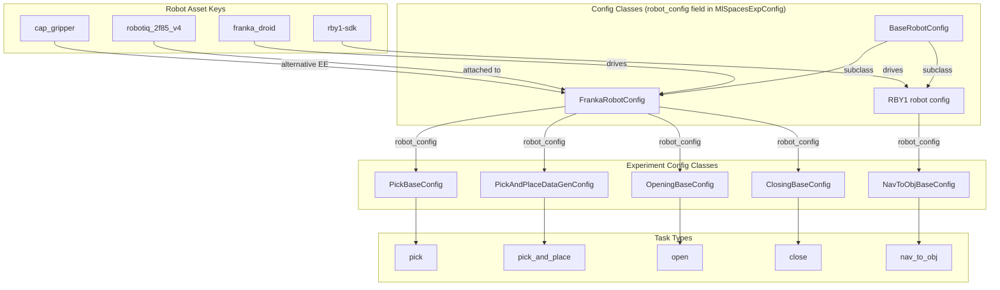

Sources: [README.md:290-295](), diagrams from system overview (Config Hierarchy, Task and Policy Type Map)

---

## Cross-Simulator Convention Enforcement

The coordinate conventions above are applied at the asset level — robot MJCF and USDa files are modified from their upstream sources so that all simulator representations share the same axis orientation.

| Simulator | Format | Robot Asset Location |
|---|---|---|
| MuJoCo | `.xml` (MJCF) | `$MLSPACES_ASSETS_DIR/robots/<asset_key>/` |
| Isaac Sim | `.usda` (USDa) | Isaac-specific asset bucket (see [Simulator Integrations](#3)) |
| ManiSkill | ManiSkill wrapper | ManiSkill-specific setup (see [Simulator Integrations](#3)) |

Because the convention is baked into the robot asset files rather than applied at runtime, any policy or controller that assumes the standard frame (e.g., computing end-effector poses, planning grasp approach vectors along `+z`) will behave consistently regardless of which simulator backend is active.

Sources: [README.md:24-28](), [README.md:290-295]()

---

# Page: Simulator Integrations

# Simulator Integrations

<details>
<summary>Relevant source files</summary>

The following files were used as context for generating this wiki page:

- [README.md](README.md)
- [docs/images/Multi_Simulator_Pan.jpg](docs/images/Multi_Simulator_Pan.jpg)

</details>


This page describes how MolmoSpaces assets (scenes, objects, and robots) are made available across three simulators: **MuJoCo**, **Isaac Sim**, and **ManiSkill**. It covers the file formats used per simulator, the directory layout of simulator-specific packages, the data endpoints for downloading pre-converted assets, and quick-start viewing instructions.

For information about the assets themselves (scene types, object collections, robots), see the [Asset System](#2) and [Objects & Scenes](#2.1) and [Robots & Coordinate Conventions](#2.2) pages. For MuJoCo-specific runtime usage in data generation and evaluation, see [Pipeline Architecture](#5.1) and [Evaluation & Benchmarking](#6).

---

## Supported Simulators at a Glance

MolmoSpaces provides assets in native formats for each simulator. The benchmarks and data generation pipeline currently run exclusively in MuJoCo; Isaac Sim and ManiSkill are supported as asset targets only.

| Simulator | Asset Format | Package Directory | Benchmark Support | Data Generation |
|---|---|---|---|---|
| MuJoCo | MJCF (`.xml`) | `molmo_spaces/` | ✅ | ✅ |
| Isaac Sim | USDa (`.usda`) | `molmo_spaces_isaac/` | ❌ | ❌ |
| ManiSkill | — | `molmo_spaces_maniskill/` | ❌ | ❌ |

Sources: [README.md:24-28](), [README.md:184-186]()

---

## Simulator Integration Map

**Diagram: Simulator Integrations — Packages and Formats**

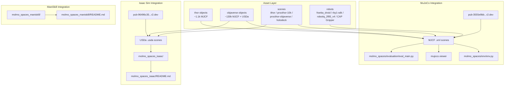

Sources: [README.md:24-28](), [README.md:120-167](), [README.md:283-285]()

---

## MuJoCo

MuJoCo is the primary simulator in MolmoSpaces. All data generation, evaluation, and teleoperation run against MuJoCo. Assets are distributed in **MJCF** (`.xml`) format.

### Asset Format

- **Scenes**: `$MLSPACES_ASSETS_DIR/scenes/{scene_type}/{scene_name}.xml`
  - Example: `$MLSPACES_ASSETS_DIR/scenes/ithor/FloorPlan1_physics.xml`
- **Objects**: per-object `.xml` files, symlinked into the asset directory on install
- **Robots**: `.xml` files sourced from `mujoco_menagerie` and vendor SDKs

### Scene Download and Viewing

Scenes are installed on demand via the lazy-loading API. The `install_scene_with_objects_and_grasps_from_path` function handles fetching the scene XML and all referenced object assets. The `get_scenes` function returns a dict of scene paths keyed by split.

```text
# Programmatic install (see molmo_spaces/utils/lazy_loading_utils.py)
install_scene_with_objects_and_grasps_from_path(get_scenes("ithor", "train")["train"][1])

# Viewer
python -m mujoco.viewer --mjcf $MLSPACES_ASSETS_DIR/scenes/ithor/FloorPlan1_physics.xml
```

Sources: [README.md:120-136]()

### Viewer Tips

| Issue | Resolution |
|---|---|
| Red bounding boxes on objects | Toggle `Group Enable > Site groups > Site 0` in left panel |
| Interact with objects | Double-click object → Ctrl + right mouse drag (active viewer only) |
| Keyboard shortcuts | See MuJoCo docs for `sasimulate` sample |

Sources: [README.md:265-269]()

### Runtime Integration

During data generation and evaluation, the MuJoCo environment is managed by `molmo_spaces/env/env.py`. The `ParallelRolloutRunner` in `molmo_spaces/data_generation/pipeline.py` initializes and resets this environment per episode. For evaluation, `molmo_spaces/evaluation/eval_main.py` drives the same MuJoCo environment.

The `mujoco.viewer` module is used separately for offline inspection and is not part of the runtime loop.

Sources: [README.md:195-202]()

### Public Data Endpoint

Pre-converted MJCF assets (scenes and objects) are served from:

```
https://pub-3555e9bb2d304fab9c6c79819e48aa40.r2.dev
```

The asset manager (`molmo_spaces/molmo_spaces_constants.py`) uses this endpoint internally when `install_uid` or `install_scene_with_objects_and_grasps_from_path` is called.

Sources: [README.md:283-285]()

---

## Isaac Sim

Isaac Sim support is provided as a separate top-level package directory `molmo_spaces_isaac/`. Assets for Isaac Sim are distributed in **USDa** format.

### Asset Format

- **Scenes and objects**: `.usda` files (Universal Scene Description, ASCII variant)
- Pre-converted USDa assets are served from a dedicated endpoint separate from the MJCF endpoint

### Setup

Full setup and usage instructions are maintained in the Isaac-specific README:

```
molmo_spaces_isaac/README.md
```

Sources: [README.md:159-162]()

### Public Data Endpoint

Pre-converted USDa assets are served from:

```
https://pub-96496c3574b24d0c98b235219711d359.r2.dev
```

Sources: [README.md:283-285]()

---

## ManiSkill

ManiSkill support is provided as a separate top-level package directory `molmo_spaces_maniskill/`. Setup and usage instructions are maintained in the ManiSkill-specific README:

```
molmo_spaces_maniskill/README.md
```

Sources: [README.md:164-167]()

---

## Format Comparison

**Diagram: Asset Format by Simulator and Asset Type**

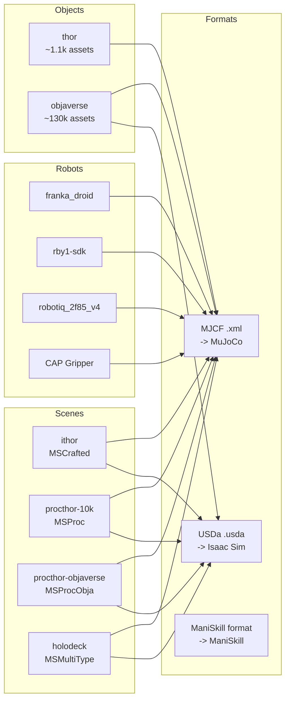

Sources: [README.md:104-118](), [README.md:283-285]()

---

## Feature Support by Simulator

| Feature | MuJoCo | Isaac Sim | ManiSkill |
|---|---|---|---|
| Scene assets | ✅ MJCF | ✅ USDa | See README |
| Object assets (thor) | ✅ | ✅ | — |
| Object assets (objaverse) | ✅ | ✅ | — |
| Robot models | ✅ | — | — |
| Data generation pipeline | ✅ | ❌ | ❌ |
| Benchmark evaluation | ✅ | ❌ | ❌ |
| Grasp annotations | ✅ | — | — |
| Teleoperation | ✅ | ❌ | ❌ |
| Lazy asset install API | ✅ | — | — |

Sources: [README.md:184-186](), [README.md:159-167]()

---

## Asset Conversion Notes

Assets distributed for Isaac Sim and ManiSkill are pre-converted and served from their respective public endpoints. The conversion tooling is included in the respective sub-packages (`molmo_spaces_isaac/` and `molmo_spaces_maniskill/`). Refer to each sub-package's README for conversion pipeline details.

The `housegen` optional dependency group (installed via `uv pip install -e .[housegen]`) provides the pipeline for generating MuJoCo-compatible house/scene XMLs from iTHOR, ProcTHOR, or Holodeck JSON scene descriptions. This is a prerequisite step before scenes can be loaded in MuJoCo.

Sources: [README.md:59-67](), [README.md:159-167]()

---

# Page: Configuration System

# Configuration System

<details>
<summary>Relevant source files</summary>

The following files were used as context for generating this wiki page:

- [molmo_spaces/configs/__init__.py](molmo_spaces/configs/__init__.py)
- [molmo_spaces/configs/abstract_config.py](molmo_spaces/configs/abstract_config.py)
- [molmo_spaces/configs/abstract_exp_config.py](molmo_spaces/configs/abstract_exp_config.py)

</details>


This page gives a conceptual overview of the hierarchical Pydantic-based configuration system used throughout MolmoSpaces. It covers the two base classes (`Config` and `MlSpacesExpConfig`), how sub-configs compose into a single experiment definition, and how configs are serialized and saved at runtime.

For documentation of the concrete task-specific subclasses (`PickBaseConfig`, `NavToObjBaseConfig`, etc.) and the `register_config` decorator, see [Task Configurations](#4.2). For how `MlSpacesExpConfig` is loaded and passed into the data generation pipeline at runtime, see [Pipeline Architecture](#5.1).

---

## Role in the System

Every data generation run, evaluation, and benchmark episode is parameterized by a single config object — a subclass of `MlSpacesExpConfig`. The config carries all timing parameters, scene selection, camera setup, robot model, task definition, and policy choice in one validated, serializable unit. This makes experiments reproducible: the config can be saved to disk and later reloaded to replay an exact episode.

Sources: [molmo_spaces/configs/__init__.py:1-59](), [molmo_spaces/configs/abstract_exp_config.py:1-35]()

---

## Class Hierarchy

**Config hierarchy diagram**

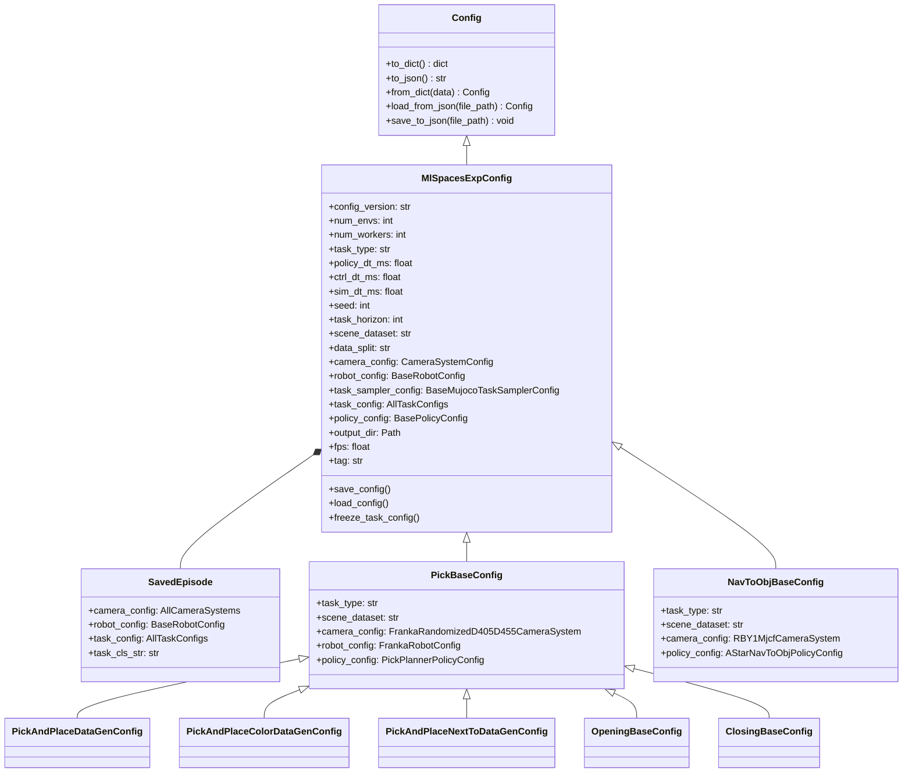

Sources: [molmo_spaces/configs/abstract_config.py:1-43](), [molmo_spaces/configs/abstract_exp_config.py:33-216]()

---

## Sub-Config Composition

`MlSpacesExpConfig` does not contain camera, robot, task, or policy settings directly. Instead, it holds references to dedicated sub-config objects. Each sub-config is independently validated by Pydantic before the parent config is constructed.

**Sub-config composition diagram**

```mermaid
graph TD
    EXP["MlSpacesExpConfig\n(abstract_exp_config.py)"]

    CAM["camera_config\nCameraSystemConfig"]
    ROB["robot_config\nBaseRobotConfig"]
    TS["task_sampler_config\nBaseMujocoTaskSamplerConfig"]
    TC["task_config\nAllTaskConfigs"]
    POL["policy_config\nBasePolicyConfig"]

    CAM_IMPL1["FrankaRandomizedD405D455CameraSystem"]
    CAM_IMPL2["RBY1MjcfCameraSystem"]
    CAM_IMPL3["FrankaDroidCameraSystem"]

    ROB_IMPL1["FrankaRobotConfig"]
    ROB_IMPL2["RBY1RobotConfig"]

    TS_IMPL1["PickTaskSamplerConfig"]
    TS_IMPL2["NavToObjTaskSamplerConfig"]

    TC_IMPL1["PickTaskConfig"]
    TC_IMPL2["OpenTaskConfig"]
    TC_IMPL3["NavToObjTaskConfig"]

    POL_IMPL1["PickPlannerPolicyConfig"]
    POL_IMPL2["AStarNavToObjPolicyConfig"]
    POL_IMPL3["TeleopPolicyConfig"]
    POL_IMPL4["LearnedPolicyConfig"]

    EXP --> CAM
    EXP --> ROB
    EXP --> TS
    EXP --> TC
    EXP --> POL

    CAM --> CAM_IMPL1
    CAM --> CAM_IMPL2
    CAM --> CAM_IMPL3

    ROB --> ROB_IMPL1
    ROB --> ROB_IMPL2

    TS --> TS_IMPL1
    TS --> TS_IMPL2

    TC --> TC_IMPL1
    TC --> TC_IMPL2
    TC --> TC_IMPL3

    POL --> POL_IMPL1
    POL --> POL_IMPL2
    POL --> POL_IMPL3
    POL --> POL_IMPL4
```

Sources: [molmo_spaces/configs/abstract_exp_config.py:65-72](), [molmo_spaces/configs/__init__.py:13-59]()

---

## `Config` — The Base Class

All configuration objects in MolmoSpaces inherit from `Config`, defined in [molmo_spaces/configs/abstract_config.py:9-43](). It is a thin wrapper around Pydantic's `BaseModel` with `arbitrary_types_allowed = True` to accommodate MuJoCo and NumPy types.

| Method | Signature | Description |
|--------|-----------|-------------|
| `to_dict` | `() -> dict` | Calls `model_dump()` to produce a plain dict |
| `to_json` | `() -> str` | Calls `model_dump_json(warnings="error")` |
| `from_dict` | `(data: dict) -> Config` | Class method; calls `model_validate(data)` |
| `load_from_json` | `(file_path: str) -> Config` | Reads a JSON file and calls `model_validate_json` |
| `save_to_json` | `(file_path: str) -> None` | Writes `to_json()` output to a file |

Sources: [molmo_spaces/configs/abstract_config.py:9-43]()

---

## `MlSpacesExpConfig` — The Experiment Config

`MlSpacesExpConfig` is an abstract subclass of `Config` that holds every parameter needed to run one experiment. It is defined in [molmo_spaces/configs/abstract_exp_config.py:33-216]().

### Timing fields

These three timing parameters govern the simulation loop. Validation in `model_post_init` enforces that `policy_dt_ms` is an integer multiple of `ctrl_dt_ms`, which must itself be an integer multiple of `sim_dt_ms`.

| Field | Type | Meaning |
|-------|------|---------|
| `sim_dt_ms` | `float` | Physics integration step (milliseconds) |
| `ctrl_dt_ms` | `float` | Controller update period (milliseconds) |
| `policy_dt_ms` | `float` | Policy query period (milliseconds) |
| `fps` | `float` (property) | Derived as `1000.0 / policy_dt_ms` |

### Parallelism fields

| Field | Type | Default | Meaning |
|-------|------|---------|---------|
| `num_envs` | `int` | — | Batched environments per worker (vectorized physics) |
| `num_workers` | `int` | `1` | Worker processes for episode-level parallelism |

### Scene and task fields

| Field | Type | Default | Meaning |
|-------|------|---------|---------|
| `scene_dataset` | `str` | — | Dataset key: `ithor`, `procthor-10k`, `procthor-objaverse`, `holodeck` |
| `data_split` | `str` | `"train"` | Split: `train`, `val`, or `test` |
| `task_type` | `str` | — | Task identifier string, e.g. `"pick"`, `"nav_to_obj"` |
| `task_horizon` | `int \| None` | `None` | Maximum steps per episode; `None` means no limit |
| `seed` | `int \| None` | `None` | RNG seed; if `None`, a random seed is generated |
| `collision_free_pose_limit` | `int` | `3` | Max retries for collision-free initial pose sampling |

### Sub-config fields

| Field | Type | Notes |
|-------|------|-------|
| `camera_config` | `CameraSystemConfig \| None` | Camera and sensor setup |
| `robot_config` | `BaseRobotConfig` | Robot model parameters |
| `task_sampler_config` | `BaseMujocoTaskSamplerConfig` | How tasks and scenes are sampled |
| `task_config` | `AllTaskConfigs` | Task-specific parameters |
| `task_config_preset_exp` | `AllTaskConfigs \| None` | Cached config for whole-experiment replay |
| `task_config_preset_scn` | `AllTaskConfigs \| None` | Cached config for per-scene replay |
| `policy_config` | `BasePolicyConfig` | Policy parameters |

### Optional runtime/logging fields

| Field | Type | Default | Notes |
|-------|------|---------|-------|
| `benchmark_path` | `Path \| None` | `None` | Path to a JSON file listing fully-specified episodes |
| `eval_runtime_params` | `Any` | auto-initialized | Set during evaluation; defaults to `EvalRuntimeParams()` |
| `output_dir` | `Path` | — | Where results are written |
| `profile` | `bool` | `False` | Enable profiling via `Profiler` |
| `log_level` | `str` | `"info"` | One of `debug`, `info`, `warning`, `error`, `none` |
| `use_wandb` | `bool` | `False` | Enable Weights & Biases logging |
| `filter_for_successful_trajectories` | `bool` | `True` | When `True`, only successful episodes go to the main output directory |

### Abstract members

Subclasses must implement the `tag` property, which returns a human-readable string identifying the experiment variant. This string is used in output directory naming and logging.

Sources: [molmo_spaces/configs/abstract_exp_config.py:33-130]()

---

## Validation: `model_post_init`

After field validation, Pydantic calls `model_post_init` [molmo_spaces/configs/abstract_exp_config.py:99-114](). It performs two assertions:

1. `policy_dt_ms / ctrl_dt_ms` must be an integer — ensures policy steps align on control boundaries.
2. `ctrl_dt_ms / sim_dt_ms` must be an integer — ensures control steps align on physics boundaries.

It also initializes `eval_runtime_params` to a default `EvalRuntimeParams()` instance if not already set, avoiding a circular import by deferring the import to runtime.

Sources: [molmo_spaces/configs/abstract_exp_config.py:99-114]()

---

## Serialization and Persistence

**Config serialization flow**

```mermaid
flowchart LR
    subgraph "JSON path (Config)"
        A1["Config instance"] -->|"to_json()"| A2["JSON string"]
        A2 -->|"save_to_json(path)"| A3["file.json"]
        A3 -->|"load_from_json(path)"| A1
        A2 -->|"from_dict(data)"| A1
    end

    subgraph "Pickle path (MlSpacesExpConfig)"
        B1["MlSpacesExpConfig instance"] -->|"save_config(output_dir)"| B2["experiment_config_TIMESTAMP.pkl"]
        B2 -->|"load_config(output_dir)"| B1
    end
```

- `Config.save_to_json` / `Config.load_from_json` — lightweight, human-readable; uses Pydantic's JSON serialization.
- `MlSpacesExpConfig.save_config` — saves the full experiment config as a timestamped `.pkl` file using `pickle.dump`. The timestamp format is `%Y%m%d_%H%M%S`.
- `MlSpacesExpConfig.load_config` — loads from `experiment_config.pkl` in the given directory using `pickle.load`.

> **Note:** The pickle path preserves Python objects (e.g. class references stored in sub-configs) that cannot be round-tripped through JSON.

Sources: [molmo_spaces/configs/abstract_config.py:19-43](), [molmo_spaces/configs/abstract_exp_config.py:121-139]()

---

## Episode Freezing: `SavedEpisode` and `freeze_task_config`

The inner class `SavedEpisode` [molmo_spaces/configs/abstract_exp_config.py:142-148]() is a `Config` subclass that captures the exact state of one sampled episode — camera poses, robot `qpos`, object poses, and task parameters — so the episode can be replayed deterministically later.

`freeze_task_config` [molmo_spaces/configs/abstract_exp_config.py:150-216]() populates a `SavedEpisode` from a live task:

1. Deep-copies `robot_config`, strips non-serializable fields (`robot_cls`, `robot_factory`), and records the actual initial `qpos`.
2. Deep-copies `camera_config`, converts randomized camera types (`MjcfCameraConfig`, `RandomizedExocentricCameraConfig`) to their fixed equivalents (`RobotMountedCameraConfig`, `FixedExocentricCameraConfig`) using the live camera manager state.
3. Records all mobile object poses via `pose_mat_to_7d`.
4. Deep-copies `task_config`, strips `task_cls`, and records `task_cls_str` for later reconstruction.
5. Serializes the `SavedEpisode` with `pickle.dumps` and returns it as a base64-encoded string.

This base64 string is stored in the trajectory HDF5 file and can be decoded and unpickled to recreate the exact episode setup.

Sources: [molmo_spaces/configs/abstract_exp_config.py:142-216]()

---

## Module Exports

The `molmo_spaces.configs` package re-exports all public config symbols from `__init__.py`:

| Symbol | Source module |
|--------|--------------|
| `Config` | `abstract_config` |
| `MlSpacesExpConfig` | `abstract_exp_config` |
| `CameraSystemConfig`, `CameraConfig`, `MjcfCameraConfig`, `RobotMountedCameraConfig`, `FixedExocentricCameraConfig`, `RandomizedExocentricCameraConfig`, `RBY1MjcfCameraSystem`, `FrankaRandomizedD405D455CameraSystem`, `FrankaDroidCameraSystem` | `camera_configs` |
| `BaseRobotConfig`, `FrankaRobotConfig` | `robot_configs` |
| `BaseMujocoTaskConfig`, `PickTaskConfig` | `task_configs` |
| `BaseMujocoTaskSamplerConfig`, `PickTaskSamplerConfig` | `task_sampler_configs` |
| `BasePolicyConfig` | `policy_configs` |

Sources: [molmo_spaces/configs/__init__.py:1-59]()

---

# Page: Base Configuration Classes

# Base Configuration Classes

<details>
<summary>Relevant source files</summary>

The following files were used as context for generating this wiki page:

- [molmo_spaces/configs/abstract_config.py](molmo_spaces/configs/abstract_config.py)
- [molmo_spaces/configs/abstract_exp_config.py](molmo_spaces/configs/abstract_exp_config.py)

</details>


This page documents the two foundational configuration classes: `Config` (the Pydantic base) and `MlSpacesExpConfig` (the abstract experiment base). These classes define the shared serialization interface and all experiment-level fields that concrete task configurations inherit. For documentation of the concrete task configurations (`PickBaseConfig`, `NavToObjBaseConfig`, etc.) see [Task Configurations](#4.2). For a conceptual overview of how the hierarchy composes, see [Configuration System](#4).

---

## `Config` — The Serialization Base

**File:** [molmo_spaces/configs/abstract_config.py:1-43]()

`Config` wraps Pydantic's `BaseModel` and provides a uniform serialization interface used throughout the codebase. Every configuration class in MolmoSpaces ultimately inherits from `Config`.

The inner `Config` (Pydantic model config) class at [molmo_spaces/configs/abstract_config.py:15-17]() sets `arbitrary_types_allowed = True`, which permits fields that hold non-JSON-primitive objects such as NumPy arrays or class references.

### Methods

| Method | Signature | Description |
|---|---|---|
| `to_dict` | `() -> dict` | Returns `model_dump()` — a plain Python dictionary of all fields. |
| `to_json` | `() -> str` | Returns `model_dump_json(warnings="error")` — a JSON string; serialization warnings are raised as errors. |
| `from_dict` | `(cls, data: dict) -> Config` | Class method; validates and constructs an instance from a dictionary via `model_validate`. |
| `load_from_json` | `(cls, file_path: str) -> Config` | Class method; reads a JSON file and validates it with `model_validate_json`. |
| `save_to_json` | `(file_path: str) -> None` | Writes the JSON representation to a file. |

**Sources:** [molmo_spaces/configs/abstract_config.py:1-43]()

---

## `MlSpacesExpConfig` — The Experiment Base

**File:** [molmo_spaces/configs/abstract_exp_config.py:33-216]()

`MlSpacesExpConfig` is an abstract class (`ABC`) that extends `Config`. It defines all fields that every experiment configuration must supply: timing, parallelism, scene selection, sub-configs for camera/robot/task/policy, and output settings. Concrete subclasses (e.g. `PickBaseConfig`) supply default values for these fields.

**Diagram: Class Relationship**

```mermaid
classDiagram
    direction TB

    class BaseModel {
        <<pydantic>>
    }
    class Config {
        +to_dict() dict
        +to_json() str
        +from_dict(data) Config
        +load_from_json(file_path) Config
        +save_to_json(file_path) None
    }
    class MlSpacesExpConfig {
        <<abstract>>
        +tag: str
        +save_config(output_dir)
        +load_config(output_dir) MlSpacesExpConfig
        +freeze_task_config(observation, task) str
        +model_post_init(_context) None
        +fps: float
    }
    class SavedEpisode {
        +camera_config: AllCameraSystems
        +robot_config: BaseRobotConfig
        +task_config: AllTaskConfigs
        +task_cls_str: str
    }

    BaseModel <|-- Config
    Config <|-- MlSpacesExpConfig
    MlSpacesExpConfig +-- SavedEpisode
```

Sources: [molmo_spaces/configs/abstract_config.py:9-43](), [molmo_spaces/configs/abstract_exp_config.py:33-145]()

---

### Field Reference

Fields are defined at [molmo_spaces/configs/abstract_exp_config.py:39-97]().

#### Timing & Simulation

| Field | Type | Description |
|---|---|---|
| `policy_dt_ms` | `float` | Policy step duration in milliseconds. |
| `ctrl_dt_ms` | `float` | Controller step duration in milliseconds. Must divide evenly into `policy_dt_ms`. |
| `sim_dt_ms` | `float` | MuJoCo simulation step duration in milliseconds. Must divide evenly into `ctrl_dt_ms`. |
| `task_horizon` | `int \| None` | Max steps per episode. `None` means no time limit. |

The `fps` computed property returns `1000.0 / policy_dt_ms` [molmo_spaces/configs/abstract_exp_config.py:62-63]().

The timing hierarchy enforced by `model_post_init` is:

```
policy_dt_ms
    └── ctrl_dt_ms  (policy_dt_ms % ctrl_dt_ms == 0)
            └── sim_dt_ms  (ctrl_dt_ms % sim_dt_ms == 0)
```

#### Parallelism

| Field | Type | Default | Description |
|---|---|---|---|
| `num_envs` | `int` | — | Batched environments per worker (vectorized physics via `CPUMujocoEnv`). |
| `num_workers` | `int` | `1` | Worker processes for episode-level parallelism. |

#### Scene & Task

| Field | Type | Description |
|---|---|---|
| `task_type` | `str` | Task type identifier, e.g. `"pick"`, `"pick_and_place"`. |
| `scene_dataset` | `str` | Scene collection, e.g. `"procthor-10k"`, `"ithor"`. |
| `data_split` | `str` | Dataset split: `"train"`, `"val"`, or `"test"`. Default: `"train"`. |
| `seed` | `int \| None` | Random seed for task sampling. `None` generates a random seed. |
| `collision_free_pose_limit` | `int` | Max attempts to find a collision-free pose. Default: `3`. |

#### Sub-configuration Fields

| Field | Type | Description |
|---|---|---|
| `camera_config` | `CameraSystemConfig \| None` | Camera and sensor configuration. |
| `robot_config` | `BaseRobotConfig` | Robot model configuration. |
| `task_sampler_config` | `BaseMujocoTaskSamplerConfig` | Task and scene sampling configuration. |
| `task_config` | `AllTaskConfigs` | Per-task parameters (object targets, placement constraints, etc.). |
| `task_config_preset_exp` | `AllTaskConfigs \| None` | Cached config frozen at experiment start. |
| `task_config_preset_scn` | `AllTaskConfigs \| None` | Cached config frozen at scene load. |
| `policy_config` | `BasePolicyConfig` | Policy parameters (planner, teleop, or learned). |

#### Output & Profiling

| Field | Type | Default | Description |
|---|---|---|---|
| `output_dir` | `Path` | — | Directory where trajectories and configs are saved. |
| `profile` | `bool` | `False` | Enable profiling. |
| `profiler` | `Profiler \| None` | `None` | Auto-created if `profile=True`. |
| `datagen_profiler` | `bool` | `True` | Run the data generation profiler. |
| `filter_for_successful_trajectories` | `bool` | `True` | If `True`, only successful episodes go to the main output directory. |

#### Logging & Monitoring

| Field | Type | Default | Description |
|---|---|---|---|
| `log_level` | `str` | `"info"` | One of `"debug"`, `"info"`, `"warning"`, `"error"`, `"none"`. |
| `use_wandb` | `bool` | `False` | Enable Weights & Biases logging. |
| `wandb_project` | `str \| None` | `None` | W&B project name. |
| `wandb_name` | `str \| None` | `None` | W&B run name. |

#### Evaluation

| Field | Type | Description |
|---|---|---|
| `benchmark_path` | `Path \| None` | Path to a JSON file listing fully-specified benchmark episodes. |
| `eval_runtime_params` | `Any` | `EvalRuntimeParams` instance from `eval_main`. Auto-initialized in `model_post_init`. |

**Sources:** [molmo_spaces/configs/abstract_exp_config.py:39-97]()

---

### `model_post_init`

[molmo_spaces/configs/abstract_exp_config.py:99-114]()

Called automatically by Pydantic after field validation. It performs two tasks:

1. **Timing assertion** — verifies that `policy_dt_ms` is an integer multiple of `ctrl_dt_ms`, and that `ctrl_dt_ms` is an integer multiple of `sim_dt_ms`. Violating either raises an `AssertionError`.
2. **`eval_runtime_params` initialization** — if `eval_runtime_params` is `None`, imports `EvalRuntimeParams` from `molmo_spaces.evaluation.eval_main` and sets a default instance. The import is deferred to avoid circular dependency.

---

### `tag` (Abstract Property)

[molmo_spaces/configs/abstract_exp_config.py:116-119]()

Every subclass must implement `tag` as a `@property`. It returns a human-readable string identifying the experiment type (e.g. `"pick_procthor10k"`). The tag is used for naming outputs and W&B runs.

---

### `save_config` and `load_config`

[molmo_spaces/configs/abstract_exp_config.py:121-139]()

| Method | Signature | Behavior |
|---|---|---|
| `save_config` | `(output_dir=None) -> None` | Pickles the config object to `{output_dir}/experiment_config_{timestamp}.pkl`. Creates the directory if absent. |
| `load_config` | `(output_dir: Path) -> MlSpacesExpConfig` | Reads `{output_dir}/experiment_config.pkl` and unpickles it. |

> **Note:** `save_config` uses a timestamped filename; `load_config` expects the fixed name `experiment_config.pkl`. The `pkl` format preserves all Python objects including class references, unlike the JSON methods on `Config`.

**Sources:** [molmo_spaces/configs/abstract_exp_config.py:121-139]()

---

### `SavedEpisode` — Reproducible Episode Replay

[molmo_spaces/configs/abstract_exp_config.py:142-148]()

An inner class (itself a `Config` subclass) that records the fully-resolved state of one episode — after randomization has occurred — so that the episode can be re-executed deterministically.

| Field | Type | Description |
|---|---|---|
| `camera_config` | `AllCameraSystems \| None` | Camera positions resolved to fixed values. |
| `robot_config` | `BaseRobotConfig \| None` | Robot config with `init_qpos` set to the actual starting joint state. |
| `task_config` | `AllTaskConfigs \| None` | Task config with `object_poses` filled in. |
| `task_cls_str` | `str \| None` | Fully-qualified class name of the task (e.g. `"molmo_spaces.tasks.pick.PickTask"`). |

**Sources:** [molmo_spaces/configs/abstract_exp_config.py:142-148]()

---

### `freeze_task_config`

[molmo_spaces/configs/abstract_exp_config.py:150-216]()

Captures the post-randomization state of an episode into a base64-encoded pickle string. This string can be stored alongside HDF5 trajectory data and used to exactly reproduce the episode.

**Diagram: `freeze_task_config` Data Flow**

```mermaid
flowchart TD
    A["freeze_task_config(observation, task)"]

    subgraph "Robot State"
        B["robot_config.model_copy(deep=True)"]
        C["Strip: robot_cls, robot_factory, robot_view_factory"]
        D["Strip: init_qpos_noise_range"]
        E["Set: init_qpos = observation[0]['qpos']"]
    end

    subgraph "Camera State"
        F["camera_config.model_copy(deep=True)"]
        G{"camera type?"}
        H["MjcfCameraConfig / RobotMountedCameraConfig\n-> RobotMountedCameraConfig (fixed)"]
        I["RandomizedExocentricCameraConfig / FixedExocentricCameraConfig\n-> FixedExocentricCameraConfig (fixed)"]
    end

    subgraph "Task State"
        J["om.get_mobile_objects()"]
        K["pose_mat_to_7d(task_object.pose)"]
        L["task_config.object_poses = obj_poses"]
        M["task_config.model_copy(deep=True)"]
        N["Strip: task_cls"]
        O["Save: task_cls_str (fully-qualified name)"]
    end

    P["SavedEpisode assembled"]
    Q["pickle.dumps -> base64.b64encode -> UTF-8 string"]

    A --> B --> C --> D --> E --> P
    A --> F --> G
    G --> H --> P
    G --> I --> P
    A --> J --> K --> L --> M --> N --> O --> P
    P --> Q
```

Sources: [molmo_spaces/configs/abstract_exp_config.py:150-216]()

---

### Class Aliases (`ClassVar`)

[molmo_spaces/configs/abstract_exp_config.py:93-95]()

Three `ClassVar` attributes act as backward-compatible aliases for the base config types:

```
MlSpacesExpConfig.CameraConfig  -> CameraSystemConfig
MlSpacesExpConfig.RobotConfig   -> BaseRobotConfig
MlSpacesExpConfig.PolicyConfig  -> BasePolicyConfig
```

Because they are declared as `ClassVar`, Pydantic does not treat them as model fields.

---

## Configuration Lifecycle

**Diagram: Configuration Usage Across the Pipeline**

```mermaid
sequenceDiagram
    participant User
    participant "SubclassConfig" as Cfg
    participant "model_post_init" as PostInit
    participant "ParallelRolloutRunner" as Runner
    participant "freeze_task_config" as Freeze
    participant "HDF5" as Disk

    User->>Cfg: "instantiate (e.g. PickBaseConfig(...))"
    Cfg->>PostInit: "pydantic validation complete"
    PostInit->>PostInit: "assert timing divisibility"
    PostInit->>PostInit: "init eval_runtime_params"
    PostInit-->>Cfg: "validated instance"
    Cfg->>Runner: "pass config"
    Runner->>Cfg: "save_config(output_dir)"
    loop "per episode"
        Runner->>Freeze: "freeze_task_config(observation, task)"
        Freeze-->>Disk: "base64 pickle string stored in HDF5"
    end
```

Sources: [molmo_spaces/configs/abstract_exp_config.py:99-139](), [molmo_spaces/configs/abstract_exp_config.py:150-216]()

---

# Page: Task Configurations

# Task Configurations

<details>
<summary>Relevant source files</summary>

The following files were used as context for generating this wiki page:

- [molmo_spaces/configs/__init__.py](molmo_spaces/configs/__init__.py)
- [molmo_spaces/configs/base_nav_to_obj_config.py](molmo_spaces/configs/base_nav_to_obj_config.py)
- [molmo_spaces/configs/base_open_task_configs.py](molmo_spaces/configs/base_open_task_configs.py)
- [molmo_spaces/configs/base_pick_and_place_color_configs.py](molmo_spaces/configs/base_pick_and_place_color_configs.py)
- [molmo_spaces/configs/base_pick_and_place_configs.py](molmo_spaces/configs/base_pick_and_place_configs.py)
- [molmo_spaces/configs/base_pick_and_place_next_to_configs.py](molmo_spaces/configs/base_pick_and_place_next_to_configs.py)
- [molmo_spaces/configs/base_pick_config.py](molmo_spaces/configs/base_pick_config.py)

</details>


This page documents the concrete experiment configuration classes used to define data generation and evaluation runs in MolmoSpaces. These classes are the primary way to specify which task type is used, which robot and camera system, which task sampler, and which policy. Each class is a Pydantic model that composes the sub-configs described in [Base Configuration Classes](#4.1).

For documentation of the base classes (`Config`, `MlSpacesExpConfig`) that these configs inherit from, see [Base Configuration Classes](#4.1). For documentation of what each task type actually does at runtime, see [Task Types](#5.2).

---

## Class Hierarchy

All concrete task configs derive from either `PickBaseConfig` or `NavToObjBaseConfig`, both of which extend `MlSpacesExpConfig`.

**Class hierarchy diagram:**

```mermaid
classDiagram
    direction TB

    class MlSpacesExpConfig {
        +num_envs: int
        +num_workers: int
        +policy_dt_ms: float
        +ctrl_dt_ms: float
        +sim_dt_ms: float
        +task_horizon: int
        +scene_dataset: str
        +tag: str
    }

    class PickBaseConfig {
        +task_type: str = "pick"
        +policy_dt_ms: float = 66.0
        +scene_dataset: str = "procthor-10k"
        +camera_config: FrankaRandomizedD405D455CameraSystem
        +robot_config: BaseRobotConfig
        +task_sampler_config: PickTaskSamplerConfig
        +task_config: PickTaskConfig
        +policy_config: PickPlannerPolicyConfig
        +task_config_preset: PickTaskConfig
        +tag: str = "franka_pick_datagen"
        +SavedEpisode
        +_init_policy_config()
        +model_post_init()
    }

    class NavToObjBaseConfig {
        +task_type: str = "nav_to_obj"
        +policy_dt_ms: float = 200.0
        +scene_dataset: str = "procthor-10k"
        +camera_config: RBY1MjcfCameraSystem
        +robot_config: BaseRobotConfig
        +task_sampler_config: NavToObjTaskSamplerConfig
        +task_config: NavToObjTaskConfig
        +policy_config: AStarNavToObjPolicyConfig
        +tag: str = "nav_to_obj_datagen"
        +SavedEpisode
        +_init_policy_config()
        +model_post_init()
    }

    class PickAndPlaceDataGenConfig {
        +task_type: str = "pick_and_place"
        +task_sampler_config: PickAndPlaceTaskSamplerConfig
        +task_config: PickAndPlaceTaskConfig
        +policy_config: PickAndPlacePlannerPolicyConfig
        +SavedEpisode
    }

    class PickAndPlaceColorDataGenConfig {
        +task_type: str = "pick_and_place_color"
        +task_sampler_config: PickAndPlaceColorTaskSamplerConfig
        +task_config: PickAndPlaceColorTaskConfig
        +policy_config: PickAndPlaceColorPlannerPolicyConfig
        +tag: str = "pick_and_place_color_base_datagen"
    }

    class PickAndPlaceNextToDataGenConfig {
        +task_type: str = "pick_and_place_next_to"
        +task_sampler_config: PickAndPlaceNextToTaskSamplerConfig
        +task_config: PickAndPlaceNextToTaskConfig
        +policy_config: PickAndPlaceNextToPlannerPolicyConfig
        +robot_config: FrankaRobotConfig
    }

    class OpeningBaseConfig {
        +task_type: str = "open"
        +task_sampler_config: OpenTaskSamplerConfig
        +task_config: OpeningTaskConfig
        +policy_config: OpenClosePlannerPolicyConfig
    }

    class ClosingBaseConfig {
        +task_type: str = "close"
        +task_sampler_config: OpenTaskSamplerConfig
        +task_config: OpeningTaskConfig
        +policy_config: OpenClosePlannerPolicyConfig
    }

    MlSpacesExpConfig <|-- PickBaseConfig
    MlSpacesExpConfig <|-- NavToObjBaseConfig
    PickBaseConfig <|-- PickAndPlaceDataGenConfig
    PickBaseConfig <|-- PickAndPlaceColorDataGenConfig
    PickBaseConfig <|-- PickAndPlaceNextToDataGenConfig
    PickBaseConfig <|-- OpeningBaseConfig
    PickBaseConfig <|-- ClosingBaseConfig
```

Sources: [molmo_spaces/configs/base_pick_config.py:1-115](), [molmo_spaces/configs/base_nav_to_obj_config.py:1-113](), [molmo_spaces/configs/base_open_task_configs.py:1-57](), [molmo_spaces/configs/base_pick_and_place_configs.py:1-29](), [molmo_spaces/configs/base_pick_and_place_color_configs.py:1-34](), [molmo_spaces/configs/base_pick_and_place_next_to_configs.py:1-27]()

---

## PickBaseConfig

**File:** [molmo_spaces/configs/base_pick_config.py]()

`PickBaseConfig` is the parent for all Franka-arm manipulation tasks. It is not intended to be used directly — the file-level comment notes: *"will not work if used directly. Subclass examples in data_generation/configs.py"*.

### Default Sub-Config Bindings

| Field | Default Type | Default Value / Class |
|---|---|---|
| `task_type` | `str` | `"pick"` |
| `camera_config` | `FrankaRandomizedD405D455CameraSystem` | randomized D405+D455 camera rig |
| `robot_config` | `BaseRobotConfig \| None` | `None` (subclasses assign) |
| `task_sampler_config` | `PickTaskSamplerConfig` | `PickTaskSampler` |
| `task_config` | `PickTaskConfig` | `PickTask` |
| `policy_config` | `BasePolicyConfig` | `PickPlannerPolicyConfig()` |
| `task_config_preset` | `PickTaskConfig \| None` | `None` |

### Timing Defaults

| Field | Value | Notes |
|---|---|---|
| `policy_dt_ms` | `66.0` ms | ~15 Hz policy rate |
| `ctrl_dt_ms` | `2.0` ms | control step |
| `sim_dt_ms` | `2.0` ms | simulator step |
| `task_horizon` | `500` | max steps per episode |

### Key Methods

- **`_init_policy_config()`** — Returns `self.policy_config`. Subclasses override this for dynamic (e.g., GPU-conditional) policy initialization.
- **`model_post_init()`** — Calls `_init_policy_config()` and suppresses GPU-related `RuntimeError`s, logging a warning instead. Also auto-instantiates a `Profiler` if `profile=True` and `profiler` is `None`.
- **`tag`** property — Returns `"franka_pick_datagen"`. Subclasses override this to produce meaningful run identifiers.

### SavedEpisode Inner Class

`PickBaseConfig.SavedEpisode` is a `Config` subclass used to serialize enough state to replay a specific episode:

```
SavedEpisode:
  camera_config: AllCameraSystems | None
  robot_config: FrankaRobotConfig | None
  task_config: PickTaskConfig | None
  task_cls_str: str | None
```

Sources: [molmo_spaces/configs/base_pick_config.py:24-115]()

---

## NavToObjBaseConfig

**File:** [molmo_spaces/configs/base_nav_to_obj_config.py]()

`NavToObjBaseConfig` is the base class for mobile manipulation / navigation-to-object tasks. It uses the RBY1 robot and an A* planner rather than the Franka arm and grasp planner.

### Default Sub-Config Bindings

| Field | Default Type | Default Value / Class |
|---|---|---|
| `task_type` | `str` | `"nav_to_obj"` |
| `camera_config` | `RBY1MjcfCameraSystem` | RBY1 onboard cameras |
| `robot_config` | `BaseRobotConfig \| None` | `None` |
| `task_sampler_config` | `NavToObjTaskSamplerConfig` | `NavToObjTaskSampler` |
| `task_config` | `NavToObjTaskConfig` | `NavToObjTask` |
| `policy_config` | `BasePolicyConfig` | `AStarNavToObjPolicyConfig()` |

### Timing Defaults

| Field | Value | Notes |
|---|---|---|
| `policy_dt_ms` | `200.0` ms | 5 Hz — slower than manipulation |
| `ctrl_dt_ms` | `2.0` ms | |
| `sim_dt_ms` | `2.0` ms | |
| `task_horizon` | `500` | |

### Key Differences from PickBaseConfig

- Uses `RBY1MjcfCameraSystem` instead of `FrankaRandomizedD405D455CameraSystem`.
- Policy defaults to `AStarNavToObjPolicyConfig` instead of `PickPlannerPolicyConfig`.
- `policy_dt_ms` is 200 ms (5 Hz) vs. 66 ms (15 Hz) for pick tasks.
- `tag` returns `"nav_to_obj_datagen"`.

### SavedEpisode Inner Class

```
SavedEpisode:
  camera_config: RBY1MjcfCameraSystem | None
  robot_config: RBY1Config | None
  task_config: NavToObjTaskConfig | None
  task_cls_str: str | None
```

Sources: [molmo_spaces/configs/base_nav_to_obj_config.py:23-113]()

---

## PickAndPlaceDataGenConfig

**File:** [molmo_spaces/configs/base_pick_and_place_configs.py]()

Extends `PickBaseConfig` for pick-and-place tasks where a specific object must be moved to a goal receptacle.

### Overrides

| Field | Value |
|---|---|
| `task_type` | `"pick_and_place"` |
| `num_workers` | `1` |
| `task_sampler_config` | `PickAndPlaceTaskSamplerConfig(task_sampler_class=PickAndPlaceTaskSampler, pickup_types=PICK_AND_PLACE_OBJECTS, samples_per_house=20)` |
| `task_config` | `PickAndPlaceTaskConfig(task_cls=PickAndPlaceTask)` |
| `policy_config` | `PickAndPlacePlannerPolicyConfig()` |

The `PICK_AND_PLACE_OBJECTS` constant (from `molmo_spaces.utils.constants.object_constants`) defines the set of eligible object categories.

`samples_per_house=20` means the sampler will generate up to 20 task instances per loaded scene before moving to the next.

### SavedEpisode Inner Class

```
SavedEpisode:
  camera_config: AllCameraSystems | None
  robot_config: FrankaRobotConfig | None
  task_config: PickAndPlaceTaskConfig | None
  task_cls_str: str | None
```

Sources: [molmo_spaces/configs/base_pick_and_place_configs.py:1-29]()

---

## PickAndPlaceColorDataGenConfig

**File:** [molmo_spaces/configs/base_pick_and_place_color_configs.py]()

Extends `PickBaseConfig` for color-conditioned pick-and-place, where the task instruction includes a color attribute (e.g., "pick up the **red** mug").

This class is decorated with `@register_config("PickAndPlaceColorDataGenConfig")`, making it discoverable by name at runtime.

### Overrides

| Field | Value |
|---|---|
| `task_type` | `"pick_and_place_color"` |
| `num_workers` | `1` |
| `output_dir` | `ASSETS_DIR / "experiment_output" / "datagen" / "pick_and_place_color_base_v1"` |
| `wandb_project` | `"molmo-spaces-data-generation"` |
| `task_sampler_config` | `PickAndPlaceColorTaskSamplerConfig(task_sampler_class=PickAndPlaceColorTaskSampler, pickup_types=PICK_AND_PLACE_OBJECTS, samples_per_house=20)` |
| `task_config` | `PickAndPlaceColorTaskConfig(task_cls=PickAndPlaceColorTask)` |
| `policy_config` | `PickAndPlaceColorPlannerPolicyConfig()` |
| `use_passive_viewer` | `False` |

The `tag` property returns `"pick_and_place_color_base_datagen"`.

Sources: [molmo_spaces/configs/base_pick_and_place_color_configs.py:1-34]()

---

## PickAndPlaceNextToDataGenConfig

**File:** [molmo_spaces/configs/base_pick_and_place_next_to_configs.py]()

Extends `PickBaseConfig` for tasks where an object must be placed *next to* a reference object rather than inside a receptacle.

This class is also registered with `@register_config("PickAndPlaceNextToDataGenConfig")`.

### Overrides

| Field | Value |
|---|---|
| `task_type` | `"pick_and_place_next_to"` |
| `num_workers` | `1` |
| `task_sampler_config` | `PickAndPlaceNextToTaskSamplerConfig(task_sampler_class=PickAndPlaceNextToTaskSampler, pickup_types=PICK_AND_PLACE_OBJECTS, samples_per_house=20)` |
| `task_config` | `PickAndPlaceNextToTaskConfig(task_cls=PickAndPlaceNextToTask)` |
| `policy_config` | `PickAndPlaceNextToPlannerPolicyConfig()` |
| `robot_config` | `FrankaRobotConfig()` (explicitly set, unlike other pick variants) |
| `use_passive_viewer` | `False` |

Sources: [molmo_spaces/configs/base_pick_and_place_next_to_configs.py:1-27]()

---

## OpeningBaseConfig and ClosingBaseConfig

**File:** [molmo_spaces/configs/base_open_task_configs.py]()

Both configs extend `PickBaseConfig` and share the same sampler class (`OpenTaskSampler`) and task class (`OpeningTask`). The difference is the initial and goal joint state:

| Property | `OpeningBaseConfig` | `ClosingBaseConfig` |
|---|---|---|
| `task_type` | `"open"` | `"close"` |
| `task_sampler_config.target_initial_state_open_percentage` | `0` (start closed) | `0.5` (start half-open) |
| `task_config.task_success_threshold` | `0.15` (small opening counts) | `0.85` (mostly closed counts) |
| `task_config.any_inst_of_category` | `True` | `False` |
| `policy_config` | `OpenClosePlannerPolicyConfig()` | `OpenClosePlannerPolicyConfig()` |

Both use `joint_index=0` by default in `OpeningTaskConfig`.

The `task_success_threshold` values reflect practical constraints: the opening task uses a low threshold (`0.15`) due to known IK and placement limitations, while the closing task uses a high threshold (`0.85`) to confirm near-full closure.

Sources: [molmo_spaces/configs/base_open_task_configs.py:1-57]()

---

## Config-to-Component Mapping

This diagram bridges config class names to the concrete task, sampler, and policy classes they wire up:

```mermaid
graph TD
    subgraph "PickBaseConfig lineage"
        PBC["PickBaseConfig\nbase_pick_config.py"]
        PAPDC["PickAndPlaceDataGenConfig\nbase_pick_and_place_configs.py"]
        PAPCDC["PickAndPlaceColorDataGenConfig\nbase_pick_and_place_color_configs.py"]
        PAPNTDC["PickAndPlaceNextToDataGenConfig\nbase_pick_and_place_next_to_configs.py"]
        OBC["OpeningBaseConfig\nbase_open_task_configs.py"]
        CBC["ClosingBaseConfig\nbase_open_task_configs.py"]
    end

    PBC -->|"inherits"| PAPDC
    PBC -->|"inherits"| PAPCDC
    PBC -->|"inherits"| PAPNTDC
    PBC -->|"inherits"| OBC
    PBC -->|"inherits"| CBC

    PAPDC --> TS1["PickAndPlaceTaskSampler"]
    PAPDC --> TK1["PickAndPlaceTask"]
    PAPDC --> PL1["PickAndPlacePlannerPolicyConfig"]

    PAPCDC --> TS2["PickAndPlaceColorTaskSampler"]
    PAPCDC --> TK2["PickAndPlaceColorTask"]
    PAPCDC --> PL2["PickAndPlaceColorPlannerPolicyConfig"]

    PAPNTDC --> TS3["PickAndPlaceNextToTaskSampler"]
    PAPNTDC --> TK3["PickAndPlaceNextToTask"]
    PAPNTDC --> PL3["PickAndPlaceNextToPlannerPolicyConfig"]

    OBC --> TS4["OpenTaskSampler\ninitial_open_pct=0"]
    OBC --> TK4["OpeningTask\nthreshold=0.15"]
    OBC --> PL4["OpenClosePlannerPolicyConfig"]

    CBC --> TS5["OpenTaskSampler\ninitial_open_pct=0.5"]
    CBC --> TK5["OpeningTask\nthreshold=0.85"]
    CBC --> PL5["OpenClosePlannerPolicyConfig"]
```

Sources: [molmo_spaces/configs/base_pick_and_place_configs.py:1-29](), [molmo_spaces/configs/base_pick_and_place_color_configs.py:1-34](), [molmo_spaces/configs/base_pick_and_place_next_to_configs.py:1-27](), [molmo_spaces/configs/base_open_task_configs.py:1-57]()

---

## The `register_config` Decorator

`PickAndPlaceColorDataGenConfig` and `PickAndPlaceNextToDataGenConfig` are decorated with `@register_config(name)` from `molmo_spaces.data_generation.config_registry`. This registers the class under the given string key so that `data_generation/main.py` can resolve a config class from a name passed on the command line (e.g., `python -m molmo_spaces.data_generation.main <config_path> PickAndPlaceColorDataGenConfig`).

Not all config classes use `@register_config`. Classes like `PickBaseConfig`, `PickAndPlaceDataGenConfig`, `OpeningBaseConfig`, and `ClosingBaseConfig` are used via direct import or are subclassed further.

Sources: [molmo_spaces/configs/base_pick_and_place_color_configs.py:14](), [molmo_spaces/configs/base_pick_and_place_next_to_configs.py:12]()

---

## The `tag` Property Convention

Every concrete config class exposes a `tag` property that returns a short string identifier for the run. This string is typically used in output directory names and W&B run names.

| Config Class | `tag` Value |
|---|---|
| `PickBaseConfig` | `"franka_pick_datagen"` |
| `NavToObjBaseConfig` | `"nav_to_obj_datagen"` |
| `PickAndPlaceColorDataGenConfig` | `"pick_and_place_color_base_datagen"` |
| `PickAndPlaceDataGenConfig` | *(inherits from `PickBaseConfig`)* |
| `PickAndPlaceNextToDataGenConfig` | *(inherits from `PickBaseConfig`)* |
| `OpeningBaseConfig` | *(inherits from `PickBaseConfig`)* |
| `ClosingBaseConfig` | *(inherits from `PickBaseConfig`)* |

Subclasses that do not override `tag` inherit `"franka_pick_datagen"` from `PickBaseConfig`. It is recommended that new concrete configs override `tag` with a unique value.

Sources: [molmo_spaces/configs/base_pick_config.py:106-108](), [molmo_spaces/configs/base_nav_to_obj_config.py:104-106](), [molmo_spaces/configs/base_pick_and_place_color_configs.py:31-33]()

---

## Summary Table

| Config Class | `task_type` | Robot | Camera System | Default Policy |
|---|---|---|---|---|
| `PickBaseConfig` | `pick` | `None` (subclass) | `FrankaRandomizedD405D455CameraSystem` | `PickPlannerPolicyConfig` |
| `NavToObjBaseConfig` | `nav_to_obj` | `None` (subclass) | `RBY1MjcfCameraSystem` | `AStarNavToObjPolicyConfig` |
| `PickAndPlaceDataGenConfig` | `pick_and_place` | *(from PickBaseConfig)* | `FrankaRandomizedD405D455CameraSystem` | `PickAndPlacePlannerPolicyConfig` |
| `PickAndPlaceColorDataGenConfig` | `pick_and_place_color` | *(from PickBaseConfig)* | `FrankaRandomizedD405D455CameraSystem` | `PickAndPlaceColorPlannerPolicyConfig` |
| `PickAndPlaceNextToDataGenConfig` | `pick_and_place_next_to` | `FrankaRobotConfig` | `FrankaRandomizedD405D455CameraSystem` | `PickAndPlaceNextToPlannerPolicyConfig` |
| `OpeningBaseConfig` | `open` | *(from PickBaseConfig)* | `FrankaRandomizedD405D455CameraSystem` | `OpenClosePlannerPolicyConfig` |
| `ClosingBaseConfig` | `close` | *(from PickBaseConfig)* | `FrankaRandomizedD405D455CameraSystem` | `OpenClosePlannerPolicyConfig` |

Sources: [molmo_spaces/configs/base_pick_config.py:1-115](), [molmo_spaces/configs/base_nav_to_obj_config.py:1-113](), [molmo_spaces/configs/base_pick_and_place_configs.py:1-29](), [molmo_spaces/configs/base_pick_and_place_color_configs.py:1-34](), [molmo_spaces/configs/base_pick_and_place_next_to_configs.py:1-27](), [molmo_spaces/configs/base_open_task_configs.py:1-57]()

---

# Page: Data Generation

# Data Generation

<details>
<summary>Relevant source files</summary>

The following files were used as context for generating this wiki page:

- [README.md](README.md)
- [docs/code_structure.md](docs/code_structure.md)

</details>


This page provides a top-level introduction to the data generation subsystem: what it is for, how to invoke it, and how its components relate to one another. For architectural details of the pipeline internals, see [Pipeline Architecture](#5.1). For the output file schema, see [Data Format](#5.3). For postprocessing steps that produce training-ready data, see [Data Postprocessing](#5.4). For task-specific behavior, see [Task Types](#5.2). For grasp data generation, see [Grasp Generation](#5.5).

---

## Purpose

The data generation subsystem executes scripted robot demonstrations at scale and records them as trajectory datasets. These trajectories are the primary input to robot learning pipelines. The system runs one or more worker threads in parallel, each of which:

1. Samples a task and scene from a configured distribution
2. Resets a MuJoCo environment to match the scene and task
3. Runs a policy (planner, learned, or teleoperation) for up to `task_horizon` steps
4. Writes the resulting trajectory to an HDF5 file alongside per-camera MP4 video

The output is a structured collection of HDF5 files and videos that are later processed by the postprocessing pipeline before use in training.

Sources: [docs/code_structure.md:49-61](), [README.md:33-36]()

---

## Command-Line Invocation

Data generation is launched as a Python module, passing a config file path and a config class name:

```
python -m molmo_spaces.data_generation.main \
    <path/to/config_file.py> \
    <ConfigClassName>
```

**Example** (from the code structure documentation):

```
python -m molmo_spaces.data_generation.main \
    molmo_spaces/data_generation/config/rby1_door_opening_config.py \
    DoorOpeningDataGenConfig
```

Required environment setup on Linux/macOS:

```
export PYTHONPATH=${PYTHONPATH}:.
export MUJOCO_GL=egl
export PYOPENGL_PLATFORM=egl
```

The `<ConfigClassName>` must refer to a class registered with `@register_config` that inherits from `MlSpacesExpConfig`. Configuration classes are described in detail in [Configuration System](#4) and [Task Configurations](#4.2).

Sources: [docs/code_structure.md:83-95](), [README.md:33-36]()

---

## Component Overview

The data generation subsystem is composed of four cooperating layers:

| Layer | Key Code Entity | Responsibility |
|---|---|---|
| Entry point | `data_generation/main.py` | Load config, instantiate runner |
| Pipeline | `ParallelRolloutRunner` (`pipeline.py`) | Manage worker threads, write HDF5 + MP4 |
| Task sampling | `TaskSampler` (`tasks/task_sampler.py`) | Sample scene + task parameters per episode |
| Policy execution | `Policy` (`policy/abstract.py`) | Produce actions from observations |
| Environment | `MujocoEnv` (`env/env.py`) | Step simulation, return observations |

Supporting modules that the pipeline depends on:

| Module | Path | Role |
|---|---|---|
| Controllers | `controllers/` | Low-level joint/EE command translation |
| Kinematics | `kinematics/` | Forward/inverse kinematics solvers |
| Planner | `planner/` | Motion planning (e.g., A\*, CuRobo) |
| Robots | `robots/` | Robot-specific MuJoCo interface |
| Config | `config/` | Pydantic experiment configuration |

Sources: [docs/code_structure.md:6-45](), [docs/code_structure.md:49-73]()

---

## High-Level Pipeline Flow

**Diagram: Data Generation Runtime Flow**

```mermaid
sequenceDiagram
    participant "main.py" as Main
    participant "MlSpacesExpConfig subclass" as Cfg
    participant "ParallelRolloutRunner" as Runner
    participant "TaskSampler" as TS
    participant "Policy" as Pol
    participant "MujocoEnv (env.py)" as Env
    participant "HDF5 + MP4" as Disk

    Main->>"MlSpacesExpConfig subclass": "load_from_json / from class definition"
    "MlSpacesExpConfig subclass"-->>Main: "camera, robot, task, policy configs"
    Main->>"ParallelRolloutRunner": "initialize(config)"

    loop "Per worker thread"
        "ParallelRolloutRunner"->>"TaskSampler": "create from task_sampler_config"
        loop "Per episode"
            "TaskSampler"-->>"ParallelRolloutRunner": "sampled task + scene"
            "ParallelRolloutRunner"->>"MujocoEnv (env.py)": "reset(scene, task)"
            "ParallelRolloutRunner"->>"Policy": "initialize(policy_config)"
            loop "Per step (up to task_horizon)"
                "MujocoEnv (env.py)"-->>"Policy": "obs: qpos, qvel, images"
                "Policy"-->>"MujocoEnv (env.py)": "action: joint_pos / ee_pose / twist"
                "MujocoEnv (env.py)"-->>"ParallelRolloutRunner": "reward, success, terminated"
            end
            "ParallelRolloutRunner"->>"HDF5 + MP4": "write traj_{ep_idx} to trajectories_batch_*.h5"
            "ParallelRolloutRunner"->>"HDF5 + MP4": "write episode_*_{cam}_*.mp4"
        end
    end
```

Sources: [docs/code_structure.md:49-73]()

---

## Policy Types

Each task configuration specifies a default policy. Three policy families are supported:

| Policy Family | Sub-path | Triggered By |
|---|---|---|
| Planner policies | `policy/planner_policy/` | `PickPlannerPolicyConfig`, `PickAndPlacePlannerPolicyConfig`, `AStarNavToObjPolicyConfig`, `OpenClosePlannerPolicyConfig`, etc. |
| Teleoperation policies | `policy/teleop_policy/` | `TeleopPolicyConfig` — iPhone TeleDex app |
| Learned policies | `policy/learned_policy/` | `LearnedPolicyConfig` |

Planner policies are the default for automated data generation. Teleoperation and learned policies are used mainly during evaluation; see [Evaluation & Benchmarking](#6).

Sources: [docs/code_structure.md:33-40]()

---

## Task Types Summary

Seven task types are available. Each is paired with a configuration class and a default policy:

| Task Type | Config Class | Default Policy Config |
|---|---|---|
| `pick` | `PickBaseConfig` | `PickPlannerPolicyConfig` |
| `pick_and_place` | `PickAndPlaceDataGenConfig` | `PickAndPlacePlannerPolicyConfig` |
| `pick_and_place_color` | `PickAndPlaceColorDataGenConfig` | `PickAndPlaceColorPlannerPolicyConfig` |
| `pick_and_place_next_to` | `PickAndPlaceNextToDataGenConfig` | `PickAndPlaceNextToPlannerPolicyConfig` |
| `open` | `OpeningBaseConfig` | `OpenClosePlannerPolicyConfig` |
| `close` | `ClosingBaseConfig` | `OpenClosePlannerPolicyConfig` |
| `nav_to_obj` | `NavToObjBaseConfig` | `AStarNavToObjPolicyConfig` |

See [Task Types](#5.2) for per-task details including task sampler classes, success thresholds, and relevant config fields.

Sources: [docs/code_structure.md:49-73]()

---

## Module Dependency Graph

**Diagram: data_generation module dependencies**

```mermaid
graph TD
    main["data_generation/main.py"]
    pipeline["pipeline.py\n(ParallelRolloutRunner)"]
    cfg["config/\n(MlSpacesExpConfig subclasses)"]
    env["env/env.py\n(MujocoEnv)"]
    tasks["tasks/\n(TaskSampler, Task)"]
    policy["policy/\n(PlannerPolicy, TeleopPolicy, LearnedPolicy)"]
    robots["robots/\n(FrankaRobot, RBY1Robot)"]
    controllers["controllers/\n(JointPosController, BasePoseController)"]
    kinematics["kinematics/\n(MujocoKinematics, RBY1Kinematics)"]
    planner["planner/\n(AbstractPlanner, CuroboPlanner)"]
    disk["Output\ntrain/house_{i}/\n  trajectories_batch_*.h5\n  episode_*_{cam}_*.mp4"]

    main --> cfg
    main --> pipeline
    pipeline --> tasks
    pipeline --> policy
    pipeline --> env
    env --> robots
    robots --> controllers
    policy --> kinematics
    policy --> planner
    pipeline --> disk
```

Sources: [docs/code_structure.md:6-45]()

---

## Output Overview

Each run produces raw output organized by scene (house) index, episode index, and batch index:

```
train/
  house_{i}/
    trajectories_batch_{batch_idx}.h5
    episode_{ep_idx}_{cam_name}_{batch_idx}.mp4
```

The HDF5 files contain full trajectory data: actions, joint states, end-effector poses, camera observations, rewards, success flags, and termination flags. The MP4 files contain per-camera video.

This raw output must be passed through the three-stage postprocessing pipeline (`repair_video_paths.py` → `validate_trajectories.py` → `calculate_stats.py`) before it is suitable for training. See [Data Format](#5.3) for the complete HDF5 schema and [Data Postprocessing](#5.4) for the postprocessing steps.

Sources: [docs/code_structure.md:49-73]()

---

# Page: Pipeline Architecture

# Pipeline Architecture

<details>
<summary>Relevant source files</summary>

The following files were used as context for generating this wiki page:

- [docs/code_structure.md](docs/code_structure.md)
- [molmo_spaces/configs/abstract_exp_config.py](molmo_spaces/configs/abstract_exp_config.py)

</details>


This page covers the internal architecture of the data generation pipeline: the entry point in `main.py`, the `ParallelRolloutRunner` in `pipeline.py`, and how tasks, policies, and environments are wired together at runtime. For the types of tasks the pipeline executes, see [Task Types](#5.2). For the HDF5 output schema produced by the pipeline, see [Data Format](#5.3). For the postprocessing steps that run after the pipeline completes, see [Data Postprocessing](#5.4). For the configuration classes that parameterize the pipeline, see [Configuration System](#4).

---

## Entry Point: `data_generation/main.py`

The pipeline is launched via:

```
python -m molmo_spaces.data_generation.main <config_path> <ConfigClassName>
```

`main.py` is responsible for:

1. Loading a concrete `MlSpacesExpConfig` subclass from the specified file path and class name.
2. Validating the config (Pydantic validates field types and the `model_post_init` assertions on timing ratios).
3. Instantiating a `ParallelRolloutRunner` from `pipeline.py`.
4. Handing control to the runner, which manages all worker threads and episode collection.

The config class name is passed as a string argument so that a single config file can hold multiple config variants. The `register_config` decorator (see [Task Configurations](#4.2)) makes these classes discoverable by name.

**Example invocation** (from `docs/code_structure.md`):

```bash
export PYTHONPATH=${PYTHONPATH}:.
export MUJOCO_GL=egl
export PYOPENGL_PLATFORM=egl

python -m molmo_spaces.data_generation.main \
    molmo_spaces/data_generation/config/rby1_door_opening_config.py \
    DoorOpeningDataGenConfig
```

Sources: [docs/code_structure.md:83-95](), [molmo_spaces/configs/abstract_exp_config.py:33-115]()

---

## Module Dependency Graph

The pipeline draws from six major subsystems. Each has a well-defined role and communicates with adjacent modules through abstract base classes.

**Diagram: Module Dependency Graph**

```mermaid
graph TD
    MAIN["data_generation/main.py"]
    RUNNER["pipeline.py\nParallelRolloutRunner"]
    CFG["configs/abstract_exp_config.py\nMlSpacesExpConfig"]
    ENV["env/env.py\nMuJoCo Environment"]
    TASKS["tasks/task.py\nBaseMujocoTask"]
    SAMPLER["tasks/task_sampler.py\nTaskSampler"]
    POL["policy/abstract.py\nBasePolicy"]
    PLANNER["planner/abstract.py\nBasePlanner\n(curobo_planner.py)"]
    KIN["kinematics/\nmujoco_kinematics.py\nrby1_kinematics.py"]
    ROBOT["robots/abstract.py\nBaseRobot"]
    CTRL["controllers/abstract.py\nBaseController"]
    DISK["Output\nHDF5 + MP4"]

    MAIN --> CFG
    MAIN --> RUNNER
    RUNNER --> SAMPLER
    RUNNER --> ENV
    RUNNER --> POL
    RUNNER --> DISK
    ENV --> ROBOT
    ENV --> CTRL
    POL --> PLANNER
    POL --> KIN
    SAMPLER --> TASKS
    ROBOT --> KIN
```

Sources: [docs/code_structure.md:1-44]()

---

## `ParallelRolloutRunner`: Core Execution Engine

`ParallelRolloutRunner` in `molmo_spaces/data_generation/pipeline.py` is the central orchestrator. It implements episode-level parallelism using worker threads, each of which owns an independent MuJoCo environment and interacts with a `TaskSampler`.

### Parallelism Model

| Parameter | Config Field | Description |
|---|---|---|
| Worker threads | `num_workers` | Number of parallel rollout threads; each runs its own env + sampler |
| Batched envs | `num_envs` | Vectorized physics envs per worker (for `CPUMujocoEnv`) |
| Max steps/episode | `task_horizon` | Episode truncation limit; `None` means no limit |
| Random seed | `seed` | If `None`, a random seed is generated at startup |

Sources: [molmo_spaces/configs/abstract_exp_config.py:40-55]()

### Worker Thread Responsibilities

Each worker thread performs the following loop:

1. Instantiate a `TaskSampler` from `task_sampler_config`.
2. Call `TaskSampler.sample()` to get a concrete task + scene.
3. Reset the MuJoCo environment with the sampled scene.
4. Initialize the `Policy` from `policy_config`.
5. Step the environment up to `task_horizon` times, collecting observations and actions.
6. Evaluate success and write the trajectory to an HDF5 file.
7. Optionally write per-camera MP4 files.
8. Repeat from step 2.

The timing relationship between the three clock rates is enforced at config construction time:

- `policy_dt_ms` must be an integer multiple of `ctrl_dt_ms`
- `ctrl_dt_ms` must be an integer multiple of `sim_dt_ms`

[molmo_spaces/configs/abstract_exp_config.py:99-106]()

---

## Episode Lifecycle

**Diagram: Episode Lifecycle Sequence**

```mermaid
sequenceDiagram
    participant main as "data_generation/main.py"
    participant runner as "ParallelRolloutRunner\n(pipeline.py)"
    participant sampler as "TaskSampler\n(task_sampler.py)"
    participant env as "MuJoCo Environment\n(env/env.py)"
    participant policy as "BasePolicy\n(policy/abstract.py)"
    participant disk as "Output\n(HDF5 + MP4)"

    main->>runner: "initialize(MlSpacesExpConfig)"
    loop "per worker thread"
        runner->>sampler: "create from task_sampler_config"
        loop "per episode"
            sampler-->>runner: "sampled task + scene"
            runner->>env: "reset(scene, task)"
            env-->>runner: "initial observation (qpos, qvel, images)"
            runner->>policy: "initialize(policy_config)"
            loop "per step (up to task_horizon)"
                env-->>policy: "observation"
                policy-->>env: "action (joint_pos / ee_pose / twist)"
                env-->>runner: "reward, success, terminated"
            end
            runner->>disk: "write traj_{ep_idx} to trajectories_batch_*.h5"
            runner->>disk: "write episode_*_{cam}_*.mp4"
        end
    end
```

Sources: [docs/code_structure.md:49-63](), [molmo_spaces/configs/abstract_exp_config.py:33-115]()

---

## Key Abstractions and Their Roles

**Diagram: Core Abstract Classes and Their Subclass Hierarchies**

```mermaid
classDiagram
    direction TB

    class "MlSpacesExpConfig" {
        +num_workers: int
        +num_envs: int
        +task_horizon: int
        +policy_dt_ms: float
        +ctrl_dt_ms: float
        +sim_dt_ms: float
        +scene_dataset: str
        +camera_config: CameraSystemConfig
        +robot_config: BaseRobotConfig
        +task_sampler_config: BaseMujocoTaskSamplerConfig
        +task_config: AllTaskConfigs
        +policy_config: BasePolicyConfig
        +freeze_task_config()
        +save_config()
        +load_config()
    }

    class "BaseMujocoTask" {
        +env: MuJoCo Environment
        +config: MlSpacesExpConfig
    }

    class "BasePolicy" {
        +initialize(policy_config)
        +act(observation)
    }

    class "BasePlanner" {
        +plan(start, goal)
    }

    class "BaseRobot" {
        +kinematics
        +controller
    }

    class "BaseController" {
        +step(command)
    }

    "MlSpacesExpConfig" --> "BaseMujocoTask" : "task_config"
    "MlSpacesExpConfig" --> "BasePolicy" : "policy_config"
    "MlSpacesExpConfig" --> "BaseRobot" : "robot_config"
    "BasePolicy" --> "BasePlanner" : "uses"
    "BaseRobot" --> "BaseController" : "uses"

    class "PickPlannerPolicy" 
    class "AStarNavToObjPolicy"
    class "TeleopPolicy"
    class "LearnedPolicy"

    "BasePolicy" <|-- "PickPlannerPolicy"
    "BasePolicy" <|-- "AStarNavToObjPolicy"
    "BasePolicy" <|-- "TeleopPolicy"
    "BasePolicy" <|-- "LearnedPolicy"
```

Sources: [docs/code_structure.md:64-71](), [molmo_spaces/configs/abstract_exp_config.py:33-100]()

---

## Timing and Clock Rates

The pipeline operates on three nested clock rates, all expressed in milliseconds:

| Clock | Field | Typical Role |
|---|---|---|
| Simulation | `sim_dt_ms` | MuJoCo physics step |
| Control | `ctrl_dt_ms` | Robot controller update; integer multiple of `sim_dt_ms` |
| Policy | `policy_dt_ms` | Policy query rate; integer multiple of `ctrl_dt_ms` |

The derived `fps` property on `MlSpacesExpConfig` is `1000.0 / policy_dt_ms` and represents the data collection frame rate stored in the output HDF5.

[molmo_spaces/configs/abstract_exp_config.py:61-63]()

---

## Episode State Freezing and Replay

`MlSpacesExpConfig.freeze_task_config()` serializes a complete episode snapshot into a `SavedEpisode` object (a nested `Config` class), which is then base64-encoded and stored alongside the trajectory. This snapshot captures:

- **Robot state**: `init_qpos` from the post-reset observation; noise ranges removed.
- **Camera state**: Random camera placements resolved to fixed `FixedExocentricCameraConfig` or `RobotMountedCameraConfig` instances.
- **Object poses**: A `{name: pose_7d}` dict for all mobile objects in the scene.
- **Task class**: Module-qualified class name string for dynamic re-instantiation.

This mechanism enables deterministic episode replay from a stored benchmark without re-running the task sampler. It underpins the benchmark episode format used by `eval_main.py` (see [Evaluation & Benchmarking](#6)).

[molmo_spaces/configs/abstract_exp_config.py:142-216]()

---

## Directory Layout (Pipeline-Relevant Files)

```
molmo_spaces/
├── data_generation/
│   ├── main.py              # CLI entry point
│   ├── pipeline.py          # ParallelRolloutRunner
│   └── config/              # Concrete experiment config files
│       └── rby1_door_opening_config.py
├── env/
│   ├── env.py               # MuJoCo environment wrapper
│   └── data_views.py        # Data view utilities
├── tasks/
│   ├── task.py              # BaseMujocoTask
│   └── task_sampler.py      # TaskSampler
├── policy/
│   ├── abstract.py          # BasePolicy
│   ├── planner_policy/      # Planning-based policies
│   ├── teleop_policy/       # Teleoperation policies
│   └── learned_policy/      # Learned policies
├── robots/
│   ├── abstract.py          # BaseRobot
│   └── rby1.py
├── controllers/
│   ├── abstract.py          # BaseController
│   ├── joint_pos.py
│   ├── joint_vel.py
│   └── base_pose.py
├── kinematics/
│   ├── mujoco_kinematics.py
│   └── rby1_kinematics.py
└── planner/
    ├── abstract.py
    └── curobo_planner.py
```

Sources: [docs/code_structure.md:7-44]()

---

# Page: Task Types

# Task Types

<details>
<summary>Relevant source files</summary>

The following files were used as context for generating this wiki page:

- [docs/code_structure.md](docs/code_structure.md)
- [molmo_spaces/configs/base_nav_to_obj_config.py](molmo_spaces/configs/base_nav_to_obj_config.py)
- [molmo_spaces/configs/base_open_task_configs.py](molmo_spaces/configs/base_open_task_configs.py)
- [molmo_spaces/configs/base_pick_and_place_color_configs.py](molmo_spaces/configs/base_pick_and_place_color_configs.py)
- [molmo_spaces/configs/base_pick_and_place_configs.py](molmo_spaces/configs/base_pick_and_place_configs.py)
- [molmo_spaces/configs/base_pick_and_place_next_to_configs.py](molmo_spaces/configs/base_pick_and_place_next_to_configs.py)
- [molmo_spaces/configs/base_pick_config.py](molmo_spaces/configs/base_pick_config.py)

</details>


This page describes the seven task types supported in the MolmoSpaces data generation pipeline. For each task type it documents the config class, task sampler, task class, success criteria, and default policy. For information on how these task types are composed into experiment configs, see [4.2](#4.2). For how the pipeline executes tasks at runtime, see [5.1](#5.1).

---

## Overview

Each task type is defined by a chain of four cooperating classes: a **config subclass**, a **task sampler**, a **task**, and a **policy config**. The `task_type` string field on the config is the identifier used by the pipeline to distinguish task types at runtime.

**Task type to config class mapping:**

| `task_type` | Config Class | Source File |
|---|---|---|
| `pick` | `PickBaseConfig` | `molmo_spaces/configs/base_pick_config.py` |
| `pick_and_place` | `PickAndPlaceDataGenConfig` | `molmo_spaces/configs/base_pick_and_place_configs.py` |
| `pick_and_place_color` | `PickAndPlaceColorDataGenConfig` | `molmo_spaces/configs/base_pick_and_place_color_configs.py` |
| `pick_and_place_next_to` | `PickAndPlaceNextToDataGenConfig` | `molmo_spaces/configs/base_pick_and_place_next_to_configs.py` |
| `open` | `OpeningBaseConfig` | `molmo_spaces/configs/base_open_task_configs.py` |
| `close` | `ClosingBaseConfig` | `molmo_spaces/configs/base_open_task_configs.py` |
| `nav_to_obj` | `NavToObjBaseConfig` | `molmo_spaces/configs/base_nav_to_obj_config.py` |

Sources: `molmo_spaces/configs/base_pick_config.py`, `molmo_spaces/configs/base_pick_and_place_configs.py`, `molmo_spaces/configs/base_pick_and_place_color_configs.py`, `molmo_spaces/configs/base_pick_and_place_next_to_configs.py`, `molmo_spaces/configs/base_open_task_configs.py`, `molmo_spaces/configs/base_nav_to_obj_config.py`

---

## Class Hierarchy

All Franka-arm task types inherit from `PickBaseConfig`. The navigation task type has its own parallel hierarchy rooted in `NavToObjBaseConfig`. Both inherit from `MlSpacesExpConfig`.

**Config class inheritance and task wiring diagram:**

```mermaid
classDiagram
    direction TB

    class MlSpacesExpConfig {
        +task_type: str
        +task_sampler_config
        +task_config
        +policy_config
    }

    class PickBaseConfig {
        +task_type = "pick"
        +task_sampler_config: PickTaskSamplerConfig
        +task_config: PickTaskConfig
        +policy_config: PickPlannerPolicyConfig
        +robot_config: FrankaRobotConfig
        +camera_config: FrankaRandomizedD405D455CameraSystem
        +policy_dt_ms = 66.0
        +task_horizon = 500
    }

    class NavToObjBaseConfig {
        +task_type = "nav_to_obj"
        +task_sampler_config: NavToObjTaskSamplerConfig
        +task_config: NavToObjTaskConfig
        +policy_config: AStarNavToObjPolicyConfig
        +camera_config: RBY1MjcfCameraSystem
        +policy_dt_ms = 200.0
        +task_horizon = 500
    }

    class PickAndPlaceDataGenConfig {
        +task_type = "pick_and_place"
        +task_sampler_config: PickAndPlaceTaskSamplerConfig
        +task_config: PickAndPlaceTaskConfig
        +policy_config: PickAndPlacePlannerPolicyConfig
    }

    class PickAndPlaceColorDataGenConfig {
        +task_type = "pick_and_place_color"
        +task_sampler_config: PickAndPlaceColorTaskSamplerConfig
        +task_config: PickAndPlaceColorTaskConfig
        +policy_config: PickAndPlaceColorPlannerPolicyConfig
    }

    class PickAndPlaceNextToDataGenConfig {
        +task_type = "pick_and_place_next_to"
        +task_sampler_config: PickAndPlaceNextToTaskSamplerConfig
        +task_config: PickAndPlaceNextToTaskConfig
        +policy_config: PickAndPlaceNextToPlannerPolicyConfig
    }

    class OpeningBaseConfig {
        +task_type = "open"
        +task_sampler_config: OpenTaskSamplerConfig
        +task_config: OpeningTaskConfig
        +policy_config: OpenClosePlannerPolicyConfig
    }

    class ClosingBaseConfig {
        +task_type = "close"
        +task_sampler_config: OpenTaskSamplerConfig
        +task_config: OpeningTaskConfig
        +policy_config: OpenClosePlannerPolicyConfig
    }

    MlSpacesExpConfig <|-- PickBaseConfig
    MlSpacesExpConfig <|-- NavToObjBaseConfig
    PickBaseConfig <|-- PickAndPlaceDataGenConfig
    PickBaseConfig <|-- PickAndPlaceColorDataGenConfig
    PickBaseConfig <|-- PickAndPlaceNextToDataGenConfig
    PickBaseConfig <|-- OpeningBaseConfig
    PickBaseConfig <|-- ClosingBaseConfig
```

Sources: `molmo_spaces/configs/base_pick_config.py`, `molmo_spaces/configs/base_nav_to_obj_config.py`, `molmo_spaces/configs/base_pick_and_place_configs.py`, `molmo_spaces/configs/base_pick_and_place_color_configs.py`, `molmo_spaces/configs/base_pick_and_place_next_to_configs.py`, `molmo_spaces/configs/base_open_task_configs.py`

---

## Task Sampler and Task Class Wiring

Each config class instantiates its sampler and task via typed config objects. This diagram shows the runtime class relationships.

**Task sampler and task class wiring diagram:**

```mermaid
graph TD
    subgraph "pick"
        PBC["PickBaseConfig"] --> PTS["PickTaskSamplerConfig\n(task_sampler_class=PickTaskSampler)"]
        PBC --> PTC["PickTaskConfig\n(task_cls=PickTask)"]
        PBC --> PP["PickPlannerPolicyConfig"]
    end

    subgraph "pick_and_place"
        PAPC["PickAndPlaceDataGenConfig"] --> PAPTS["PickAndPlaceTaskSamplerConfig\n(task_sampler_class=PickAndPlaceTaskSampler)\nsamples_per_house=20"]
        PAPC --> PAPTC["PickAndPlaceTaskConfig\n(task_cls=PickAndPlaceTask)"]
        PAPC --> PAPP["PickAndPlacePlannerPolicyConfig"]
    end

    subgraph "pick_and_place_color"
        PAPCC["PickAndPlaceColorDataGenConfig"] --> PAPCTS["PickAndPlaceColorTaskSamplerConfig\n(task_sampler_class=PickAndPlaceColorTaskSampler)\nsamples_per_house=20"]
        PAPCC --> PAPCTC["PickAndPlaceColorTaskConfig\n(task_cls=PickAndPlaceColorTask)"]
        PAPCC --> PAPCP["PickAndPlaceColorPlannerPolicyConfig"]
    end

    subgraph "pick_and_place_next_to"
        PAPNTC["PickAndPlaceNextToDataGenConfig"] --> PAPNTTS["PickAndPlaceNextToTaskSamplerConfig\n(task_sampler_class=PickAndPlaceNextToTaskSampler)\nsamples_per_house=20"]
        PAPNTC --> PAPNTTC["PickAndPlaceNextToTaskConfig\n(task_cls=PickAndPlaceNextToTask)"]
        PAPNTC --> PAPNTP["PickAndPlaceNextToPlannerPolicyConfig"]
    end

    subgraph "open and close"
        OBC["OpeningBaseConfig"] --> OTS["OpenTaskSamplerConfig\n(task_sampler_class=OpenTaskSampler)\ntarget_initial_state_open_percentage=0"]
        OBC --> OTC["OpeningTaskConfig\n(task_cls=OpeningTask)\ntask_success_threshold=0.15\nany_inst_of_category=True"]
        OBC --> OCP["OpenClosePlannerPolicyConfig"]

        CBC["ClosingBaseConfig"] --> CTS["OpenTaskSamplerConfig\n(task_sampler_class=OpenTaskSampler)\ntarget_initial_state_open_percentage=0.5"]
        CBC --> CTC["OpeningTaskConfig\n(task_cls=OpeningTask)\ntask_success_threshold=0.85\nany_inst_of_category=False"]
        CBC --> CCP["OpenClosePlannerPolicyConfig"]
    end

    subgraph "nav_to_obj"
        NTBC["NavToObjBaseConfig"] --> NTTS["NavToObjTaskSamplerConfig\n(task_sampler_class=NavToObjTaskSampler)"]
        NTBC --> NTTC["NavToObjTaskConfig\n(task_cls=NavToObjTask)"]
        NTBC --> NTP["AStarNavToObjPolicyConfig"]
    end
```

Sources: `molmo_spaces/configs/base_pick_config.py`, `molmo_spaces/configs/base_pick_and_place_configs.py`, `molmo_spaces/configs/base_pick_and_place_color_configs.py`, `molmo_spaces/configs/base_pick_and_place_next_to_configs.py`, `molmo_spaces/configs/base_open_task_configs.py`, `molmo_spaces/configs/base_nav_to_obj_config.py`

---

## Per-Task Reference

### pick

**Config class:** `PickBaseConfig` — [molmo_spaces/configs/base_pick_config.py:24-114]()

`PickBaseConfig` is the root config for all Franka-arm manipulation tasks. It is not intended for direct use; subclasses are expected to override `task_type` and associated configs.

| Field | Value |
|---|---|
| `task_type` | `"pick"` |
| `task_sampler_config` | `PickTaskSamplerConfig(task_sampler_class=PickTaskSampler)` |
| `task_config` | `PickTaskConfig(task_cls=PickTask)` |
| `policy_config` | `PickPlannerPolicyConfig()` |
| `robot_config` | `FrankaRobotConfig` (default) |
| `camera_config` | `FrankaRandomizedD405D455CameraSystem` |
| `scene_dataset` | `"procthor-10k"` |
| `policy_dt_ms` | `66.0` (~15 Hz) |
| `task_horizon` | `500` steps |

The `tag` property returns `"franka_pick_datagen"`. A `SavedEpisode` inner class records `camera_config`, `robot_config`, `task_config`, and `task_cls_str` for reproducible replay.

Sources: [molmo_spaces/configs/base_pick_config.py:24-114]()

---

### pick_and_place

**Config class:** `PickAndPlaceDataGenConfig` — [molmo_spaces/configs/base_pick_and_place_configs.py:13-28]()

The robot picks up an object and places it on a target surface. Inherits all Franka defaults from `PickBaseConfig`.

| Field | Value |
|---|---|
| `task_type` | `"pick_and_place"` |
| `task_sampler_config` | `PickAndPlaceTaskSamplerConfig(task_sampler_class=PickAndPlaceTaskSampler, pickup_types=PICK_AND_PLACE_OBJECTS, samples_per_house=20)` |
| `task_config` | `PickAndPlaceTaskConfig(task_cls=PickAndPlaceTask)` |
| `policy_config` | `PickAndPlacePlannerPolicyConfig()` |
| `num_workers` | `1` |

The `pickup_types` field is populated from the `PICK_AND_PLACE_OBJECTS` constant defined in `molmo_spaces/utils/constants/object_constants.py`. The `samples_per_house` value of `20` controls how many task instances are sampled per scene.

Sources: [molmo_spaces/configs/base_pick_and_place_configs.py:13-28]()

---

### pick_and_place_color

**Config class:** `PickAndPlaceColorDataGenConfig` — [molmo_spaces/configs/base_pick_and_place_color_configs.py:14-33]()

A variant of `pick_and_place` where the target placement is disambiguated by object color. Registered with `@register_config("PickAndPlaceColorDataGenConfig")`.

| Field | Value |
|---|---|
| `task_type` | `"pick_and_place_color"` |
| `task_sampler_config` | `PickAndPlaceColorTaskSamplerConfig(task_sampler_class=PickAndPlaceColorTaskSampler, pickup_types=PICK_AND_PLACE_OBJECTS, samples_per_house=20)` |
| `task_config` | `PickAndPlaceColorTaskConfig(task_cls=PickAndPlaceColorTask)` |
| `policy_config` | `PickAndPlaceColorPlannerPolicyConfig()` |
| `num_workers` | `1` |
| `output_dir` | `ASSETS_DIR / "experiment_output" / "datagen" / "pick_and_place_color_base_v1"` |
| `wandb_project` | `"molmo-spaces-data-generation"` |

The `tag` property returns `"pick_and_place_color_base_datagen"`.

Sources: [molmo_spaces/configs/base_pick_and_place_color_configs.py:14-33]()

---

### pick_and_place_next_to

**Config class:** `PickAndPlaceNextToDataGenConfig` — [molmo_spaces/configs/base_pick_and_place_next_to_configs.py:13-25]()

A variant of `pick_and_place` where the placement goal is defined as a position next to a reference object. Registered with `@register_config("PickAndPlaceNextToDataGenConfig")`.

| Field | Value |
|---|---|
| `task_type` | `"pick_and_place_next_to"` |
| `task_sampler_config` | `PickAndPlaceNextToTaskSamplerConfig(task_sampler_class=PickAndPlaceNextToTaskSampler, pickup_types=PICK_AND_PLACE_OBJECTS, samples_per_house=20)` |
| `task_config` | `PickAndPlaceNextToTaskConfig(task_cls=PickAndPlaceNextToTask)` |
| `policy_config` | `PickAndPlaceNextToPlannerPolicyConfig()` |
| `robot_config` | `FrankaRobotConfig()` (explicitly set) |
| `num_workers` | `1` |

Sources: [molmo_spaces/configs/base_pick_and_place_next_to_configs.py:13-25]()

---

### open

**Config class:** `OpeningBaseConfig` — [molmo_spaces/configs/base_open_task_configs.py:11-33]()

The robot opens an articulated object (e.g., a cabinet door or drawer). Inherits from `PickBaseConfig`.

| Field | Value |
|---|---|
| `task_type` | `"open"` |
| `task_sampler_config` | `OpenTaskSamplerConfig(task_sampler_class=OpenTaskSampler, target_initial_state_open_percentage=0)` |
| `task_config` | `OpeningTaskConfig(task_cls=OpeningTask, task_success_threshold=0.15, joint_index=0, any_inst_of_category=True)` |
| `policy_config` | `OpenClosePlannerPolicyConfig()` |

**Key config details:**
- `target_initial_state_open_percentage=0`: the object starts fully closed before the episode begins.
- `task_success_threshold=0.15`: the episode is considered successful when the joint is at least 15% open. The comment in source notes this is currently set low due to placement/IK constraints; the target is ~0.66.
- `any_inst_of_category=True`: success is evaluated against any instance of the target object category, not a specific object instance.
- `joint_index=0`: the primary joint used for measuring open/close state.

Sources: [molmo_spaces/configs/base_open_task_configs.py:11-33]()

---

### close

**Config class:** `ClosingBaseConfig` — [molmo_spaces/configs/base_open_task_configs.py:35-56]()

The robot closes an articulated object. Shares the `OpenTaskSampler` and `OpeningTask` classes with the `open` task but uses different threshold values.

| Field | Value |
|---|---|
| `task_type` | `"close"` |
| `task_sampler_config` | `OpenTaskSamplerConfig(task_sampler_class=OpenTaskSampler, target_initial_state_open_percentage=0.5)` |
| `task_config` | `OpeningTaskConfig(task_cls=OpeningTask, task_success_threshold=0.85, joint_index=0, any_inst_of_category=False)` |
| `policy_config` | `OpenClosePlannerPolicyConfig()` |

**Key config details:**
- `target_initial_state_open_percentage=0.5`: the object starts at 50% open.
- `task_success_threshold=0.85`: the episode is successful when the joint is at least 85% closed (i.e., open percentage ≤ 0.15). The comment notes the target is ~0.33.
- `any_inst_of_category=False`: success is evaluated against the specific object instance, not any instance of the category.

Sources: [molmo_spaces/configs/base_open_task_configs.py:35-56]()

---

### nav_to_obj

**Config class:** `NavToObjBaseConfig` — [molmo_spaces/configs/base_nav_to_obj_config.py:23-112]()

The robot navigates to a target object using a whole-body mobile platform (RBY1). This task type uses a separate config hierarchy from the Franka-based tasks.

| Field | Value |
|---|---|
| `task_type` | `"nav_to_obj"` |
| `task_sampler_config` | `NavToObjTaskSamplerConfig(task_sampler_class=NavToObjTaskSampler)` |
| `task_config` | `NavToObjTaskConfig(task_cls=NavToObjTask)` |
| `policy_config` | `AStarNavToObjPolicyConfig()` |
| `camera_config` | `RBY1MjcfCameraSystem` |
| `scene_dataset` | `"procthor-10k"` |
| `policy_dt_ms` | `200.0` (5 Hz) |
| `task_horizon` | `500` steps |
| `num_threads` | `1` |

`NavToObjBaseConfig` notes it should not be used directly — only through concrete subclasses defined elsewhere. The `tag` property returns `"nav_to_obj_datagen"`.

The policy `AStarNavToObjPolicyConfig` uses A\* search for navigation planning, in contrast to the CuRobo-based planner policies used for manipulation tasks.

Sources: [molmo_spaces/configs/base_nav_to_obj_config.py:23-112]()

---

## Comparison Summary

The following table summarizes key differentiating parameters across all task types.

| `task_type` | Robot | Policy | Sampler | `samples_per_house` | `task_success_threshold` | `policy_dt_ms` |
|---|---|---|---|---|---|---|
| `pick` | Franka | `PickPlannerPolicyConfig` | `PickTaskSampler` | — | — | 66.0 |
| `pick_and_place` | Franka | `PickAndPlacePlannerPolicyConfig` | `PickAndPlaceTaskSampler` | 20 | — | 66.0 |
| `pick_and_place_color` | Franka | `PickAndPlaceColorPlannerPolicyConfig` | `PickAndPlaceColorTaskSampler` | 20 | — | 66.0 |
| `pick_and_place_next_to` | Franka | `PickAndPlaceNextToPlannerPolicyConfig` | `PickAndPlaceNextToTaskSampler` | 20 | — | 66.0 |
| `open` | Franka | `OpenClosePlannerPolicyConfig` | `OpenTaskSampler` | — | 0.15 | 66.0 |
| `close` | Franka | `OpenClosePlannerPolicyConfig` | `OpenTaskSampler` | — | 0.85 | 66.0 |
| `nav_to_obj` | RBY1 | `AStarNavToObjPolicyConfig` | `NavToObjTaskSampler` | — | — | 200.0 |

Sources: `molmo_spaces/configs/base_pick_config.py`, `molmo_spaces/configs/base_pick_and_place_configs.py`, `molmo_spaces/configs/base_pick_and_place_color_configs.py`, `molmo_spaces/configs/base_pick_and_place_next_to_configs.py`, `molmo_spaces/configs/base_open_task_configs.py`, `molmo_spaces/configs/base_nav_to_obj_config.py`

---

# Page: Data Format

# Data Format

<details>
<summary>Relevant source files</summary>

The following files were used as context for generating this wiki page:

- [docs/data_format.md](docs/data_format.md)

</details>


This page specifies the complete output schema produced by the data generation pipeline: the on-disk directory layout, file naming conventions, and the full HDF5 trajectory schema. It covers the raw output as written by `ParallelRolloutRunner` and the augmented root structure added by postprocessing.

- For how data is generated, see the [Pipeline Architecture](#5.1) page.
- For the three-stage postprocessing that augments the raw output, see [Data Postprocessing](#5.4).

---

## On-Disk Directory Layout

Data generation writes output into a root directory split into `train/` and `test/` partitions. Within each partition, episodes are grouped by scene (`house_idx`). Each scene directory contains one or more HDF5 files and the corresponding MP4 video files.

```
train/
    house_{house_idx}/
        trajectories_batch_{batch_idx}_of_{n_batches}.h5
        episode_{ep_idx:08d}_{camera_name}_batch_{batch_idx}_of_{n_batches}.mp4
        ...
    ...
test/
    house_{house_idx}/
        ...
```

| Path Component | Description |
|---|---|
| `house_{house_idx}` | One directory per scene. `house_idx` matches the scene index in the task sampler. |
| `trajectories_batch_{batch_idx}_of_{n_batches}.h5` | HDF5 file containing all trajectories for this batch. |
| `episode_{ep_idx:08d}_{camera_name}_batch_{batch_idx}_of_{n_batches}.mp4` | Video file for one camera in one episode. Multiple MP4 files exist per episode — one per camera. |

**Sources:** [docs/data_format.md:1-15]()

---

## HDF5 File Structure

Each `.h5` file contains multiple trajectory groups at the root level. Trajectory groups are keyed as `traj_{ep_idx}`.

### Type Encoding Conventions

Two special type annotations appear throughout the schema:

| Annotation | Encoding |
|---|---|
| `dict` | A `(K,)` `uint8` array containing a byte-encoded, JSON-encoded dictionary, right-padded with `\x00` to `K` bytes. |
| `list[dict]` | A 2D array where each row is a `(K,)` `uint8` array (a serialized `dict`). `K` may differ between values within the same trajectory. |

`T` denotes the number of timesteps in an episode; it will differ between trajectories.

**Sources:** [docs/data_format.md:17-19]()

---

### Trajectory Schema

The following diagram shows the complete tree of HDF5 groups and datasets within a single `traj_{ep_idx}` group.

**HDF5 Trajectory Group Schema**

```mermaid
graph TD
    TRAJ["traj_{ep_idx}/"]

    ACTIONS["actions/"]
    CMD["commanded_action\nlist[dict]\nraw policy output"]
    JP["joint_pos\nlist[dict]\nposition-controlled move-groups"]
    JPR["joint_pos_rel\nlist[dict]\ndelta: commanded - current"]
    EEP["ee_pose\nlist[dict]\nleaf frame pos+quat rel. to robot base"]
    EET["ee_twist\nlist[dict]\n6D body-frame ee twist"]

    OBS["obs/"]
    AGENT["agent/"]
    QPOS["qpos\nlist[dict]"]
    QVEL["qvel\nlist[dict]"]
    EXTRA["extra/\nother state info"]
    SDATA["sensor_data/"]
    CAM_VID["{camera_name}\nbyte-encoded string\nvideo filename"]
    SPARAM["sensor_param/"]
    CAM_PARAM["{camera_name}/"]
    C2W["cam2world_gl\n(T, 4, 4) float\ncam-to-world transform"]
    EXT["extrinsic_cv\n(T, 3, 4) float\ntop 3 rows of cam2world_gl"]
    INT["intrinsic_cv\n(T, 3, 3) float\ncamera intrinsics"]

    OBS_SCENE["obs_scene\ndict\ntime-invariant scene info"]
    REWARDS["rewards\n(T,) float\nper-step reward"]
    SUCCESS["success\n(T,) bool\nper-step success signal"]
    TERMINATED["terminated\n(T,) bool\nper-step done or timeout"]
    TRUNCATED["truncated\n(T,) bool\nper-step timeout only"]

    TRAJ --> ACTIONS
    ACTIONS --> CMD
    ACTIONS --> JP
    ACTIONS --> JPR
    ACTIONS --> EEP
    ACTIONS --> EET

    TRAJ --> OBS
    OBS --> AGENT
    AGENT --> QPOS
    AGENT --> QVEL
    OBS --> EXTRA
    OBS --> SDATA
    SDATA --> CAM_VID
    OBS --> SPARAM
    SPARAM --> CAM_PARAM
    CAM_PARAM --> C2W
    CAM_PARAM --> EXT
    CAM_PARAM --> INT

    TRAJ --> OBS_SCENE
    TRAJ --> REWARDS
    TRAJ --> SUCCESS
    TRAJ --> TERMINATED
    TRAJ --> TRUNCATED
```

**Sources:** [docs/data_format.md:21-48]()

---

### Field Reference

#### `actions/`

| Field | Type | Description |
|---|---|---|
| `commanded_action` | `list[dict]` | Raw action returned by the policy (demonstrator). Format depends on policy type; may not be joint positions. |
| `joint_pos` | `list[dict]` | Joint position commands for position-controlled move-groups. |
| `joint_pos_rel` | `list[dict]` | Delta between commanded joint position and current joint position for position-controlled move-groups. |
| `ee_pose` | `list[dict]` | Commanded leaf frame pose (position + quaternion) relative to robot base, for position-controlled move-groups. |
| `ee_twist` | `list[dict]` | Commanded 6D body-frame end-effector twist of the leaf frame, for position-controlled move-groups. |

#### `obs/agent/`

| Field | Type | Description |
|---|---|---|
| `qpos` | `list[dict]` | Generalized joint positions for all joints. |
| `qvel` | `list[dict]` | Generalized joint velocities for all joints. |

#### `obs/sensor_data/`

| Field | Type | Description |
|---|---|---|
| `{camera_name}` | byte-encoded string | Filename (not full path) of the MP4 video for this camera. The video file resides in the same directory as the `.h5` file. |

#### `obs/sensor_param/{camera_name}/`

| Field | Shape | Description |
|---|---|---|
| `cam2world_gl` | `(T, 4, 4)` float | Camera-to-world homogeneous transformation matrix (OpenGL convention). |
| `extrinsic_cv` | `(T, 3, 4)` float | Top 3 rows of `cam2world_gl` (OpenCV convention). |
| `intrinsic_cv` | `(T, 3, 3)` float | Camera intrinsics matrix (OpenCV convention). |

#### Top-level trajectory fields

| Field | Shape / Type | Description |
|---|---|---|
| `obs_scene` | `dict` | Time-invariant, scene-specific metadata (object IDs, layout, etc.). |
| `rewards` | `(T,)` float | Per-step scalar reward. |
| `success` | `(T,)` bool | Per-step success flag. |
| `terminated` | `(T,)` bool | Per-step flag: episode is done (success) or timed out. |
| `truncated` | `(T,)` bool | Per-step flag: episode ended due to timeout only. |

**Sources:** [docs/data_format.md:21-48]()

---

## State/Action Temporal Alignment

The data format uses an off-by-one convention between states and actions that must be handled correctly during training.

> **Rule:** The `i`-th state (observation) corresponds to the `(i+1)`-th action.

Two sentinel actions are introduced by the data generation process:

1. **First action** — a dummy action at position 0. It has no corresponding preceding state and should not be used for supervision.
2. **Last action** — a `done` sentinel action appended at the end of the episode.

**Temporal alignment diagram**

```mermaid
sequenceDiagram
    participant S as "obs[i] (state)"
    participant A as "actions[i] (action)"

    Note over A: "actions[0] → DUMMY (discard)"
    Note over S,A: "obs[0] → actions[1]"
    Note over S,A: "obs[1] → actions[2]"
    Note over S,A: "obs[T-2] → actions[T-1]"
    Note over A: "actions[T-1] → DONE sentinel (discard if ignoring done)"
    Note over S: "obs[T-1] → last state (discard)"
```

The table below summarizes which indices to keep depending on the supervision goal:

| Supervision Goal | Discard Actions | Discard States |
|---|---|---|
| All actions (including `done`) | `actions[0]` (first, dummy) | `obs[T-1]` (last) |
| Move actions only (excluding `done`) | `actions[0]` (first), `actions[T-1]` (last, done sentinel) | `obs[T-2]`, `obs[T-1]` (last two) |

In all cases, `actions[0]` and `obs[T-1]` should be discarded.

**Sources:** [docs/data_format.md:17-19]()

---

## Augmented HDF5 Root Structure (Post-Postprocessing)

After the three-stage postprocessing pipeline runs, the root of each `.h5` file gains two additional top-level keys. The trajectory groups themselves are not modified.

```
traj_0/           ← original, unchanged
traj_1/
...
traj_N/
valid_traj_mask   ← added by validate_trajectories.py
stats/            ← added by calculate_stats.py
```

| Key | Added By | Description |
|---|---|---|
| `valid_traj_mask` | `validate_trajectories.py` | `(N,)` bool array; `True` if trajectory `i` is valid. |
| `stats/` | `calculate_stats.py` | Mirrors the `traj_{i}/` structure; contains `min`, `max`, `mean`, `var` per field. |

The companion files written alongside the `.h5` files at the dataset root are:

| File | Description |
|---|---|
| `valid_trajectory_index.json` | JSON list of valid trajectory indices across the dataset. |
| `aggregated_statistics.json` | Aggregated statistics across all trajectories. |

For full details on how these are computed, see [Data Postprocessing](#5.4).

**Sources:** [docs/data_format.md:51-66]()

---

# Page: Data Postprocessing

# Data Postprocessing

<details>
<summary>Relevant source files</summary>

The following files were used as context for generating this wiki page:

- [docs/data_processing.md](docs/data_processing.md)

</details>


This page documents the three-stage postprocessing pipeline that must be run on raw HDF5 output before it can be used for training. The pipeline repairs known data generation bugs, filters invalid trajectories, and computes normalization statistics.

For context on the raw HDF5 schema produced before postprocessing, see the Data Format page [5.3](#5.3). For details on how the data generation pipeline produces that raw output, see Pipeline Architecture [5.1](#5.1).

---

## Overview

Raw data generated by the `ParallelRolloutRunner` (see [5.1](#5.1)) contains several known deficiencies that must be corrected before training. The postprocessing pipeline is a sequential, three-stage process orchestrated by `scripts/data/process_data.sh`.

**Pipeline stages — in order:**

| Stage | Script | Input | Output Added |
|---|---|---|---|
| 1 | `repair_video_paths.py` | Raw `.h5` files | Populated `traj_{i}/obs/sensor_data/` video filenames |
| 2 | `validate_trajectories.py` | Repaired `.h5` files | `valid_traj_mask` in `.h5` root; `valid_trajectory_index.json` in dataset root |
| 3 | `calculate_stats.py` | Validated `.h5` files | `stats/` group in `.h5` root; `aggregated_statistics.json` in dataset root |

> **Important:** Stages must be run in the order listed. Each stage assumes the previous stage has completed successfully.

Sources: [docs/data_processing.md:1-6]()

---

## Stage 1: Video Path Repair

**Script:** `scripts/data/repair_video_paths.py`

Due to a known bug ([Issue #286](https://github.com/allenai/molmo-spaces/issues/286)), the data generation pipeline does not populate `traj_{i}/obs/sensor_data/{cam}` with the corresponding video filenames at write time. Downstream consumers of camera observations depend on these paths being present.

`repair_video_paths.py` scans the raw `.h5` files and fills in the missing video filename references, making the `sensor_data` entries consistent with the actual `.mp4` files on disk.

This stage does not modify trajectory data — it only repairs missing metadata pointers.

Sources: [docs/data_processing.md:7-10]()

---

## Stage 2: Trajectory Validation

**Script:** `scripts/data/validate_trajectories.py`

Generated episodes can be invalid due to simulation failures, truncated rollouts, or asset loading issues. This stage marks each trajectory as valid or invalid and writes the result back into the `.h5` file.

### `valid_traj_mask`

The script adds a `valid_traj_mask` dataset to the root of each `.h5` file:

- **Shape:** `(N,)` boolean array, where `N` is the number of trajectories in the file
- **Semantics:** `valid_traj_mask[i] == True` means `traj_{i}` is usable

### Visibility Check (`--check-visibility`)

A separate known issue ([Issue #293](https://github.com/allenai/molmo-spaces/issues/293)) causes the data generation pipeline to omit object visibility checks for the exo camera. Trajectories where the target object is not visible in the exo camera should be excluded. Passing `--check-visibility` to `validate_trajectories.py` enables this check and marks affected trajectories invalid.

### `valid_trajectory_index.json`

In addition to modifying the `.h5` files, the validation script writes a `valid_trajectory_index.json` file to the dataset root. This index allows training pipelines to enumerate valid trajectories without opening every `.h5` file.

**Structure:**

```json
{
    "house_{house_id}": {
        "{datafile_path}": {
            "traj_{traj_idx}": "{traj_len}",
            ...
        },
        ...
    },
    ...
}
```

- `{datafile_path}` is relative to the dataset root
- `traj_len` is the full trajectory length and has **not** had dummy actions trimmed
- Houses and datafiles with zero valid trajectories are omitted entirely

Sources: [docs/data_processing.md:11-34]()

---

## Stage 3: Statistics Computation

**Script:** `scripts/data/calculate_stats.py`

Training pipelines commonly normalize inputs using dataset-level statistics. This stage computes per-field statistics and writes them alongside the trajectory data in the `.h5` file.

### `stats/` Group in HDF5

The script adds a `stats/` group to the root of each `.h5` file. The structure mirrors `traj_{i}/` but replaces values with their aggregate statistics:

```
stats/
    traj_{ep_idx}/
        {dict_key}:     list[dict]       ← for dict-valued fields
        {array_key}/
            min
            max
            mean
            var
```

For array-valued fields, a sub-group is created under `stats/` containing `min`, `max`, `mean`, and `var` datasets. For dict-valued fields, statistics are stored as dicts or lists of dicts.

### `aggregated_statistics.json`

The script also writes an `aggregated_statistics.json` file to the dataset root, aggregating statistics across all trajectories and datafiles:

```json
{
    "<key>/<move_group>": {
        "mean": [],
        "std": [],
        "min": [],
        "max": [],
        "count": 0,
        "sum": [],
        "sum_sq": []
    }
}
```

Where `<key>` corresponds to the path `traj_{traj_idx}/{key}` in the HDF5 datafile.

Sources: [docs/data_processing.md:36-71]()

---

## Final Augmented HDF5 Structure

After all three stages complete, the root of each `.h5` file contains:

```
traj_{i}/         ← unchanged trajectory data (from data generation)
...
stats/            ← added by calculate_stats.py
valid_traj_mask   ← added by validate_trajectories.py
```

Postprocessing never modifies or removes existing data; it only appends new groups and datasets to the `.h5` root.

Sources: [docs/data_processing.md:73-83]()

---

## Pipeline Diagram

**Diagram: Postprocessing script flow and HDF5 mutations**

```mermaid
flowchart TD
    RAW["Raw output\ntrain/house_{i}/trajectories_batch_*.h5\ntrain/house_{i}/episode_*_{cam}_*.mp4"]

    subgraph STAGE1["Stage 1: repair_video_paths.py"]
        R1["Reads: traj_{i}/obs/sensor_data/{cam}"]
        R2["Writes: video filename references\n(Issue #286 workaround)"]
        R1 --> R2
    end

    subgraph STAGE2["Stage 2: validate_trajectories.py"]
        V1["Checks: trajectory completeness,\nasset load success"]
        V2["Optional --check-visibility\n(Issue #293 workaround)"]
        V3["Writes to .h5 root: valid_traj_mask (bool N,)"]
        V4["Writes to dataset root: valid_trajectory_index.json"]
        V1 --> V2 --> V3
        V3 --> V4
    end

    subgraph STAGE3["Stage 3: calculate_stats.py"]
        S1["Reads: all traj_{i}/ fields"]
        S2["Writes to .h5 root: stats/ group\n(mirrors traj_{i}/ with min/max/mean/var)"]
        S3["Writes to dataset root: aggregated_statistics.json"]
        S1 --> S2 --> S3
    end

    FINAL["Augmented .h5 root\ntraj_{i}/  (unchanged)\nvalid_traj_mask\nstats/"]
    INDEX["Dataset root files\nvalid_trajectory_index.json\naggregated_statistics.json"]
    TRAIN["Training pipeline\nreads valid_traj_mask,\nstats/, aggregated_statistics.json"]

    RAW --> STAGE1 --> STAGE2 --> STAGE3 --> FINAL
    STAGE2 --> INDEX
    STAGE3 --> INDEX
    FINAL --> TRAIN
    INDEX --> TRAIN
```

Sources: [docs/data_processing.md:1-83]()

---

## Script-to-Output Mapping

**Diagram: Which script produces which output artifact**

```mermaid
graph LR
    SH["scripts/data/process_data.sh"]

    subgraph SCRIPTS["Postprocessing Scripts"]
        RVP["scripts/data/repair_video_paths.py"]
        VT["scripts/data/validate_trajectories.py"]
        CS["scripts/data/calculate_stats.py"]
    end

    subgraph H5_MUTATIONS["HDF5 Root Mutations (per .h5 file)"]
        SDC["traj_{i}/obs/sensor_data/{cam}\n(video filename refs)"]
        VTM["valid_traj_mask\n(bool array, shape N)"]
        STG["stats/\n(group mirroring traj_{i}/)"]
    end

    subgraph DATASET_FILES["Dataset Root Files"]
        VTI["valid_trajectory_index.json"]
        AGG["aggregated_statistics.json"]
    end

    SH -->|"runs in order"| RVP
    SH -->|"runs in order"| VT
    SH -->|"runs in order"| CS

    RVP --> SDC
    VT --> VTM
    VT --> VTI
    CS --> STG
    CS --> AGG
```

Sources: [docs/data_processing.md:1-6](), [docs/data_processing.md:7-82]()

---

## Reference: Key Flags and Behavior

| Script | Key Flag / Behavior | Notes |
|---|---|---|
| `repair_video_paths.py` | *(no special flags documented)* | Workaround for Issue #286 |
| `validate_trajectories.py` | `--check-visibility` | Filters trajectories where target object is not visible in exo camera (Issue #293) |
| `calculate_stats.py` | *(no special flags documented)* | Reads all trajectory fields; skips `valid_traj_mask` |

Sources: [docs/data_processing.md:11-16]()

---

# Page: Grasp Generation

# Grasp Generation

<details>
<summary>Relevant source files</summary>

The following files were used as context for generating this wiki page:

- [README.md](README.md)
- [docs/images/grasps/grasp_example1.png](docs/images/grasps/grasp_example1.png)
- [docs/images/grasps/grasp_example2.jpg](docs/images/grasps/grasp_example2.jpg)
- [docs/images/grasps/grasp_example4.jpg](docs/images/grasps/grasp_example4.jpg)
- [docs/images/grasps/grasp_example5.png](docs/images/grasps/grasp_example5.png)
- [docs/images/grasps/grasp_example6.jpg](docs/images/grasps/grasp_example6.jpg)

</details>


This page covers the grasp generation pipeline: how it is installed, how grasp data is attached to objects and scenes within the asset system, and how it is consumed at runtime. For a broader description of the asset system and scene/object loading, see [Asset System](#2). For how grasps are used within pick tasks during data generation, see [Task Types](#5.2).

---

## Purpose

Grasps encode valid gripper approach poses for a given object. Each grasp is a 6-DOF pose (position + orientation) of the gripper frame relative to the object's coordinate frame. Pre-generated grasps are distributed as part of the MolmoSpaces asset system and are consumed at runtime by planner policies (e.g., `PickPlannerPolicyConfig`) to determine where a robot should position its gripper when executing a pick task.

The grasp generation code and its dependencies are gated behind the optional `grasp` install extra. Standard usage—loading scenes and running policies—requires only that pre-generated grasp assets are present on disk; regenerating grasps from scratch requires the full `grasp` extra.

---

## Installation

The `grasp` extra installs dependencies for the grasp generation pipeline. It is activated at install time alongside any other extras:

```bash
uv pip install -e .[dev,grasp]
```

The available install groups are summarized below:

| Extra | Purpose |
|---|---|
| `dev` | Code development dependencies |
| `grasp` | Grasp generation pipeline dependencies |
| `housegen` | House generation from iTHOR/ProcTHOR/Holodeck JSONs |

Sources: [README.md:60-66]()

---

## Position in the System

The grasp generation pipeline sits at the boundary between the Asset Layer and the Data Generation Layer. Grasps are computed once per object and stored as asset files. At runtime, the `ParallelRolloutRunner` loads scenes via `install_scene_with_objects_and_grasps_from_path`, which ensures all required object grasps are present on disk before any episode begins.

**Diagram: Grasp Generation in Context**

```mermaid
flowchart TD
    MESH["Object mesh\n(.obj / .glb)"]
    GEN["Grasp generation pipeline\n(grasp extra)"]
    STORED["Stored grasp assets\n(per object, in MLSPACES_ASSETS_DIR)"]

    LOAD["install_scene_with_objects_and_grasps_from_path\n(lazy_loading_utils.py)"]
    SCENE["Scene MJCF\n(.xml)"]
    OBJ["Object asset\n(symlinked via install_uid)"]

    PLANNER["PickPlannerPolicyConfig\n(planner policy)"]
    TASK["Pick / PickAndPlace task\n(task sampler)"]

    MESH --> GEN --> STORED
    STORED --> LOAD
    SCENE --> LOAD
    OBJ --> LOAD
    LOAD --> PLANNER
    LOAD --> TASK
    PLANNER --> TASK
```

Sources: [README.md:122-130](), [README.md:60-66]()

---

## Loading API

The primary entry point for loading a scene with its associated object grasps is `install_scene_with_objects_and_grasps_from_path`, located in `molmo_spaces/utils/lazy_loading_utils.py`.

**Typical usage:**

```python
from molmo_spaces.utils.lazy_loading_utils import install_scene_with_objects_and_grasps_from_path
from molmo_spaces.molmo_spaces_constants import get_scenes

install_scene_with_objects_and_grasps_from_path(get_scenes("ithor", "train")["train"][1])
```

This call:
1. Resolves the scene path from `get_scenes`.
2. Downloads and symlinks the scene MJCF and all referenced object assets if they are not already present.
3. Downloads and installs any grasp data files associated with the objects referenced in that scene.

For loading individual object assets without grasps, `install_uid` in `molmo_spaces/utils/lazy_loading_utils.py` can be used instead. For a full description of the lazy loading system, see [Asset System](#2).

**Diagram: install_scene_with_objects_and_grasps_from_path Call Flow**

```mermaid
sequenceDiagram
    participant Caller
    participant Fn as "install_scene_with_objects_and_grasps_from_path\n(lazy_loading_utils.py)"
    participant GetScenes as "get_scenes\n(molmo_spaces_constants.py)"
    participant AM as "Asset Manager"
    participant Disk as "MLSPACES_ASSETS_DIR"

    Caller->>GetScenes: "get_scenes(dataset, split)"
    GetScenes-->>Caller: "scene path dict"
    Caller->>Fn: "scene path"
    Fn->>AM: "resolve scene asset version"
    AM->>Disk: "download/symlink scene .xml"
    Fn->>AM: "resolve object assets for scene"
    AM->>Disk: "download/symlink object meshes"
    Fn->>AM: "resolve grasp assets for objects"
    AM->>Disk: "download/symlink grasp files"
    Fn-->>Caller: "scene ready on disk"
```

Sources: [README.md:122-130](), [README.md:104-107]()

---

## Grasp Data Format

Grasps are stored as part of the asset distribution alongside the object mesh files. Each grasp encodes a complete 6-DOF gripper pose relative to the object's local coordinate frame. The following conventions apply (consistent with the robot coordinate system described in [Robots & Coordinate Conventions](#2.2)):

| Axis | Gripper Meaning |
|---|---|
| +z | Forward (approach direction) |
| +y | Finger opening direction |
| +x | Lateral |

Multiple grasps may be stored per object, covering a range of valid approach angles and finger orientations. The planner policy selects among them based on the current scene geometry and the robot's reachability constraints.

At runtime, the pick planner resolves a grasp from the stored set for the target object and uses it as the target end-effector pose for trajectory planning.

---

## Grasp Examples

The `docs/images/grasps/` directory contains reference images illustrating pre-generated gripper configurations on various objects. These show the variety of grasp poses that are generated per object: top-down grasps, side grasps, and angled approaches are all represented.

Example image locations:
- `docs/images/grasps/grasp_example1.png`
- `docs/images/grasps/grasp_example2.jpg`
- `docs/images/grasps/grasp_example4.jpg`

---

## Summary of Key Code Entities

| Code Entity | File | Role |
|---|---|---|
| `install_scene_with_objects_and_grasps_from_path` | `molmo_spaces/utils/lazy_loading_utils.py` | Downloads scene + objects + grasps to `MLSPACES_ASSETS_DIR` |
| `install_uid` | `molmo_spaces/utils/lazy_loading_utils.py` | Downloads a single object asset (no grasps) |
| `get_scenes` | `molmo_spaces/molmo_spaces_constants.py` | Returns scene path dict for a given dataset and split |
| `PickPlannerPolicyConfig` | (policy config) | Selects and executes a grasp pose at runtime |
| `MLSPACES_ASSETS_DIR` | environment variable | Root directory where grasp assets are stored on disk |

Sources: [README.md:60-66](), [README.md:97-102](), [README.md:122-130](), [README.md:136-155]()

---

# Page: Evaluation & Benchmarking

# Evaluation & Benchmarking

<details>
<summary>Relevant source files</summary>

The following files were used as context for generating this wiki page:

- [README.md](README.md)

</details>


This page covers the MolmoSpaces evaluation infrastructure: the **MS-Bench v1** benchmark, the `eval_main.py` entry point, supported policy evaluation modes, and the teleoperation workflow via the TeleDex iPhone app.

For information about how training data is produced and postprocessed before evaluation, see [Data Generation](#5) and [Data Postprocessing](#5.4). For details on the configuration system underlying eval configs, see [Configuration System](#4).

> **Simulator support note:** Installing and running the benchmark is currently only supported in the **MuJoCo** simulator.

---

## MS-Bench v1

MS-Bench v1 is the base benchmark for **atomic manipulation tasks**. It covers eight tasks drawn from three task categories:

| Category | Tasks |
|----------|-------|
| Pick | `pick` variants |
| Open | `open` variants |
| Close | `close` variants |

Benchmark episodes are defined as JSON files stored in a benchmark directory. Each episode specifies a scene, target object, and task goal. The benchmark is distributed as a versioned asset via the MolmoSpaces asset manager.

> For the full set of task types (including pick-and-place, nav-to-obj, and others used in data generation but not yet in MS-Bench v1), see [Task Types](#5.2).

Sources: [README.md:36-36](), [README.md:117-117](), [README.md:183-185]()

---

## Installing Benchmark Assets

Before running evaluations, benchmark assets must be installed. Set the `MLSPACES_ASSETS_DIR` environment variable and run the asset manager:

```bash
export MLSPACES_ASSETS_DIR=/path/to/symlink/resources
python -m molmo_spaces.molmo_spaces_constants
```

This downloads and symlinks all benchmark-related scene and object assets under `MLSPACES_ASSETS_DIR`. Versioning behavior is controlled by the same environment variables used for all asset types (see [Asset System](#2)):

| Variable | Effect |
|----------|--------|
| `MLSPACES_ASSETS_DIR` | Root directory for downloaded assets |
| `MLSPACES_AUTO_INSTALL` | Download without prompting |
| `MLSPACES_FORCE_INSTALL` | Override existing assets |
| `MLSPACES_PINNED_ASSETS_FILE` | Lock asset versions |

Sources: [README.md:188-192](), [README.md:97-102]()

---

## Running Evaluations

The entry point for all benchmark evaluation is `molmo_spaces/evaluation/eval_main.py`. It is invoked as:

```bash
python molmo_spaces/evaluation/eval_main.py \
    <module_path>:<ConfigClassName> \
    --benchmark_dir <path/to/benchmark/> \
    --task_horizon_steps <N>
```

### Arguments

| Argument | Description |
|----------|-------------|
| positional (config class) | Fully qualified import path to the eval config class, e.g. `molmo_spaces.evaluation.configs.evaluation_configs:PiPolicyEvalConfig` |
| `--benchmark_dir` | Path to the benchmark directory containing episode JSON definitions |
| `--task_horizon_steps` | Maximum number of simulation steps per episode before truncation |

The config class resolves the policy type, camera setup, robot model, and all other experiment parameters. The `--benchmark_dir` and `--task_horizon_steps` arguments override or complement defaults in the config.

Sources: [README.md:196-203](), [README.md:212-217]()

---

## Evaluation Config Classes

Two evaluation-specific config classes are provided under `molmo_spaces/evaluation/configs/evaluation_configs.py`. Both extend the broader `MlSpacesExpConfig` hierarchy.

**Component map:**

```mermaid
classDiagram
    direction TB

    class "MlSpacesExpConfig" {
        +num_envs: int
        +num_workers: int
        +task_horizon: int
        +scene_dataset: str
        +camera_config
        +robot_config
        +policy_config
    }

    class "PiPolicyEvalConfig" {
        +policy_config: LearnedPolicyConfig
        +Use: trained checkpoint
    }

    class "TeleopPolicyEvalConfig" {
        +policy_config: TeleopPolicyConfig
        +Use: TeleDex iPhone app
    }

    class "LearnedPolicyConfig" {
        +checkpoint_path: str
    }

    class "TeleopPolicyConfig" {
        +port: int
    }

    "MlSpacesExpConfig" <|-- "PiPolicyEvalConfig"
    "MlSpacesExpConfig" <|-- "TeleopPolicyEvalConfig"
    "PiPolicyEvalConfig" --> "LearnedPolicyConfig"
    "TeleopPolicyEvalConfig" --> "TeleopPolicyConfig"
```

Sources: [README.md:196-217]()

### `PiPolicyEvalConfig`

Used to evaluate a **learned (Pi) policy** against benchmark episodes. Wraps a `LearnedPolicyConfig` that points to a trained model checkpoint. Invocation:

```bash
python molmo_spaces/evaluation/eval_main.py \
    molmo_spaces.evaluation.configs.evaluation_configs:PiPolicyEvalConfig \
    --benchmark_dir assets/benchmarks/path-to-benchmark/ \
    --task_horizon_steps 500
```

### `TeleopPolicyEvalConfig`

Used to collect **human demonstrations** via phone-based teleoperation, running episodes defined by the same benchmark JSON files. Invocation:

```bash
python molmo_spaces/evaluation/eval_main.py \
    molmo_spaces.evaluation.configs.evaluation_configs:TeleopPolicyEvalConfig \
    --benchmark_dir assets/bench/path-to-benchmark.json \
    --task_horizon_steps 1000
```

A longer `task_horizon_steps` is typical for teleoperation since humans operate more slowly than scripted planners.

Sources: [README.md:196-217]()

---

## Teleoperation Workflow

The teleoperation path uses the **TeleDex iPhone app** to stream motion commands from an iPhone to the simulation environment over a local network.

**Evaluation flow for teleoperation:**

```mermaid
sequenceDiagram
    participant "User (phone)" as Phone
    participant "eval_main.py" as EvalMain
    participant "TeleopPolicyConfig" as TeleopPolicy
    participant "MuJoCo Env" as Env
    participant "Benchmark JSON" as Bench

    "eval_main.py"->>EvalMain: "parse TeleopPolicyEvalConfig"
    EvalMain->>"MuJoCo Env": "initialize env + load scene"
    EvalMain->>"TeleopPolicyConfig": "start server (default port 8888)"
    "TeleopPolicyConfig"-->EvalMain: "display QR code + IP:port in terminal"
    "User (phone)"->>"TeleopPolicyConfig": "connect via TeleDex app (scan QR or enter IP:port)"
    loop "Per episode (from benchmark_dir)"
        EvalMain->>"Benchmark JSON": "load episode spec (scene, object, task)"
        EvalMain->>"MuJoCo Env": "reset to episode"
        loop "Per step (up to task_horizon_steps)"
            "User (phone)"->>"TeleopPolicyConfig": "phone motion → end-effector command"
            "TeleopPolicyConfig"->>"MuJoCo Env": "action"
            "MuJoCo Env"-->EvalMain: "obs, success, terminated"
        end
        "User (phone)"-->EvalMain: "press button → next episode"
    end
```

### Setup Steps

1. **Install TeleDex** from the Apple App Store (iPhone only).
2. **Start the evaluation** with `TeleopPolicyEvalConfig` (see command above).
3. **Connect phone and machine** to the same local network.
4. **Scan the QR code** displayed in the terminal, or manually enter the IP address and port shown:

   ```
   TeleDex Session Starting on port 8888...
   Session Started. Details:
   IP Address: xxx.xxx.xx.xxx
   Port: 8888
   Waiting for a device to connect...
   ```

5. **Control the robot** using the TeleDex app:

| Control | Action |
|---------|--------|
| Toggle | Open / close gripper |
| Button | Advance to next episode |

Sources: [README.md:207-228]()

---

## Evaluation System Architecture

The diagram below maps the evaluation subsystem components to their corresponding code entities.

```mermaid
flowchart TD
    subgraph "Entry Point"
        EVAL_MAIN["molmo_spaces/evaluation/eval_main.py"]
    end

    subgraph "Configs (evaluation_configs.py)"
        PI["PiPolicyEvalConfig"]
        TELEOP_CFG["TeleopPolicyEvalConfig"]
    end

    subgraph "Policy Implementations"
        LEARNED["LearnedPolicyConfig\n(checkpoint-based)"]
        TELEOP_POL["TeleopPolicyConfig\n(port 8888, QR code)"]
    end

    subgraph "Benchmark Assets"
        BENCH_JSON["benchmark_dir/*.json\n(episode specs)"]
        ASSET_MGR["molmo_spaces_constants.py\n(asset installer)"]
        ASSETS_DIR["MLSPACES_ASSETS_DIR/\nbenchmarks/"]
    end

    subgraph "Simulation"
        MUJOCO_ENV["MuJoCo Environment\n(env/env.py)"]
        SCENES["MLSPACES_ASSETS_DIR/\nscenes/"]
    end

    subgraph "External"
        TELEDEX["TeleDex iPhone App\n(App Store)"]
    end

    EVAL_MAIN --> PI
    EVAL_MAIN --> TELEOP_CFG
    PI --> LEARNED
    TELEOP_CFG --> TELEOP_POL
    TELEOP_POL <-->|"WebSocket / local network"| TELEDEX
    EVAL_MAIN --> BENCH_JSON
    ASSET_MGR --> ASSETS_DIR
    BENCH_JSON --> MUJOCO_ENV
    SCENES --> MUJOCO_ENV
    LEARNED --> MUJOCO_ENV
    TELEOP_POL --> MUJOCO_ENV
```

Sources: [README.md:183-228]()

---

## Reference: Benchmark-Related Asset Types

The asset manager treats benchmark definitions as a first-class asset type alongside objects, scenes, and robots. The table below summarizes the benchmark-relevant asset names:

| Asset Type | Code Name | Paper Name | Description |
|------------|-----------|------------|-------------|
| benchmark | *(versioned)* | MS-Bench v1 | Atomic pick/open/close task JSONs |
| scenes | `ithor` | MSCrafted | Used in ithor benchmark episodes |
| scenes | `procthor-10k` | MSProc | Used in procthor benchmark episodes |
| objects | `thor` | — | Hand-crafted objects referenced in episodes |

For more details on scene and object asset types, see [Objects & Scenes](#2.1). For the asset versioning and pinning mechanism, see [Asset System](#2).

Sources: [README.md:109-117](), [README.md:183-192]()

---

# Page: Development Guide

# Development Guide

<details>
<summary>Relevant source files</summary>

The following files were used as context for generating this wiki page:

- [README.md](README.md)
- [docs/development.md](docs/development.md)

</details>


This page is the entry point for contributors to the MolmoSpaces codebase. It summarizes the development toolchain and points to sub-pages covering each area in detail. For installing MolmoSpaces as an end user (not a contributor), see [Installation & Quick Start](#1.1). For information about the asset system, see [Asset System](#2).

---

## Toolchain Overview

MolmoSpaces uses a small, standard set of tools for dependency management, formatting, linting, and pre-commit validation.

| Tool | Role | Config Location |
|---|---|---|
| `conda` | Python environment management (Python 3.10) | — |
| `uv` | Fast package installer (preferred over plain `pip`) | — |
| `ruff` | Linting and code formatting | `pyproject.toml` → `[tool.ruff]` |
| `pre-commit` | Git hook runner; executes `ruff` and `mypy` on staged files | `.pre-commit-config.yaml` |
| `mypy` | Static type checking (planned integration) | `pyproject.toml` |
| `pybind11-stubgen` | Generates type stubs for `mujoco` and `open3d` (for IDE support) | — |

---

## Install Extras Groups

The `pyproject.toml` defines optional dependency groups that are activated at install time. Contributors typically install `dev` at minimum.

| Extra Group | Purpose |
|---|---|
| `dev` | Installs `pre-commit`, `ruff`, `mypy`, and other development tools |
| `grasp` | Installs dependencies for the grasp generation pipeline |
| `housegen` | Installs dependencies for scene generation from iTHOR, ProcTHOR, or Holodeck JSONs |

A typical contributor install (using `uv`):

```
uv pip install -e .[dev,grasp]
```

See [Environment Setup](#7.1) for the complete installation sequence, including the special `bpy==3.6.0` pre-installation step required for the house generation pipeline.

---

## Development Workflow Diagram

**Diagram: Contributor Workflow from Clone to Commit**

```mermaid
flowchart TD
    CLONE["git clone allenai/molmospaces"]
    BPY["Install bpy==3.6.0\n(extra-index-url: blender.org/pypi)"]
    INSTALL["uv pip install -e .[dev,grasp]"]
    HOOKS["pre-commit install"]
    DEV["Edit code"]
    STAGE["git add staged_files"]
    COMMIT["git commit"]
    HOOKS_RUN["pre-commit runs:\n- ruff (format+lint)\n- mypy (type check)\n- end-of-file-fixer"]
    PASS{"All hooks pass?"}
    FIX["Fix issues\n(or use --no-verify\nas last resort)"]
    PUSH["git push"]

    CLONE --> BPY --> INSTALL --> HOOKS --> DEV --> STAGE --> COMMIT --> HOOKS_RUN --> PASS
    PASS -->|"Yes"| PUSH
    PASS -->|"No"| FIX --> DEV
```

Sources: [docs/development.md:1-68](), [README.md:40-67]()

---

## Key Files for Contributors

**Diagram: Developer-Facing File Map**

```mermaid
graph TD
    subgraph "Config Files"
        PY["pyproject.toml\n[tool.ruff.lint] select/ignore\n[tool.mypy]"]
        PC[".pre-commit-config.yaml\nhook definitions"]
        DC[".dockerignore\nexcludes venv, __pycache__,\nobjaverse objects"]
    end

    subgraph "Documentation"
        DEV["docs/development.md\nsetup guide, ruff rules,\nVS Code config"]
        README["README.md\ninstallation, env vars,\ndev section"]
    end

    subgraph "External Source"
        EXT["external_src/Manifold\n(git submodule)\nhjwdzh/Manifold.git"]
    end

    subgraph "Entry Points"
        MAIN["molmo_spaces/data_generation/main.py"]
        EVAL["molmo_spaces/evaluation/eval_main.py"]
        CONST["molmo_spaces/molmo_spaces_constants.py\nMOLMO_SPACES_BASE_DIR"]
    end

    DEV --> PY
    DEV --> PC
    README --> MAIN
    README --> EVAL
```

Sources: [docs/development.md:1-145](), [README.md:233-268]()

---

## Sub-Pages

| Page | Contents |
|---|---|
| [Environment Setup](#7.1) | conda + uv install paths, `bpy==3.6.0` special step, editable install, `dev` extras, VS Code settings |
| [Code Quality Tools](#7.2) | `ruff` select/ignore rules in `pyproject.toml`, `pre-commit install` and `pre-commit run`, `--no-verify` escape hatch, `mypy` integration, VS Code `charliermarsh.ruff` extension |
| [Docker & Containerization](#7.3) | `.dockerignore` exclusion policy (what is kept vs. excluded), building a Docker image |
| [External Dependencies](#7.4) | `external_src/Manifold` submodule, `git submodule update --init --recursive`, `external_src/` and `external_assets/` gitignore policy |

---

## Quick Reference: Common Developer Commands

| Task | Command |
|---|---|
| Format code | `ruff format .` |
| Lint code | `ruff check .` |
| Install pre-commit hooks | `pre-commit install` |
| Run hooks on staged files | `pre-commit run` |
| Run hooks on all files | `pre-commit run --all-files` |
| Bypass hooks (emergency) | `git commit --no-verify` |
| Generate MuJoCo type stubs | `pybind11-stubgen mujoco -o ./typings/` |
| Initialize submodules | `git submodule update --init --recursive` |

Sources: [README.md:233-268](), [docs/development.md:40-68]()

---

# Page: Environment Setup

# Environment Setup

<details>
<summary>Relevant source files</summary>

The following files were used as context for generating this wiki page:

- [README.md](README.md)
- [docs/development.md](docs/development.md)

</details>


This page covers the step-by-step process for setting up a working development environment for MolmoSpaces. It includes the full dependency installation sequence, optional extras groups, and recommended IDE configuration.

For information on code quality tools (ruff, pre-commit, mypy) that are enabled after the dev environment is set up, see [Code Quality Tools](#7.2). For Docker-based environment setup, see [Docker & Containerization](#7.3). For managing Git submodules and external dependencies, see [External Dependencies](#7.4).

---

## Prerequisites

- **Python 3.10** is required. The `bpy==3.6.0` package that powers house generation is not available on PyPI for Python 3.10+, so it must be installed from Blender's own package index (see below).
- Either **conda** or **uv** can be used as the package manager. Both paths are documented.
- Git, for cloning the repository.

---

## Installation Path Overview

The following diagram maps the installation steps to their corresponding commands and files in the codebase.

**Installation Step Flow**

```mermaid
flowchart TD
    A["Create conda env\n(python=3.10)"] --> B["Clone repository\ngit clone allenai/molmospaces"]
    B --> C["Install bpy==3.6.0\n(blender.org extra-index-url)"]
    C --> D["Editable install\npip install -e . or uv pip install -e ."]
    D --> E{"Which extras?"}
    E --> F["dev\n(ruff, pre-commit, mypy)"]
    E --> G["grasp\n(grasp generation pipeline)"]
    E --> H["housegen\n(THOR/ProcTHOR/Holodeck house gen)"]
    D --> I["Set environment variables\n(optional)"]
    I --> J["Run first asset download\nmolmo_spaces.molmo_spaces_constants"]
```

Sources: [README.md:40-90](), [docs/development.md:1-40]()

---

## Step 1: Create and Activate a Conda Environment

```bash
conda create -n mlspaces python=3.10
conda activate mlspaces
```

Sources: [README.md:44-49]()

---

## Step 2: Clone the Repository

```bash
git clone git@github.com:allenai/molmospaces.git
cd molmospaces
```

Sources: [README.md:52-57]()

---

## Step 3: Install `bpy` (Special Step)

The `bpy==3.6.0` package is not published on PyPI for Python 3.10, so it must be fetched from Blender's own package index using `--extra-index-url`. This package is required only for the house generation pipeline (`housegen` extras group), but must be installed **before** the main package if you intend to use it — installing it after can cause conflicts.

| Package Manager | Command |
|---|---|
| conda (plain pip) | `pip install bpy==3.6.0 --extra-index-url https://download.blender.org/pypi/` |
| uv | `uv pip install bpy==3.6.0 --extra-index-url https://download.blender.org/pypi/` |

Sources: [docs/development.md:9-19]()

---

## Step 4: Install the `molmo_spaces` Package

Install the package in editable mode using the `pyproject.toml` at the repo root.

| Package Manager | Command |
|---|---|
| conda (plain pip) | `pip install -e .` |
| uv | `uv pip install -e .` |

To include optional extras groups at install time:

| Package Manager | Command |
|---|---|
| conda (plain pip) | `pip install -e .[dev,grasp]` |
| uv | `uv pip install -e .[dev,grasp]` |

Sources: [README.md:59-67](), [docs/development.md:22-38]()

---

## Extras Groups Reference

The following extras groups are defined in `pyproject.toml` and can be combined freely.

| Extras Group | Purpose | Typical Use Case |
|---|---|---|
| `dev` | Code development tools: ruff, pre-commit, mypy stubs | All developers |
| `grasp` | Grasp generation pipeline dependencies | Data generation with grasps |
| `housegen` | House generation from iTHOR, ProcTHOR, or Holodeck JSONs (requires `bpy`) | Scene construction |

Sources: [README.md:62-67]()

---

## Step 5: Set Environment Variables (Optional)

Environment variables with the `MLSPACES_` prefix configure asset download behavior. These do not need to be set for a basic install, but are commonly needed for data generation and evaluation workflows.

| Variable | Default | Effect |
|---|---|---|
| `MLSPACES_ASSETS_DIR` | `../assets` relative to the repo | Directory where downloaded assets are stored |
| `MLSPACES_AUTO_INSTALL` | `True` | Download/update assets without interactive prompts |
| `MLSPACES_FORCE_INSTALL` | `True` | Overwrite existing assets on re-install |
| `MLSPACES_PINNED_ASSETS_FILE` | *(none)* | Path to a `.json` file with pinned asset versions, overriding defaults in `molmo_spaces_constants.py` |

The pinned assets file must follow the same key structure as `DATA_TYPE_TO_SOURCE_TO_VERSION` in [molmo_spaces/molmo_spaces_constants.py](). See [Asset System](#2) for more detail on asset versioning.

Sources: [README.md:92-102]()

---

## Step 6: Install Dev Extras and Configure pre-commit

After installing with `[dev]`, set up the pre-commit hooks so they run automatically on each commit:

```bash
pre-commit install
```

To manually run the hooks against staged files:

```bash
pre-commit run
```

See [Code Quality Tools](#7.2) for full details on ruff rules and pre-commit hook behavior.

Sources: [docs/development.md:42-68]()

---

## Dependency and Package Relationships

The following diagram shows how the install steps, extras groups, and code modules relate to each other.

**Package and Extras Dependency Map**

```mermaid
graph TD
    pyproject["pyproject.toml\n(project root)"]

    subgraph extras["Extras Groups"]
        dev["dev\n(ruff, pre-commit, mypy)"]
        grasp["grasp\n(grasp generation)"]
        housegen["housegen\n(house generation)"]
    end

    subgraph modules["Key Modules"]
        constants["molmo_spaces/molmo_spaces_constants.py\n(DATA_TYPE_TO_SOURCE_TO_VERSION)"]
        lazy["molmo_spaces/utils/lazy_loading_utils.py\n(install_uid, install_scene_...)"]
        objmeta["molmo_spaces/utils/object_metadata.py\n(ObjectMeta.annotation)"]
    end

    bpy["bpy==3.6.0\n(blender.org PyPI)"]
    precommit["pre-commit hooks\n(.pre-commit-config.yaml)"]
    env["MLSPACES_ASSETS_DIR\nMLSPACES_AUTO_INSTALL\nMLSPACES_FORCE_INSTALL\nMLSPACES_PINNED_ASSETS_FILE"]

    pyproject --> dev
    pyproject --> grasp
    pyproject --> housegen
    housegen -.->|"requires (manual step)"| bpy
    dev --> precommit
    env --> constants
    constants --> lazy
    constants --> objmeta
```

Sources: [README.md:59-103](), [docs/development.md:9-40]()

---

## VS Code Setup

### Type Stubs for MuJoCo and Open3D

The `mujoco` and `open3d` packages are C extensions that lack bundled type stubs. Generate stubs to enable autocompletion and type checking in VS Code:

```bash
pybind11-stubgen mujoco -o ./typings/
```

This places generated stub files under `./typings/`, which VS Code's Python extension will pick up automatically if `python.analysis.stubPath` is set to `typings`.

### Ruff Extension

Install the `charliermarsh.ruff` extension from the VS Code marketplace. Add the following to your user or workspace settings to use ruff as the default Python formatter:

```json
"[python]": {
    "editor.formatOnSave": false,
    "editor.defaultFormatter": "charliermarsh.ruff"
}
```

Set `formatOnSave` to `true` if you want automatic formatting on every save.

Sources: [README.md:258-268](), [docs/development.md:126-144]()

---

## Full Install Sequence (Summary)

```mermaid
sequenceDiagram
    participant Dev as "Developer"
    participant Conda as "conda"
    participant Pip as "pip / uv pip"
    participant Blender as "blender.org PyPI"
    participant PyPI as "PyPI"
    participant PreCommit as "pre-commit"

    Dev->>Conda: "conda create -n mlspaces python=3.10"
    Conda-->>Dev: "environment ready"
    Dev->>Pip: "install bpy==3.6.0 --extra-index-url (blender.org)"
    Pip->>Blender: "fetch bpy==3.6.0"
    Blender-->>Pip: "bpy wheel"
    Dev->>Pip: "pip install -e .[dev,grasp]"
    Pip->>PyPI: "resolve pyproject.toml dependencies"
    PyPI-->>Pip: "all packages"
    Pip-->>Dev: "molmo_spaces installed (editable)"
    Dev->>PreCommit: "pre-commit install"
    PreCommit-->>Dev: "hooks installed"
```

Sources: [README.md:40-90](), [docs/development.md:9-50]()

---

# Page: Code Quality Tools

# Code Quality Tools

<details>
<summary>Relevant source files</summary>

The following files were used as context for generating this wiki page:

- [docs/development.md](docs/development.md)
- [docs/images/img_doc_pre_commit_sample.png](docs/images/img_doc_pre_commit_sample.png)
- [docs/images/img_docs_ruff_vscode_extension.png](docs/images/img_docs_ruff_vscode_extension.png)
- [docs/images/img_docs_vscode_user_settings.png](docs/images/img_docs_vscode_user_settings.png)

</details>


This page covers the code quality toolchain used for development in MolmoSpaces: the `ruff` linter/formatter, the `pre-commit` hook system, the planned `mypy` type checker, and VS Code integration. For environment setup steps (installing the `dev` extras group) that are a prerequisite for using these tools, see [Environment Setup](#7.1).

---

## Overview

MolmoSpaces uses a layered quality enforcement strategy:

| Layer | Tool | Scope | Trigger |
|---|---|---|---|
| Formatting | `ruff format` | Python files | pre-commit hook / IDE save |
| Linting | `ruff check` | Python files | pre-commit hook / IDE |
| Type checking | `mypy` | Python files | pre-commit hook (planned) |
| Hook orchestration | `pre-commit` | Staged files | `git commit` |

All tool configuration lives in `pyproject.toml`. The `pre-commit` configuration references the same `ruff` binary configured there.

**Sources:** [docs/development.md:40-68]()

---

## Ruff

`ruff` serves as both the **linter** and the **formatter** for the project, replacing `black` (which was used previously only for formatting) and consolidating multiple flake8-style checks into a single tool.

### Enabled Rule Sets

The `[tool.ruff.lint]` section of `pyproject.toml` activates the following rule groups:

| Rule Code | Plugin | What it checks |
|---|---|---|
| `D` | pydocstyle | Docstring conventions |
| `E` | pycodestyle | PEP 8 style errors |
| `F` | Pyflakes | Unused imports, undefined names |
| `UP` | pyupgrade | Outdated Python syntax |
| `B` | flake8-bugbear | Common bug patterns |
| `SIM` | flake8-simplify | Overly complex expressions |
| `I` | isort | Import ordering |
| `W` | pycodestyle | PEP 8 style warnings |
| `ANN` | flake8-annotations | Missing type annotations |

**Sources:** [docs/development.md:74-98]()

### Ignored Rules

Specific rules are suppressed via the `ignore` list in `[tool.ruff.lint]`:

| Rule ID | Reason suppressed |
|---|---|
| `C408` | Allow `dict()` call style |
| `C901` | No complaints about function complexity |
| `E501` | Line length handled by the `line-length` setting, not this rule |
| `B006` | Mutable defaults allowed |
| `UP015` | Redundant `open()` mode arguments are acceptable |
| `SIM117` | Nested `with` statements permitted |
| `SIM102` | Nested `if` statements permitted |
| `SIM114` | Merging `if` branches with `or` not required |

**Sources:** [docs/development.md:100-124]()

### Modifying Lint Rules

To add or remove a rule:

1. Find the rule ID from the ruff documentation (linked from `docs/development.md`) or by hovering over a lint warning in VS Code.
2. Add the ID to the `select` list in `[tool.ruff.lint]` to enable it.
3. Add the ID to the `ignore` list in `[tool.ruff.lint]` to suppress it.

**Configuration location:** `pyproject.toml`, section `[tool.ruff.lint]`

**Sources:** [docs/development.md:70-124]()

---

## Pre-commit Hooks

`pre-commit` orchestrates all quality checks at commit time. It runs only on **staged files**, which limits false positives and keeps commit times short.

### Setup

After installing the `dev` dependency group (see [Environment Setup](#7.1)), install the hooks once per clone:

```
pre-commit install
```

To run the hooks manually against currently staged files:

```
pre-commit run
```

**Sources:** [docs/development.md:40-60]()

### Hook Execution Flow

**Diagram: pre-commit Hook Execution**

```mermaid
flowchart TD
    GC["git commit"]
    STAGED["Staged files"]
    PC["pre-commit runner"]
    EOL["end-of-file-fixer\n(trailing newline check)"]
    RUFF_FMT["ruff\n(format check)"]
    RUFF_LINT["ruff\n(lint check)"]
    MYPY["mypy\n(type check, planned)"]
    PASS["Commit proceeds"]
    FAIL["Commit blocked\n(files auto-fixed or errors reported)"]
    NOVERIFY["git commit --no-verify\n(bypass all hooks)"]

    GC --> PC
    PC --> STAGED
    STAGED --> EOL
    STAGED --> RUFF_FMT
    STAGED --> RUFF_LINT
    STAGED --> MYPY
    EOL -->|"pass"| PASS
    RUFF_FMT -->|"pass"| PASS
    RUFF_LINT -->|"pass"| PASS
    MYPY -->|"pass"| PASS
    EOL -->|"fail"| FAIL
    RUFF_FMT -->|"fail"| FAIL
    RUFF_LINT -->|"fail"| FAIL
    MYPY -->|"fail"| FAIL
    NOVERIFY -->|"skips pre-commit"| PASS
```

**Sources:** [docs/development.md:40-68]()

### Escape Hatch

In exceptional situations where hooks are misconfigured or running incorrectly:

```
git commit --no-verify
```

This bypasses **all** pre-commit hooks. The development guide notes that a CI/CD pipeline is intended to catch issues that slip through this path once fully enabled.

**Sources:** [docs/development.md:63-68]()

---

## Mypy (Planned)

`mypy` for static type checking is listed as a forthcoming addition to the pre-commit hook suite. As of the current state of `docs/development.md`, the hook infrastructure acknowledges that `mypy` is part of the intended chain but has not yet been activated. The development notes describe this as a near-term PR to switch from `black`-only formatting to `ruff` formatting, `ruff` linting, and `mypy` type checking.

**Sources:** [docs/development.md:63-68]()

---

## VS Code Integration

### Ruff Extension

Install the `charliermarsh.ruff` extension from the VS Code Marketplace to get inline lint feedback and format-on-save via the same `ruff` binary used by pre-commit.

**Diagram: Tool-to-Config Mapping**

```mermaid
graph LR
    subgraph "pyproject.toml"
        RUFF_LINT_CFG["[tool.ruff.lint]\nselect / ignore lists"]
        RUFF_FMT_CFG["[tool.ruff]\nline-length setting"]
    end

    subgraph "VS Code"
        EXT["charliermarsh.ruff\nextension"]
        SETTINGS["User settings.json\n[python] defaultFormatter\n[python] formatOnSave"]
    end

    subgraph "pre-commit"
        HOOKS[".pre-commit-config.yaml\nhooks: ruff, ruff-format, mypy"]
    end

    RUFF_LINT_CFG --> EXT
    RUFF_FMT_CFG --> EXT
    RUFF_LINT_CFG --> HOOKS
    RUFF_FMT_CFG --> HOOKS
    SETTINGS --> EXT
```

**Sources:** [docs/development.md:126-144]()

### Recommended User Settings

Add the following to VS Code's user `settings.json` to use `ruff` as the default Python formatter:

```json
"[python]": {
    "editor.formatOnSave": false,
    "editor.defaultFormatter": "charliermarsh.ruff"
}
```

Set `formatOnSave` to `true` to automatically format on every save. The setting shown in `docs/development.md` defaults it to `false` and leaves the choice to the developer.

**Sources:** [docs/development.md:126-144]()

---

## Summary: Configuration Locations

**Diagram: Config and Tool Relationships**

```mermaid
graph TD
    subgraph "Repository Root"
        PYPROJECT["pyproject.toml\n[tool.ruff.lint] select/ignore\n[tool.ruff] line-length"]
        PRECOMMIT[".pre-commit-config.yaml\nhook definitions"]
    end

    subgraph "Developer Workstation"
        CLI_RUFF["ruff CLI\n(installed via dev extras)"]
        CLI_MYPY["mypy CLI\n(installed via dev extras)"]
        CLI_PC["pre-commit CLI\n(installed via dev extras)"]
        VSCODE["VS Code\ncharliermarsh.ruff extension"]
    end

    PYPROJECT --> CLI_RUFF
    PYPROJECT --> VSCODE
    PRECOMMIT --> CLI_PC
    CLI_PC --> CLI_RUFF
    CLI_PC --> CLI_MYPY
```

| Config file | Controls |
|---|---|
| `pyproject.toml` `[tool.ruff.lint]` | Enabled rule sets, ignored rule IDs |
| `pyproject.toml` `[tool.ruff]` | Line-length and other formatter settings |
| `.pre-commit-config.yaml` | Which hooks run and in what order |
| VS Code `settings.json` | `formatOnSave`, `defaultFormatter` for Python |

**Sources:** [docs/development.md:40-144]()

---

# Page: Docker & Containerization

# Docker & Containerization

<details>
<summary>Relevant source files</summary>

The following files were used as context for generating this wiki page:

- [.dockerignore](.dockerignore)

</details>


This page documents the Docker build configuration for MolmoSpaces: what is included in and excluded from the build context, and the rationale behind those choices. It does not cover environment setup (see [7.1](#7.1)) or external dependency management (see [7.4](#7.4)).

---

## Overview

The primary Docker configuration artifact in this repository is [`.dockerignore`](.dockerignore)(). Its purpose is to keep the Docker build context small and reproducible by excluding large asset files that are either downloaded on demand at runtime or regenerated programmatically.

The asset system (see [2](#2)) is designed around lazy loading: heavy assets like Objaverse objects and procedurally generated scenes are fetched at runtime from remote storage using `MLSPACES_ASSETS_DIR`. Bundling them into a Docker image would make images impractically large and difficult to version. The `.dockerignore` file reflects this design.

---

## Build Context Exclusions

**Exclusion and Inclusion Rules in `.dockerignore`**

```mermaid
flowchart TD
    ROOT["Build Context Root"]

    ROOT --> GIT["\"Excluded: .git/, .github/\n(git history & CI config)\""]
    ROOT --> BUILD["\"Excluded: build/, dist/, tmp/\n(build artifacts)\""]
    ROOT --> VENV["\"Excluded: venv/, venv-*/, .venv/\n(virtual environments)\""]
    ROOT --> CACHE["\"Excluded: .cache/, .ruff_cache/, uv.lock, *.lock\n(tool caches and lockfiles)\""]
    ROOT --> IDE["\"Excluded: .vscode/\n(editor settings)\""]
    ROOT --> PY["\"Excluded: *.egg-info/, __pycache__/, *.ipynb_checkpoints/\n(Python temp files)\""]
    ROOT --> TYPINGS["\"Excluded: /typings\n(pybind11-stubgen output)\""]
    ROOT --> TESTFILES["\"Excluded: /*.json, /*.txt, /*.zip, *.gz\n(test artifacts and archives)\""]

    ROOT --> ASSETS["assets/"]
    ASSETS --> OBJ["\"Excluded: assets/objects/objaverse/\n(~130k converted meshes)\""]
    ASSETS --> SCENES["assets/scenes/"]
    SCENES --> SCENES_EXCL["\"Excluded: assets/scenes/*\n(procedural and LLM-generated scenes)\""]
    SCENES --> REFS["\"Included: assets/scenes/refs/\n(reference scene files)\""]
    SCENES --> ITHOR["\"Included: assets/scenes/ithor/\n(hand-crafted MSCrafted scenes)\""]
```

Sources: [`.dockerignore:1-50`](.dockerignore:1-50)()

---

## Rule-by-Rule Reference

| Rule | File / Pattern | Reason |
|---|---|---|
| `.git/`, `.github/` | Git repository data and CI config | Not needed at runtime; reduces context significantly |
| `build/`, `build-*/`, `dist/`, `tmp/` | Compiled / distribution artifacts | Regenerated during image build |
| `venv/`, `venv-*/`, `.venv/` | Python virtual environments | Recreated inside the container |
| `.cache/`, `.ruff_cache/` | Tool caches | Not needed at runtime |
| `uv.lock`, `*.lock` | Dependency lockfiles | Lock files are environment-specific; `uv` resolves inside the container |
| `.vscode` | IDE configuration | Developer-local, not portable |
| `*.egg-info/` | Editable install metadata | Regenerated during `pip install -e .` |
| `__pycache__/`, `*.ipynb_checkpoints/` | Python bytecode / notebook state | Stale across Python versions |
| `/typings` | `pybind11-stubgen` output | Regenerated from compiled extensions |
| `/assets/scenes/*` | All generated scene directories | Procedurally generated (ProcTHOR, Holodeck) or large; fetched at runtime |
| `!/assets/scenes/refs/` | Reference scene files | **Kept**: small reference files required for scene initialization |
| `!/assets/scenes/ithor/` | Hand-crafted iTHOR / MSCrafted scenes | **Kept**: small, stable, hand-authored; not downloadable on demand |
| `/assets/objects/objaverse/` | ~130k converted Objaverse meshes | Very large; downloaded on demand via the asset system |
| `/*.json`, `/*.txt`, `/*.TXT` | Root-level test-run output files | Ephemeral outputs from evaluation runs |
| `*.zip`, `*.gz` | Archives | Downloaded externally; not source files |

Sources: [`.dockerignore:1-50`](.dockerignore:1-50)()

---

## Asset Inclusion Strategy

The two asset subdirectories explicitly kept in the build context reflect different asset categories:

**`assets/scenes/refs/`** — Contains reference scene descriptors used as templates or index files. These are small structured files that the scene loading system requires to exist at a fixed path, making them appropriate to bundle directly into the image.

**`assets/scenes/ithor/`** — Contains the hand-crafted MolmoSpaces scenes (paper name: *MSCrafted*, code name: `ithor`). These scenes are not procedurally generated and are not auto-downloadable in the same way as procedural scene sets. Because they are small and stable, they are included in the image rather than fetched at runtime.

The following scene types are **excluded** because they are either procedurally generated or LLM-generated, and can be downloaded via the runtime asset system:

| Excluded Asset Directory | Code Name | Paper Name | Generation Method |
|---|---|---|---|
| `assets/scenes/procthor-10k/` | `procthor-10k` | *MSProc* | Procedural (THOR assets) |
| `assets/scenes/procthor-objaverse/` | `procthor-objaverse` | *MSProcObja* | Procedural (Objaverse assets) |
| `assets/scenes/holodeck/` | `holodeck` | *MSMultiType* | LLM-generated |
| `assets/objects/objaverse/` | `objaverse` | — | ~130k converted meshes |

Sources: [`.dockerignore:31-34`](.dockerignore:31-34)()

---

## Build Context Size Reduction

**What the `.dockerignore` keeps vs. excludes by category**

```mermaid
graph LR
    subgraph "Included in Build Context"
        SRC["\"molmo_spaces/ source code\""]
        PYPROJECT["\"pyproject.toml, setup files\""]
        REFS["\"assets/scenes/refs/\""]
        ITHOR["\"assets/scenes/ithor/\""]
        THOROBJ["\"assets/objects/thor/ (~1.1k objects)\""]
        DOCS["\"docs/, scripts/\""]
    end

    subgraph "Excluded from Build Context"
        GITDATA["\"Git history (.git/, .github/)\""]
        ENVS["\"Virtual envs (venv/, .venv/)\""]
        OBJAVERSE["\"assets/objects/objaverse/ (~130k meshes)\""]
        PROC["\"assets/scenes/procthor-10k/\""]
        PROCOBJA["\"assets/scenes/procthor-objaverse/\""]
        HOLO["\"assets/scenes/holodeck/\""]
        PYCACHE["\"__pycache__, *.egg-info\""]
        LOCKFILES["\"uv.lock, *.lock\""]
    end
```

Sources: [`.dockerignore:1-50`](.dockerignore:1-50)()

---

## Building a Docker Image

No `Dockerfile` is committed to the repository at the time of writing; the `.dockerignore` is used alongside a `Dockerfile` provided in deployment contexts. When building, the `.dockerignore` rules are applied automatically by the Docker daemon to filter the build context sent from the host.

A typical invocation from the repository root would follow the pattern:

```
docker build -t molmospaces:latest .
```

The `.dockerignore` file ensures that `assets/objects/objaverse/` and most `assets/scenes/` subdirectories are not transferred to the daemon, keeping the build context to a manageable size even if the host machine has a fully populated asset directory at `MLSPACES_ASSETS_DIR`.

For runtime behavior, the container must have access to the full asset store. This is typically provided by mounting a volume at the path set by `MLSPACES_ASSETS_DIR`. See [2](#2) for the full asset loading and directory layout documentation.

Sources: [`.dockerignore:1-50`](.dockerignore:1-50)()

---

# Page: External Dependencies

# External Dependencies

<details>
<summary>Relevant source files</summary>

The following files were used as context for generating this wiki page:

- [.gitignore](.gitignore)
- [.gitmodules](.gitmodules)
- [docs/development.md](docs/development.md)

</details>


This page covers third-party code and asset dependencies that are managed outside the standard Python package ecosystem: the `external_src/` Git submodule, the `external_assets/` directory, and notable Python packages that require non-standard installation steps. For standard Python dependency installation and development environment setup, see [Environment Setup](#7.1).

---

## Git Submodule: Manifold

The only registered Git submodule in the repository is **Manifold**, a mesh processing library used for watertight mesh generation.

| Field       | Value                                         |
|-------------|-----------------------------------------------|
| Submodule path | `external_src/Manifold`                    |
| Upstream URL   | `https://github.com/hjwdzh/Manifold.git`   |
| Config file    | [.gitmodules:1-4]()                        |

### Initializing the Submodule

After cloning the repository, the submodule directory is empty. Initialize and populate it with:

```bash
git submodule update --init --recursive
```

The `--recursive` flag ensures that any nested submodules within Manifold are also initialized.

Sources: [.gitmodules:1-4]()

---

## `external_src/` and `external_assets/` Directory Policy

Both `external_src/` and `external_assets/` are globally excluded from Git tracking via `.gitignore`.

```
external_src/
external_assets/
```

[.gitignore:13-14](), [.gitignore:26-26]()

The rationale is stated directly in the `.gitignore` comment:

> If you're adding things to git under `external_src`, please do this explicitly by running `git add -f <files>`, this is to prevent accidentally adding external source files to the repo.

[.gitignore:10-12]()

**Consequence:** Any file placed under `external_src/` or `external_assets/` — including build artifacts from the Manifold submodule — will not be staged or committed by default. To deliberately track a file in either directory, you must force-add it:

```bash
git add -f external_src/some_file
```

**Diagram: `external_src/` Directory Layout and Gitignore Interaction**

```mermaid
graph TD
    subgraph "Repository Root"
        GM[".gitmodules"]
        GI[".gitignore"]
    end

    subgraph "external_src/"
        MAN["Manifold/\n(hjwdzh/Manifold.git)"]
    end

    subgraph "external_assets/"
        EA["(downloaded/generated\nassets, not tracked)"]
    end

    GM -->|"registers submodule path"| MAN
    GI -->|"excludes external_src/ globally"| MAN
    GI -->|"excludes external_assets/ globally"| EA
    MAN -.->|"git add -f required\nto track any file here"| MAN
```

Sources: [.gitignore:10-26](), [.gitmodules:1-4]()

---

## Notable Python Dependencies

Several Python packages used by MolmoSpaces require non-standard installation procedures.

### `bpy` (Blender Python API)

`bpy` is used for procedural house generation (the `housegen` optional install group). For Python 3.10, the package is not available on PyPI and must be installed from Blender's own package index:

```bash
# Using pip
pip install bpy==3.6.0 --extra-index-url https://download.blender.org/pypi/

# Using uv
uv pip install bpy==3.6.0 --extra-index-url https://download.blender.org/pypi/
```

This step must be completed **before** running `pip install -e .`, because the main install does not pull `bpy` automatically.

Sources: [docs/development.md:11-19]()

### Optional Dependency Groups

The `pyproject.toml` defines optional dependency groups that activate additional functionality. The relevant groups mentioned in project documentation are:

| Group     | Purpose                                                  | Install command                    |
|-----------|----------------------------------------------------------|------------------------------------|
| `dev`     | Code quality tools: `ruff`, `pre-commit`, `mypy`         | `uv pip install -e . --group dev`  |
| `grasp`   | Grasp generation pipeline                                | (see page [5.5](#5.5))             |
| `housegen`| Procedural house generation via `bpy`                    | Requires manual `bpy` install first |

Sources: [docs/development.md:31-38]()

---

## Dependency Relationship Overview

**Diagram: External Dependency Integration Points**

```mermaid
graph LR
    subgraph "MolmoSpaces Package"
        HG["housegen\n(procedural scene generation)"]
        GG["grasp_generation\n(install_scene_with_objects_and_grasps_from_path)"]
        ASSETS["asset system\n(external_assets/)"]
    end

    subgraph "external_src/"
        MAN["Manifold/\n(watertight mesh processing)"]
    end

    subgraph "PyPI / Custom Index"
        BPY["bpy==3.6.0\n(blender.org/pypi)"]
        MUJOCO["mujoco"]
        PYDANTIC["pydantic\n(Config base class)"]
    end

    HG -->|"import bpy"| BPY
    GG -->|"builds/calls"| MAN
    ASSETS -->|"downloaded to"| EA["external_assets/\n(gitignored)"]

    MAN -.->|"git submodule\nexternal_src/Manifold"| MAN
```

Sources: [.gitmodules:1-4](), [.gitignore:13-26](), [docs/development.md:11-38]()

---

## Summary

| Dependency         | Type              | Location / Install                                     | Notes                                              |
|--------------------|-------------------|--------------------------------------------------------|----------------------------------------------------|
| Manifold           | Git submodule     | `external_src/Manifold`                                | `git submodule update --init --recursive`          |
| `external_assets/` | Directory policy  | `external_assets/`                                     | Gitignored; use `git add -f` to force-track        |
| `bpy==3.6.0`       | Python package    | Blender PyPI index (`download.blender.org/pypi`)       | Must install before `pip install -e .`             |
| `dev` group        | Python extras     | via `pyproject.toml`                                   | `ruff`, `pre-commit`, `mypy`; see [7.2](#7.2)      |
| `grasp` group      | Python extras     | via `pyproject.toml`                                   | Grasp generation pipeline; see [5.5](#5.5)         |

Sources: [.gitmodules:1-4](), [.gitignore:1-56](), [docs/development.md:1-38]()