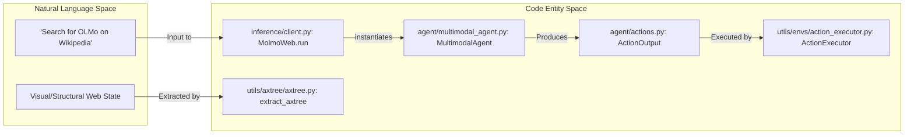

<!-- source: DeepWiki mcp.deepwiki.com · repo allenai/molmoweb · page 1 MolmoWeb Overview · fetched 2026-10-26 -->

# MolmoWeb Overview

<details>
<summary>Relevant source files</summary>

The following files were used as context for generating this wiki page:

- [README.md](README.md)
- [assets/logo.png](assets/logo.png)
- [demo.ipynb](demo.ipynb)
- [demo_task.json](demo_task.json)
- [pyproject.toml](pyproject.toml)

</details>


MolmoWeb is an open multimodal web agent developed by [Ai2](https://allenai.org). It is designed to autonomously navigate and interact with the web to complete natural-language tasks. By combining a multimodal vision-language model with a browser automation engine, MolmoWeb can perceive visual webpage states and execute actions like clicking, typing, and scrolling. [README.md:15-15]()

This repository provides the complete ecosystem for the agent, including the model server, inference client, action execution logic, and evaluation benchmarks. [README.md:15-15]()

## Core System Architecture

MolmoWeb operates using a split-process architecture. The system is divided into a **Model Server**, which typically runs on a GPU-enabled machine to handle heavy inference tasks, and an **Inference Client**, which manages the browser environment and agent logic. [README.md:101-110](), [README.md:164-166]()

### High-Level Component Interaction

The following diagram illustrates how the primary code entities interact during a single step of a web task.

**MolmoWeb Execution Flow**
```mermaid
graph TD
    subgraph "Client Side (Browser Machine)"
        [MolmoWeb_Client] -- "manages" --> [BrowserEnv]
        [MolmoWeb_Client] -- "runs" --> [AgentBase_Implementation]
        [AgentBase_Implementation] -- "sends observation" --> [InferenceBackend]
        [InferenceBackend] -- "returns action" --> [AgentBase_Implementation]
        [AgentBase_Implementation] -- "executes" --> [ActionExecutor]
        [ActionExecutor] -- "Playwright API" --> [BrowserEnv]
    end

    subgraph "Server Side (GPU Machine)"
        [FastAPI_Model_Server] -- "manages" --> [PredictorPool]
        [PredictorPool] -- "runs" --> [NativeActionPredictor]
    end

    [InferenceBackend] -- "REST /predict" --> [FastAPI_Model_Server]
```
Sources: [README.md:122-130](), [README.md:164-166](), [README.md:209-211]()

## Key Components

### 1. The Agent Layer
The agent layer defines the decision-making logic. The native `MultimodalAgent` uses MolmoWeb models to predict actions based on screenshots and task descriptions. The system also supports alternative agents backed by external LLM APIs (e.g., Gemini, GPT-4o) for comparison and benchmarking. [README.md:79-84](), [README.md:211-211]()

*   **Action Schema:** All agents output structured actions defined in the codebase, such as `Click`, `Type`, or `Scroll`.
*   **For details, see [Agent Layer](#2).**

### 2. Model Server & Inference Backends
The `FastAPI` model server acts as a remote inference provider. It hosts the model weights and exposes a `/predict` endpoint. On the client side, different `InferenceBackend` implementations handle the communication with the server or local model instances. [README.md:101-130](), [README.md:209-211]()

*   **Predictor Pool:** The server uses a pool of predictors (configured via `NUM_PREDICTORS`) to handle concurrent requests and manage GPU memory. [README.md:117-117]()
*   **For details, see [Model Server & Inference Backends](#3).**

### 3. Inference Client & Browser Environment
The `MolmoWeb` client is the primary entry point for users. It orchestrates the browser environment (using Playwright) to capture screenshots and extract accessibility trees (AXTree). It then passes this data to the agent and uses an action executor to perform the resulting actions in the browser. [README.md:164-184](), [README.md:218-220]()

*   **Deployment Modes:** Supports local Chromium instances or cloud-based browsers via `Browserbase`. [README.md:75-77](), [README.md:175-175]()
*   **For details, see [Inference Client](#4) and [Browser Environment & Action Execution](#5).**

## Data and Code Entity Mapping

The following diagram maps the conceptual "Natural Language Space" (user goals) to the "Code Entity Space" (specific classes and files) that process them.

**Conceptual to Code Mapping**

Sources: [README.md:170-184](), [README.md:218-220](), [demo.ipynb:24-30]()

## Getting Started

To begin using MolmoWeb, you must install the dependencies (including Playwright), download the model weights, and start the FastAPI server. [README.md:51-68](), [README.md:88-120]()

*   **Installation:** Uses `uv` for dependency management. [README.md:53-53](), [pyproject.toml:1-30]()
*   **Hardware:** Requires a GPU for the model server (e.g., MolmoWeb-8B). [README.md:38-41]()
*   **For details, see [Getting Started](#1.1).**

## System Architecture Deep-Dive

The system supports various deployment configurations, from running everything on a single local machine to distributed setups using Modal or Browserbase. [README.md:75-77](), [README.md:209-211]()

*   **For details, see [System Architecture](#1.2).**

---

