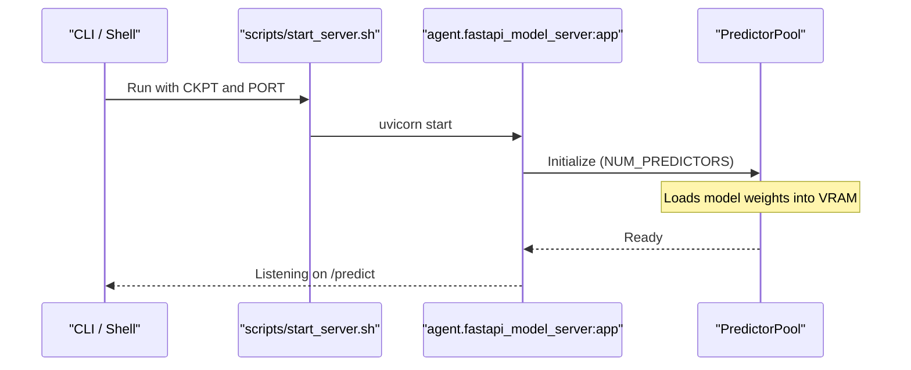
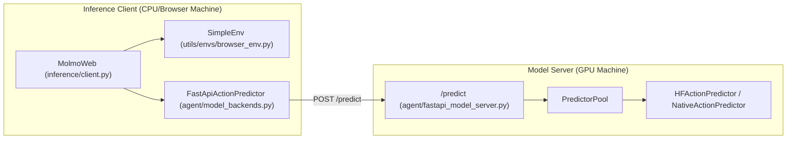

<!-- source: DeepWiki mcp.deepwiki.com · repo allenai/molmoweb · page 1.1 Getting Started · fetched 2026-10-26 -->

# Getting Started

<details>
<summary>Relevant source files</summary>

The following files were used as context for generating this wiki page:

- [.venv.lock](.venv.lock)
- [README.md](README.md)
- [demo.ipynb](demo.ipynb)
- [inference/.env.example](inference/.env.example)
- [pyproject.toml](pyproject.toml)
- [scripts/download_weights.sh](scripts/download_weights.sh)
- [scripts/start_server.sh](scripts/start_server.sh)

</details>


This page provides a technical step-by-step guide for setting up the MolmoWeb environment. It covers dependency installation, model weight management, server configuration, and initial verification.

## 1. Installation

MolmoWeb requires **Python 3.10+** and uses `uv` for fast, reliable dependency management [README.md:53-54](), [pyproject.toml:6-7]().

### Local Setup
1.  **Install uv**:
    ```bash
    curl -LsSf https://astral.sh/uv/install.sh | sh
    ```
2.  **Clone and Sync**:
    ```bash
    git clone git@github.com:allenai/molmoweb.git
    cd molmoweb
    uv venv --python ">=3.10,<3.13"
    uv sync
    ```
3.  **Install Playwright**:
    The agent requires Playwright to control the browser locally. You must install the browser binaries and their system dependencies [README.md:65-68]().
    ```bash
    uv run playwright install
    uv run playwright install --with-deps chromium
    ```

### Environment Variables
Configure your environment based on your deployment choice. These are typically set in a `.env` file or exported in your shell [README.md:72-84]().

| Variable | Purpose | Required For |
| :--- | :--- | :--- |
| `BROWSERBASE_API_KEY` | Cloud browser authentication | `--env_type browserbase` |
| `BROWSERBASE_PROJECT_ID` | Cloud browser project | `--env_type browserbase` |
| `GOOGLE_API_KEY` | Gemini model access | `gemini_cua`, `gemini_axtree` |
| `OPENAI_API_KEY` | GPT-4 model access | `gpt_axtree` |

**Sources:** [README.md:51-84](), [pyproject.toml:1-26]()

---

## 2. Downloading Model Weights

MolmoWeb supports several model variants, ranging from 4B to 8B parameters, in both HuggingFace-compatible and Molmo-native formats [README.md:36-43]().

The `scripts/download_weights.sh` script automates the download process using the `hf` CLI provided by the environment [scripts/download_weights.sh:18]().

| Model Alias | HuggingFace Path | Type |
| :--- | :--- | :--- |
| MolmoWeb-8B (Default) | `allenai/MolmoWeb-8B` | HF/Transformers |
| MolmoWeb-4B | `allenai/MolmoWeb-4B` | HF/Transformers |
| MolmoWeb-8B-Native | `allenai/MolmoWeb-8B-Native` | Native Checkpoint |
| MolmoWeb-4B-Native | `allenai/MolmoWeb-4B-Native` | Native Checkpoint |

**Usage:**
```bash
# Downloads to ./checkpoints/MolmoWeb-8B by default
bash scripts/download_weights.sh 

# Download specific native version
bash scripts/download_weights.sh allenai/MolmoWeb-4B-Native
```

**Sources:** [README.md:34-47](), [scripts/download_weights.sh:1-23]()

---

## 3. Starting the Model Server

The model server is a FastAPI application that wraps the model inference logic, allowing the browser client to stay lightweight while the heavy computation happens on a GPU-enabled machine [README.md:163]().

### Server Initialization Flow
The server uses `uvicorn` to host the application defined in `agent.fastapi_model_server:app` [scripts/start_server.sh:39]().

#### Model Server Startup Sequence


### Configuration
You can configure the server via CLI arguments or environment variables. CLI arguments take precedence over environment variables [scripts/start_server.sh:11-19]().

| Variable | Description | Default |
| :--- | :--- | :--- |
| `CKPT` | Path to local weights or HF ID | `allenai/MolmoWeb-8B` |
| `PREDICTOR_TYPE` | Inference backend (`native` or `hf`) | `native` |
| `NUM_PREDICTORS` | Number of GPU worker processes | `1` |
| `PORT` | Server port | `8001` |
| `TEMPERATURE` | Sampling temperature | `0.7` |
| `TOP_P` | Top-p sampling | `0.8` |

**Execution:**
```bash
# Start with local checkpoint and custom port
bash scripts/start_server.sh ./checkpoints/MolmoWeb-8B 8002
```

**Sources:** [scripts/start_server.sh:1-40](), [README.md:101-129]()

---

## 4. Verifying the Setup

Once the server is running, you should verify the end-to-end inference pipeline using the provided smoke test.

### Smoke Test Script
The `scripts/test_server.py` script performs the following:
1.  Encodes a local test image (`assets/test_screenshot.png`) to Base64 [README.md:152-153]().
2.  Sends a `POST` request to the `/predict` endpoint with a prompt [README.md:155-158]().
3.  Prints the model's structured response (thought and action).

```bash
uv run python scripts/test_server.py
```

### Manual Verification
You can also verify the endpoint via a simple Python snippet:
```python
import base64, requests
with open("assets/test_screenshot.png", "rb") as f:
    image_b64 = base64.b64encode(f.read()).decode()

resp = requests.post("http://127.0.0.1:8001/predict", json={
    "prompt": "What are the first four job titles listed under 'Open roles'?",
    "image_base64": image_b64,
})
print(resp.json())
```

**Sources:** [README.md:131-160]()

---

## 5. Running the Demo Notebook

The `demo.ipynb` notebook provides a high-level interface to the `MolmoWeb` client, demonstrating complex multi-step tasks like product discovery and parallel price comparison [demo.ipynb:9-15]().

### Client-Server Architecture
The `MolmoWeb` client manages the browser lifecycle while delegating vision-language reasoning to the model server.

#### Code Entity Mapping


### Demo Steps
1.  **Initialize Client**: Instantiate `MolmoWeb` with `local=True` to use the local Chromium instance [demo.ipynb:27-30]().
2.  **Single Query**: Run a task using `client.run()`. The agent will autonomously navigate and perform actions [demo.ipynb:58-59]().
3.  **Inspect Trajectory**: Access `traj.steps` to see the model's `thought` and the resulting `action` for any step [demo.ipynb:84-89]().
4.  **Follow-up Query**: Use `client.continue_run()` to maintain the browser state and history for a new task [README.md:188-191]().
5.  **Visualization**: The client can save the entire interaction as an interactive HTML file [README.md:182]().

**Sources:** [demo.ipynb:1-90](), [README.md:161-204]()

---

