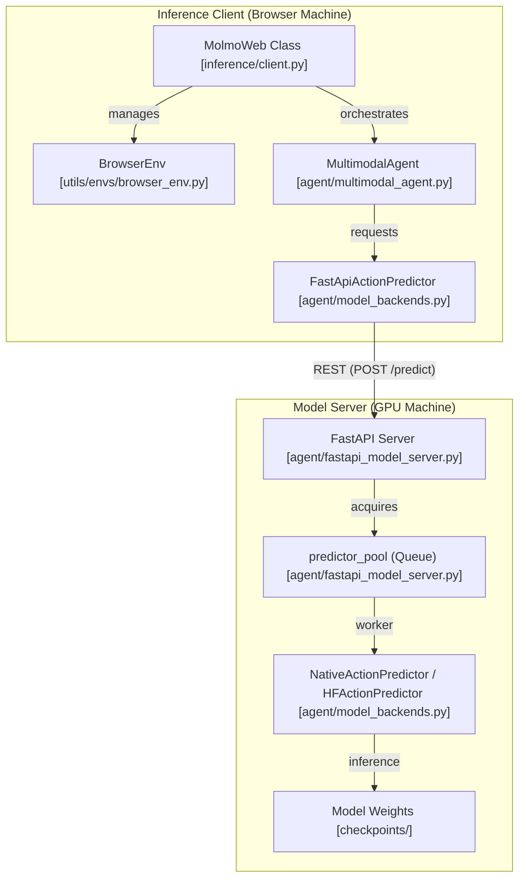
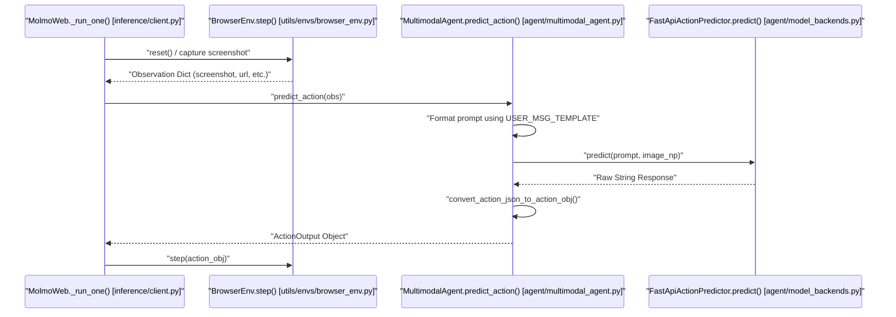

<!-- source: DeepWiki mcp.deepwiki.com · repo allenai/molmoweb · page 1.2 System Architecture · fetched 2026-10-26 -->

# System Architecture

Relevant source files

The following files were used as context for generating this wiki page:

- [README.md](README.md)
- [agent/fastapi_model_server.py](agent/fastapi_model_server.py)
- [agent/model_backends.py](agent/model_backends.py)
- [inference/client.py](inference/client.py)
- [scripts/start_server.sh](scripts/start_server.sh)

MolmoWeb employs a split-process architecture designed to decouple heavy GPU-bound model inference from the browser-bound agent logic. This separation allows the **Model Server** to run on specialized hardware (e.g., a GPU cluster or serverless provider) while the **Inference Client** manages the browser environment and state transitions on a standard machine.

## High-Level Architecture

The system is divided into two primary domains: the server-side infrastructure for model execution and the client-side infrastructure for web automation.

### Component Overview Diagram
This diagram illustrates the relationship between the core classes and their distribution across the network.

**Figure 1: Split-Process Architecture**

**Sources:** [inference/client.py:56-82](), [agent/fastapi_model_server.py:67-79](), [agent/model_backends.py:22-50](), [agent/fastapi_model_server.py:59-65]().

---

## Model Server (GPU)

The Model Server is a FastAPI-based application that wraps Molmo model checkpoints. It is designed for high-throughput and multi-GPU utilization through a predictor pool pattern.

### Key Implementation Details
*   **Predictor Pool:** The server initializes a `queue.Queue` of predictors via `create_predictor_pool` during startup. Each predictor is assigned to a specific CUDA device based on the `NUM_PREDICTORS` environment variable [agent/fastapi_model_server.py:26-56]().
*   **The `/predict` Endpoint:** This endpoint accepts a `PredictRequest` containing a `prompt`, `image_base64` screenshot, and an optional history of `past_actions` [agent/fastapi_model_server.py:70-79]().
*   **Stateless Inference with State Restoration:** While the model itself is stateless, the server supports per-request sampling parameters (`temperature`, `top_p`) by saving the predictor's defaults and restoring them after the `predict()` call [agent/fastapi_model_server.py:89-105]().
*   **Backend Support:** The server can be configured via `PREDICTOR_TYPE` to use either `NativeActionPredictor` (for OLMo-native checkpoints) or `HFActionPredictor` (for HuggingFace Transformers-compatible checkpoints) [agent/fastapi_model_server.py:42-51]().

**Sources:** [agent/fastapi_model_server.py:15-23](), [agent/fastapi_model_server.py:59-65](), [agent/fastapi_model_server.py:83-108](), [agent/model_backends.py:95-141]().

---

## Inference Client (Browser)

The Inference Client is the orchestrator of the web-agent loop. It manages the lifecycle of the browser, captures observations, and executes actions returned by the model.

### Data Flow & Execution Loop
The `MolmoWeb` class uses an internal `MultimodalAgent` to handle prompt construction and a `BrowserEnv` to handle the actual web interaction.

**Figure 2: Execution Loop and Code Entities**

**Sources:** [inference/client.py:155-175](), [agent/model_backends.py:33-49](), [inference/client.py:98-105]().

---

## Deployment Modes

MolmoWeb supports three primary deployment modes to accommodate different hardware and scaling requirements.

| Mode | Model Location | Browser Location | Implementation Class |
| :--- | :--- | :--- | :--- |
| **Local** | Local GPU (via FastAPI) | Local Chromium | `SimpleEnv` [inference/client.py:108-118]() |
| **Browserbase** | Remote GPU | Cloud Browser | `BrowserbaseEnv` [inference/client.py:120-129]() |
| **Modal** | Serverless GPU | Local/Cloud | `ModalActionPredictor` [agent/model_backends.py:56-89]() |

### Deployment Details
1.  **Local Mode:** Uses Playwright to launch a local Chromium instance. The client connects to a model server running on `localhost` (usually port 8001) [inference/client.py:71-80]().
2.  **Browserbase Mode:** Offloads the browser execution to the Browserbase cloud platform via `BrowserbaseEnv`. This is useful for avoiding bot detection and scaling many parallel browser sessions [inference/client.py:120-129]().
3.  **Modal Mode:** Utilizes the `ModalActionPredictor` to invoke model inference as a serverless function via a Modal endpoint, removing the need to maintain a long-running FastAPI server [agent/model_backends.py:56-61]().
4.  **Local Inference (No Server):** For development, `HFActionPredictor` or `NativeActionPredictor` can be used directly within the client process if a GPU is available locally, bypassing the REST layer [agent/model_backends.py:95-148]().

**Sources:** [README.md:164-184](), [inference/client.py:75-82](), [agent/model_backends.py:22-50](), [scripts/start_server.sh:7-16]().

---

