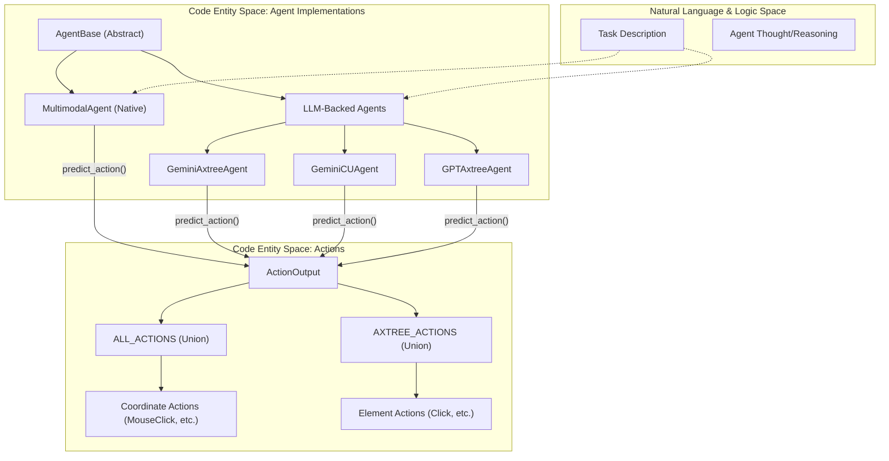
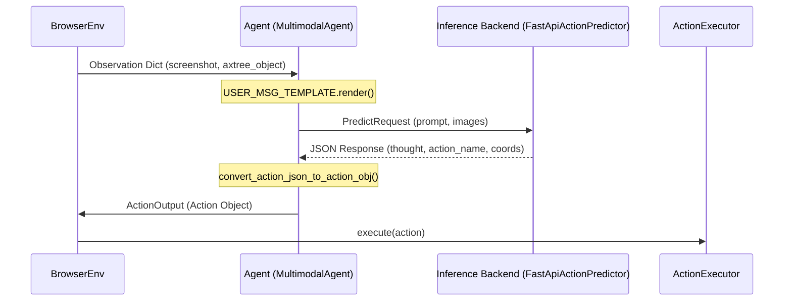

<!-- source: DeepWiki mcp.deepwiki.com · repo allenai/molmoweb · page 2 Agent Layer · fetched 2026-10-26 -->

# Agent Layer

Relevant source files

The following files were used as context for generating this wiki page:

- [agent/actions.py](agent/actions.py)
- [agent/gemini_axtree_agent.py](agent/gemini_axtree_agent.py)
- [agent/gemini_cua.py](agent/gemini_cua.py)
- [agent/gpt_axtree_agent.py](agent/gpt_axtree_agent.py)
- [agent/multimodal_agent.py](agent/multimodal_agent.py)
- [agent/utils.py](agent/utils.py)

The Agent Layer is the decision-making core of MolmoWeb. It abstracts the logic required to observe a web page, reason about a task goal, and produce a structured action. The system supports multiple agent implementations, ranging from the native Molmo-based multimodal agent to specialized agents backed by external LLMs like GPT-4o or Gemini.

### Core Abstractions

All agents in MolmoWeb inherit from the `AgentBase` abstract class [agent/utils.py:5-26](). This base class defines a standard interface for resetting agent state and predicting actions based on environment observations.

| Component | Description |
| :--- | :--- |
| `AgentBase` | Abstract base class defining `predict_action` and `reset` [agent/utils.py:5-26](). |
| `ActionOutput` | A Pydantic wrapper that pairs a predicted `action` with the agent's internal `thought` process [agent/actions.py:218-222](). |
| `ALL_ACTIONS` | A union type encompassing all valid action objects (Click, Type, Scroll, etc.) [agent/actions.py:225-241](). |

### Agent Subsystem Overview

The following diagram illustrates how the abstract agent interface is realized by different implementations and how they interact with the Action Schema.

**Agent Architecture & Code Entities**

**Sources:** [agent/utils.py:5-26](), [agent/multimodal_agent.py:162-205](), [agent/actions.py:218-241](), [agent/gemini_axtree_agent.py:135-138](), [agent/gemini_cua.py:191-198](), [agent/gpt_axtree_agent.py:135-141]()

---

### Action Schema
The Action Schema defines the "language" used by agents to interact with the browser. It includes coordinate-based actions (e.g., `MouseClick` at X, Y) and element-based actions (e.g., `Click` on a specific `bid`). The schema also defines the termination protocol via `Noop` and `ReportInfeasible` [agent/actions.py:202-216]().

For details, see [Action Schema](#2.1).

**Sources:** [agent/actions.py:10-216]()

---

### Multimodal Agent (MolmoWeb Native)
The `MultimodalAgent` is the primary implementation designed to work with Molmo models. It processes visual screenshots and textual task descriptions directly. A key responsibility of this agent is coordinate transformation: it converts model predictions (typically 0-100 percentages) into pixel coordinates using `_pct_to_coord` [agent/multimodal_agent.py:66-70]() and `_pct_to_px` [agent/multimodal_agent.py:62-63]() based on the screenshot dimensions.

For details, see [Multimodal Agent (MolmoWeb Native)](#2.2).

**Sources:** [agent/multimodal_agent.py:162-205](), [agent/multimodal_agent.py:73-147]()

---

### LLM-Backed Agents
MolmoWeb provides alternative agent implementations that use external APIs. These agents typically rely on the Accessibility Tree (AXTree) or specialized computer-use protocols.

*   **GeminiAxtreeAgent**: Uses Google's Gemini models with a flattened AXTree string and a two-step `[ANSWER]` / `[EXIT]` termination protocol [agent/gemini_axtree_agent.py:63-82]().
*   **GeminiCUAgent**: Utilizes the `gemini-2.5-computer-use-preview` model for direct coordinate interaction using a 0-999 normalized scale [agent/gemini_cua.py:71-79]().
*   **GPTAxtreeAgent**: Uses OpenAI's models with structured output parsing via `beta.chat.completions.parse` [agent/gpt_axtree_agent.py:65-74]().

For details, see [LLM-Backed Agents](#2.3).

**Sources:** [agent/gemini_axtree_agent.py:135-145](), [agent/gemini_cua.py:191-215](), [agent/gpt_axtree_agent.py:135-145]()

---

### System Data Flow

This diagram bridges the gap between the high-level task and the specific code entities involved in the prediction loop.

**Prediction Flow: Observation to Action**

**Sources:** [agent/multimodal_agent.py:42-59](), [agent/multimodal_agent.py:73-147](), [agent/multimodal_agent.py:228-260](), [agent/model_backends.py:126-140]()

---

