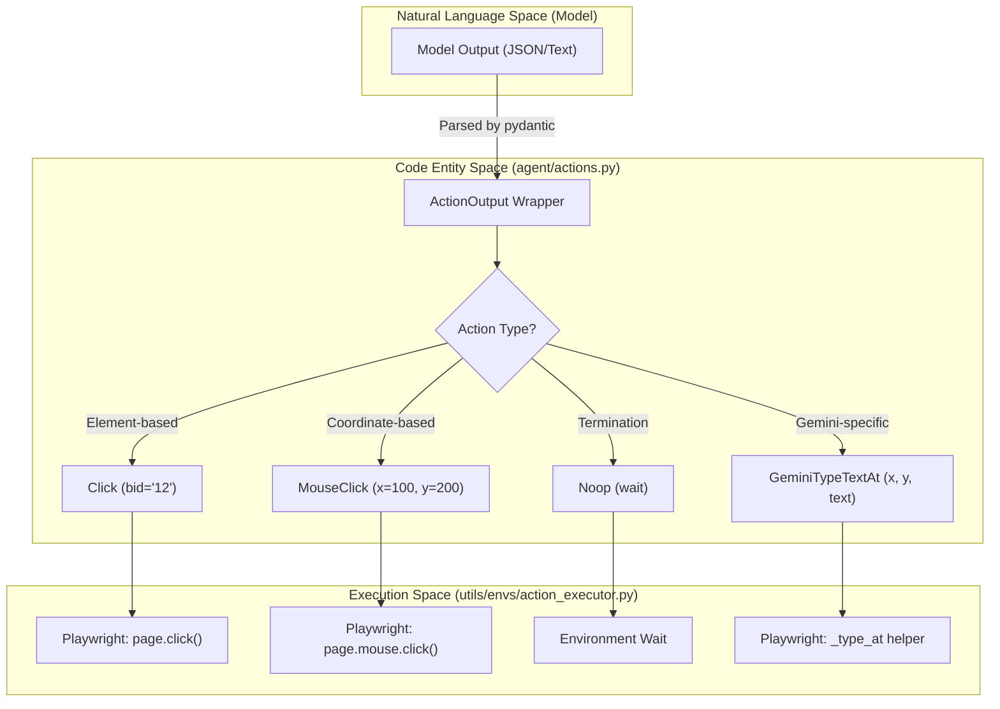
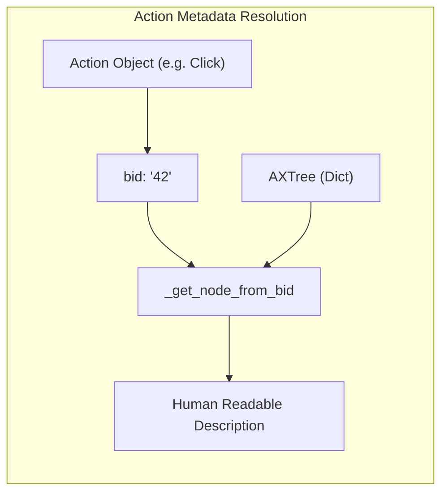

<!-- source: DeepWiki mcp.deepwiki.com · repo allenai/molmoweb · page 2.1 Action Schema · fetched 2026-10-26 -->

# Action Schema

Relevant source files

The following files were used as context for generating this wiki page:

- [agent/actions.py](agent/actions.py)

The Action Schema defines the formal language through which agents interact with the web environment. All actions are implemented as Pydantic models in `agent/actions.py`, providing structured validation and serialization for the split-process architecture.

## Overview of Action Types

Actions in MolmoWeb are categorized into two primary paradigms: **Element-based** (referencing specific nodes in the Accessibility Tree) and **Coordinate-based** (referencing pixel locations on the viewport).

### Element-Based Actions
These actions target elements using a `bid` (Backend ID), which is a unique identifier injected into the DOM and Accessibility Tree (AXTree) by the environment.

*   **`Click`**: Performs a click on a specific element identified by its `bid`. Supports `left`, `right`, and `middle` buttons, and `single` or `double` click types [agent/actions.py:10-17]().
*   **`Type`**: Targets a specific element by `bid` to type text. It includes options to `clear_before_typing` and `press_enter` after completion [agent/actions.py:218-223]().
*   **`Hover`**: Moves the mouse over a specific element by `bid` [agent/actions.py:236-240]().

### Coordinate-Based Actions
These actions interact with the page using raw pixel coordinates `(x, y)`. These are typically used by agents that process visual input directly (like Molmo or Gemini Computer Use).

*   **`MouseClick`**: A click at a specific pixel location [agent/actions.py:39-47]().
*   **`MouseMove` / `HoverAt`**: Moves the cursor to or hovers at a specific coordinate [agent/actions.py:60-76]().
*   **`MouseDragAndDrop`**: Drags from a starting `(x, y)` to a destination `(x, y)` [agent/actions.py:123-129]().
*   **`ScrollAt`**: Performs a scroll gesture starting at a specific pixel location [agent/actions.py:103-109]().
*   **`GeminiTypeTextAt`**: A specialized coordinate-based typing action used by Gemini agents that combines positioning, clearing, typing, and optionally pressing enter [agent/actions.py:170-177]().

### Browser & System Actions
*   **`Goto`**: Navigates the browser to a specific URL [agent/actions.py:188-191]().
*   **`BrowserNav`**: Executes browser-level commands like `back`, `forward`, or `reload` [agent/actions.py:202-205]().
*   **`Scroll`**: A global scroll action (not location-specific) [agent/actions.py:85-89]().
*   **`KeyboardPress`**: Presses specific keys or combinations (e.g., "Enter", "Control+L") [agent/actions.py:148-151]().
*   **`SelectAll`**: A specialized `KeyboardPress` wrapper for the "ControlOrMeta+a" shortcut [agent/actions.py:159-162]().

Sources: [agent/actions.py:10-240]()

---

## Action Wrappers and Unions

To handle the variety of possible outputs from different models, the codebase uses union types and wrapper classes.

### The ActionOutput Wrapper
The `ActionOutput` class acts as a container for the agent's response. It includes the action itself, the agent's internal reasoning, and an optional answer if the task is complete.

| Field | Type | Description |
| :--- | :--- | :--- |
| `action` | `ALL_ACTIONS` | The specific action object to execute. |
| `thought` | `str` | The agent's step-by-step reasoning. |
| `answer` | `str \| None` | The final answer to the user's request (if applicable). |

Sources: [agent/actions.py:291-295]()

### Union Types
The system defines two main union types to categorize actions based on the agent's capabilities:

1.  **`AXTREE_ACTIONS`**: Includes `Click`, `Type`, `Hover`, `Goto`, `BrowserNav`, `Scroll`, `KeyboardPress`, `Noop`, and `ReportInfeasible`. This set is used by agents that rely on the Accessibility Tree [agent/actions.py:307-318]().
2.  **`ALL_ACTIONS`**: A superset including all `AXTREE_ACTIONS` plus coordinate-based actions like `MouseClick`, `MouseMove`, `HoverAt`, `MouseDragAndDrop`, and `GeminiTypeTextAt` [agent/actions.py:321-336]().

---

## Termination Protocol

MolmoWeb uses a specific protocol to signal the end of a trajectory or the inability to proceed.

### Noop (No Operation)
The `Noop` action is used when the agent believes the task is finished or it needs to wait for a page state to change.
*   **Implementation**: `Noop` triggers a wait period (default `NOOP_WAIT_MS = 5000`) [agent/actions.py:7, 252-255]().
*   **Termination**: If an agent provides an `answer` alongside a `Noop`, the `ActionExecutor` treats this as a successful completion of the task [agent/actions.py:291-295]().

### ReportInfeasible
If the agent determines the user's request cannot be fulfilled (e.g., a missing button or a broken link), it returns `ReportInfeasible`.
*   **Fields**: Contains a `reason` string explaining why the task failed [agent/actions.py:269-272]().

Sources: [agent/actions.py:7, 252-272, 291-295]()

---

## Data Flow: From Model Output to Execution

The following diagram illustrates how a natural language thought process is transformed into a validated code entity and finally executed.

### Action Transformation Pipeline
"Natural Language Space to Code Entity Space"

Sources: [agent/actions.py:10-58, 170-177, 252-255, 291-295]()

---

## Implementation Details

### Coordinate Handling
Coordinate-based actions (`MouseClick`, `MouseMove`, etc.) use raw pixel values. However, the `NativeActionPredictor` and certain agents may work with percentage-based coordinates (0-1000) which are scaled to the actual viewport size before being encapsulated in these Pydantic models.

### String Representation and Descriptions
Every action class implements `__str__` for logging and `describe()` for generating human-readable summaries of the agent's steps. The `describe()` method for element-based actions can optionally take an `axtree` to resolve a `bid` into a descriptive name (e.g., "button 'Submit'") [agent/actions.py:23-37, 53-57]().

### Element Resolution Helper
The private function `_get_node_from_bid` is used internally by the `describe()` methods to traverse the AXTree dictionary and find the node metadata associated with a specific `bid` [agent/actions.py:343-353]().

Sources: [agent/actions.py:26-31, 343-353]()

---

