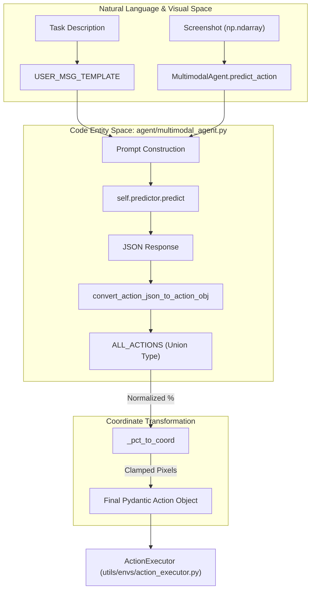
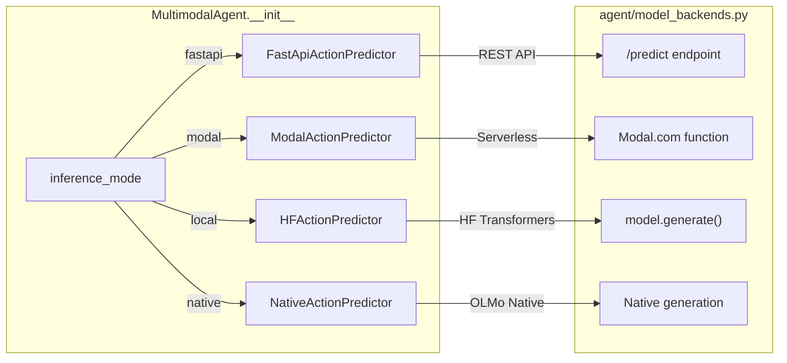

<!-- source: DeepWiki mcp.deepwiki.com · repo allenai/molmoweb · page 2.2 Multimodal Agent (MolmoWeb Native) · fetched 2026-10-26 -->

# Multimodal Agent (MolmoWeb Native)

Relevant source files

The following files were used as context for generating this wiki page:

- [agent/actions.py](agent/actions.py)
- [agent/multimodal_agent.py](agent/multimodal_agent.py)
- [agent/utils.py](agent/utils.py)

The `MultimodalAgent` is the core implementation for the native MolmoWeb model. Unlike LLM-backed agents that rely on text-based accessibility trees (AXTrees), the `MultimodalAgent` is designed to process visual screenshots directly alongside task descriptions and action history. It manages the transformation of model-predicted percentage coordinates into pixel-perfect browser actions and handles the stateful history of the agent's trajectory.

## Overview of MultimodalAgent

The `MultimodalAgent` class inherits from the abstract `AgentBase` [agent/utils.py:5-26]() and implements a stateful loop for web navigation. It maintains a history of `past_actions` and `past_observations` [agent/multimodal_agent.py:185-186]() to provide context for the next prediction.

### Key Responsibilities
*   **Prompt Construction**: Building the `USER_MSG_TEMPLATE` with task goals and history [agent/multimodal_agent.py:42-59]().
*   **Coordinate Transformation**: Converting the model's normalized 0-100 coordinates into viewport pixels using `_pct_to_coord` [agent/multimodal_agent.py:66-70]().
*   **Action Parsing**: Translating JSON output from the inference backend into Pydantic action objects via `convert_action_json_to_action_obj` [agent/multimodal_agent.py:73-147]().
*   **Backend Dispatch**: Routing requests to various inference engines (FastAPI, Modal, Local HF, or Native) [agent/multimodal_agent.py:188-215]().

### Multimodal Agent Data Flow

The following diagram illustrates how the `MultimodalAgent` bridges the gap between raw browser observations and the structured actions executed by the system.

**Data Flow: Observation to Action**

**Sources:** [agent/multimodal_agent.py:42-148](), [agent/multimodal_agent.py:228-260](), [agent/actions.py:261-285]()

---

## Prompt Engineering & History Management

The agent uses a structured Jinja2 template, `USER_MSG_TEMPLATE`, to format the input for the model. This template includes the goal, a history of previous steps, and metadata about the currently active page [agent/multimodal_agent.py:42-59]().

### USER_MSG_TEMPLATE Structure
| Section | Content | Source |
| :--- | :--- | :--- |
| **# GOAL** | The high-level task description provided by the user. | `task_description` [agent/multimodal_agent.py:45]() |
| **# PREVIOUS STEPS** | A list of prior thoughts and actions, limited by `max_past_steps`. | `past_actions` [agent/multimodal_agent.py:48-52]() |
| **# CURRENTLY ACTIVE PAGE** | Title, URL, and index of the browser tab. | `page_title`, `page_url`, `page_index` [agent/multimodal_agent.py:54]() |

The agent limits history using `max_past_steps` (default 3) and `max_past_images` (default 0) to prevent context window overflow and reduce latency [agent/multimodal_agent.py:170-171]().

**Sources:** [agent/multimodal_agent.py:42-59](), [agent/multimodal_agent.py:230-245]()

---

## Coordinate Transformation

The native Molmo model predicts locations as percentages (0.0 to 100.0) relative to the image dimensions. The agent provides two utility functions to map these back to the browser viewport:

1.  **`_pct_to_px(pct, dim)`**: A simple linear scaling used for relative movements like scrolling [agent/multimodal_agent.py:62-63]().
2.  **`_pct_to_coord(pct, dim)`**: A robust scaling function for absolute coordinates (clicks, hovers). It clamps the resulting pixel value to `[1.0, dim - 2.0]` to ensure that even if the model predicts exactly `0` or `100`, the action lands inside the clickable area of the viewport [agent/multimodal_agent.py:66-70]().

**Sources:** [agent/multimodal_agent.py:62-71]()

---

## Action Parsing Logic

The function `convert_action_json_to_action_obj` is the central dispatcher that converts the model's raw JSON output into the typed action objects defined in `agent/actions.py`.

### Mapping Table
| Model JSON `name` | Pydantic Class | Logic / Transformations |
| :--- | :--- | :--- |
| `click`, `dblclick`, `mouse_click` | `MouseClick` | Converts `x`, `y` via `_pct_to_coord`. Supports `button` and `click_type`. [agent/multimodal_agent.py:88-94]() |
| `hover_at` | `HoverAt` | Converts `x`, `y` via `_pct_to_coord`. [agent/multimodal_agent.py:95-100]() |
| `drag_and_drop` | `MouseDragAndDrop` | Converts `from` and `to` coordinates. [agent/multimodal_agent.py:101-107]() |
| `type`, `keyboard_type`| `KeyboardType` | Extracts `text` string. [agent/multimodal_agent.py:120-121]() |
| `keypress`, `keyboard_press` | `KeyboardPress` | Validates key against `ALLOWED_KEYS`. [agent/multimodal_agent.py:122-127]() |
| `scroll` | `Scroll` | Converts `delta_x`, `delta_y` via `_pct_to_px`. [agent/multimodal_agent.py:108-112]() |
| `goto` | `Goto` | Extracts target `url`. [agent/multimodal_agent.py:136-137]() |
| `noop` | `Noop` | Captures `noop_reason` (e.g., "loading"). [agent/multimodal_agent.py:142-143]() |

If an action is unsupported or the JSON is malformed, the agent returns a `ReportInfeasible` object with a detailed reason [agent/multimodal_agent.py:144-147]().

**Sources:** [agent/multimodal_agent.py:73-148](), [agent/actions.py:10-258]()

---

## Inference Backends & Dispatch

The `MultimodalAgent` does not run inference itself; it delegates to a `predictor` object based on the `inference_mode` [agent/multimodal_agent.py:188-215]().

**Backend Selection Logic**

**Sources:** [agent/multimodal_agent.py:188-215](), [agent/model_backends.py:1-20]()

### Execution Cycle in `predict_action`

When `predict_action` is called with a browser observation [agent/multimodal_agent.py:228](), the following steps occur:

1.  **State Capture**: Extracts current URL, title, and tab index from the observation dictionary [agent/multimodal_agent.py:231-235]().
2.  **Prompting**: Renders the `USER_MSG_TEMPLATE` with the current task, truncated URLs, and history [agent/multimodal_agent.py:240-252]().
3.  **Inference**: Calls `self.predictor.predict(...)` with the prompt and the current screenshot [agent/multimodal_agent.py:254-260]().
4.  **Conversion**: Passes the resulting JSON to `convert_action_json_to_action_obj` along with the screenshot for coordinate scaling [agent/multimodal_agent.py:262]().
5.  **History Update**: Appends the predicted thought and action to `self.past_actions` and maintains `past_observations` [agent/multimodal_agent.py:270-280]().

**Sources:** [agent/multimodal_agent.py:228-285]()

---

