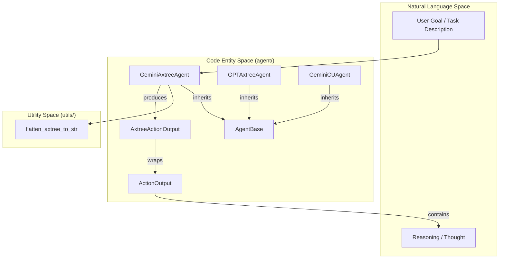
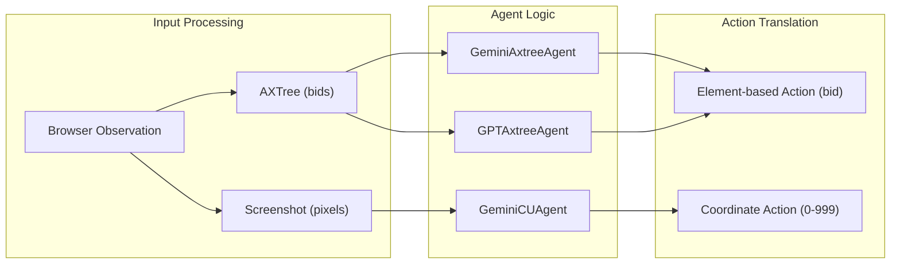

<!-- source: DeepWiki mcp.deepwiki.com · repo allenai/molmoweb · page 2.3 LLM-Backed Agents · fetched 2026-10-26 -->

# LLM-Backed Agents

Relevant source files

The following files were used as context for generating this wiki page:

- [agent/gemini_axtree_agent.py](agent/gemini_axtree_agent.py)
- [agent/gemini_cua.py](agent/gemini_cua.py)
- [agent/gpt_axtree_agent.py](agent/gpt_axtree_agent.py)
- [agent/utils.py](agent/utils.py)

The MolmoWeb framework provides three alternative agent implementations that utilize external Large Language Model (LLM) APIs—specifically from Google (Gemini) and OpenAI (GPT). These agents serve as high-performance alternatives to the native multimodal model, leveraging specialized features like structured JSON outputs or native "Computer Use" capabilities to navigate the web.

## Overview of Agent Implementations

While the native `MultimodalAgent` processes visual screenshots directly, the LLM-backed agents primarily interact with the page via a flattened Accessibility Tree (AXTree) or through specialized API-level tool calls.

| Agent Class | LLM Provider | Primary Input | Output Mechanism |
| :--- | :--- | :--- | :--- |
| `GeminiAxtreeAgent` | Google Gemini | Flattened AXTree (Text) | Structured JSON (Response Schema) |
| `GeminiCUAgent` | Google Gemini | Screenshot + Tools | Native Computer Use Tool Calls |
| `GPTAxtreeAgent` | OpenAI GPT | Flattened AXTree (Text) | Structured Outputs (`beta.chat.completions.parse`) |

### Shared Patterns

All LLM-backed agents inherit from the `AgentBase` abstract class [agent/utils.py:5-26](). They follow a common execution loop where observations from the `BrowserEnv` are transformed into a prompt, sent to an API, and the resulting action is parsed into an `ActionOutput` object.

Key shared features include:
*   **AXTree Flattening**: Both `GeminiAxtreeAgent` and `GPTAxtreeAgent` use `flatten_axtree_to_str` to convert the DOM into a text representation where elements are identified by "bids" (Backend IDs) [agent/gemini_axtree_agent.py:5](), [agent/gpt_axtree_agent.py:5](), [agent/gpt_axtree_agent.py:79-88]().
*   **Termination Protocol**: These agents typically use a two-step termination sequence: first sending an `[ANSWER]` via `send_msg_to_user`, followed by an `[EXIT]` signal [agent/gemini_axtree_agent.py:63-82]().
*   **System Prompting**: They share a common `SYSTEM_MESSAGE` that defines navigation guidelines, constraints on "thoughts" (reasoning), and efficiency requirements [agent/gemini_axtree_agent.py:12-102](), [agent/gpt_axtree_agent.py:11]().

### Agent Architecture to Code Mapping

The following diagram illustrates how the abstract agent concepts map to specific classes and utility functions within the codebase.

**LLM Agent Entity Mapping**

**Sources:** [agent/utils.py:5-26](), [agent/gemini_axtree_agent.py:1-11](), [agent/gpt_axtree_agent.py:135-141](), [agent/gemini_cua.py:191-198]()

---

## GeminiAxtreeAgent

The `GeminiAxtreeAgent` uses the Google Gemini API to process a text-based representation of the web page. It relies heavily on a structured system message that instructs the model to use element IDs (bids) for interaction [agent/gemini_axtree_agent.py:12-22](). It uses a specific `response_schema` (defined via `AxtreeActionOutput`) to ensure the model returns valid JSON that maps directly to `AXTREE_ACTIONS`.

For details, see [GeminiAxtreeAgent](#2.3.1).

**Sources:** [agent/gemini_axtree_agent.py:12-102](), [agent/gemini_axtree_agent.py:136-140]()

---

## GeminiCUAgent (Computer Use)

The `GeminiCUAgent` leverages the `gemini-2.5-computer-use-preview` model [agent/gemini_cua.py:195](). Unlike the AXTree-based agents, this agent operates on a 0-999 coordinate system and uses native API tool calls (`computer_use` tools) to perform actions like `click_at`, `type_text_at`, and `scroll_at` [agent/gemini_cua.py:205-215](). It manages a multi-turn history of `Content` objects, including screenshots and function responses [agent/gemini_cua.py:216-217]().

For details, see [GeminiCUAgent (Computer Use)](#2.3.2).

**Sources:** [agent/gemini_cua.py:193-215](), [agent/gemini_cua.py:71-80](), [agent/gemini_cua.py:108-189]()

---

## GPTAxtreeAgent

The `GPTAxtreeAgent` utilizes OpenAI's GPT models (defaulting to `gpt-5` or as configured via `GPT_AXTREE_MODEL`) through the `beta.chat.completions.parse` method [agent/gpt_axtree_agent.py:13-14](), [agent/gpt_axtree_agent.py:65-72](). It shares the same system message and AXTree filtering strategy as the Gemini AXTree agent but implements a specific error feedback loop that passes `last_action_error` back into the user prompt to handle execution failures [agent/gpt_axtree_agent.py:105-109]().

For details, see [GPTAxtreeAgent](#2.3.3).

**Sources:** [agent/gpt_axtree_agent.py:13-14](), [agent/gpt_axtree_agent.py:65-72](), [agent/gpt_axtree_agent.py:105-109]()

---

## Comparison of Action Logic

The following diagram shows how actions are dispatched differently between the AXTree-based agents (which use element IDs) and the Computer Use agent (which uses normalized coordinates).

**Action Dispatch Flow**

**Sources:** [agent/gemini_axtree_agent.py:136-140](), [agent/gpt_axtree_agent.py:159-170](), [agent/gemini_cua.py:108-112]()

---

