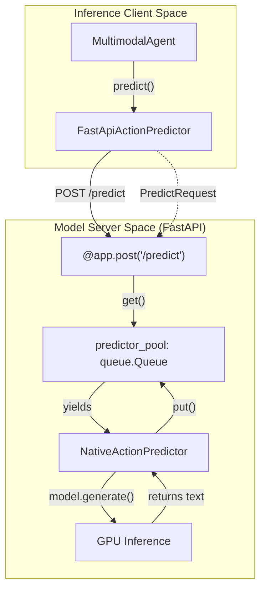
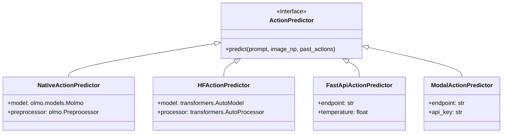

<!-- source: DeepWiki mcp.deepwiki.com · repo allenai/molmoweb · page 3 Model Server & Inference Backends · fetched 2026-10-26 -->

# Model Server & Inference Backends

Relevant source files

The following files were used as context for generating this wiki page:

- [agent/fastapi_model_server.py](agent/fastapi_model_server.py)
- [agent/model_backends.py](agent/model_backends.py)
- [scripts/start_server.sh](scripts/start_server.sh)
- [scripts/test_server.py](scripts/test_server.py)

The MolmoWeb system separates high-resource inference tasks from the browser-based agent logic. This is achieved through a server-side infrastructure that manages GPU-accelerated model instances and provides a unified interface for action prediction. The system supports multiple execution environments, ranging from local HuggingFace transformers to remote serverless deployments.

## High-Level Architecture

The inference infrastructure is built around a "Predictor" abstraction. Whether the model is running locally on a GPU or via a remote API, the agent interacts with it through a consistent interface. The system is designed to be backend-agnostic, allowing the same agent logic to work across different hardware configurations.

### Inference Data Flow
The following diagram illustrates how a prediction request moves from the `MultimodalAgent` through the `FastApiActionPredictor` (client-side) to the `FastAPI` server and finally to a `NativeActionPredictor` instance on the GPU.

**Prediction Pipeline: Agent to GPU**

**Sources:** [agent/fastapi_model_server.py:78-108](), [agent/model_backends.py:22-50](), [agent/fastapi_model_server.py:34-56]()

## FastAPI Model Server

The `fastapi_model_server.py` provides a production-ready wrapper around the inference backends. It is designed to maximize GPU utilization by managing a pool of predictors across available CUDA devices.

Key features include:
*   **Predictor Pool:** Uses a `queue.Queue` to manage multiple model instances, allowing concurrent requests to be served if multiple GPUs or instances are configured via `NUM_PREDICTORS` [agent/fastapi_model_server.py:19-34]().
*   **State Management:** Implements a save-and-restore pattern for sampling parameters (`temperature`, `top_p`) to ensure that per-request settings do not permanently alter the predictor's base configuration [agent/fastapi_model_server.py:89-105]().
*   **Configuration:** Managed entirely via environment variables such as `CKPT`, `PREDICTOR_TYPE`, and `NUM_PREDICTORS` [agent/fastapi_model_server.py:15-23]().
*   **Deployment:** Can be launched using the `scripts/start_server.sh` utility, which configures `uvicorn` and sets default sampling parameters [scripts/start_server.sh:18-39]().

For a deep dive into the server implementation and configuration, see [FastAPI Model Server](#3.1).

## Inference Backends

The system defines four distinct backend implementations in `agent/model_backends.py`. Each backend implements a `predict` method that accepts a prompt and an image (as a NumPy array) and returns a string containing the predicted action.

| Backend Class | Type | Description |
| :--- | :--- | :--- |
| `NativeActionPredictor` | Local GPU | Uses native `olmo` libraries and `load_model_state` for high-performance inference [agent/model_backends.py:148-173](). |
| `HFActionPredictor` | Local GPU | Uses HuggingFace `transformers` and `AutoModelForImageTextToText` [agent/model_backends.py:95-112](). |
| `FastApiActionPredictor` | Remote | A client-side proxy that communicates with the FastAPI model server via HTTP `POST` [agent/model_backends.py:22-42](). |
| `ModalActionPredictor` | Serverless | Connects to a serverless deployment hosted on the Modal platform using `pil_image_to_base64` [agent/model_backends.py:56-75](). |

### Backend Class Hierarchy
The backends are designed with "lazy imports" [agent/model_backends.py:5-6]() to ensure that heavy dependencies like `torch` or `olmo` are only loaded when a specific backend is instantiated.

**Predictor Implementation Map**

**Sources:** [agent/model_backends.py:1-156]()

For details on coordinate scaling, sampling parameters, and specific backend logic, see [Inference Backends](#3.2).

---

