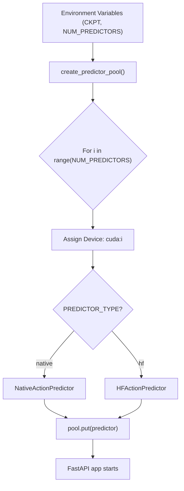
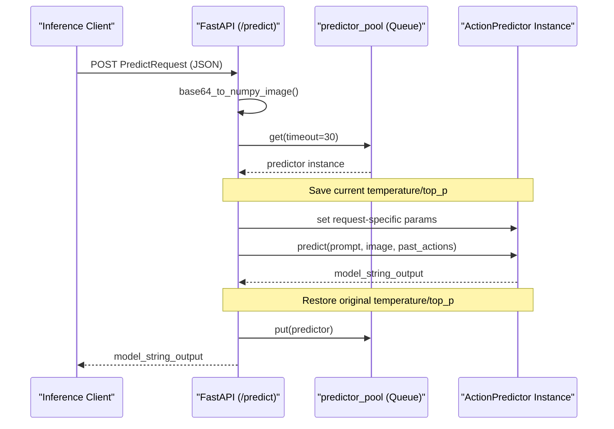

<!-- source: DeepWiki mcp.deepwiki.com · repo allenai/molmoweb · page 3.1 FastAPI Model Server · fetched 2026-10-26 -->

# FastAPI Model Server

<details>
<summary>Relevant source files</summary>

The following files were used as context for generating this wiki page:

- [agent/fastapi_model_server.py](agent/fastapi_model_server.py)
- [scripts/start_server.sh](scripts/start_server.sh)
- [scripts/test_server.py](scripts/test_server.py)

</details>


The FastAPI Model Server is a high-performance inference wrapper designed to serve Molmo models over HTTP. It is typically deployed on a GPU-enabled machine to handle the heavy lifting of multimodal inference while exposing a simple REST API to the inference client. It manages a pool of predictor instances, allowing for concurrent request handling across multiple GPUs or multiple instances on a single GPU.

## System Configuration and Environment

The server is configured primarily through environment variables, which are often set via the `scripts/start_server.sh` utility script [scripts/start_server.sh:18-26](). Before any model imports occur, the server sets a default `MOLMO_DATA_DIR` to ensure model artifacts are stored in a consistent location [agent/fastapi_model_server.py:4]().

| Variable | Description | Default |
| :--- | :--- | :--- |
| `CKPT` | Path to local model weights or HuggingFace model ID. | `allenai/MolmoWeb-8B` |
| `NUM_PREDICTORS` | Number of model instances to load into the pool. | `1` |
| `PREDICTOR_TYPE` | Backend implementation: `native` (OLMo native) or `hf` (Transformers). | `native` |
| `TEMPERATURE` | Default sampling temperature for the model. | `0.7` |
| `TOP_P` | Default top-p sampling value. | `0.8` |
| `PORT` | The port on which the FastAPI server listens. | `8001` |

**Sources:** [agent/fastapi_model_server.py:4](), [agent/fastapi_model_server.py:15-23](), [scripts/start_server.sh:18-26]()

## Predictor Pool Initialization

Upon startup, the server initializes a `queue.Queue` containing `NUM_PREDICTORS` instances of the chosen backend [agent/fastapi_model_server.py:34-56](). This pool facilitates CUDA device assignment: each predictor in the loop is assigned to a specific device index (e.g., `cuda:0`, `cuda:1`) based on its position in the pool [agent/fastapi_model_server.py:39-40]().

### Data Flow: Server Initialization
The following diagram illustrates how environment variables and the `create_predictor_pool` function transform into a running service.

**Model Server Startup Flow**

**Sources:** [agent/fastapi_model_server.py:26-65](), [agent/fastapi_model_server.py:67]()

## The `/predict` Endpoint

The primary interface for the server is the `POST /predict` endpoint [agent/fastapi_model_server.py:78](). It accepts a structured JSON payload and returns the raw string output from the model.

### Request Schema: `PredictRequest`
The endpoint uses a Pydantic model to validate incoming data [agent/fastapi_model_server.py:70-75]():
*   `prompt` (str): The text instruction for the model.
*   `image_base64` (str): A base64-encoded screenshot.
*   `past_actions` (list | None): Optional history of previous actions for context.
*   `temperature` (float | None): Request-specific sampling temperature.
*   `top_p` (float | None): Request-specific top-p sampling.

### Save-and-Restore Pattern
To support request-specific sampling parameters without permanently altering the state of a shared predictor in the pool, the server implements a "save-and-restore" pattern [agent/fastapi_model_server.py:89-105]():
1.  **Acquire**: A predictor is pulled from `predictor_pool` with a 30-second timeout [agent/fastapi_model_server.py:84]().
2.  **Save**: Current `temperature` and `top_p` values of the predictor are stored in a temporary dictionary [agent/fastapi_model_server.py:89-92]().
3.  **Override**: If the request provides new values, they are applied to the predictor instance [agent/fastapi_model_server.py:93-96]().
4.  **Execute**: `predictor.predict()` is called with the prompt, converted image, and history [agent/fastapi_model_server.py:99]().
5.  **Restore**: In a `finally` block, the original values are written back to the predictor to ensure consistency for the next request [agent/fastapi_model_server.py:102-105]().
6.  **Release**: The predictor is returned to the pool [agent/fastapi_model_server.py:107]().

**Sources:** [agent/fastapi_model_server.py:70-108]()

## Request Lifecycle Diagram

This diagram maps the HTTP request handling to the internal logic of `agent/fastapi_model_server.py`.

**Predict Request Execution**

**Sources:** [agent/fastapi_model_server.py:78-108](), [agent/model_backends.py:11](), [utils/vis_utils/image.py:12]()

## Deployment and Testing

### Starting the Server
The server is typically launched using `uvicorn`. The helper script `scripts/start_server.sh` provides a convenient wrapper that sets up environment variables before executing the server [scripts/start_server.sh:18-39]():
```bash
# Start with default 8B model on port 8001
bash scripts/start_server.sh

# Start with 4B model on port 8002
bash scripts/start_server.sh allenai/MolmoWeb-4B 8002
```

### Testing Connection
A smoke test script is provided in `scripts/test_server.py`. It reads a local `test_screenshot.png`, encodes it to base64, and sends it to the `/predict` endpoint with a sample prompt about job titles [scripts/test_server.py:20-44](). It then prints the JSON response returned by the model [scripts/test_server.py:52]().

**Sources:** [scripts/start_server.sh:39](), [scripts/test_server.py:17-56]()

---

