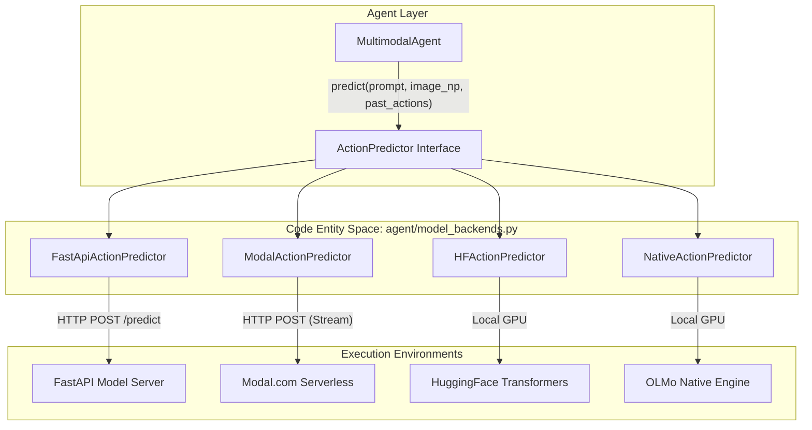
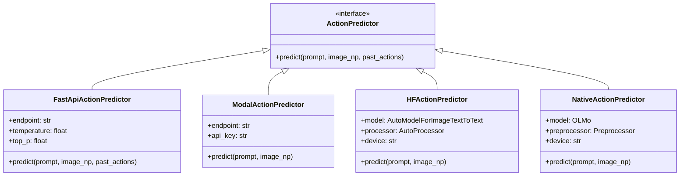

<!-- source: DeepWiki mcp.deepwiki.com · repo allenai/molmoweb · page 3.2 Inference Backends · fetched 2026-10-26 -->

# Inference Backends

Relevant source files

The following files were used as context for generating this wiki page:

- [agent/model_backends.py](agent/model_backends.py)

The MolmoWeb architecture decouples the agent logic from the model execution via a set of predictor classes. All inference backends are defined in `agent/model_backends.py` and implement a standardized `predict` interface. This allows the `MultimodalAgent` to remain agnostic of whether the model is running locally on a GPU, inside a serverless container, or behind a remote REST API.

To minimize environment overhead, all heavy dependencies (such as `torch`, `olmo`, or `transformers`) are imported lazily within the class methods rather than at the module level [agent/model_backends.py:4-6]().

## Backend Architecture Overview

The following diagram illustrates how the `MultimodalAgent` interacts with the various backend implementations to transform visual observations and prompts into action strings.

### Data Flow: Agent to Backend

Sources: [agent/model_backends.py:1-6](), [agent/model_backends.py:22-186]()

---

## 1. FastApiActionPredictor (Remote HTTP)

The `FastApiActionPredictor` is the primary backend used in the split-process architecture where the agent runs on a client (e.g., a laptop) and the model runs on a remote GPU server [agent/model_backends.py:22-28]().

- **Implementation**: It serializes the `numpy` image to a Base64 string using `utils.vis_utils.image.image_to_base64` and sends a JSON payload to the `/predict` endpoint [agent/model_backends.py:33-36]().
- **Parameters**: Supports `temperature` and `top_p` sampling parameters passed during initialization and included in the HTTP payload [agent/model_backends.py:30-40]().
- **Data Flow**:
    1. Agent calls `predict()`.
    2. Image is converted to Base64 via `image_to_base64` [agent/model_backends.py:34-36]().
    3. `requests.post` is sent to `{endpoint}/predict` with the JSON payload [agent/model_backends.py:42]().
    4. JSON response is returned as a string [agent/model_backends.py:46]().

Sources: [agent/model_backends.py:22-50]()

---

## 2. ModalActionPredictor (Serverless)

This backend interfaces with the [Modal](https://modal.com) serverless platform, allowing for on-demand GPU inference without maintaining a persistent server [agent/model_backends.py:56-59]().

- **Streaming**: Unlike the FastAPI backend, this implementation handles a streaming response. It iterates over lines in the response via `resp.iter_lines()`, parsing each chunk to reconstruct the final output text [agent/model_backends.py:81-84]().
- **Authentication**: Supports optional API keys via the `Authorization: Bearer` header [agent/model_backends.py:65-66]().
- **Data Conversion**: Uses `pil_image_to_base64` to encode the screenshot after converting the numpy array to a PIL Image [agent/model_backends.py:62, 72]().

Sources: [agent/model_backends.py:56-89]()

---

## 3. HFActionPredictor (HuggingFace Transformers)

The `HFActionPredictor` uses the standard HuggingFace `transformers` library to load the model. This is useful for users who want to run the model locally using the official library integration [agent/model_backends.py:95-99]().

- **Model Loading**: Uses `AutoProcessor` and `AutoModelForImageTextToText` with `trust_remote_code=True`. It defaults to `sdpa` (Scaled Dot Product Attention) for efficiency [agent/model_backends.py:105-111]().
- **Inference Pipeline**:
    1. Wraps prompt and image into a "user" role message [agent/model_backends.py:119-122]().
    2. Calls `process_vision_info` from `molmo_utils` to prepare image tensors [agent/model_backends.py:116, 123]().
    3. Disables `return_mm_token_type_ids` during processing because Molmo uses pure causal attention rather than bidirectional image tokens [agent/model_backends.py:127-128]().
    4. Calls `model.generate()` with `do_sample` logic based on whether `top_p` is provided [agent/model_backends.py:130-137]().

Sources: [agent/model_backends.py:95-143]()

---

## 4. NativeActionPredictor (OLMo Native)

The `NativeActionPredictor` uses the internal `olmo` library directly. This backend provides the most control over the model's execution and is used when performance or specific OLMo native features are required [agent/model_backends.py:148-156]().

- **Initialization**:
    - Sets `MOLMO_DATA_DIR` for caching model data [agent/model_backends.py:159-162]().
    - Resolves bare HF repo IDs (e.g., "allenai/MolmoWeb-8B-Native") to local snapshots using `snapshot_download` [agent/model_backends.py:177-180]().
    - Loads the model configuration from `config.yaml` using `BaseModelConfig` [agent/model_backends.py:182-183]().
- **Loading Strategy**: Uses a "meta" device initialization followed by `to_empty` and `load_model_state` to efficiently load weights without doubling memory usage [agent/model_backends.py:185-188]().
- **Sampling**: Implements inference using the `TopPSampler` from `olmo.nn.beam_search` [agent/model_backends.py:204]().

Sources: [agent/model_backends.py:148-212]()

---

## Implementation Details

### Coordinate Conventions and Sampling
All backends are designed to support the MolmoWeb coordinate system. The `predict` method signature across all classes ensures consistency:

| Parameter | Type | Description |
| :--- | :--- | :--- |
| `prompt` | `str` | The formatted text prompt containing instructions and AXTree. |
| `image_np` | `np.ndarray` | The screenshot as a numpy array. |
| `past_actions` | `list` | (Optional) History of previous actions for multi-turn reasoning. |
| `temperature` | `float` | Controls randomness (default 0.7). |
| `top_p` | `float` | Nucleus sampling threshold (default 0.8). |

### Backend Class Relationships

Sources: [agent/model_backends.py:22-148]()

### Weight Management
Weights for these backends are typically managed via the `scripts/download_weights.sh` utility, which downloads the model from HuggingFace into a local directory [scripts/download_weights.sh:14-18](). The path to these weights is then provided to the local predictors (`HFActionPredictor` or `NativeActionPredictor`) via the `checkpoint` argument [agent/model_backends.py:96, 151]().

Sources: [scripts/download_weights.sh:1-23](), [agent/model_backends.py:96-151]()

---

