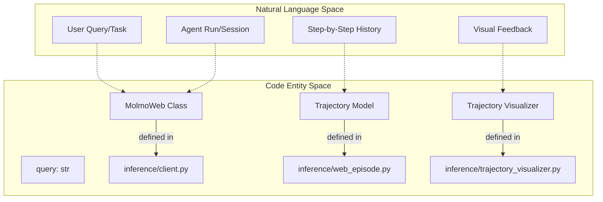
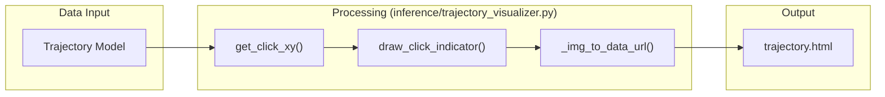

<!-- source: DeepWiki mcp.deepwiki.com · repo allenai/molmoweb · page 4 Inference Client · fetched 2026-10-26 -->

# Inference Client

Relevant source files

The following files were used as context for generating this wiki page:

- [inference/__init__.py](inference/__init__.py)
- [inference/client.py](inference/client.py)
- [inference/trajectory_visualizer.py](inference/trajectory_visualizer.py)
- [inference/web_episode.py](inference/web_episode.py)

The `inference/` package provides the primary interface for interacting with the MolmoWeb agent. It encapsulates the complexity of managing browser environments, executing multi-step agent trajectories, and serializing the resulting data for visualization or analysis.

### System Overview

The inference subsystem bridges the gap between the high-level agent logic and the low-level browser automation. It manages the lifecycle of a `Trajectory`, which consists of a sequence of `Step` objects containing the environment `State` (screenshots and URLs) and the agent's predicted `ActionOutput`.

#### Natural Language to Code Mapping

The following diagram illustrates how high-level inference concepts map to specific classes and files within the `inference/` package.

**Inference Entity Mapping**

**Sources:** [inference/client.py:56-63](), [inference/web_episode.py:78-79](), [inference/trajectory_visualizer.py:90-95]()

---

### MolmoWeb Client

The `MolmoWeb` class is the central entry point for the library. It coordinates the `MultimodalAgent` [inference/client.py:98-105]() and the browser environment (`SimpleEnv` or `BrowserbaseEnv`) [inference/client.py:107-129](). It handles the boilerplate of setting up the Playwright event loop context [inference/client.py:86-96](), resizing screenshots to the expected viewport dimensions (1280x720) [inference/client.py:156-161](), and managing the iterative loop of observation, prediction, and execution.

Key capabilities include:
*   **Environment Management**: Automatically switches between local Chromium and remote Browserbase sessions based on the `local` flag [inference/client.py:107-129]().
*   **Execution Loops**: Supports `fresh_run` for new tasks [inference/client.py:202-209](), `continue_run` for existing sessions, and parallel batch processing via `run_batch` using a `ThreadPoolExecutor` [inference/client.py:38-53]().
*   **Robustness**: Implements retry logic via the `tenacity` library for the `_predict` method to handle transient model server failures [inference/client.py:139-149]().

For details, see [MolmoWeb Client](#4.1).

**Sources:** [inference/client.py:56-83](), [inference/client.py:139-149](), [inference/client.py:202-210]()

---

### Trajectory Data Models

The `inference/web_episode.py` module defines Pydantic-based data models that ensure type safety and easy serialization of agent runs. These models allow trajectories to be saved to disk, reloaded, or rendered as HTML.

| Model | Description | Key Attributes |
| :--- | :--- | :--- |
| `State` | Captures the browser state at a specific moment. | `img` (PIL), `page_url`, `page_title` |
| `Step` | A single interaction unit in a trajectory. | `state`, `prediction` (ActionOutput), `error` |
| `Trajectory` | A collection of steps representing a full task. | `steps` (list[Step]) |

The `State` model includes a custom `field_serializer` and `field_validator` to handle the conversion of PIL images to Base64 strings for JSON compatibility [inference/web_episode.py:45-70]().

For details, see [Trajectory Data Models & Visualizer](#4.2).

**Sources:** [inference/web_episode.py:38-79]()

---

### Trajectory Visualizer

To facilitate debugging and qualitative analysis, the `inference/trajectory_visualizer.py` module provides a Jinja2-based HTML generator. This tool converts a `Trajectory` object into a human-readable webpage using the `trajectory.html` template [inference/trajectory_visualizer.py:90-95]().

**Visualization Flow**

The visualizer includes logic to "burn" red click indicators into screenshots using `draw_click_indicator` based on the agent's predicted coordinates [inference/trajectory_visualizer.py:47-56](). This is applied to actions like `mouse_click` or `gemini_type_text_at` [inference/trajectory_visualizer.py:30-44]().

For details, see [Trajectory Data Models & Visualizer](#4.2).

**Sources:** [inference/trajectory_visualizer.py:30-44](), [inference/trajectory_visualizer.py:47-56](), [inference/trajectory_visualizer.py:90-95]()

---

