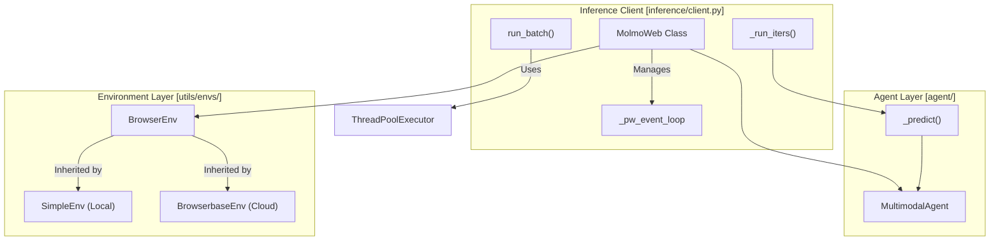
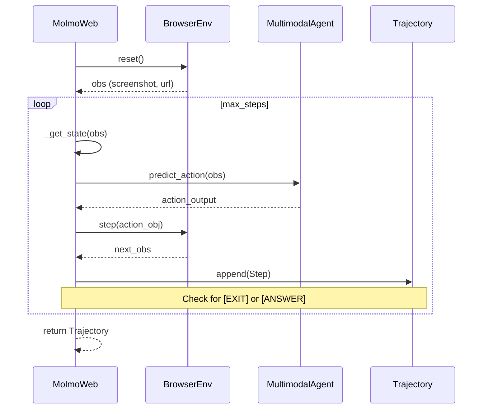

<!-- source: DeepWiki mcp.deepwiki.com · repo allenai/molmoweb · page 4.1 MolmoWeb Client · fetched 2026-10-26 -->

# MolmoWeb Client

Relevant source files

The following files were used as context for generating this wiki page:

- [inference/.env.example](inference/.env.example)
- [inference/__init__.py](inference/__init__.py)
- [inference/client.py](inference/client.py)

The `MolmoWeb` client is the primary interface for executing web-based inference using the Molmo model. It manages the lifecycle of browser environments (local or cloud-hosted), orchestrates agent interactions, and handles the collection of trajectories for evaluation or visualization.

## Overview and Purpose

The `MolmoWeb` class in `inference/client.py` provides a high-level API to run autonomous web agents. It abstracts away the complexities of Playwright's asynchronous event loop, environment selection (Local vs. Browserbase), and the iterative loop of observation and action.

### Key Methods
| Method | Description |
| :--- | :--- |
| `run` | Executes a fresh browser session for a specific natural language query. |
| `continue_run` | Resumes an existing session with a new query, maintaining state and history. |
| `run_batch` | Parallelizes multiple queries across a `ThreadPoolExecutor`. |
| `get_axtree` | Utility to extract and flatten the current page's Accessibility Tree. |

**Sources:** [inference/client.py:56-83](), [inference/client.py:212-250]()

---

## System Architecture and Data Flow

The client acts as a bridge between the **Model Server** (via the `MultimodalAgent`) and the **Browser Environment**.

### Logical Component Mapping
The following diagram maps high-level logical concepts to specific code entities within the `MolmoWeb` infrastructure.

"Natural Language to Code Entity Space"

**Sources:** [inference/client.py:56-105](), [inference/client.py:107-130](), [inference/client.py:177-200](), [inference/client.py:237-250]()

---

## Core Implementation Details

### Playwright Asyncio Event Loop
Playwright requires an active `asyncio` event loop. To allow `MolmoWeb` to be used in synchronous contexts (like Jupyter notebooks) while maintaining persistent browser sessions, it uses a custom context manager `_pw_context`. This manager captures the running loop during the first `reset()` and restores it for subsequent calls, ensuring that sync calls to Playwright work across separate method invocations.

**Sources:** [inference/client.py:86-96](), [inference/client.py:203-209]()

### Environment Selection
The client dynamically selects the browser backend based on the `local` flag passed during initialization:
1.  **Local (`local=True`)**: Instantiates `SimpleEnv`, which launches a local Chromium instance via Playwright [inference/client.py:108-118]().
2.  **Browserbase (`local=False`)**: Instantiates `BrowserbaseEnv`. This requires `BROWSERBASE_API_KEY` and `BROWSERBASE_PROJECT_ID` environment variables [inference/client.py:120-129](). Credentials are validated via `_check_browserbase_credentials` [inference/client.py:25-35]().

### Robustness and Retry Logic
The client utilizes the `tenacity` library to handle transient failures during inference. The `_predict` method is decorated with a retry strategy that attempts the model call up to 2 times with a 5-second fixed wait between failures, catching general `Exception` types.

**Sources:** [inference/client.py:139-144](), [inference/client.py:145-149]()

---

## Execution Lifecycle

The execution flow for a single query follows a strict loop of observing the state, predicting an action, and stepping the environment.

### Inference Step Sequence
"Inference Step Data Flow"

**Sources:** [inference/client.py:131-137](), [inference/client.py:150-153](), [inference/client.py:155-175](), [inference/client.py:177-200]()

---

## Batch Processing and Parallelism

For high-throughput evaluation, `MolmoWeb` provides `run_batch`. This method uses a `ThreadPoolExecutor` to run multiple `_run_one_query` workers in parallel.

*   **Process Isolation**: Each query in the batch creates its own `MolmoWeb` instance with `keep_alive=False` to ensure environments are cleaned up after each task [inference/client.py:38-53]().
*   **Concurrency**: The number of parallel workers is controlled by the `max_workers` parameter. Results are collected as they complete using `as_completed` [inference/client.py:237-250]().

| Feature | run() | run_batch() |
| :--- | :--- | :--- |
| **Concurrency** | Single-threaded | Multi-threaded (`ThreadPoolExecutor`) |
| **Persistence** | Can `keep_alive` for `continue_run` | Cleans up after each query |
| **Use Case** | Interactive use / Debugging | Large scale evaluation / Benchmarking |

**Sources:** [inference/client.py:38-53](), [inference/client.py:237-250]()

---

## AXTree Extraction

The `get_axtree` method provides a simplified interface for retrieving the accessibility tree of the current page. It utilizes `extract_axtree` and `flatten_axtree_to_str` from the utility layer.

1.  It ensures the environment is initialized [inference/client.py:253-254]().
2.  It calls `extract_axtree` with a retry limit defined by `EXTRACT_OBS_MAX_TRIES` [inference/client.py:257-258]().
3.  It returns a flattened string representation of the tree, which is often used for debugging or as input for LLM-backed agents [inference/client.py:259-265]().

**Sources:** [inference/client.py:252-265](), [utils/axtree/axtree.py:22-22]()

---

