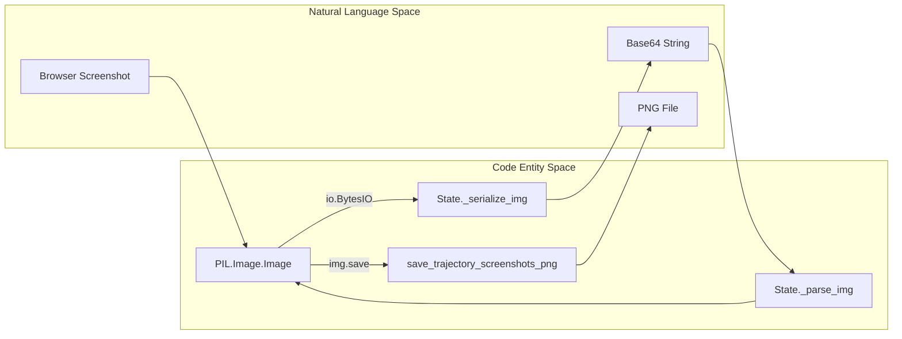
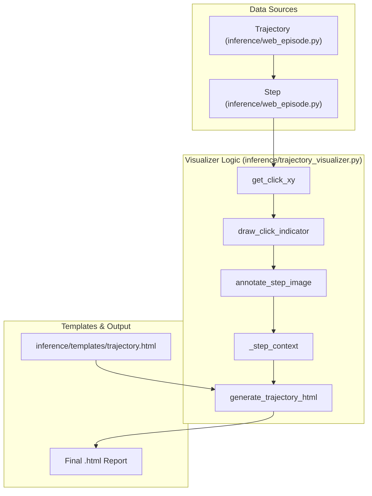

<!-- source: DeepWiki mcp.deepwiki.com · repo allenai/molmoweb · page 4.2 Trajectory Data Models & Visualizer · fetched 2026-10-26 -->

# Trajectory Data Models & Visualizer

Relevant source files

The following files were used as context for generating this wiki page:

- [inference/htmls/trajectory.html](inference/htmls/trajectory.html)
- [inference/templates/trajectory.html](inference/templates/trajectory.html)
- [inference/trajectory_visualizer.py](inference/trajectory_visualizer.py)
- [inference/web_episode.py](inference/web_episode.py)

This page documents the data structures and visualization tools used to represent and inspect agent execution history. The system relies on Pydantic models for structured data and a Jinja2-based HTML generator to create visual step-by-step reports of browser interactions.

## Trajectory Data Models

The core data structures are defined in `inference/web_episode.py`. These models capture the state of the browser, the agent's predicted actions, and any errors encountered during a session.

### Class: State
Represents the browser's condition at a specific point in time. It includes a PIL Image, which is handled via custom Pydantic validators and serializers to support seamless conversion between raw images and base64 strings for storage or transmission [inference/web_episode.py:38-43]().

| Field | Type | Description |
| :--- | :--- | :--- |
| `img` | `PIL.Image.Image` | The screenshot of the current page. |
| `page_url` | `str` | The URL of the current page. |
| `page_title` | `str` | The `<title>` of the current page. |

The `_serialize_img` method converts the PIL object to a base64-encoded PNG string [inference/web_episode.py:45-49](), while `_parse_img` handles decoding from various formats (bytes, base64 strings with or without data URIs) back into a `PIL.Image` [inference/web_episode.py:51-70]().

### Class: Step
A single interaction unit in an episode. It pairs a `State` (the observation) with an `ActionOutput` (the agent's decision) and an optional error string [inference/web_episode.py:72-75]().

### Class: Trajectory
A container for a sequence of `Step` objects [inference/web_episode.py:78-79](). It provides a utility method `save_html` which imports and delegates to the visualizer to generate a report [inference/web_episode.py:81-83]().

### Data Flow and Serialization
The following diagram illustrates how the `State` model bridges the gap between Python's `PIL.Image` and the serialized formats required for HTML or JSON storage.

**Natural Language to Code Entity: Image Serialization Flow**

Sources: [inference/web_episode.py:21-35](), [inference/web_episode.py:45-70]()

---

## Trajectory Visualizer

The visualizer transforms a `Trajectory` object into a human-readable HTML document. It is primarily implemented in `inference/trajectory_visualizer.py` and utilizes Jinja2 templates.

### Image Annotation
Before rendering, the visualizer can "burn" action indicators into the screenshots. If a step's action is a click-based action, `draw_click_indicator` renders a red dot with a white outline at the target coordinates [inference/trajectory_visualizer.py:47-56]().

*   **`_CLICK_ACTION_NAMES`**: Defines which actions trigger an indicator: `mouse_click`, `mouse_dblclick`, and `gemini_type_text_at` [inference/trajectory_visualizer.py:30]().
*   **`get_click_xy(step)`**: Extracts `x` and `y` attributes from the `ActionOutput` if the action name is in the allowed set [inference/trajectory_visualizer.py:33-44]().
*   **`annotate_step_image(step)`**: Checks for a predicted click and returns a modified copy of the screenshot using `PIL.ImageDraw` [inference/trajectory_visualizer.py:59-66]().

### HTML Generation
The visualizer uses a template-based approach to generate the final report.

*   **`_step_context(step)`**: A helper that prepares a dictionary for the Jinja2 template. It converts the annotated image to a data URL via `_img_to_data_url` and serializes the prediction into a formatted JSON string [inference/trajectory_visualizer.py:69-87]().
*   **`generate_trajectory_html(trajectory, query)`**: Loads `inference/templates/trajectory.html` from the `_env` Jinja environment and renders it [inference/trajectory_visualizer.py:90-95]().
*   **`save_trajectory_html`**: Writes the rendered HTML to disk, defaulting to `inference/htmls/trajectory.html` if no path is provided [inference/trajectory_visualizer.py:98-108]().

### Visualization Architecture
The diagram below maps the visualization process from raw data models to the final HTML output.

**Natural Language to Code Entity: Visualization Pipeline**

Sources: [inference/trajectory_visualizer.py:13-16](), [inference/trajectory_visualizer.py:59-95](), [inference/templates/trajectory.html:1-87]()

### Template Structure
The `trajectory.html` template uses a CSS flexbox layout to display information side-by-side for each step [inference/templates/trajectory.html:11-19]():
1.  **Left Panel (`.step-img`)**: Displays the screenshot as a data URL [inference/templates/trajectory.html:20-30](), [inference/templates/trajectory.html:63-69]().
2.  **Right Panel (`.step-info`)**: Contains step metadata including the URL, Page Title, and a `<pre>` block containing the raw JSON of the agent's prediction [inference/templates/trajectory.html:31-47](), [inference/templates/trajectory.html:70-82]().

Sources: [inference/trajectory_visualizer.py:1-109](), [inference/web_episode.py:1-86](), [inference/templates/trajectory.html:1-88]()

---

