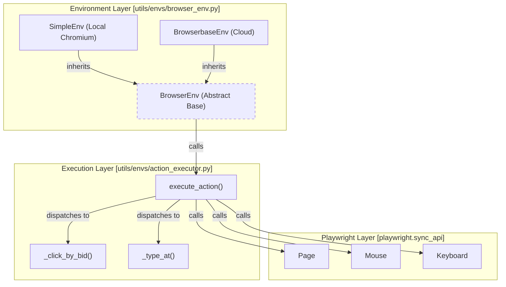

<!-- source: DeepWiki mcp.deepwiki.com · repo allenai/molmoweb · page 5 Browser Environment & Action Execution · fetched 2026-10-26 -->

# Browser Environment & Action Execution

Relevant source files

The following files were used as context for generating this wiki page:

- [utils/envs/__init__.py](utils/envs/__init__.py)
- [utils/envs/action_executor.py](utils/envs/action_executor.py)
- [utils/envs/browser_env.py](utils/envs/browser_env.py)

The `utils/envs` subsystem provides the interface between the agent's high-level decisions and the low-level browser automation. It encapsulates the lifecycle of the browser session (Playwright), manages tab state, and translates abstract action objects into concrete browser interactions.

## Architecture Overview

The system is built around an abstract base class `BrowserEnv` which defines the core loop of web interaction. Concrete implementations handle the specifics of where the browser is running (locally or in a managed cloud environment like Browserbase). The `execute_action` utility serves as the bridge, converting `Action` objects into Playwright API calls.

### Component Relationship
The following diagram illustrates how the environment classes interact with the action executor and the underlying Playwright library.

**Environment & Execution Flow**

Sources: [utils/envs/browser_env.py:70-92](), [utils/envs/action_executor.py:29-33]()

## Browser Environments

The `BrowserEnv` class manages the state of the browser, including the active page, the browser context, and the step count. It follows a standard reinforcement learning-like interface: `reset()`, `step()`, and `close()`.

*   **SimpleEnv**: Launches a local Chromium instance via `sync_playwright`. It is suitable for development and local testing [utils/envs/browser_env.py:4-6]().
*   **BrowserbaseEnv**: Connects to a remote [Browserbase](https://www.browserbase.com/) session using a `connect_url`. This implementation is used for production-grade tasks requiring stealth proxies and automated CAPTCHA solving [utils/envs/browser_env.py:5-6]().

### Observation Structure
The `_get_obs()` method in `BrowserEnv` returns a dictionary containing the current state of the browser. This typically includes:
*   `screenshot`: A numpy array of the current viewport, captured via CDP `Page.captureScreenshot` or standard Playwright screenshot [utils/envs/browser_env.py:59-67]().
*   `axtree_object`: The processed Accessibility Tree (if `extract_axtree=True`) [utils/envs/browser_env.py:246-249]().
*   `open_pages_urls`: A list of URLs for all currently open tabs in the browser context [utils/envs/browser_env.py:254-255]().

For more details on the environment lifecycle, tab detection, and navigation fallbacks, see **[Browser Environments](#5.1)**.

Sources: [utils/envs/browser_env.py:1-16](), [utils/envs/browser_env.py:70-120]()

## Action Executor

The `execute_action` function is the central dispatcher for all agent actions. It receives a `playwright.Page` object and an `Action` object (from the `agent.actions` module) and performs the corresponding automation.

### Key Execution Patterns
*   **Coordinate-based Actions**: Actions like `MouseClick`, `HoverAt`, and `ScrollAt` use absolute pixel coordinates. The executor assumes these have already been converted from percentage coordinates by the agent [utils/envs/action_executor.py:4-6]().
*   **Element-based Actions**: The `Click` action uses a `bid` (Backend ID) attribute. The executor attempts to locate the element using `page.locator(f'[bid="{action.bid}"]')` [utils/envs/action_executor.py:114-114]().
*   **Robust Fallbacks**: For `Click` actions, if a standard click fails, the executor attempts a "forced" click (`force=True`) to bypass visibility or intersection checks [utils/envs/action_executor.py:121-131]().

**Action Dispatch Mapping**
| Action Class | Code Entity / Method | Implementation Detail |
| :--- | :--- | :--- |
| `Click` | `_click_by_bid` [utils/envs/action_executor.py:112]() | Locates by `bid` attribute; supports double-click and right-click. |
| `MouseClick` | `page.mouse.click` [utils/envs/action_executor.py:38]() | Direct coordinate-based interaction. |
| `GeminiTypeTextAt` | `_type_at` [utils/envs/action_executor.py:134]() | Sequence: Click -> Clear (Optional) -> Type -> Enter (Optional). |
| `BrowserNav` | `page.go_back` / `new_page` [utils/envs/action_executor.py:88]() | Handles browser-level navigation and tab management. |

For a full reference of supported actions and their Playwright mappings, see **[Action Executor](#5.2)**.

Sources: [utils/envs/action_executor.py:29-109](), [utils/envs/action_executor.py:112-132](), [utils/envs/action_executor.py:134-154]()

## Sub-Pages
*   **[Browser Environments](#5.1)**: Detailed documentation of `BrowserEnv`, `SimpleEnv`, and `BrowserbaseEnv`. Covers the `reset`/`step`/`close` lifecycle, observation structure, and robust navigation logic (including the Bing warmup fallback).
*   **[Action Executor](#5.2)**: Technical reference for `utils/envs/action_executor.py`. Details how each action type is translated into Playwright API calls and the bid-based click fallback mechanisms.

---

