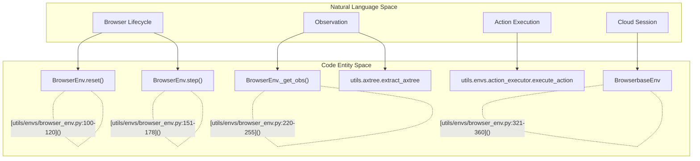
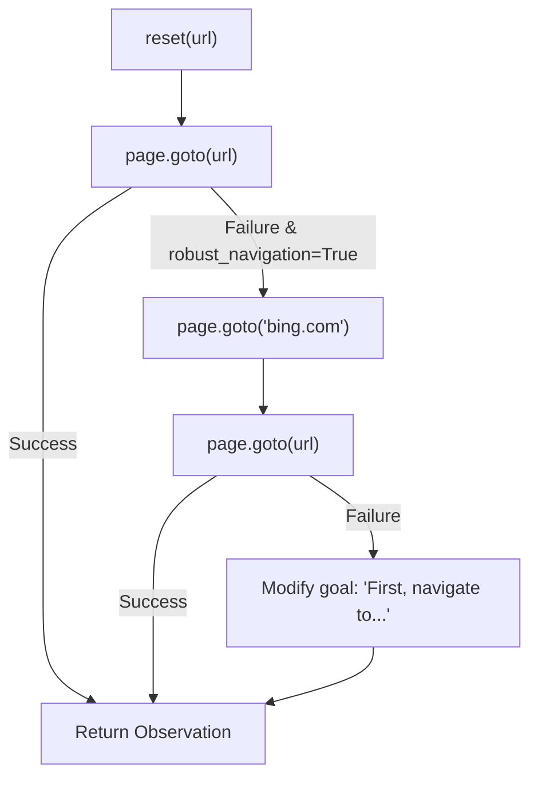
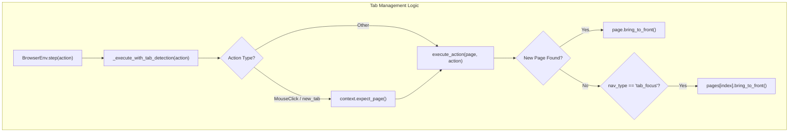

<!-- source: DeepWiki mcp.deepwiki.com · repo allenai/molmoweb · page 5.1 Browser Environments · fetched 2026-10-26 -->

# Browser Environments

Relevant source files

The following files were used as context for generating this wiki page:

- [utils/envs/__init__.py](utils/envs/__init__.py)
- [utils/envs/browser_env.py](utils/envs/browser_env.py)

The `utils/envs/browser_env.py` module provides a standardized interface for agents to interact with web browsers. It abstracts the complexities of browser lifecycle management, tab handling, and observation extraction, supporting both local execution and cloud-based sessions via Browserbase.

## Environment Architecture

The environment system is built on a base abstract class, `BrowserEnv`, which defines the lifecycle and observation protocols. Two concrete implementations satisfy different deployment needs: `SimpleEnv` for local development and `BrowserbaseEnv` for managed cloud sessions.

### Natural Language to Code Entity Mapping

The following diagram illustrates how high-level environment concepts map to specific classes and methods within the codebase.

**Environment Entity Mapping**

Sources: `[utils/envs/browser_env.py:70-360]()`

## Lifecycle: Reset, Step, and Close

All environments follow a standard RL-like lifecycle managed through Playwright.

### 1. Reset (`reset`)
The `reset` method initializes the browser instance, sets the viewport, and navigates to the starting URL `[utils/envs/browser_env.py:100-120]()`.
*   **Navigation Fallback**: If `robust_navigation` is enabled, the environment attempts to "warm up" the connection by navigating to `bing.com` first if the initial `goto` fails `[utils/envs/browser_env.py:124-149]()`.
*   **State Initialization**: It clears the `step_count` and `last_action_error` `[utils/envs/browser_env.py:115-116]()`.

### 2. Step (`step`)
The `step` method advances the environment by executing an action and returning a new observation `[utils/envs/browser_env.py:151-178]()`.
*   **Tab Detection**: It wraps action execution in `_execute_with_tab_detection` to catch new pages opened by `MouseClick` or `new_tab` actions `[utils/envs/browser_env.py:180-201]()`.
*   **Wait Strategy**: After an action, the environment waits for `domcontentloaded` across all open pages and frames to ensure the UI has settled before capturing observations `[utils/envs/browser_env.py:158-176]()`.

### 3. Close (`close`)
The `close` method ensures that the browser, context, and Playwright process are terminated to prevent memory leaks `[utils/envs/browser_env.py:209-218]()`.

Sources: `[utils/envs/browser_env.py:100-218]()`

## Observation Structure

The `_get_obs()` method compiles a comprehensive dictionary representing the current state of the browser.

| Key | Type | Description |
| :--- | :--- | :--- |
| `screenshot` | `np.ndarray` | RGB image of the current page `[utils/envs/browser_env.py:228]()`. |
| `axtree_object` | `dict` | Parsed Accessibility Tree (if `extract_axtree` is True) `[utils/envs/browser_env.py:236]()`. |
| `extra_element_properties` | `dict` | Metadata for elements (e.g., bounding boxes) `[utils/envs/browser_env.py:237]()`. |
| `open_pages_urls` | `list[str]` | List of URLs for all currently open tabs `[utils/envs/browser_env.py:246]()`. |
| `active_page_index` | `int` | Index of the currently focused tab `[utils/envs/browser_env.py:247]()`. |
| `last_action_error` | `str` | Error message from the previous action attempt `[utils/envs/browser_env.py:252]()`. |

Sources: `[utils/envs/browser_env.py:220-255]()`

## Implementation Details

### SimpleEnv (Local)
`SimpleEnv` (aliased as `LocalBrowserEnv`) launches a local Chromium instance using `playwright.chromium.launch` `[utils/envs/browser_env.py:288-318]()`. It supports `headless` mode and `slow_mo` for debugging.

### BrowserbaseEnv (Cloud)
`BrowserbaseEnv` connects to a remote browser session via the Browserbase SDK.
*   **Session Management**: It uses a `Project ID` and `API Key` to create a session `[utils/envs/browser_env.py:338-344]()`.
*   **Stealth & Proxies**: It is designed for environments requiring stealth or specific geographic proxies.
*   **Connection**: It connects via `playwright.chromium.connect_over_cdp` using a generated `connect_url` `[utils/envs/browser_env.py:348-353]()`.

### Robust Navigation Logic
The environment implements a fallback mechanism to handle sites that block automated "cold" connections.

**Navigation Data Flow**

Sources: `[utils/envs/browser_env.py:122-150]()`

## Action Execution and Tab Handling

Actions are dispatched to `utils.envs.action_executor.execute_action` via the environment's `_execute_with_tab_detection` wrapper `[utils/envs/browser_env.py:180-201]()`.

*   **Tab Switching**: If an action is a `BrowserNav` with `nav_type="tab_focus"`, the environment iterates through `self.context.pages` to find the target index and calls `bring_to_front()` `[utils/envs/browser_env.py:202-207]()`.
*   **Screenshot Fallback**: Screenshots are primarily captured via CDP (`Page.captureScreenshot`) for speed and reliability `[utils/envs/browser_env.py:61-64]()`, falling back to the standard Playwright `page.screenshot` if CDP fails `[utils/envs/browser_env.py:65-66]()`.

**Tab Detection and Focus Flow**

Sources: `[utils/envs/browser_env.py:59-67, 180-207]()`

---

