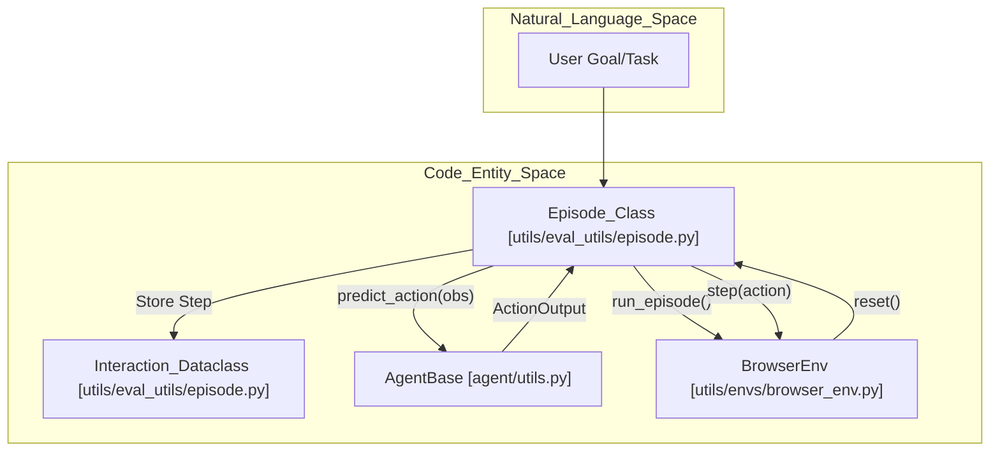
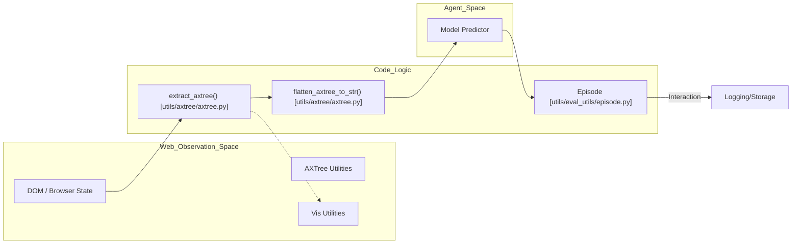

<!-- source: DeepWiki mcp.deepwiki.com · repo allenai/molmoweb · page 6 Utilities · fetched 2026-10-26 -->

# Utilities

Relevant source files

The following files were used as context for generating this wiki page:

- [utils/axtree/__init__.py](utils/axtree/__init__.py)
- [utils/eval_utils/episode.py](utils/eval_utils/episode.py)
- [utils/vis_utils/__init__.py](utils/vis_utils/__init__.py)

The `utils/` directory contains the foundational logic for interacting with web page structures, generating visual debugging assets, and managing the evaluation lifecycle of agents. These utilities bridge the gap between the raw browser state and the high-level reasoning required by the agents.

### Utility Subsystems Overview

The utility layer is divided into three primary functional areas:

| Subsystem | Primary Responsibilities | Key Code Entities |
|:---|:---|:---|
| **AXTree** | Extraction and flattening of the Accessibility Tree from Playwright. | `extract_axtree`, `flatten_axtree_to_str` |
| **Visualization** | Creating visual artifacts (images, GIFs, HTML) for debugging. | `vis_utils/vis.py`, `vis_utils/image.py`, `vis_utils/html.py` |
| **Evaluation** | Running interaction loops and logging step-by-step data. | `Episode`, `LocalEpisodeLogger`, `Interaction` |

---

### Accessibility Tree (AXTree) Utilities

The AXTree utilities are responsible for transforming a live webpage into a structured, text-based representation that LLMs can process. This involves a complex pipeline that injects temporary identifiers into the DOM, captures a snapshot via the Chrome DevTools Protocol (CDP), and merges these attributes into a tree structure.

The primary entry points are `extract_axtree` for raw data collection and `flatten_axtree_to_str` for converting that data into a prompt-friendly string format.

For details, see [Accessibility Tree (AXTree) Utilities](#6.1).

**Sources:**
- [utils/axtree/__init__.py:1-7]()

---

### Visualization Utilities

Visualization utilities provide tools for interpreting agent behavior and environmental state. This includes encoding images for model input (via `image.py`), rendering HTML reports (via `html.py`), and generating annotated GIFs (via `vis.py`) that highlight specific coordinates or elements the agent is interacting with. These tools are essential for debugging the spatial reasoning of multimodal models.

For details, see [Visualization Utilities](#6.2).

**Sources:**
- [utils/vis_utils/__init__.py:1-1]()

---

### Evaluation Utilities

The evaluation utilities manage the execution flow of an agent within an environment. The `Episode` class encapsulates the main interaction loop, handling retries, action dispatching, and state transitions. Data is captured at each step via the `Interaction` dataclass to facilitate logging and performance analysis.

**Core Evaluation Flow**
The diagram below illustrates how the `Episode` class coordinates between the `AgentBase` and the `BrowserEnv`.

**Diagram: Episode Execution Loop**

The `run_episode` method manages the loop until a maximum step count is reached, the agent sends a termination signal (e.g., `[EXIT]`), or the environment reports a terminal state.

For details, see [Evaluation Utilities](#6.3).

**Sources:**
- [utils/eval_utils/episode.py:15-21]() (Interaction dataclass)
- [utils/eval_utils/episode.py:24-33]() (Episode class definition)
- [utils/eval_utils/episode.py:35-50]() (_predict_with_retry method)
- [utils/eval_utils/episode.py:61-141]() (run_episode loop)

---

### System Data Flow

The following diagram bridges the high-level concepts of "Web Observation" and "Agent Action" to the specific utility functions and classes that handle the data transformation.

**Diagram: Observation to Action Data Pipeline**

**Sources:**
- [utils/axtree/__init__.py:3-5]()
- [utils/eval_utils/episode.py:122-130]()
- [utils/eval_utils/episode.py:15-21]()

---

