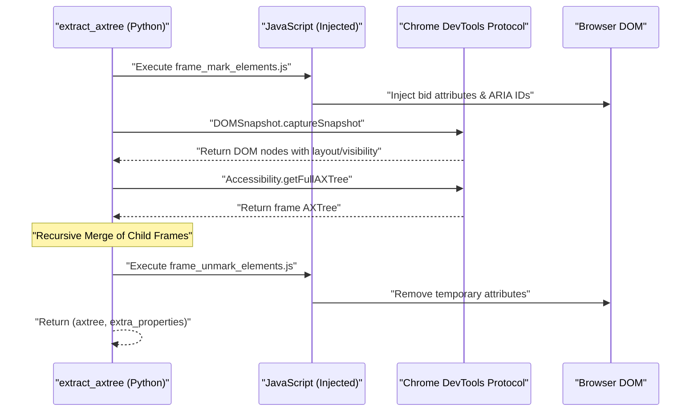
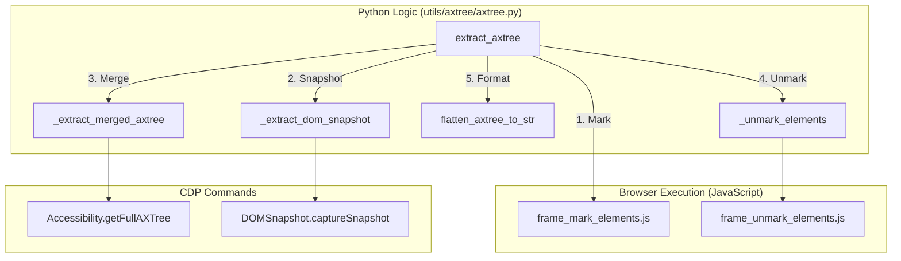

<!-- source: DeepWiki mcp.deepwiki.com · repo allenai/molmoweb · page 6.1 Accessibility Tree (AXTree) Utilities · fetched 2026-10-26 -->

# Accessibility Tree (AXTree) Utilities

Relevant source files

The following files were used as context for generating this wiki page:

- [utils/axtree/__init__.py](utils/axtree/__init__.py)
- [utils/axtree/axtree.py](utils/axtree/axtree.py)
- [utils/axtree/javascript/frame_mark_elements.js](utils/axtree/javascript/frame_mark_elements.js)
- [utils/axtree/javascript/frame_unmark_elements.js](utils/axtree/javascript/frame_unmark_elements.js)

The `utils/axtree` module provides high-level utilities for extracting, merging, and flattening the Accessibility Tree (AXTree) from Playwright `Page` objects [utils/axtree/axtree.py:1-12](). It bridges the gap between raw browser DOM structures and the structured text representations required by Large Language Models (LLMs) for web navigation tasks.

## The `extract_axtree` Pipeline

The extraction process follows a strict "mark-snapshot-merge-unmark" lifecycle to ensure that elements can be uniquely identified across multiple frames and that the resulting tree contains necessary metadata like bounding boxes and visibility ratios.

### Data Flow and Lifecycle

The pipeline is orchestrated by `extract_axtree` [utils/axtree/axtree.py:57-71]().

1.  **Marking**: Elements are injected with unique `bid` (browser ID) attributes using JavaScript. These IDs are persisted into ARIA attributes (`aria-description` or `aria-roledescription`) so they appear in the CDP AXTree [utils/axtree/javascript/frame_mark_elements.js:141-145]().
2.  **Snapshotting**: The system captures a DOM snapshot via CDP using `_extract_dom_snapshot` to gather geometric data (bounding boxes) and visibility information [utils/axtree/axtree.py:66-68](), [utils/axtree/axtree.py:248-264]().
3.  **Merging**: The AXTree is retrieved frame-by-frame via `_extract_merged_axtree`. Child frames are recursively merged into the parent tree at the point of their `iframe` or `frame` nodes [utils/axtree/axtree.py:218-245]().
4.  **Unmarking**: Temporary attributes and injected ARIA IDs are stripped from the DOM via `_unmark_elements` using `frame_unmark_elements.js` to restore the page to its original state [utils/axtree/axtree.py:214-216](), [utils/axtree/javascript/frame_unmark_elements.js:1-25]().

### AXTree Extraction Sequence
The following diagram illustrates the interaction between the Python utility and the browser via CDP.

"AXTree Extraction Sequence"

Sources: [utils/axtree/axtree.py:57-71](), [utils/axtree/javascript/frame_mark_elements.js:5-148](), [utils/axtree/axtree.py:218-245]()

## Key Functions and Implementation

### `extract_axtree(page, lenient)`
The entry point for the extraction pipeline. It handles the full lifecycle and returns a tuple containing the merged AXTree dictionary and an `extra_properties` dictionary mapping `bid` to visibility, bounding box, and clickability data [utils/axtree/axtree.py:57-71]().

### `_extract_merged_axtree(page)`
Iterates through all frames in the page. It skips frames that match ad markers (e.g., "doubleclick", "googlesyndication") or restricted URL prefixes (e.g., "chrome://", "data:") [utils/axtree/axtree.py:38-46](). It uses `Accessibility.getFullAXTree` to retrieve the tree for each frame and stitches them together [utils/axtree/axtree.py:218-245]().

### `flatten_axtree_to_str(...)`
Converts the complex AXTree dictionary into a human-readable, indented string. It supports several filtering and formatting options [utils/axtree/axtree.py:93-105]():
*   **`filter_visible_only`**: Excludes nodes where `molmoweb_visibility_ratio` is < 0.5 [utils/axtree/axtree.py:123-124]().
*   **`filter_with_bid_only`**: Excludes nodes that were not assigned a unique `bid` during the marking phase [utils/axtree/axtree.py:118-120]().
*   **`remove_redundant_static_text`**: Suppresses `StaticText` nodes if their content is already contained within the parent node's name [utils/axtree/axtree.py:170-172]().
*   **`with_center_coords` / `with_bounding_box_coords`**: Injects coordinate strings into the output for LLM grounding [utils/axtree/axtree.py:129-136]().

### `extract_screenshot(page, scale_factor)`
A utility to capture the viewport using CDP's `Page.captureScreenshot`. It temporarily overrides device metrics via `Emulation.setDeviceMetricsOverride` to match the requested `scale_factor` before returning a NumPy array [utils/axtree/axtree.py:74-90]().

## JavaScript Element Marking

The marking script `frame_mark_elements.js` is responsible for assigning IDs that persist across the CDP boundary.

| Feature | Implementation Detail |
| :--- | :--- |
| **Unique IDs (bid)** | Standard elements get numeric IDs (`0`, `1`). Frames get alphabetic IDs (`a`, `b`) [utils/axtree/javascript/frame_mark_elements.js:122-130](). |
| **Global Context** | BIDs are prefixed with the parent frame's BID to ensure uniqueness across nested iframes [utils/axtree/javascript/frame_mark_elements.js:131-136](). |
| **Visibility** | Uses an `IntersectionObserver` to calculate `molmoweb_visibility_ratio` for every marked element [utils/axtree/javascript/frame_mark_elements.js:37-51](). |
| **Set of Marks** | Injects `molmoweb_set_of_marks` attribute for interactive tags like `button`, `a`, `input`, and `select` [utils/axtree/javascript/frame_mark_elements.js:24-26](), [utils/axtree/javascript/frame_mark_elements.js:147-152](). |
| **Dynamic Values** | Explicitly sets `value` and `checked` attributes from the element's current state to ensure they are captured in the snapshot [utils/axtree/javascript/frame_mark_elements.js:93-105](). |

## System Mapping: Logic to Code Entities

This diagram maps the conceptual "Extraction Pipeline" to the specific Python functions and JavaScript files that implement them.

"AXTree Logic to Code Mapping"

Sources: [utils/axtree/axtree.py:57-71](), [utils/axtree/axtree.py:218-245](), [utils/axtree/axtree.py:248-264](), [utils/axtree/axtree.py:214-216]()

## Data Structures and Constants

### Ignored Elements
To reduce token usage in LLM prompts, certain roles and properties are filtered out during flattening:
*   **Roles**: `LineBreak` [utils/axtree/axtree.py:33]().
*   **Properties**: `editable`, `readonly`, `level`, `settable`, `multiline`, `invalid`, `focusable` [utils/axtree/axtree.py:34-36]().

### Extra Properties Dictionary
The `extra` dictionary returned by `extract_axtree` contains the following structure for each `bid` extracted from the `DOMSnapshot` [utils/axtree/axtree.py:266-285]():
*   `visibility`: Float (0.0 to 1.0) derived from `molmoweb_visibility_ratio`.
*   `bbox`: Tuple of `(x, y, width, height)`.
*   `clickable`: Boolean indicating if the element is likely interactive.
*   `set_of_marks`: Boolean indicating if the element should be highlighted in Set-of-Marks visualizations.

Sources: [utils/axtree/axtree.py:1-285](), [utils/axtree/javascript/frame_mark_elements.js:1-152](), [utils/axtree/javascript/frame_unmark_elements.js:1-41]()

---

