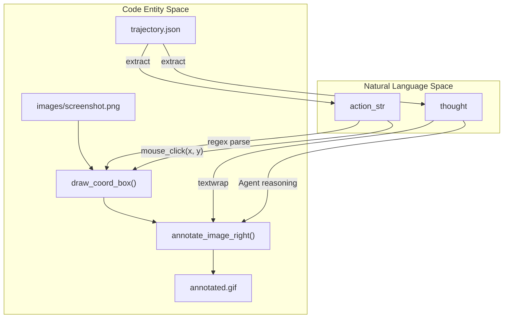
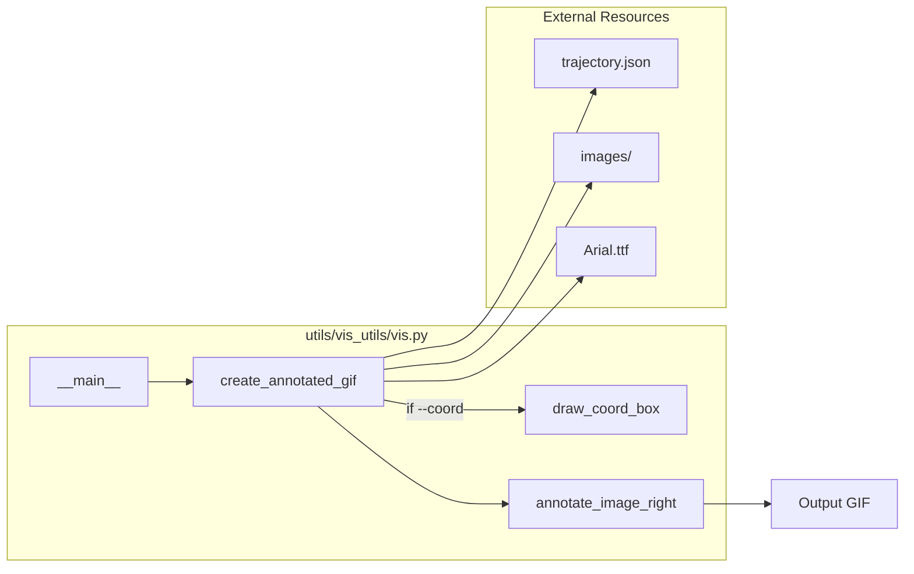

<!-- source: DeepWiki mcp.deepwiki.com · repo allenai/molmoweb · page 6.2 Visualization Utilities · fetched 2026-10-26 -->

# Visualization Utilities

Relevant source files

The following files were used as context for generating this wiki page:

- [utils/vis_utils/Arial.ttf](utils/vis_utils/Arial.ttf)
- [utils/vis_utils/__init__.py](utils/vis_utils/__init__.py)
- [utils/vis_utils/html.py](utils/vis_utils/html.py)
- [utils/vis_utils/image.py](utils/vis_utils/image.py)
- [utils/vis_utils/vis.py](utils/vis_utils/vis.py)

The `utils/vis_utils/` directory provides a suite of tools for handling image transformations, generating HTML reports, and creating annotated visual trajectories. These utilities are used across the codebase to debug agent behavior, visualize action coordinates, and export execution logs into human-readable formats.

## Image Encoding and Decoding

The `image.py` module serves as the primary bridge between raw image data (PIL or NumPy) and the Base64 strings required for JSON-based network transmission and HTML embedding.

### Key Functions
| Function | Description |
| :--- | :--- |
| `pil_image_to_base64` | Converts a PIL Image object into a Base64 string, defaulting to PNG format [[utils/vis_utils/image.py:9-24]](). |
| `numpy_image_to_base64` | Converts a NumPy array to an RGB PIL image before encoding to Base64 [[utils/vis_utils/image.py:27-29]](). |
| `image_to_base64` | Polymorphic helper that handles both `np.ndarray` and `Image.Image` types [[utils/vis_utils/image.py:32-38]](). |
| `base64_to_pil_image` | Decodes a Base64 string (handling optional headers like `data:image/png;base64,`) back into a PIL Image [[utils/vis_utils/image.py:41-48]](). |
| `base64_to_numpy_image` | Decodes a Base64 string directly into a NumPy array [[utils/vis_utils/image.py:51-52]](). |
| `pil_image_to_html` | Wraps a Base64-encoded image in an `` tag for direct injection into HTML templates [[utils/vis_utils/image.py:64-67]](). |

**Sources:**
- `utils/vis_utils/image.py` [[9-67]]()

## HTML Rendering Utilities

The `html.py` module leverages the `fasthtml` library to programmatically generate structural HTML components. This is primarily used for generating tabular views of agent trajectories.

### Implementation Details
- **Page Creation**: `create_page` initializes a standard HTML document structure using Pico CSS for styling and Flexbox Grid for layout [[utils/vis_utils/html.py:6-17]]().
- **Table Generation**: `create_table` accepts a list of column headers and a list of dictionaries (rows) to build a standard `<table>` with `<thead>` and `Tbody` sections [[utils/vis_utils/html.py:25-30]]().
- **Persistence**: `save_html` converts the `fasthtml` object tree into an XML/HTML string and writes it to a specified file path [[utils/vis_utils/html.py:20-22]]().

**Sources:**
- `utils/vis_utils/html.py` [[6-30]]()

## Annotated Trajectory Visualization

The `vis.py` module is a standalone utility for creating animated GIFs that visualize an agent's decision-making process. It combines screenshots from a browser environment with the textual "thought" and "action" metadata from a trajectory log.

### Trajectory-to-Visual Mapping

The following diagram illustrates how the `create_annotated_gif` function maps data from the `trajectory.json` file to visual elements in the output GIF.

**Data Flow: Trajectory to Annotated Frame**

**Sources:**
- `utils/vis_utils/vis.py` [[9-27, 70-137]]()

### Key Visualization Features

#### 1. Coordinate Box Drawing
The `draw_coord_box` function uses regular expressions to detect coordinate patterns (e.g., `x=371, y=252`) within an action string [[utils/vis_utils/vis.py:18-21]](). If found, it uses `ImageDraw.rectangle` to draw a red indicator at those coordinates on the screenshot [[utils/vis_utils/vis.py:23-25]]().

#### 2. Right-Panel Annotation
The `annotate_image_right` function extends the canvas of the original screenshot to the right to create a dedicated text area [[utils/vis_utils/vis.py:37-42]](). 
- It wraps text based on the font's average character width calculated via `font.getbbox` [[utils/vis_utils/vis.py:51-55]]().
- It centers the combined Action and Thought text vertically within the black background panel using `multiline_textbbox` for height calculation [[utils/vis_utils/vis.py:58-65]]().

#### 3. GIF Composition
The `create_annotated_gif` function iterates through sorted keys in a trajectory directory [[utils/vis_utils/vis.py:85-99]](). It loads the `Arial.ttf` font provided in the utility directory [[utils/vis_utils/vis.py:92]]() and saves the sequence of annotated frames as a looping GIF [[utils/vis_utils/vis.py:131-137]]().

**Component Interaction Diagram**

**Sources:**
- `utils/vis_utils/vis.py` [[9-137]]()
- `utils/vis_utils/Arial.ttf` [[1-18]]()

---

