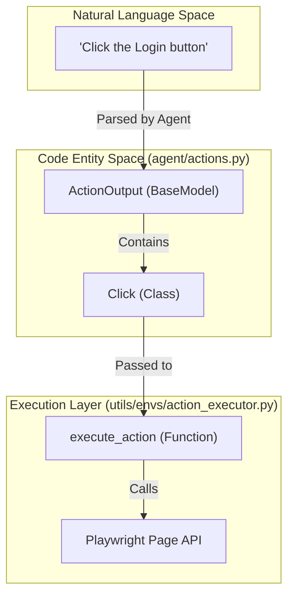
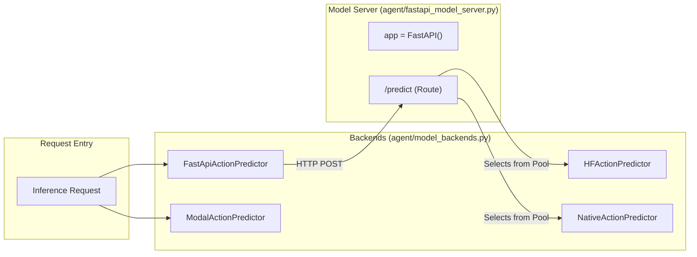

<!-- source: DeepWiki mcp.deepwiki.com · repo allenai/molmoweb · page 7 Glossary · fetched 2026-10-26 -->

# Glossary

Relevant source files

The following files were used as context for generating this wiki page:

- [README.md](README.md)
- [agent/actions.py](agent/actions.py)
- [agent/fastapi_model_server.py](agent/fastapi_model_server.py)
- [agent/model_backends.py](agent/model_backends.py)
- [inference/client.py](inference/client.py)
- [inference/web_episode.py](inference/web_episode.py)
- [utils/axtree/axtree.py](utils/axtree/axtree.py)
- [utils/envs/browser_env.py](utils/envs/browser_env.py)

This page provides definitions for codebase-specific terms, abbreviations, and domain concepts used throughout MolmoWeb. It serves as a technical reference for understanding the relationship between high-level system components and their underlying code implementations.

## Core System Concepts

### 1. AXTree (Accessibility Tree)
The AXTree is a hierarchical representation of a web page's user interface, derived from the browser's accessibility tree via the Chrome DevTools Protocol (CDP). Unlike a raw DOM tree, it focuses on elements that are meaningful for user interaction and screen readers.

*   **Extraction Pipeline**: The process involves marking DOM elements with unique `bid` attributes using JavaScript, taking a CDP snapshot, merging trees from multiple frames, and finally unmarking the elements [utils/axtree/axtree.py:57-71]().
*   **Flattening**: The `flatten_axtree_to_str` function converts the tree into a human-readable (and LLM-readable) indented text format, applying filters for visibility and interactivity [utils/axtree/axtree.py:93-105]().

### 2. BID (Browser ID)
A unique string identifier assigned to DOM elements during the observation phase. BIDs are injected as a temporary HTML attribute (`bid`) to allow the agent to refer to specific elements in its predicted actions.

*   **Implementation**: Defined as `BID_ATTR = "bid"` [utils/axtree/axtree.py:25-25]().
*   **Usage**: Used in the `Click` action class to specify the target element [agent/actions.py:10-11]().

### 3. Predictor Pool
A concurrency management pattern used in the Model Server to handle multiple inference requests across one or more GPUs.

*   **Mechanism**: A `queue.Queue` stores initialized `ActionPredictor` objects. When a `/predict` request arrives, a predictor is "borrowed" from the pool and returned after inference [agent/fastapi_model_server.py:34-56]().
*   **Device Assignment**: Each predictor in the pool is pinned to a specific CUDA device based on its index [agent/fastapi_model_server.py:39-40]().

---

## Technical Mapping: Natural Language to Code Entity

The following diagrams bridge conceptual domain terms with their specific implementation entities in the codebase.

### Diagram 1: Action Execution Flow
This diagram maps the conceptual "Action" to the classes and functions responsible for its lifecycle.

**Sources:** [agent/actions.py:10-37](), [agent/actions.py:250-255](), [utils/envs/action_executor.py:1-10]()

### Diagram 2: Inference Backend Hierarchy
This diagram maps the "Inference Request" to the various backend implementations and the server that hosts them.

**Sources:** [agent/model_backends.py:22-136](), [agent/fastapi_model_server.py:67-79](), [agent/fastapi_model_server.py:84-108]()

---

## Domain Terms Table

| Term | Definition | Code Pointer |
| :--- | :--- | :--- |
| **ActionOutput** | A wrapper containing the thought, the structured action object, and the raw model string. | [agent/actions.py:250-255]() |
| **Browserbase** | A cloud-based browser platform used for stealth, proxies, and session persistence. | [utils/envs/browser_env.py:5-12]() |
| **CDP** | Chrome DevTools Protocol; used for low-level browser interaction like AXTree extraction and screenshots. | [utils/axtree/axtree.py:74-87]() |
| **Native Predictor** | A backend that loads Molmo models using the `olmo` library directly rather than `transformers`. | [agent/model_backends.py:148-173]() |
| **Step** | A single interaction cycle consisting of a State, a Prediction, and an optional Error. | [inference/web_episode.py:72-75]() |
| **Trajectory** | A sequence of Steps representing a complete agent execution for a single goal. | [inference/web_episode.py:78-83]() |
| **SimpleEnv** | A local Playwright environment for running the agent on the host machine's browser. | [inference/client.py:108-118]() |

---

## Action Types Reference

MolmoWeb defines a standard set of actions that agents can emit. These are divided into two main categories:

### Coordinate-Based Actions
Actions that use screen coordinates (pixels).
*   `MouseClick`: Clicks at specific `x, y` coordinates [agent/actions.py:39-47]().
*   `ScrollAt`: Performs a scroll starting from a specific `x, y` point [agent/actions.py:103-108]().
*   `MouseMove`: Moves the cursor to specific `x, y` coordinates [agent/actions.py:60-63]().
*   `HoverAt`: Hovers the cursor at `x, y` for a specific duration [agent/actions.py:72-76]().
*   `GeminiTypeTextAt`: A specialized action for Gemini that combines coordinate-based positioning with typing [agent/actions.py:170-177]().

### Element-Based Actions
Actions that target specific BIDs from the AXTree.
*   `Click`: Clicks on an element identified by its `bid` [agent/actions.py:10-17]().

### System & Navigation Actions
*   `Goto`: Navigates the browser to a specific URL [agent/actions.py:202-204]().
*   `BrowserNav`: Handles browser-level navigation like `go_back`, `go_forward`, `reload`, or `tab_focus` [agent/actions.py:211-214]().
*   `KeyboardType`: Types a string into the currently focused element [agent/actions.py:137-140]().
*   `SendMsgToUser`: The termination mechanism for reporting results or exiting [agent/actions.py:231-233]().

**Sources:** [agent/actions.py:1-248](), [inference/client.py:150-153](), [utils/envs/browser_env.py:151-156]()