# Page: MolmoWeb Overview

# MolmoWeb Overview

<details>
<summary>Relevant source files</summary>

The following files were used as context for generating this wiki page:

- [README.md](README.md)
- [assets/logo.png](assets/logo.png)
- [demo.ipynb](demo.ipynb)
- [demo_task.json](demo_task.json)
- [pyproject.toml](pyproject.toml)

</details>


MolmoWeb is an open multimodal web agent developed by [Ai2](https://allenai.org). It is designed to autonomously navigate and interact with the web to complete natural-language tasks. By combining a multimodal vision-language model with a browser automation engine, MolmoWeb can perceive visual webpage states and execute actions like clicking, typing, and scrolling. [README.md:15-15]()

This repository provides the complete ecosystem for the agent, including the model server, inference client, action execution logic, and evaluation benchmarks. [README.md:15-15]()

## Core System Architecture

MolmoWeb operates using a split-process architecture. The system is divided into a **Model Server**, which typically runs on a GPU-enabled machine to handle heavy inference tasks, and an **Inference Client**, which manages the browser environment and agent logic. [README.md:101-110](), [README.md:164-166]()

### High-Level Component Interaction

The following diagram illustrates how the primary code entities interact during a single step of a web task.

**MolmoWeb Execution Flow**
```mermaid
graph TD
    subgraph "Client Side (Browser Machine)"
        [MolmoWeb_Client] -- "manages" --> [BrowserEnv]
        [MolmoWeb_Client] -- "runs" --> [AgentBase_Implementation]
        [AgentBase_Implementation] -- "sends observation" --> [InferenceBackend]
        [InferenceBackend] -- "returns action" --> [AgentBase_Implementation]
        [AgentBase_Implementation] -- "executes" --> [ActionExecutor]
        [ActionExecutor] -- "Playwright API" --> [BrowserEnv]
    end

    subgraph "Server Side (GPU Machine)"
        [FastAPI_Model_Server] -- "manages" --> [PredictorPool]
        [PredictorPool] -- "runs" --> [NativeActionPredictor]
    end

    [InferenceBackend] -- "REST /predict" --> [FastAPI_Model_Server]
```
Sources: [README.md:122-130](), [README.md:164-166](), [README.md:209-211]()

## Key Components

### 1. The Agent Layer
The agent layer defines the decision-making logic. The native `MultimodalAgent` uses MolmoWeb models to predict actions based on screenshots and task descriptions. The system also supports alternative agents backed by external LLM APIs (e.g., Gemini, GPT-4o) for comparison and benchmarking. [README.md:79-84](), [README.md:211-211]()

*   **Action Schema:** All agents output structured actions defined in the codebase, such as `Click`, `Type`, or `Scroll`.
*   **For details, see [Agent Layer](#2).**

### 2. Model Server & Inference Backends
The `FastAPI` model server acts as a remote inference provider. It hosts the model weights and exposes a `/predict` endpoint. On the client side, different `InferenceBackend` implementations handle the communication with the server or local model instances. [README.md:101-130](), [README.md:209-211]()

*   **Predictor Pool:** The server uses a pool of predictors (configured via `NUM_PREDICTORS`) to handle concurrent requests and manage GPU memory. [README.md:117-117]()
*   **For details, see [Model Server & Inference Backends](#3).**

### 3. Inference Client & Browser Environment
The `MolmoWeb` client is the primary entry point for users. It orchestrates the browser environment (using Playwright) to capture screenshots and extract accessibility trees (AXTree). It then passes this data to the agent and uses an action executor to perform the resulting actions in the browser. [README.md:164-184](), [README.md:218-220]()

*   **Deployment Modes:** Supports local Chromium instances or cloud-based browsers via `Browserbase`. [README.md:75-77](), [README.md:175-175]()
*   **For details, see [Inference Client](#4) and [Browser Environment & Action Execution](#5).**

## Data and Code Entity Mapping

The following diagram maps the conceptual "Natural Language Space" (user goals) to the "Code Entity Space" (specific classes and files) that process them.

**Conceptual to Code Mapping**
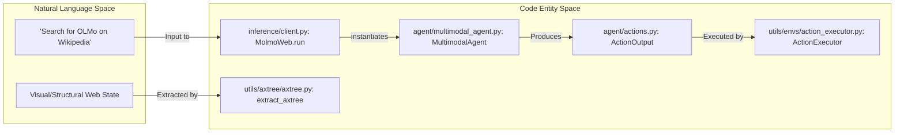
Sources: [README.md:170-184](), [README.md:218-220](), [demo.ipynb:24-30]()

## Getting Started

To begin using MolmoWeb, you must install the dependencies (including Playwright), download the model weights, and start the FastAPI server. [README.md:51-68](), [README.md:88-120]()

*   **Installation:** Uses `uv` for dependency management. [README.md:53-53](), [pyproject.toml:1-30]()
*   **Hardware:** Requires a GPU for the model server (e.g., MolmoWeb-8B). [README.md:38-41]()
*   **For details, see [Getting Started](#1.1).**

## System Architecture Deep-Dive

The system supports various deployment configurations, from running everything on a single local machine to distributed setups using Modal or Browserbase. [README.md:75-77](), [README.md:209-211]()

*   **For details, see [System Architecture](#1.2).**

---

# Page: Getting Started

# Getting Started

<details>
<summary>Relevant source files</summary>

The following files were used as context for generating this wiki page:

- [.venv.lock](.venv.lock)
- [README.md](README.md)
- [demo.ipynb](demo.ipynb)
- [inference/.env.example](inference/.env.example)
- [pyproject.toml](pyproject.toml)
- [scripts/download_weights.sh](scripts/download_weights.sh)
- [scripts/start_server.sh](scripts/start_server.sh)

</details>


This page provides a technical step-by-step guide for setting up the MolmoWeb environment. It covers dependency installation, model weight management, server configuration, and initial verification.

## 1. Installation

MolmoWeb requires **Python 3.10+** and uses `uv` for fast, reliable dependency management [README.md:53-54](), [pyproject.toml:6-7]().

### Local Setup
1.  **Install uv**:
    ```bash
    curl -LsSf https://astral.sh/uv/install.sh | sh
    ```
2.  **Clone and Sync**:
    ```bash
    git clone git@github.com:allenai/molmoweb.git
    cd molmoweb
    uv venv --python ">=3.10,<3.13"
    uv sync
    ```
3.  **Install Playwright**:
    The agent requires Playwright to control the browser locally. You must install the browser binaries and their system dependencies [README.md:65-68]().
    ```bash
    uv run playwright install
    uv run playwright install --with-deps chromium
    ```

### Environment Variables
Configure your environment based on your deployment choice. These are typically set in a `.env` file or exported in your shell [README.md:72-84]().

| Variable | Purpose | Required For |
| :--- | :--- | :--- |
| `BROWSERBASE_API_KEY` | Cloud browser authentication | `--env_type browserbase` |
| `BROWSERBASE_PROJECT_ID` | Cloud browser project | `--env_type browserbase` |
| `GOOGLE_API_KEY` | Gemini model access | `gemini_cua`, `gemini_axtree` |
| `OPENAI_API_KEY` | GPT-4 model access | `gpt_axtree` |

**Sources:** [README.md:51-84](), [pyproject.toml:1-26]()

---

## 2. Downloading Model Weights

MolmoWeb supports several model variants, ranging from 4B to 8B parameters, in both HuggingFace-compatible and Molmo-native formats [README.md:36-43]().

The `scripts/download_weights.sh` script automates the download process using the `hf` CLI provided by the environment [scripts/download_weights.sh:18]().

| Model Alias | HuggingFace Path | Type |
| :--- | :--- | :--- |
| MolmoWeb-8B (Default) | `allenai/MolmoWeb-8B` | HF/Transformers |
| MolmoWeb-4B | `allenai/MolmoWeb-4B` | HF/Transformers |
| MolmoWeb-8B-Native | `allenai/MolmoWeb-8B-Native` | Native Checkpoint |
| MolmoWeb-4B-Native | `allenai/MolmoWeb-4B-Native` | Native Checkpoint |

**Usage:**
```bash
# Downloads to ./checkpoints/MolmoWeb-8B by default
bash scripts/download_weights.sh 

# Download specific native version
bash scripts/download_weights.sh allenai/MolmoWeb-4B-Native
```

**Sources:** [README.md:34-47](), [scripts/download_weights.sh:1-23]()

---

## 3. Starting the Model Server

The model server is a FastAPI application that wraps the model inference logic, allowing the browser client to stay lightweight while the heavy computation happens on a GPU-enabled machine [README.md:163]().

### Server Initialization Flow
The server uses `uvicorn` to host the application defined in `agent.fastapi_model_server:app` [scripts/start_server.sh:39]().

#### Model Server Startup Sequence
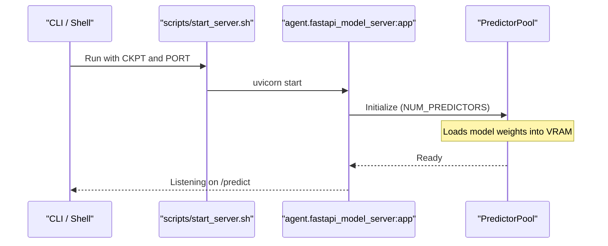

### Configuration
You can configure the server via CLI arguments or environment variables. CLI arguments take precedence over environment variables [scripts/start_server.sh:11-19]().

| Variable | Description | Default |
| :--- | :--- | :--- |
| `CKPT` | Path to local weights or HF ID | `allenai/MolmoWeb-8B` |
| `PREDICTOR_TYPE` | Inference backend (`native` or `hf`) | `native` |
| `NUM_PREDICTORS` | Number of GPU worker processes | `1` |
| `PORT` | Server port | `8001` |
| `TEMPERATURE` | Sampling temperature | `0.7` |
| `TOP_P` | Top-p sampling | `0.8` |

**Execution:**
```bash
# Start with local checkpoint and custom port
bash scripts/start_server.sh ./checkpoints/MolmoWeb-8B 8002
```

**Sources:** [scripts/start_server.sh:1-40](), [README.md:101-129]()

---

## 4. Verifying the Setup

Once the server is running, you should verify the end-to-end inference pipeline using the provided smoke test.

### Smoke Test Script
The `scripts/test_server.py` script performs the following:
1.  Encodes a local test image (`assets/test_screenshot.png`) to Base64 [README.md:152-153]().
2.  Sends a `POST` request to the `/predict` endpoint with a prompt [README.md:155-158]().
3.  Prints the model's structured response (thought and action).

```bash
uv run python scripts/test_server.py
```

### Manual Verification
You can also verify the endpoint via a simple Python snippet:
```python
import base64, requests
with open("assets/test_screenshot.png", "rb") as f:
    image_b64 = base64.b64encode(f.read()).decode()

resp = requests.post("http://127.0.0.1:8001/predict", json={
    "prompt": "What are the first four job titles listed under 'Open roles'?",
    "image_base64": image_b64,
})
print(resp.json())
```

**Sources:** [README.md:131-160]()

---

## 5. Running the Demo Notebook

The `demo.ipynb` notebook provides a high-level interface to the `MolmoWeb` client, demonstrating complex multi-step tasks like product discovery and parallel price comparison [demo.ipynb:9-15]().

### Client-Server Architecture
The `MolmoWeb` client manages the browser lifecycle while delegating vision-language reasoning to the model server.

#### Code Entity Mapping
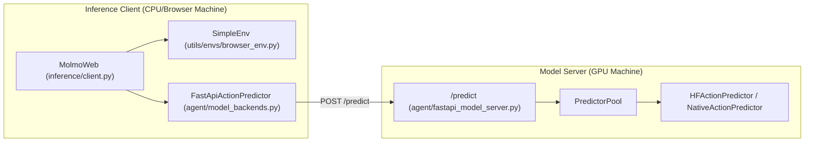

### Demo Steps
1.  **Initialize Client**: Instantiate `MolmoWeb` with `local=True` to use the local Chromium instance [demo.ipynb:27-30]().
2.  **Single Query**: Run a task using `client.run()`. The agent will autonomously navigate and perform actions [demo.ipynb:58-59]().
3.  **Inspect Trajectory**: Access `traj.steps` to see the model's `thought` and the resulting `action` for any step [demo.ipynb:84-89]().
4.  **Follow-up Query**: Use `client.continue_run()` to maintain the browser state and history for a new task [README.md:188-191]().
5.  **Visualization**: The client can save the entire interaction as an interactive HTML file [README.md:182]().

**Sources:** [demo.ipynb:1-90](), [README.md:161-204]()

---

# Page: System Architecture

# System Architecture

<details>
<summary>Relevant source files</summary>

The following files were used as context for generating this wiki page:

- [README.md](README.md)
- [agent/fastapi_model_server.py](agent/fastapi_model_server.py)
- [agent/model_backends.py](agent/model_backends.py)
- [inference/client.py](inference/client.py)
- [scripts/start_server.sh](scripts/start_server.sh)

</details>


MolmoWeb employs a split-process architecture designed to decouple heavy GPU-bound model inference from the browser-bound agent logic. This separation allows the **Model Server** to run on specialized hardware (e.g., a GPU cluster or serverless provider) while the **Inference Client** manages the browser environment and state transitions on a standard machine.

## High-Level Architecture

The system is divided into two primary domains: the server-side infrastructure for model execution and the client-side infrastructure for web automation.

### Component Overview Diagram
This diagram illustrates the relationship between the core classes and their distribution across the network.

**Figure 1: Split-Process Architecture**
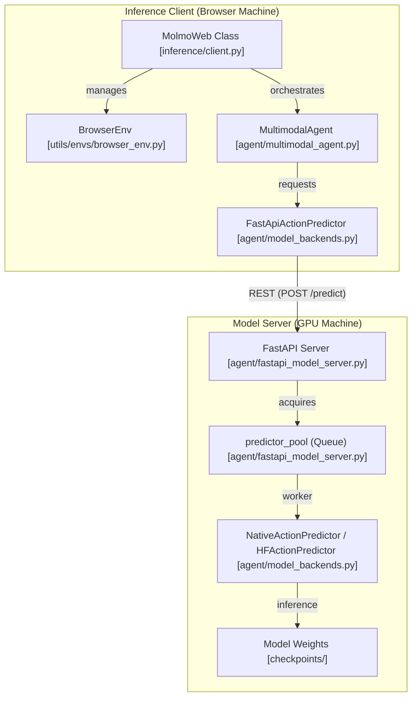
**Sources:** [inference/client.py:56-82](), [agent/fastapi_model_server.py:67-79](), [agent/model_backends.py:22-50](), [agent/fastapi_model_server.py:59-65]().

---

## Model Server (GPU)

The Model Server is a FastAPI-based application that wraps Molmo model checkpoints. It is designed for high-throughput and multi-GPU utilization through a predictor pool pattern.

### Key Implementation Details
*   **Predictor Pool:** The server initializes a `queue.Queue` of predictors via `create_predictor_pool` during startup. Each predictor is assigned to a specific CUDA device based on the `NUM_PREDICTORS` environment variable [agent/fastapi_model_server.py:26-56]().
*   **The `/predict` Endpoint:** This endpoint accepts a `PredictRequest` containing a `prompt`, `image_base64` screenshot, and an optional history of `past_actions` [agent/fastapi_model_server.py:70-79]().
*   **Stateless Inference with State Restoration:** While the model itself is stateless, the server supports per-request sampling parameters (`temperature`, `top_p`) by saving the predictor's defaults and restoring them after the `predict()` call [agent/fastapi_model_server.py:89-105]().
*   **Backend Support:** The server can be configured via `PREDICTOR_TYPE` to use either `NativeActionPredictor` (for OLMo-native checkpoints) or `HFActionPredictor` (for HuggingFace Transformers-compatible checkpoints) [agent/fastapi_model_server.py:42-51]().

**Sources:** [agent/fastapi_model_server.py:15-23](), [agent/fastapi_model_server.py:59-65](), [agent/fastapi_model_server.py:83-108](), [agent/model_backends.py:95-141]().

---

## Inference Client (Browser)

The Inference Client is the orchestrator of the web-agent loop. It manages the lifecycle of the browser, captures observations, and executes actions returned by the model.

### Data Flow & Execution Loop
The `MolmoWeb` class uses an internal `MultimodalAgent` to handle prompt construction and a `BrowserEnv` to handle the actual web interaction.

**Figure 2: Execution Loop and Code Entities**
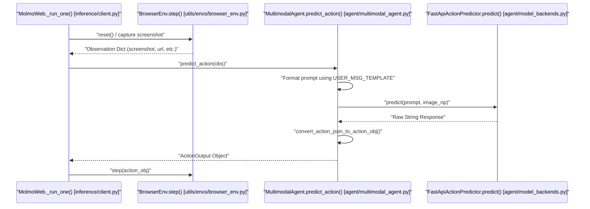
**Sources:** [inference/client.py:155-175](), [agent/model_backends.py:33-49](), [inference/client.py:98-105]().

---

## Deployment Modes

MolmoWeb supports three primary deployment modes to accommodate different hardware and scaling requirements.

| Mode | Model Location | Browser Location | Implementation Class |
| :--- | :--- | :--- | :--- |
| **Local** | Local GPU (via FastAPI) | Local Chromium | `SimpleEnv` [inference/client.py:108-118]() |
| **Browserbase** | Remote GPU | Cloud Browser | `BrowserbaseEnv` [inference/client.py:120-129]() |
| **Modal** | Serverless GPU | Local/Cloud | `ModalActionPredictor` [agent/model_backends.py:56-89]() |

### Deployment Details
1.  **Local Mode:** Uses Playwright to launch a local Chromium instance. The client connects to a model server running on `localhost` (usually port 8001) [inference/client.py:71-80]().
2.  **Browserbase Mode:** Offloads the browser execution to the Browserbase cloud platform via `BrowserbaseEnv`. This is useful for avoiding bot detection and scaling many parallel browser sessions [inference/client.py:120-129]().
3.  **Modal Mode:** Utilizes the `ModalActionPredictor` to invoke model inference as a serverless function via a Modal endpoint, removing the need to maintain a long-running FastAPI server [agent/model_backends.py:56-61]().
4.  **Local Inference (No Server):** For development, `HFActionPredictor` or `NativeActionPredictor` can be used directly within the client process if a GPU is available locally, bypassing the REST layer [agent/model_backends.py:95-148]().

**Sources:** [README.md:164-184](), [inference/client.py:75-82](), [agent/model_backends.py:22-50](), [scripts/start_server.sh:7-16]().

---

# Page: Agent Layer

# Agent Layer

<details>
<summary>Relevant source files</summary>

The following files were used as context for generating this wiki page:

- [agent/actions.py](agent/actions.py)
- [agent/gemini_axtree_agent.py](agent/gemini_axtree_agent.py)
- [agent/gemini_cua.py](agent/gemini_cua.py)
- [agent/gpt_axtree_agent.py](agent/gpt_axtree_agent.py)
- [agent/multimodal_agent.py](agent/multimodal_agent.py)
- [agent/utils.py](agent/utils.py)

</details>


The Agent Layer is the decision-making core of MolmoWeb. It abstracts the logic required to observe a web page, reason about a task goal, and produce a structured action. The system supports multiple agent implementations, ranging from the native Molmo-based multimodal agent to specialized agents backed by external LLMs like GPT-4o or Gemini.

### Core Abstractions

All agents in MolmoWeb inherit from the `AgentBase` abstract class [agent/utils.py:5-26](). This base class defines a standard interface for resetting agent state and predicting actions based on environment observations.

| Component | Description |
| :--- | :--- |
| `AgentBase` | Abstract base class defining `predict_action` and `reset` [agent/utils.py:5-26](). |
| `ActionOutput` | A Pydantic wrapper that pairs a predicted `action` with the agent's internal `thought` process [agent/actions.py:218-222](). |
| `ALL_ACTIONS` | A union type encompassing all valid action objects (Click, Type, Scroll, etc.) [agent/actions.py:225-241](). |

### Agent Subsystem Overview

The following diagram illustrates how the abstract agent interface is realized by different implementations and how they interact with the Action Schema.

**Agent Architecture & Code Entities**
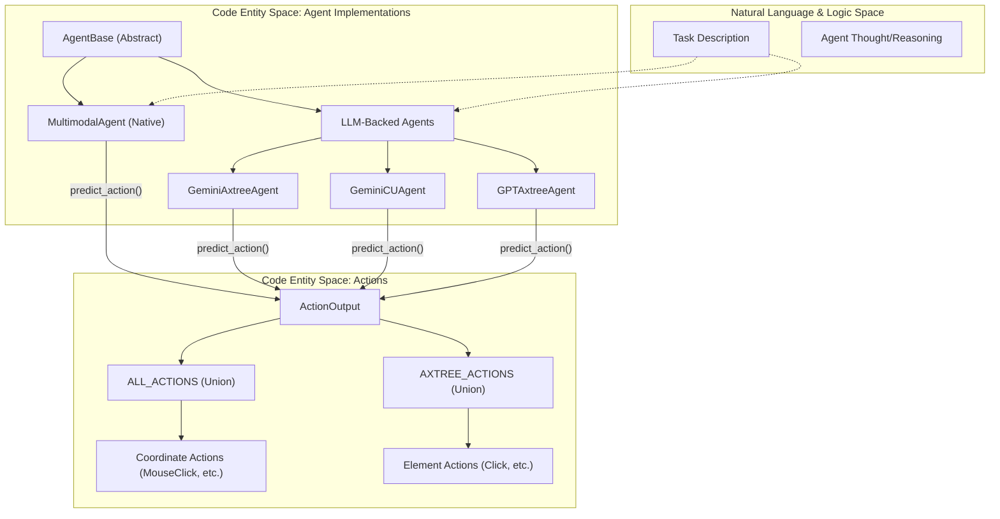
**Sources:** [agent/utils.py:5-26](), [agent/multimodal_agent.py:162-205](), [agent/actions.py:218-241](), [agent/gemini_axtree_agent.py:135-138](), [agent/gemini_cua.py:191-198](), [agent/gpt_axtree_agent.py:135-141]()

---

### Action Schema
The Action Schema defines the "language" used by agents to interact with the browser. It includes coordinate-based actions (e.g., `MouseClick` at X, Y) and element-based actions (e.g., `Click` on a specific `bid`). The schema also defines the termination protocol via `Noop` and `ReportInfeasible` [agent/actions.py:202-216]().

For details, see [Action Schema](#2.1).

**Sources:** [agent/actions.py:10-216]()

---

### Multimodal Agent (MolmoWeb Native)
The `MultimodalAgent` is the primary implementation designed to work with Molmo models. It processes visual screenshots and textual task descriptions directly. A key responsibility of this agent is coordinate transformation: it converts model predictions (typically 0-100 percentages) into pixel coordinates using `_pct_to_coord` [agent/multimodal_agent.py:66-70]() and `_pct_to_px` [agent/multimodal_agent.py:62-63]() based on the screenshot dimensions.

For details, see [Multimodal Agent (MolmoWeb Native)](#2.2).

**Sources:** [agent/multimodal_agent.py:162-205](), [agent/multimodal_agent.py:73-147]()

---

### LLM-Backed Agents
MolmoWeb provides alternative agent implementations that use external APIs. These agents typically rely on the Accessibility Tree (AXTree) or specialized computer-use protocols.

*   **GeminiAxtreeAgent**: Uses Google's Gemini models with a flattened AXTree string and a two-step `[ANSWER]` / `[EXIT]` termination protocol [agent/gemini_axtree_agent.py:63-82]().
*   **GeminiCUAgent**: Utilizes the `gemini-2.5-computer-use-preview` model for direct coordinate interaction using a 0-999 normalized scale [agent/gemini_cua.py:71-79]().
*   **GPTAxtreeAgent**: Uses OpenAI's models with structured output parsing via `beta.chat.completions.parse` [agent/gpt_axtree_agent.py:65-74]().

For details, see [LLM-Backed Agents](#2.3).

**Sources:** [agent/gemini_axtree_agent.py:135-145](), [agent/gemini_cua.py:191-215](), [agent/gpt_axtree_agent.py:135-145]()

---

### System Data Flow

This diagram bridges the gap between the high-level task and the specific code entities involved in the prediction loop.

**Prediction Flow: Observation to Action**
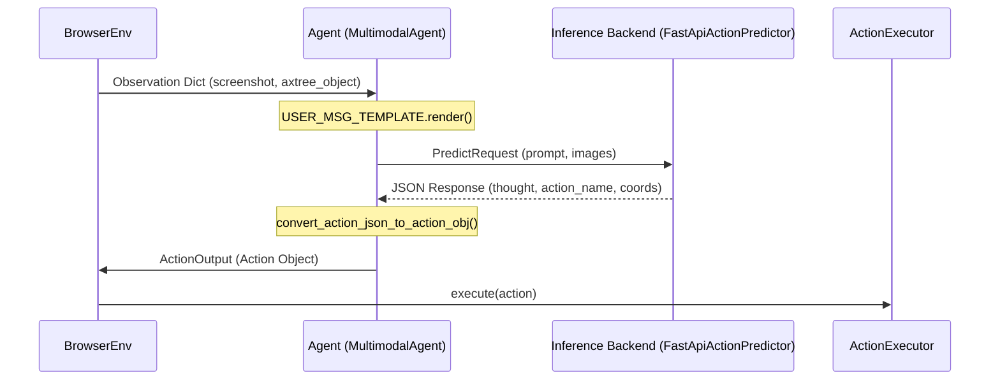
**Sources:** [agent/multimodal_agent.py:42-59](), [agent/multimodal_agent.py:73-147](), [agent/multimodal_agent.py:228-260](), [agent/model_backends.py:126-140]()

---

# Page: Action Schema

# Action Schema

<details>
<summary>Relevant source files</summary>

The following files were used as context for generating this wiki page:

- [agent/actions.py](agent/actions.py)

</details>


The Action Schema defines the formal language through which agents interact with the web environment. All actions are implemented as Pydantic models in `agent/actions.py`, providing structured validation and serialization for the split-process architecture.

## Overview of Action Types

Actions in MolmoWeb are categorized into two primary paradigms: **Element-based** (referencing specific nodes in the Accessibility Tree) and **Coordinate-based** (referencing pixel locations on the viewport).

### Element-Based Actions
These actions target elements using a `bid` (Backend ID), which is a unique identifier injected into the DOM and Accessibility Tree (AXTree) by the environment.

*   **`Click`**: Performs a click on a specific element identified by its `bid`. Supports `left`, `right`, and `middle` buttons, and `single` or `double` click types [agent/actions.py:10-17]().
*   **`Type`**: Targets a specific element by `bid` to type text. It includes options to `clear_before_typing` and `press_enter` after completion [agent/actions.py:218-223]().
*   **`Hover`**: Moves the mouse over a specific element by `bid` [agent/actions.py:236-240]().

### Coordinate-Based Actions
These actions interact with the page using raw pixel coordinates `(x, y)`. These are typically used by agents that process visual input directly (like Molmo or Gemini Computer Use).

*   **`MouseClick`**: A click at a specific pixel location [agent/actions.py:39-47]().
*   **`MouseMove` / `HoverAt`**: Moves the cursor to or hovers at a specific coordinate [agent/actions.py:60-76]().
*   **`MouseDragAndDrop`**: Drags from a starting `(x, y)` to a destination `(x, y)` [agent/actions.py:123-129]().
*   **`ScrollAt`**: Performs a scroll gesture starting at a specific pixel location [agent/actions.py:103-109]().
*   **`GeminiTypeTextAt`**: A specialized coordinate-based typing action used by Gemini agents that combines positioning, clearing, typing, and optionally pressing enter [agent/actions.py:170-177]().

### Browser & System Actions
*   **`Goto`**: Navigates the browser to a specific URL [agent/actions.py:188-191]().
*   **`BrowserNav`**: Executes browser-level commands like `back`, `forward`, or `reload` [agent/actions.py:202-205]().
*   **`Scroll`**: A global scroll action (not location-specific) [agent/actions.py:85-89]().
*   **`KeyboardPress`**: Presses specific keys or combinations (e.g., "Enter", "Control+L") [agent/actions.py:148-151]().
*   **`SelectAll`**: A specialized `KeyboardPress` wrapper for the "ControlOrMeta+a" shortcut [agent/actions.py:159-162]().

Sources: [agent/actions.py:10-240]()

---

## Action Wrappers and Unions

To handle the variety of possible outputs from different models, the codebase uses union types and wrapper classes.

### The ActionOutput Wrapper
The `ActionOutput` class acts as a container for the agent's response. It includes the action itself, the agent's internal reasoning, and an optional answer if the task is complete.

| Field | Type | Description |
| :--- | :--- | :--- |
| `action` | `ALL_ACTIONS` | The specific action object to execute. |
| `thought` | `str` | The agent's step-by-step reasoning. |
| `answer` | `str \| None` | The final answer to the user's request (if applicable). |

Sources: [agent/actions.py:291-295]()

### Union Types
The system defines two main union types to categorize actions based on the agent's capabilities:

1.  **`AXTREE_ACTIONS`**: Includes `Click`, `Type`, `Hover`, `Goto`, `BrowserNav`, `Scroll`, `KeyboardPress`, `Noop`, and `ReportInfeasible`. This set is used by agents that rely on the Accessibility Tree [agent/actions.py:307-318]().
2.  **`ALL_ACTIONS`**: A superset including all `AXTREE_ACTIONS` plus coordinate-based actions like `MouseClick`, `MouseMove`, `HoverAt`, `MouseDragAndDrop`, and `GeminiTypeTextAt` [agent/actions.py:321-336]().

---

## Termination Protocol

MolmoWeb uses a specific protocol to signal the end of a trajectory or the inability to proceed.

### Noop (No Operation)
The `Noop` action is used when the agent believes the task is finished or it needs to wait for a page state to change.
*   **Implementation**: `Noop` triggers a wait period (default `NOOP_WAIT_MS = 5000`) [agent/actions.py:7, 252-255]().
*   **Termination**: If an agent provides an `answer` alongside a `Noop`, the `ActionExecutor` treats this as a successful completion of the task [agent/actions.py:291-295]().

### ReportInfeasible
If the agent determines the user's request cannot be fulfilled (e.g., a missing button or a broken link), it returns `ReportInfeasible`.
*   **Fields**: Contains a `reason` string explaining why the task failed [agent/actions.py:269-272]().

Sources: [agent/actions.py:7, 252-272, 291-295]()

---

## Data Flow: From Model Output to Execution

The following diagram illustrates how a natural language thought process is transformed into a validated code entity and finally executed.

### Action Transformation Pipeline
"Natural Language Space to Code Entity Space"

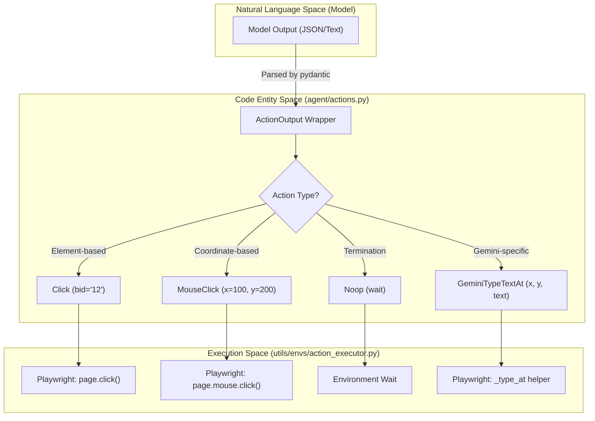
Sources: [agent/actions.py:10-58, 170-177, 252-255, 291-295]()

---

## Implementation Details

### Coordinate Handling
Coordinate-based actions (`MouseClick`, `MouseMove`, etc.) use raw pixel values. However, the `NativeActionPredictor` and certain agents may work with percentage-based coordinates (0-1000) which are scaled to the actual viewport size before being encapsulated in these Pydantic models.

### String Representation and Descriptions
Every action class implements `__str__` for logging and `describe()` for generating human-readable summaries of the agent's steps. The `describe()` method for element-based actions can optionally take an `axtree` to resolve a `bid` into a descriptive name (e.g., "button 'Submit'") [agent/actions.py:23-37, 53-57]().

### Element Resolution Helper
The private function `_get_node_from_bid` is used internally by the `describe()` methods to traverse the AXTree dictionary and find the node metadata associated with a specific `bid` [agent/actions.py:343-353]().

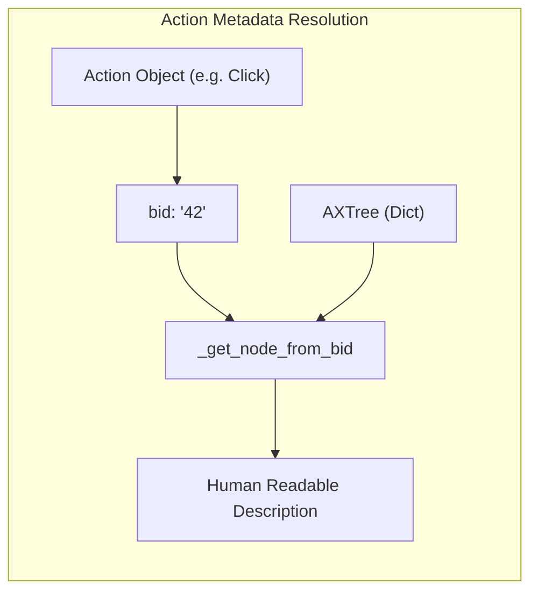
Sources: [agent/actions.py:26-31, 343-353]()

---

# Page: Multimodal Agent (MolmoWeb Native)

# Multimodal Agent (MolmoWeb Native)

<details>
<summary>Relevant source files</summary>

The following files were used as context for generating this wiki page:

- [agent/actions.py](agent/actions.py)
- [agent/multimodal_agent.py](agent/multimodal_agent.py)
- [agent/utils.py](agent/utils.py)

</details>


The `MultimodalAgent` is the core implementation for the native MolmoWeb model. Unlike LLM-backed agents that rely on text-based accessibility trees (AXTrees), the `MultimodalAgent` is designed to process visual screenshots directly alongside task descriptions and action history. It manages the transformation of model-predicted percentage coordinates into pixel-perfect browser actions and handles the stateful history of the agent's trajectory.

## Overview of MultimodalAgent

The `MultimodalAgent` class inherits from the abstract `AgentBase` [agent/utils.py:5-26]() and implements a stateful loop for web navigation. It maintains a history of `past_actions` and `past_observations` [agent/multimodal_agent.py:185-186]() to provide context for the next prediction.

### Key Responsibilities
*   **Prompt Construction**: Building the `USER_MSG_TEMPLATE` with task goals and history [agent/multimodal_agent.py:42-59]().
*   **Coordinate Transformation**: Converting the model's normalized 0-100 coordinates into viewport pixels using `_pct_to_coord` [agent/multimodal_agent.py:66-70]().
*   **Action Parsing**: Translating JSON output from the inference backend into Pydantic action objects via `convert_action_json_to_action_obj` [agent/multimodal_agent.py:73-147]().
*   **Backend Dispatch**: Routing requests to various inference engines (FastAPI, Modal, Local HF, or Native) [agent/multimodal_agent.py:188-215]().

### Multimodal Agent Data Flow

The following diagram illustrates how the `MultimodalAgent` bridges the gap between raw browser observations and the structured actions executed by the system.

**Data Flow: Observation to Action**
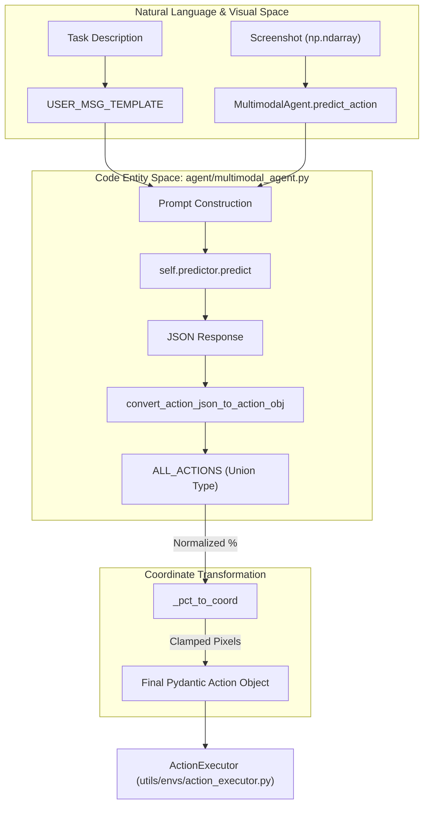
**Sources:** [agent/multimodal_agent.py:42-148](), [agent/multimodal_agent.py:228-260](), [agent/actions.py:261-285]()

---

## Prompt Engineering & History Management

The agent uses a structured Jinja2 template, `USER_MSG_TEMPLATE`, to format the input for the model. This template includes the goal, a history of previous steps, and metadata about the currently active page [agent/multimodal_agent.py:42-59]().

### USER_MSG_TEMPLATE Structure
| Section | Content | Source |
| :--- | :--- | :--- |
| **# GOAL** | The high-level task description provided by the user. | `task_description` [agent/multimodal_agent.py:45]() |
| **# PREVIOUS STEPS** | A list of prior thoughts and actions, limited by `max_past_steps`. | `past_actions` [agent/multimodal_agent.py:48-52]() |
| **# CURRENTLY ACTIVE PAGE** | Title, URL, and index of the browser tab. | `page_title`, `page_url`, `page_index` [agent/multimodal_agent.py:54]() |

The agent limits history using `max_past_steps` (default 3) and `max_past_images` (default 0) to prevent context window overflow and reduce latency [agent/multimodal_agent.py:170-171]().

**Sources:** [agent/multimodal_agent.py:42-59](), [agent/multimodal_agent.py:230-245]()

---

## Coordinate Transformation

The native Molmo model predicts locations as percentages (0.0 to 100.0) relative to the image dimensions. The agent provides two utility functions to map these back to the browser viewport:

1.  **`_pct_to_px(pct, dim)`**: A simple linear scaling used for relative movements like scrolling [agent/multimodal_agent.py:62-63]().
2.  **`_pct_to_coord(pct, dim)`**: A robust scaling function for absolute coordinates (clicks, hovers). It clamps the resulting pixel value to `[1.0, dim - 2.0]` to ensure that even if the model predicts exactly `0` or `100`, the action lands inside the clickable area of the viewport [agent/multimodal_agent.py:66-70]().

**Sources:** [agent/multimodal_agent.py:62-71]()

---

## Action Parsing Logic

The function `convert_action_json_to_action_obj` is the central dispatcher that converts the model's raw JSON output into the typed action objects defined in `agent/actions.py`.

### Mapping Table
| Model JSON `name` | Pydantic Class | Logic / Transformations |
| :--- | :--- | :--- |
| `click`, `dblclick`, `mouse_click` | `MouseClick` | Converts `x`, `y` via `_pct_to_coord`. Supports `button` and `click_type`. [agent/multimodal_agent.py:88-94]() |
| `hover_at` | `HoverAt` | Converts `x`, `y` via `_pct_to_coord`. [agent/multimodal_agent.py:95-100]() |
| `drag_and_drop` | `MouseDragAndDrop` | Converts `from` and `to` coordinates. [agent/multimodal_agent.py:101-107]() |
| `type`, `keyboard_type`| `KeyboardType` | Extracts `text` string. [agent/multimodal_agent.py:120-121]() |
| `keypress`, `keyboard_press` | `KeyboardPress` | Validates key against `ALLOWED_KEYS`. [agent/multimodal_agent.py:122-127]() |
| `scroll` | `Scroll` | Converts `delta_x`, `delta_y` via `_pct_to_px`. [agent/multimodal_agent.py:108-112]() |
| `goto` | `Goto` | Extracts target `url`. [agent/multimodal_agent.py:136-137]() |
| `noop` | `Noop` | Captures `noop_reason` (e.g., "loading"). [agent/multimodal_agent.py:142-143]() |

If an action is unsupported or the JSON is malformed, the agent returns a `ReportInfeasible` object with a detailed reason [agent/multimodal_agent.py:144-147]().

**Sources:** [agent/multimodal_agent.py:73-148](), [agent/actions.py:10-258]()

---

## Inference Backends & Dispatch

The `MultimodalAgent` does not run inference itself; it delegates to a `predictor` object based on the `inference_mode` [agent/multimodal_agent.py:188-215]().

**Backend Selection Logic**
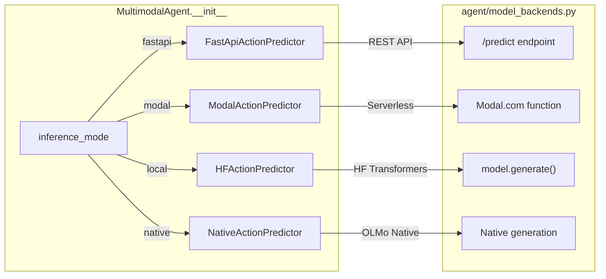
**Sources:** [agent/multimodal_agent.py:188-215](), [agent/model_backends.py:1-20]()

### Execution Cycle in `predict_action`

When `predict_action` is called with a browser observation [agent/multimodal_agent.py:228](), the following steps occur:

1.  **State Capture**: Extracts current URL, title, and tab index from the observation dictionary [agent/multimodal_agent.py:231-235]().
2.  **Prompting**: Renders the `USER_MSG_TEMPLATE` with the current task, truncated URLs, and history [agent/multimodal_agent.py:240-252]().
3.  **Inference**: Calls `self.predictor.predict(...)` with the prompt and the current screenshot [agent/multimodal_agent.py:254-260]().
4.  **Conversion**: Passes the resulting JSON to `convert_action_json_to_action_obj` along with the screenshot for coordinate scaling [agent/multimodal_agent.py:262]().
5.  **History Update**: Appends the predicted thought and action to `self.past_actions` and maintains `past_observations` [agent/multimodal_agent.py:270-280]().

**Sources:** [agent/multimodal_agent.py:228-285]()

---

# Page: LLM-Backed Agents

# LLM-Backed Agents

<details>
<summary>Relevant source files</summary>

The following files were used as context for generating this wiki page:

- [agent/gemini_axtree_agent.py](agent/gemini_axtree_agent.py)
- [agent/gemini_cua.py](agent/gemini_cua.py)
- [agent/gpt_axtree_agent.py](agent/gpt_axtree_agent.py)
- [agent/utils.py](agent/utils.py)

</details>


The MolmoWeb framework provides three alternative agent implementations that utilize external Large Language Model (LLM) APIs—specifically from Google (Gemini) and OpenAI (GPT). These agents serve as high-performance alternatives to the native multimodal model, leveraging specialized features like structured JSON outputs or native "Computer Use" capabilities to navigate the web.

## Overview of Agent Implementations

While the native `MultimodalAgent` processes visual screenshots directly, the LLM-backed agents primarily interact with the page via a flattened Accessibility Tree (AXTree) or through specialized API-level tool calls.

| Agent Class | LLM Provider | Primary Input | Output Mechanism |
| :--- | :--- | :--- | :--- |
| `GeminiAxtreeAgent` | Google Gemini | Flattened AXTree (Text) | Structured JSON (Response Schema) |
| `GeminiCUAgent` | Google Gemini | Screenshot + Tools | Native Computer Use Tool Calls |
| `GPTAxtreeAgent` | OpenAI GPT | Flattened AXTree (Text) | Structured Outputs (`beta.chat.completions.parse`) |

### Shared Patterns

All LLM-backed agents inherit from the `AgentBase` abstract class [agent/utils.py:5-26](). They follow a common execution loop where observations from the `BrowserEnv` are transformed into a prompt, sent to an API, and the resulting action is parsed into an `ActionOutput` object.

Key shared features include:
*   **AXTree Flattening**: Both `GeminiAxtreeAgent` and `GPTAxtreeAgent` use `flatten_axtree_to_str` to convert the DOM into a text representation where elements are identified by "bids" (Backend IDs) [agent/gemini_axtree_agent.py:5](), [agent/gpt_axtree_agent.py:5](), [agent/gpt_axtree_agent.py:79-88]().
*   **Termination Protocol**: These agents typically use a two-step termination sequence: first sending an `[ANSWER]` via `send_msg_to_user`, followed by an `[EXIT]` signal [agent/gemini_axtree_agent.py:63-82]().
*   **System Prompting**: They share a common `SYSTEM_MESSAGE` that defines navigation guidelines, constraints on "thoughts" (reasoning), and efficiency requirements [agent/gemini_axtree_agent.py:12-102](), [agent/gpt_axtree_agent.py:11]().

### Agent Architecture to Code Mapping

The following diagram illustrates how the abstract agent concepts map to specific classes and utility functions within the codebase.

**LLM Agent Entity Mapping**
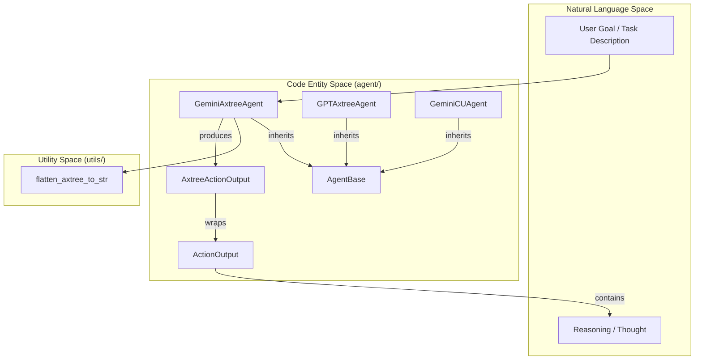
**Sources:** [agent/utils.py:5-26](), [agent/gemini_axtree_agent.py:1-11](), [agent/gpt_axtree_agent.py:135-141](), [agent/gemini_cua.py:191-198]()

---

## GeminiAxtreeAgent

The `GeminiAxtreeAgent` uses the Google Gemini API to process a text-based representation of the web page. It relies heavily on a structured system message that instructs the model to use element IDs (bids) for interaction [agent/gemini_axtree_agent.py:12-22](). It uses a specific `response_schema` (defined via `AxtreeActionOutput`) to ensure the model returns valid JSON that maps directly to `AXTREE_ACTIONS`.

For details, see [GeminiAxtreeAgent](#2.3.1).

**Sources:** [agent/gemini_axtree_agent.py:12-102](), [agent/gemini_axtree_agent.py:136-140]()

---

## GeminiCUAgent (Computer Use)

The `GeminiCUAgent` leverages the `gemini-2.5-computer-use-preview` model [agent/gemini_cua.py:195](). Unlike the AXTree-based agents, this agent operates on a 0-999 coordinate system and uses native API tool calls (`computer_use` tools) to perform actions like `click_at`, `type_text_at`, and `scroll_at` [agent/gemini_cua.py:205-215](). It manages a multi-turn history of `Content` objects, including screenshots and function responses [agent/gemini_cua.py:216-217]().

For details, see [GeminiCUAgent (Computer Use)](#2.3.2).

**Sources:** [agent/gemini_cua.py:193-215](), [agent/gemini_cua.py:71-80](), [agent/gemini_cua.py:108-189]()

---

## GPTAxtreeAgent

The `GPTAxtreeAgent` utilizes OpenAI's GPT models (defaulting to `gpt-5` or as configured via `GPT_AXTREE_MODEL`) through the `beta.chat.completions.parse` method [agent/gpt_axtree_agent.py:13-14](), [agent/gpt_axtree_agent.py:65-72](). It shares the same system message and AXTree filtering strategy as the Gemini AXTree agent but implements a specific error feedback loop that passes `last_action_error` back into the user prompt to handle execution failures [agent/gpt_axtree_agent.py:105-109]().

For details, see [GPTAxtreeAgent](#2.3.3).

**Sources:** [agent/gpt_axtree_agent.py:13-14](), [agent/gpt_axtree_agent.py:65-72](), [agent/gpt_axtree_agent.py:105-109]()

---

## Comparison of Action Logic

The following diagram shows how actions are dispatched differently between the AXTree-based agents (which use element IDs) and the Computer Use agent (which uses normalized coordinates).

**Action Dispatch Flow**
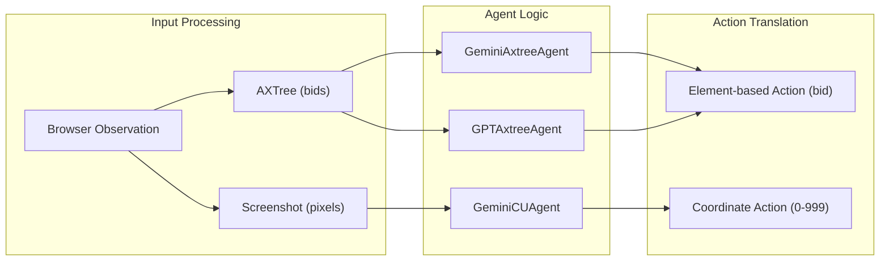
**Sources:** [agent/gemini_axtree_agent.py:136-140](), [agent/gpt_axtree_agent.py:159-170](), [agent/gemini_cua.py:108-112]()

---

# Page: GeminiAxtreeAgent

# GeminiAxtreeAgent

<details>
<summary>Relevant source files</summary>

The following files were used as context for generating this wiki page:

- [agent/actions.py](agent/actions.py)
- [agent/gemini_axtree_agent.py](agent/gemini_axtree_agent.py)

</details>


The `GeminiAxtreeAgent` is a specialized LLM-backed agent that utilizes Google's Gemini models to interact with web pages. Unlike the native multimodal agent, this agent relies on a flattened text representation of the Accessibility Tree (AXTree) rather than visual screenshots to understand page state. It employs a strict JSON response schema and a two-step termination protocol to ensure reliable task completion and structured data extraction.

### Implementation Overview

The agent is implemented in `agent/gemini_axtree_agent.py` and inherits from `AgentBase` [agent/gemini_axtree_agent.py:9-9](). It uses the `google-genai` SDK to communicate with Gemini models, specifically leveraging `response_schema` to enforce structured outputs that map directly to the system's action space.

#### Data Flow and Component Interaction

The following diagram illustrates how the `GeminiAxtreeAgent` processes environment observations and generates actions.

**GeminiAxtreeAgent Decision Loop**
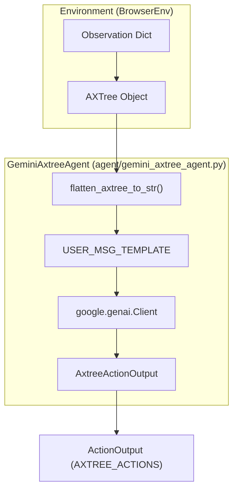
**Sources:** [agent/gemini_axtree_agent.py:5-10](), [agent/gemini_axtree_agent.py:114-138]()

---

### System Message Design

The agent is governed by a comprehensive `SYSTEM_MESSAGE` [agent/gemini_axtree_agent.py:12-102]() that defines its persona as an intelligent web assistant. Key components of the system message include:

*   **AXTree Context:** Explains the hierarchical representation of the page using unique IDs called `bid` (backend IDs) [agent/gemini_axtree_agent.py:15-22]().
*   **Thought Constraints:** Explicitly forbids the model from mentioning implementation details like `bid`, DOM structure, or HTML tags in its `thought` field to keep reasoning high-level [agent/gemini_axtree_agent.py:24-30]().
*   **Navigation Guidelines:** Includes strict rules for `goto` actions, prohibiting the fabrication of URLs or query parameters [agent/gemini_axtree_agent.py:31-42]().
*   **Reasoning Requirements:** Mandates a dense 6-point reasoning process including Goal Decomposition, Progress Assessment, and Gap Analysis [agent/gemini_axtree_agent.py:84-100]().

**Sources:** [agent/gemini_axtree_agent.py:12-102]()

---

### AXTree Flattening and Prompting

The agent converts the complex accessibility tree into a string format that Gemini can process efficiently.

1.  **Flattening:** It calls `flatten_axtree_to_str` [agent/gemini_axtree_agent.py:5-5]() to transform the `axtree_object` from the observation into a text-based hierarchy.
2.  **Templating:** The `USER_MSG_TEMPLATE` [agent/gemini_axtree_agent.py:114-140]() assembles the final prompt containing:
    *   The user's goal.
    *   A history of `past_actions`.
    *   A list of all open tabs and the currently active page.
    *   The flattened AXTree string.

**Sources:** [agent/gemini_axtree_agent.py:5-5](), [agent/gemini_axtree_agent.py:114-140]()

---

### Structured Output and Actions

The agent uses a structured JSON response schema to ensure the model's output can be parsed into `AXTREE_ACTIONS`.

| Action Category | Supported Actions |
| :--- | :--- |
| **Element-based** | `click`, `type_text_at`, `hover`, `select_option` |
| **Coordinate-based** | `mouse_click`, `scroll_at` |
| **Navigation** | `goto`, `go_back`, `go_forward`, `page_focus` |
| **System** | `send_msg_to_user`, `noop` |

These actions are defined in `agent.actions.AXTREE_ACTIONS` [agent/gemini_axtree_agent.py:10-10](). The `AxtreeActionOutput` class [agent/actions.py:255-258]() is used as the `response_schema` to enforce that the model provides both a `thought` and a valid `action`.

**Gemini Action Mapping**
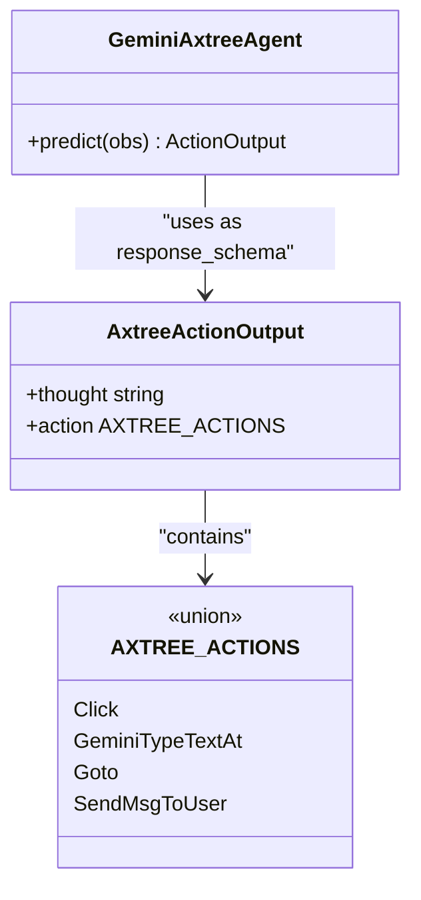
**Sources:** [agent/gemini_axtree_agent.py:8-10](), [agent/actions.py:255-258](), [agent/actions.py:241-252]()

---

### Termination Protocol

To ensure the agent successfully signals the end of a task and provides the requested information, it follows a strict two-step sequence:

1.  **Step 1: [ANSWER]**: The agent calls `send_msg_to_user(text='[ANSWER] <content>')` [agent/gemini_axtree_agent.py:67-70](). This step provides the final result to the user.
2.  **Step 2: [EXIT]**: In the subsequent turn, the agent must call `send_msg_to_user(text='[EXIT]')` [agent/gemini_axtree_agent.py:72-75]().

**Rules for Termination:**
*   The `[ANSWER]` and `[EXIT]` messages must never be combined in a single action [agent/gemini_axtree_agent.py:80-80]().
*   For non-textual tasks (e.g., "Navigate to Google"), the agent uses `[ANSWER] Done` [agent/gemini_axtree_agent.py:82-82]().
*   If an answer cannot be found, the agent should provide its best guess in the `[ANSWER]` message [agent/gemini_axtree_agent.py:81-81]().

**Sources:** [agent/gemini_axtree_agent.py:63-83]()

---

### Website-Specific Guidelines

The agent can be configured with a list of available websites via the `AVAILABLE_WEBSITES_TEMPLATE` [agent/gemini_axtree_agent.py:104-111](). This is used to inform the agent of specific URLs it is permitted to use, supporting the "Direct URL Navigation" guideline which prioritizes known URLs over search engine queries [agent/gemini_axtree_agent.py:33-42]().

**Key Constraints for URL Navigation:**
*   **NEVER** fabricate or guess URLs with paths or query parameters [agent/gemini_axtree_agent.py:35-35]().
*   Only use URLs explicitly visible on the page, provided in the task, or standard homepages [agent/gemini_axtree_agent.py:34-34]().
*   Navigate to base URLs first and then use site search for specific content [agent/gemini_axtree_agent.py:36-36]().

**Sources:** [agent/gemini_axtree_agent.py:33-42](), [agent/gemini_axtree_agent.py:104-111]()

---

# Page: GeminiCUAgent (Computer Use)

# GeminiCUAgent (Computer Use)

<details>
<summary>Relevant source files</summary>

The following files were used as context for generating this wiki page:

- [agent/actions.py](agent/actions.py)
- [agent/gemini_cua.py](agent/gemini_cua.py)

</details>


The `GeminiCUAgent` is a specialized agent implementation that leverages Google's Gemini "Computer Use" (CU) models (e.g., `gemini-2.5-computer-use-preview-10-2025`). Unlike other agents in MolmoWeb that rely on Accessibility Tree (AXTree) parsing, this agent interacts with the browser primarily through visual screenshots and a predefined toolset provided by the Gemini API. It handles coordinate scaling between Gemini's normalized 0-999 space and the browser's pixel space, manages multi-turn history using the `Content` and `Part` schema, and implements specific safety and termination protocols.

### Implementation Overview

The agent is defined in `agent/gemini_cua.py` and inherits from `AgentBase` [agent/gemini_cua.py:191-191](). It uses the `google-genai` SDK to communicate with the model and configures a `ComputerUse` tool environment specifically for the browser [agent/gemini_cua.py:208-212]().

#### Data Flow and Coordinate Scaling
Gemini's Computer Use model operates on a normalized coordinate system from 0 to 999 for both axes. The agent performs bidirectional conversion to map these to the actual pixel dimensions of the browser screenshot provided in the observation.

- **Scaling to Pixels**: The helper `_scale_1000_to_coord` converts a 0-999 value to a pixel value, clamped within the viewport to ensure actions remain within bounds [agent/gemini_cua.py:76-80]().
- **Scaling to Magnitude**: For relative movements like scrolling, `_scale_1000_to_px` provides a straight ratio conversion without clamping [agent/gemini_cua.py:71-73]().

#### Model-to-Action Translation
The model returns `function_call` objects which the agent parses into MolmoWeb's internal `Action` objects via `build_gemini_action` [agent/gemini_cua.py:108-108]().

| Gemini Function | MolmoWeb Action | Notes |
| :--- | :--- | :--- |
| `click_at` | `MouseClick` | Supports `left` button and `single` click [agent/gemini_cua.py:123-129](). |
| `double_click_at` | `MouseClick` | Configured with `click_type="double"` [agent/gemini_cua.py:131-137](). |
| `type_text_at` | `GeminiTypeTextAt` | Custom action that combines positioning and typing [agent/gemini_cua.py:139-146](). |
| `scroll_document` | `Scroll` | Full-page scrolls based on viewport height/width [agent/gemini_cua.py:148-157](). |
| `scroll_at` | `ScrollAt` | Targeted scroll at specific coordinates [agent/gemini_cua.py:159-173](). |
| `drag_and_drop` | `MouseDragAndDrop` | Maps `x/y` to `destination_x/y` [agent/gemini_cua.py:175-181](). |
| `wait_5_seconds` | `Noop` | Translated to a `Noop` with reason "loading" [agent/gemini_cua.py:114-115](). |
| `hover_at` | `MouseMove` | Translated to a simple mouse movement [agent/gemini_cua.py:183-187](). |
| `navigate` | `Goto` | Standard URL navigation [agent/gemini_cua.py:120-121](). |
| `go_back` | `BrowserNav` | Browser history navigation [agent/gemini_cua.py:117-118](). |

**Sources:** [agent/gemini_cua.py:71-189](), [agent/actions.py:9-22]()

---

### Agent Logic and Content Management

The `GeminiCUAgent` maintains a persistent `contents` list [agent/gemini_cua.py:216-216]() to track the conversation history. This is required for the Gemini API to understand the sequence of actions and their visual outcomes.

#### Content History Management
1. **Initial Turn**: The agent builds the first message containing the user's goal and the initial screenshot using `build_initial_content` [agent/gemini_cua.py:29-37]().
2. **Subsequent Turns**: After an action is executed, the result is appended as a `FunctionResponse`. This response includes the new screenshot and the current URL [agent/gemini_cua.py:39-68]().
3. **Safety Handling**: If the model provides a `safety_decision` in its function call arguments, the agent acknowledges this in the next response turn to satisfy the API's safety protocol [agent/gemini_cua.py:96-98](), [agent/gemini_cua.py:51-52]().

#### Termination Protocol
The agent terminates under three conditions:
1. **Answer/Exit**: If the model produces text without a function call, it is treated as a final answer wrapped in a `SendMsgToUser` action [agent/gemini_cua.py:102-103]().
2. **Block Count**: To prevent infinite loops or excessive API costs, the agent tracks `block_count`. If it exceeds `max_blocks_before_terminate` (default 10), the agent stops [agent/gemini_cua.py:197-197]().
3. **Manual Stop**: The model can explicitly signal completion via text, which `parse_model_response` captures as the `thought` [agent/gemini_cua.py:89-90]().

### System Interaction Diagram

The following diagram illustrates how the `GeminiCUAgent` bridges the gap between the Gemini API's "Computer Use" tool definitions and the MolmoWeb execution environment.

**Gemini Computer Use Data Flow**
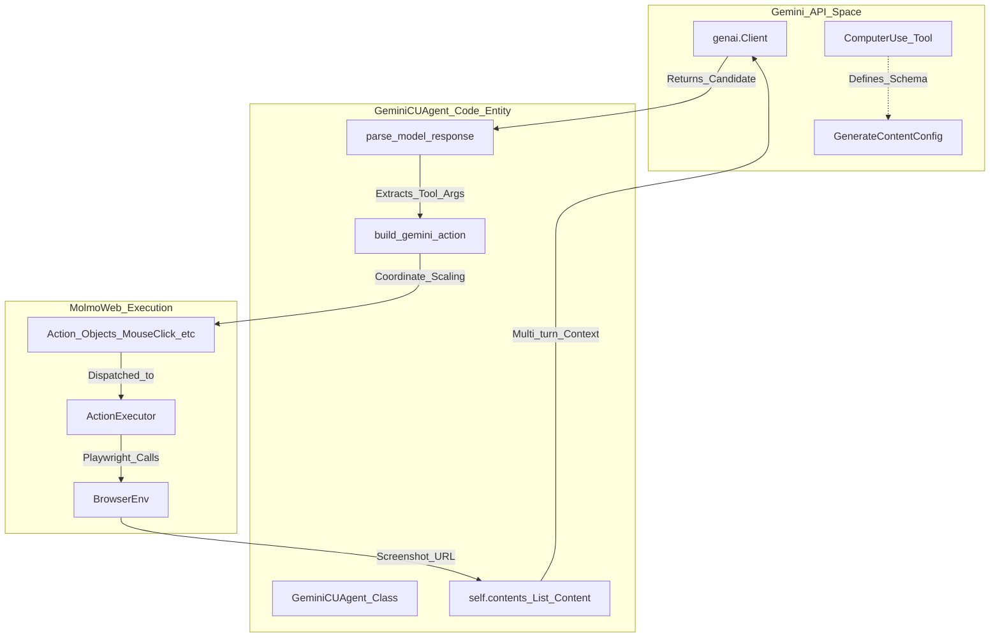
**Sources:** [agent/gemini_cua.py:191-217](), [agent/gemini_cua.py:82-105](), [utils/envs/action_executor.py:1-20]()

---

### Class Structure and Key Methods

#### `GeminiCUAgent` Class
Defined in `agent/gemini_cua.py`, this class manages the lifecycle of a computer-use session.

| Method | Role |
| :--- | :--- |
| `__init__` | Initializes the `genai.Client`, configures the `ComputerUse` tool, and sets the `max_blocks_before_terminate` threshold [agent/gemini_cua.py:193-215](). |
| `parse_model_response` | Iterates through `candidate.content.parts` to extract `thought`, `function_call`, and `safety_decision` [agent/gemini_cua.py:82-105](). |
| `build_initial_content` | Formats the goal and first image into the Gemini `Content` schema [agent/gemini_cua.py:29-37](). |
| `build_function_response_content` | Wraps action results (screenshots, URLs, errors) into a `FunctionResponse` part for the next model turn [agent/gemini_cua.py:39-68](). |

#### Component Relationship Diagram

This diagram shows the relationship between the Gemini-specific response parsing and the standard MolmoWeb Action hierarchy.

**Action Mapping Architecture**
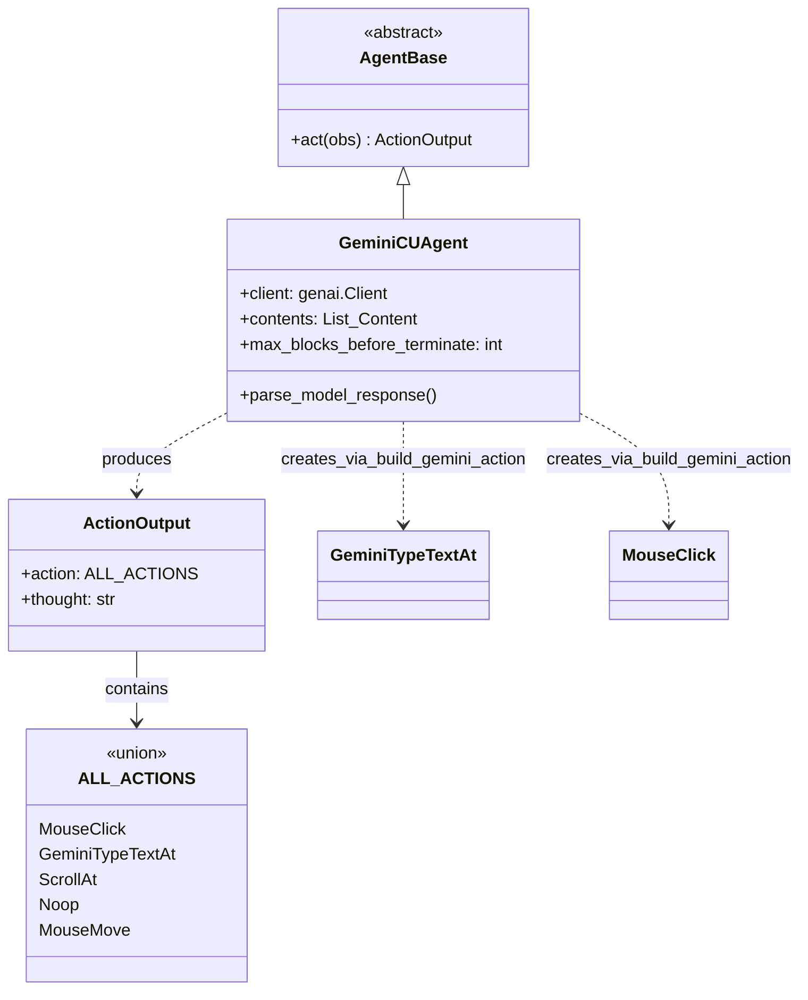
**Sources:** [agent/gemini_cua.py:191-217](), [agent/actions.py:9-22](), [agent/utils.py:23-23]()

### Technical Constraints
- **Model Version**: Specifically requires a model supporting the `computer_use` tool [agent/gemini_cua.py:195-195]().
- **Tool Exclusion**: By default, `open_web_browser`, `go_forward`, `search`, and `key_combination` are excluded from the predefined functions to rely on MolmoWeb's own navigation logic [agent/gemini_cua.py:201-203]().
- **Thinking Config**: The agent is configured with `include_thoughts=True` to capture the model's reasoning in the `thought` field of the `ActionOutput` [agent/gemini_cua.py:214-214]().
- **Coordinate Clamping**: Coordinates are clamped to `max(1.0, min(px, dim - 2.0))` to prevent clicking exactly on the edge of the viewport [agent/gemini_cua.py:79-79]().

**Sources:** [agent/gemini_cua.py:71-217]()

---

# Page: GPTAxtreeAgent

# GPTAxtreeAgent

<details>
<summary>Relevant source files</summary>

The following files were used as context for generating this wiki page:

- [agent/actions.py](agent/actions.py)
- [agent/gpt_axtree_agent.py](agent/gpt_axtree_agent.py)

</details>


The `GPTAxtreeAgent` is an LLM-backed agent implementation that utilizes OpenAI's GPT models to perform web navigation tasks. It relies on a flattened Accessibility Tree (AXTree) representation of the webpage rather than visual screenshots. The agent leverages OpenAI's structured output capabilities to ensure that actions conform to the system's defined schemas.

### Core Implementation

The agent is defined in `agent/gpt_axtree_agent.py` and inherits from `AgentBase` [agent/gpt_axtree_agent.py:135-135](). It uses the `beta.chat.completions.parse` method from the OpenAI SDK to enforce a strict JSON response format based on the `AxtreeActionOutput` class [agent/gpt_axtree_agent.py:65-72]().

#### Model Selection and Configuration
The agent defaults to a model specified by the `GPT_AXTREE_MODEL` environment variable, which defaults to `gpt-5` (a placeholder for future-proofing or specific internal naming) [agent/gpt_axtree_agent.py:13-13](). It shares the same `SYSTEM_MESSAGE` as the `GeminiAxtreeAgent` to maintain consistency in behavior across different LLM backends [agent/gpt_axtree_agent.py:11-11]().

**Data Flow: From Observation to Action**

The following diagram illustrates how browser observations are processed into a structured GPT prompt and then parsed back into executable actions.

**GPTAxtreeAgent Prediction Loop**
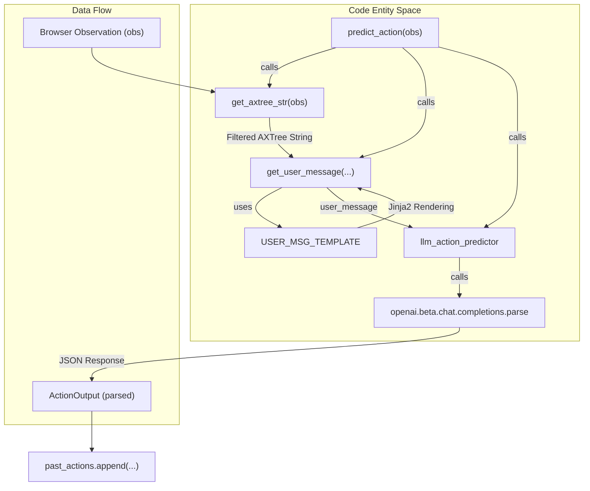
Sources: [agent/gpt_axtree_agent.py:59-76](), [agent/gpt_axtree_agent.py:159-194]()

### AXTree Filtering Strategy

To manage the context window and focus the LLM on relevant interactive elements, `GPTAxtreeAgent` employs a specific filtering strategy when converting the raw AXTree object into a string. This is handled by the `get_axtree_str` helper function [agent/gpt_axtree_agent.py:79-88]().

| Parameter | Value | Description |
| :--- | :--- | :--- |
| `filter_visible_only` | `True` | Removes elements that are not rendered or hidden via CSS [agent/gpt_axtree_agent.py:84-84](). |
| `filter_with_bid_only` | `True` | Only includes elements that have been assigned a Backend ID (`bid`) by the system [agent/gpt_axtree_agent.py:85-85](). |
| `with_clickable` | `True` | Ensures elements identified as interactive are preserved [agent/gpt_axtree_agent.py:86-86](). |
| `skip_generic` | `True` | Removes generic containers (like `div` or `span` without roles) to reduce verbosity [agent/gpt_axtree_agent.py:87-87](). |
| `with_visible` | `False` | Disables explicit visibility flags in the output string to save tokens [agent/gpt_axtree_agent.py:83-83](). |

Sources: [agent/gpt_axtree_agent.py:79-88](), [utils/axtree/axtree.py:1-1]()

### Multi-Tab Awareness and Context

The agent is designed to handle browser environments with multiple open tabs. The `USER_MSG_TEMPLATE` and `get_user_message` function explicitly inject tab information into the prompt [agent/gpt_axtree_agent.py:25-53]().

*   **All Pages/Tabs**: Lists every open tab with its index, title, and URL by zipping `obs["open_pages_titles"]` and `obs["open_pages_urls"]` [agent/gpt_axtree_agent.py:39-42](), [agent/gpt_axtree_agent.py:116-118]().
*   **Active Page**: Specifically identifies which page the AXTree belongs to using `obs["active_page_index"]` [agent/gpt_axtree_agent.py:44-45](), [agent/gpt_axtree_agent.py:113-113]().
*   **Error Feedback Loop**: If a previous action failed, the error message is included in the next prompt [agent/gpt_axtree_agent.py:50-51](). The agent filters out standard `TimeoutError` messages to avoid cluttering the context with non-informative failures [agent/gpt_axtree_agent.py:105-108]().

**Entity Mapping: Prompt Components to Code Symbols**
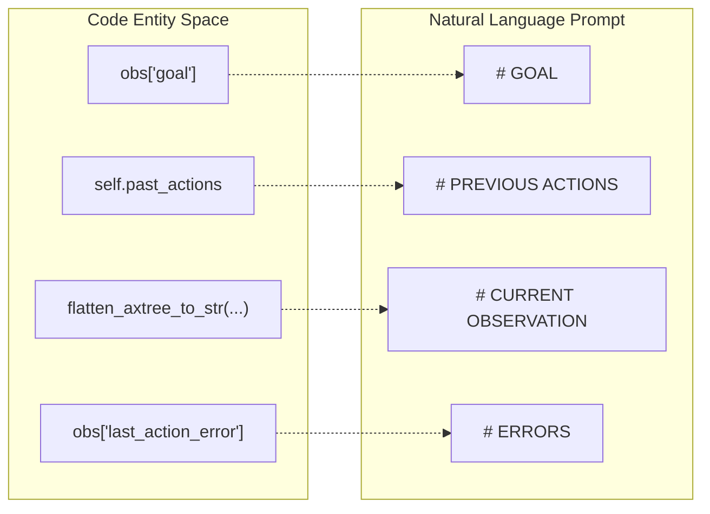
Sources: [agent/gpt_axtree_agent.py:25-53](), [agent/gpt_axtree_agent.py:91-132]()

### Structured Output and Action Prediction

The agent uses `create_llm_action_predictor` to wrap the OpenAI client call [agent/gpt_axtree_agent.py:59-76](). 

1.  **Response Format**: It uses `AxtreeActionOutput` as the `response_format`. This class defines the schema for actions that use element IDs (`bid`) rather than raw pixel coordinates [agent/gpt_axtree_agent.py:60-60]().
2.  **Parsing**: The `_client.beta.chat.completions.parse` method automatically converts the LLM's JSON response into a Python object, which is then accessed via `message.parsed` [agent/gpt_axtree_agent.py:65-74]().
3.  **History Management**: After each prediction, the agent stores the `action_output`, a textual description of the action (via `action_output.describe`), and the raw model inputs for debugging and logging [agent/gpt_axtree_agent.py:181-192](). The history is limited to the last 10 actions in the prompt to stay within context limits [agent/gpt_axtree_agent.py:124-125]().

Sources: [agent/gpt_axtree_agent.py:59-76](), [agent/gpt_axtree_agent.py:181-194](), [agent/actions.py:1-1]()

---

# Page: Model Server & Inference Backends

# Model Server & Inference Backends

<details>
<summary>Relevant source files</summary>

The following files were used as context for generating this wiki page:

- [agent/fastapi_model_server.py](agent/fastapi_model_server.py)
- [agent/model_backends.py](agent/model_backends.py)
- [scripts/start_server.sh](scripts/start_server.sh)
- [scripts/test_server.py](scripts/test_server.py)

</details>


The MolmoWeb system separates high-resource inference tasks from the browser-based agent logic. This is achieved through a server-side infrastructure that manages GPU-accelerated model instances and provides a unified interface for action prediction. The system supports multiple execution environments, ranging from local HuggingFace transformers to remote serverless deployments.

## High-Level Architecture

The inference infrastructure is built around a "Predictor" abstraction. Whether the model is running locally on a GPU or via a remote API, the agent interacts with it through a consistent interface. The system is designed to be backend-agnostic, allowing the same agent logic to work across different hardware configurations.

### Inference Data Flow
The following diagram illustrates how a prediction request moves from the `MultimodalAgent` through the `FastApiActionPredictor` (client-side) to the `FastAPI` server and finally to a `NativeActionPredictor` instance on the GPU.

**Prediction Pipeline: Agent to GPU**
```mermaid
graph TD
    subgraph "Inference Client Space"
        A["MultimodalAgent"] -- "predict()" --> B["FastApiActionPredictor"]
    end

    subgraph "Model Server Space (FastAPI)"
        B -- "POST /predict" --> C["@app.post('/predict')"]
        C -- "get()" --> D["predictor_pool: queue.Queue"]
        D -- "yields" --> E["NativeActionPredictor"]
        E -- "model.generate()" --> F["GPU Inference"]
        F -- "returns text" --> E
        E -- "put()" --> D
    end

    B -. "PredictRequest" .-> C
```
**Sources:** [agent/fastapi_model_server.py:78-108](), [agent/model_backends.py:22-50](), [agent/fastapi_model_server.py:34-56]()

## FastAPI Model Server

The `fastapi_model_server.py` provides a production-ready wrapper around the inference backends. It is designed to maximize GPU utilization by managing a pool of predictors across available CUDA devices.

Key features include:
*   **Predictor Pool:** Uses a `queue.Queue` to manage multiple model instances, allowing concurrent requests to be served if multiple GPUs or instances are configured via `NUM_PREDICTORS` [agent/fastapi_model_server.py:19-34]().
*   **State Management:** Implements a save-and-restore pattern for sampling parameters (`temperature`, `top_p`) to ensure that per-request settings do not permanently alter the predictor's base configuration [agent/fastapi_model_server.py:89-105]().
*   **Configuration:** Managed entirely via environment variables such as `CKPT`, `PREDICTOR_TYPE`, and `NUM_PREDICTORS` [agent/fastapi_model_server.py:15-23]().
*   **Deployment:** Can be launched using the `scripts/start_server.sh` utility, which configures `uvicorn` and sets default sampling parameters [scripts/start_server.sh:18-39]().

For a deep dive into the server implementation and configuration, see [FastAPI Model Server](#3.1).

## Inference Backends

The system defines four distinct backend implementations in `agent/model_backends.py`. Each backend implements a `predict` method that accepts a prompt and an image (as a NumPy array) and returns a string containing the predicted action.

| Backend Class | Type | Description |
| :--- | :--- | :--- |
| `NativeActionPredictor` | Local GPU | Uses native `olmo` libraries and `load_model_state` for high-performance inference [agent/model_backends.py:148-173](). |
| `HFActionPredictor` | Local GPU | Uses HuggingFace `transformers` and `AutoModelForImageTextToText` [agent/model_backends.py:95-112](). |
| `FastApiActionPredictor` | Remote | A client-side proxy that communicates with the FastAPI model server via HTTP `POST` [agent/model_backends.py:22-42](). |
| `ModalActionPredictor` | Serverless | Connects to a serverless deployment hosted on the Modal platform using `pil_image_to_base64` [agent/model_backends.py:56-75](). |

### Backend Class Hierarchy
The backends are designed with "lazy imports" [agent/model_backends.py:5-6]() to ensure that heavy dependencies like `torch` or `olmo` are only loaded when a specific backend is instantiated.

**Predictor Implementation Map**
```mermaid
classDiagram
    class ActionPredictor {
        <<Interface>>
        +predict(prompt, image_np, past_actions)
    }
    class NativeActionPredictor {
        +model: olmo.models.Molmo
        +preprocessor: olmo.Preprocessor
    }
    class HFActionPredictor {
        +model: transformers.AutoModel
        +processor: transformers.AutoProcessor
    }
    class FastApiActionPredictor {
        +endpoint: str
        +temperature: float
    }
    class ModalActionPredictor {
        +endpoint: str
        +api_key: str
    }

    ActionPredictor <|-- NativeActionPredictor
    ActionPredictor <|-- HFActionPredictor
    ActionPredictor <|-- FastApiActionPredictor
    ActionPredictor <|-- ModalActionPredictor
```
**Sources:** [agent/model_backends.py:1-156]()

For details on coordinate scaling, sampling parameters, and specific backend logic, see [Inference Backends](#3.2).

---

# Page: FastAPI Model Server

# FastAPI Model Server

<details>
<summary>Relevant source files</summary>

The following files were used as context for generating this wiki page:

- [agent/fastapi_model_server.py](agent/fastapi_model_server.py)
- [scripts/start_server.sh](scripts/start_server.sh)
- [scripts/test_server.py](scripts/test_server.py)

</details>


The FastAPI Model Server is a high-performance inference wrapper designed to serve Molmo models over HTTP. It is typically deployed on a GPU-enabled machine to handle the heavy lifting of multimodal inference while exposing a simple REST API to the inference client. It manages a pool of predictor instances, allowing for concurrent request handling across multiple GPUs or multiple instances on a single GPU.

## System Configuration and Environment

The server is configured primarily through environment variables, which are often set via the `scripts/start_server.sh` utility script [scripts/start_server.sh:18-26](). Before any model imports occur, the server sets a default `MOLMO_DATA_DIR` to ensure model artifacts are stored in a consistent location [agent/fastapi_model_server.py:4]().

| Variable | Description | Default |
| :--- | :--- | :--- |
| `CKPT` | Path to local model weights or HuggingFace model ID. | `allenai/MolmoWeb-8B` |
| `NUM_PREDICTORS` | Number of model instances to load into the pool. | `1` |
| `PREDICTOR_TYPE` | Backend implementation: `native` (OLMo native) or `hf` (Transformers). | `native` |
| `TEMPERATURE` | Default sampling temperature for the model. | `0.7` |
| `TOP_P` | Default top-p sampling value. | `0.8` |
| `PORT` | The port on which the FastAPI server listens. | `8001` |

**Sources:** [agent/fastapi_model_server.py:4](), [agent/fastapi_model_server.py:15-23](), [scripts/start_server.sh:18-26]()

## Predictor Pool Initialization

Upon startup, the server initializes a `queue.Queue` containing `NUM_PREDICTORS` instances of the chosen backend [agent/fastapi_model_server.py:34-56](). This pool facilitates CUDA device assignment: each predictor in the loop is assigned to a specific device index (e.g., `cuda:0`, `cuda:1`) based on its position in the pool [agent/fastapi_model_server.py:39-40]().

### Data Flow: Server Initialization
The following diagram illustrates how environment variables and the `create_predictor_pool` function transform into a running service.

**Model Server Startup Flow**
```mermaid
graph TD
    ENV["Environment Variables (CKPT, NUM_PREDICTORS)"] --> CPP["create_predictor_pool()"]
    CPP --> LOOP{"For i in range(NUM_PREDICTORS)"}
    LOOP --> DEV["Assign Device: cuda:i"]
    DEV --> TYPE{PREDICTOR_TYPE?}
    TYPE -- "native" --> NAT["NativeActionPredictor"]
    TYPE -- "hf" --> HF["HFActionPredictor"]
    NAT --> PUT["pool.put(predictor)"]
    HF --> PUT
    PUT --> APP["FastAPI app starts"]
```
**Sources:** [agent/fastapi_model_server.py:26-65](), [agent/fastapi_model_server.py:67]()

## The `/predict` Endpoint

The primary interface for the server is the `POST /predict` endpoint [agent/fastapi_model_server.py:78](). It accepts a structured JSON payload and returns the raw string output from the model.

### Request Schema: `PredictRequest`
The endpoint uses a Pydantic model to validate incoming data [agent/fastapi_model_server.py:70-75]():
*   `prompt` (str): The text instruction for the model.
*   `image_base64` (str): A base64-encoded screenshot.
*   `past_actions` (list | None): Optional history of previous actions for context.
*   `temperature` (float | None): Request-specific sampling temperature.
*   `top_p` (float | None): Request-specific top-p sampling.

### Save-and-Restore Pattern
To support request-specific sampling parameters without permanently altering the state of a shared predictor in the pool, the server implements a "save-and-restore" pattern [agent/fastapi_model_server.py:89-105]():
1.  **Acquire**: A predictor is pulled from `predictor_pool` with a 30-second timeout [agent/fastapi_model_server.py:84]().
2.  **Save**: Current `temperature` and `top_p` values of the predictor are stored in a temporary dictionary [agent/fastapi_model_server.py:89-92]().
3.  **Override**: If the request provides new values, they are applied to the predictor instance [agent/fastapi_model_server.py:93-96]().
4.  **Execute**: `predictor.predict()` is called with the prompt, converted image, and history [agent/fastapi_model_server.py:99]().
5.  **Restore**: In a `finally` block, the original values are written back to the predictor to ensure consistency for the next request [agent/fastapi_model_server.py:102-105]().
6.  **Release**: The predictor is returned to the pool [agent/fastapi_model_server.py:107]().

**Sources:** [agent/fastapi_model_server.py:70-108]()

## Request Lifecycle Diagram

This diagram maps the HTTP request handling to the internal logic of `agent/fastapi_model_server.py`.

**Predict Request Execution**
```mermaid
sequenceDiagram
    participant Client as "Inference Client"
    participant API as "FastAPI (/predict)"
    participant Pool as "predictor_pool (Queue)"
    participant Pred as "ActionPredictor Instance"

    Client->>API: POST PredictRequest (JSON)
    API->>API: base64_to_numpy_image()
    API->>Pool: get(timeout=30)
    Pool-->>API: predictor instance
    Note over API, Pred: Save current temperature/top_p
    API->>Pred: set request-specific params
    API->>Pred: predict(prompt, image, past_actions)
    Pred-->>API: model_string_output
    Note over API, Pred: Restore original temperature/top_p
    API->>Pool: put(predictor)
    API-->>Client: model_string_output
```
**Sources:** [agent/fastapi_model_server.py:78-108](), [agent/model_backends.py:11](), [utils/vis_utils/image.py:12]()

## Deployment and Testing

### Starting the Server
The server is typically launched using `uvicorn`. The helper script `scripts/start_server.sh` provides a convenient wrapper that sets up environment variables before executing the server [scripts/start_server.sh:18-39]():
```bash
# Start with default 8B model on port 8001
bash scripts/start_server.sh

# Start with 4B model on port 8002
bash scripts/start_server.sh allenai/MolmoWeb-4B 8002
```

### Testing Connection
A smoke test script is provided in `scripts/test_server.py`. It reads a local `test_screenshot.png`, encodes it to base64, and sends it to the `/predict` endpoint with a sample prompt about job titles [scripts/test_server.py:20-44](). It then prints the JSON response returned by the model [scripts/test_server.py:52]().

**Sources:** [scripts/start_server.sh:39](), [scripts/test_server.py:17-56]()

---

# Page: Inference Backends

# Inference Backends

<details>
<summary>Relevant source files</summary>

The following files were used as context for generating this wiki page:

- [agent/model_backends.py](agent/model_backends.py)

</details>


The MolmoWeb architecture decouples the agent logic from the model execution via a set of predictor classes. All inference backends are defined in `agent/model_backends.py` and implement a standardized `predict` interface. This allows the `MultimodalAgent` to remain agnostic of whether the model is running locally on a GPU, inside a serverless container, or behind a remote REST API.

To minimize environment overhead, all heavy dependencies (such as `torch`, `olmo`, or `transformers`) are imported lazily within the class methods rather than at the module level [agent/model_backends.py:4-6]().

## Backend Architecture Overview

The following diagram illustrates how the `MultimodalAgent` interacts with the various backend implementations to transform visual observations and prompts into action strings.

### Data Flow: Agent to Backend
```mermaid
graph TD
    subgraph "Agent Layer"
        A["MultimodalAgent"] -- "predict(prompt, image_np, past_actions)" --> B["ActionPredictor Interface"]
    end

    subgraph "Code Entity Space: agent/model_backends.py"
        B --> C["FastApiActionPredictor"]
        B --> D["ModalActionPredictor"]
        B --> E["HFActionPredictor"]
        B --> F["NativeActionPredictor"]
    end

    subgraph "Execution Environments"
        C -- "HTTP POST /predict" --> G["FastAPI Model Server"]
        D -- "HTTP POST (Stream)" --> H["Modal.com Serverless"]
        E -- "Local GPU" --> I["HuggingFace Transformers"]
        F -- "Local GPU" --> J["OLMo Native Engine"]
    end
```
Sources: [agent/model_backends.py:1-6](), [agent/model_backends.py:22-186]()

---

## 1. FastApiActionPredictor (Remote HTTP)

The `FastApiActionPredictor` is the primary backend used in the split-process architecture where the agent runs on a client (e.g., a laptop) and the model runs on a remote GPU server [agent/model_backends.py:22-28]().

- **Implementation**: It serializes the `numpy` image to a Base64 string using `utils.vis_utils.image.image_to_base64` and sends a JSON payload to the `/predict` endpoint [agent/model_backends.py:33-36]().
- **Parameters**: Supports `temperature` and `top_p` sampling parameters passed during initialization and included in the HTTP payload [agent/model_backends.py:30-40]().
- **Data Flow**:
    1. Agent calls `predict()`.
    2. Image is converted to Base64 via `image_to_base64` [agent/model_backends.py:34-36]().
    3. `requests.post` is sent to `{endpoint}/predict` with the JSON payload [agent/model_backends.py:42]().
    4. JSON response is returned as a string [agent/model_backends.py:46]().

Sources: [agent/model_backends.py:22-50]()

---

## 2. ModalActionPredictor (Serverless)

This backend interfaces with the [Modal](https://modal.com) serverless platform, allowing for on-demand GPU inference without maintaining a persistent server [agent/model_backends.py:56-59]().

- **Streaming**: Unlike the FastAPI backend, this implementation handles a streaming response. It iterates over lines in the response via `resp.iter_lines()`, parsing each chunk to reconstruct the final output text [agent/model_backends.py:81-84]().
- **Authentication**: Supports optional API keys via the `Authorization: Bearer` header [agent/model_backends.py:65-66]().
- **Data Conversion**: Uses `pil_image_to_base64` to encode the screenshot after converting the numpy array to a PIL Image [agent/model_backends.py:62, 72]().

Sources: [agent/model_backends.py:56-89]()

---

## 3. HFActionPredictor (HuggingFace Transformers)

The `HFActionPredictor` uses the standard HuggingFace `transformers` library to load the model. This is useful for users who want to run the model locally using the official library integration [agent/model_backends.py:95-99]().

- **Model Loading**: Uses `AutoProcessor` and `AutoModelForImageTextToText` with `trust_remote_code=True`. It defaults to `sdpa` (Scaled Dot Product Attention) for efficiency [agent/model_backends.py:105-111]().
- **Inference Pipeline**:
    1. Wraps prompt and image into a "user" role message [agent/model_backends.py:119-122]().
    2. Calls `process_vision_info` from `molmo_utils` to prepare image tensors [agent/model_backends.py:116, 123]().
    3. Disables `return_mm_token_type_ids` during processing because Molmo uses pure causal attention rather than bidirectional image tokens [agent/model_backends.py:127-128]().
    4. Calls `model.generate()` with `do_sample` logic based on whether `top_p` is provided [agent/model_backends.py:130-137]().

Sources: [agent/model_backends.py:95-143]()

---

## 4. NativeActionPredictor (OLMo Native)

The `NativeActionPredictor` uses the internal `olmo` library directly. This backend provides the most control over the model's execution and is used when performance or specific OLMo native features are required [agent/model_backends.py:148-156]().

- **Initialization**:
    - Sets `MOLMO_DATA_DIR` for caching model data [agent/model_backends.py:159-162]().
    - Resolves bare HF repo IDs (e.g., "allenai/MolmoWeb-8B-Native") to local snapshots using `snapshot_download` [agent/model_backends.py:177-180]().
    - Loads the model configuration from `config.yaml` using `BaseModelConfig` [agent/model_backends.py:182-183]().
- **Loading Strategy**: Uses a "meta" device initialization followed by `to_empty` and `load_model_state` to efficiently load weights without doubling memory usage [agent/model_backends.py:185-188]().
- **Sampling**: Implements inference using the `TopPSampler` from `olmo.nn.beam_search` [agent/model_backends.py:204]().

Sources: [agent/model_backends.py:148-212]()

---

## Implementation Details

### Coordinate Conventions and Sampling
All backends are designed to support the MolmoWeb coordinate system. The `predict` method signature across all classes ensures consistency:

| Parameter | Type | Description |
| :--- | :--- | :--- |
| `prompt` | `str` | The formatted text prompt containing instructions and AXTree. |
| `image_np` | `np.ndarray` | The screenshot as a numpy array. |
| `past_actions` | `list` | (Optional) History of previous actions for multi-turn reasoning. |
| `temperature` | `float` | Controls randomness (default 0.7). |
| `top_p` | `float` | Nucleus sampling threshold (default 0.8). |

### Backend Class Relationships
```mermaid
classDiagram
    class ActionPredictor {
        <<interface>>
        +predict(prompt, image_np, past_actions)
    }
    class FastApiActionPredictor {
        +endpoint: str
        +temperature: float
        +top_p: float
        +predict(prompt, image_np, past_actions)
    }
    class ModalActionPredictor {
        +endpoint: str
        +api_key: str
        +predict(prompt, image_np)
    }
    class HFActionPredictor {
        +model: AutoModelForImageTextToText
        +processor: AutoProcessor
        +device: str
        +predict(prompt, image_np)
    }
    class NativeActionPredictor {
        +model: OLMo
        +preprocessor: Preprocessor
        +device: str
        +predict(prompt, image_np)
    }

    ActionPredictor <|-- FastApiActionPredictor
    ActionPredictor <|-- ModalActionPredictor
    ActionPredictor <|-- HFActionPredictor
    ActionPredictor <|-- NativeActionPredictor
```
Sources: [agent/model_backends.py:22-148]()

### Weight Management
Weights for these backends are typically managed via the `scripts/download_weights.sh` utility, which downloads the model from HuggingFace into a local directory [scripts/download_weights.sh:14-18](). The path to these weights is then provided to the local predictors (`HFActionPredictor` or `NativeActionPredictor`) via the `checkpoint` argument [agent/model_backends.py:96, 151]().

Sources: [scripts/download_weights.sh:1-23](), [agent/model_backends.py:96-151]()

---

# Page: Inference Client

# Inference Client

<details>
<summary>Relevant source files</summary>

The following files were used as context for generating this wiki page:

- [inference/__init__.py](inference/__init__.py)
- [inference/client.py](inference/client.py)
- [inference/trajectory_visualizer.py](inference/trajectory_visualizer.py)
- [inference/web_episode.py](inference/web_episode.py)

</details>


The `inference/` package provides the primary interface for interacting with the MolmoWeb agent. It encapsulates the complexity of managing browser environments, executing multi-step agent trajectories, and serializing the resulting data for visualization or analysis.

### System Overview

The inference subsystem bridges the gap between the high-level agent logic and the low-level browser automation. It manages the lifecycle of a `Trajectory`, which consists of a sequence of `Step` objects containing the environment `State` (screenshots and URLs) and the agent's predicted `ActionOutput`.

#### Natural Language to Code Mapping

The following diagram illustrates how high-level inference concepts map to specific classes and files within the `inference/` package.

**Inference Entity Mapping**
```mermaid
graph TD
    subgraph "Natural Language Space"
        A["User Query/Task"]
        B["Agent Run/Session"]
        C["Step-by-Step History"]
        D["Visual Feedback"]
    end

    subgraph "Code Entity Space"
        A1["query: str"]
        B1["MolmoWeb Class"]
        C1["Trajectory Model"]
        D1["Trajectory Visualizer"]
        
        B1 -->|defined in| B1_File["inference/client.py"]
        C1 -->|defined in| C1_File["inference/web_episode.py"]
        D1 -->|defined in| D1_File["inference/trajectory_visualizer.py"]
    end

    A -.-> B1
    B -.-> B1
    C -.-> C1
    D -.-> D1
```
**Sources:** [inference/client.py:56-63](), [inference/web_episode.py:78-79](), [inference/trajectory_visualizer.py:90-95]()

---

### MolmoWeb Client

The `MolmoWeb` class is the central entry point for the library. It coordinates the `MultimodalAgent` [inference/client.py:98-105]() and the browser environment (`SimpleEnv` or `BrowserbaseEnv`) [inference/client.py:107-129](). It handles the boilerplate of setting up the Playwright event loop context [inference/client.py:86-96](), resizing screenshots to the expected viewport dimensions (1280x720) [inference/client.py:156-161](), and managing the iterative loop of observation, prediction, and execution.

Key capabilities include:
*   **Environment Management**: Automatically switches between local Chromium and remote Browserbase sessions based on the `local` flag [inference/client.py:107-129]().
*   **Execution Loops**: Supports `fresh_run` for new tasks [inference/client.py:202-209](), `continue_run` for existing sessions, and parallel batch processing via `run_batch` using a `ThreadPoolExecutor` [inference/client.py:38-53]().
*   **Robustness**: Implements retry logic via the `tenacity` library for the `_predict` method to handle transient model server failures [inference/client.py:139-149]().

For details, see [MolmoWeb Client](#4.1).

**Sources:** [inference/client.py:56-83](), [inference/client.py:139-149](), [inference/client.py:202-210]()

---

### Trajectory Data Models

The `inference/web_episode.py` module defines Pydantic-based data models that ensure type safety and easy serialization of agent runs. These models allow trajectories to be saved to disk, reloaded, or rendered as HTML.

| Model | Description | Key Attributes |
| :--- | :--- | :--- |
| `State` | Captures the browser state at a specific moment. | `img` (PIL), `page_url`, `page_title` |
| `Step` | A single interaction unit in a trajectory. | `state`, `prediction` (ActionOutput), `error` |
| `Trajectory` | A collection of steps representing a full task. | `steps` (list[Step]) |

The `State` model includes a custom `field_serializer` and `field_validator` to handle the conversion of PIL images to Base64 strings for JSON compatibility [inference/web_episode.py:45-70]().

For details, see [Trajectory Data Models & Visualizer](#4.2).

**Sources:** [inference/web_episode.py:38-79]()

---

### Trajectory Visualizer

To facilitate debugging and qualitative analysis, the `inference/trajectory_visualizer.py` module provides a Jinja2-based HTML generator. This tool converts a `Trajectory` object into a human-readable webpage using the `trajectory.html` template [inference/trajectory_visualizer.py:90-95]().

**Visualization Flow**
```mermaid
graph LR
    subgraph "Data Input"
        T["Trajectory Model"]
    end

    subgraph "Processing (inference/trajectory_visualizer.py)"
        P1["get_click_xy()"]
        P2["draw_click_indicator()"]
        P3["_img_to_data_url()"]
    end

    subgraph "Output"
        H["trajectory.html"]
    end

    T --> P1
    P1 --> P2
    P2 --> P3
    P3 --> H
```

The visualizer includes logic to "burn" red click indicators into screenshots using `draw_click_indicator` based on the agent's predicted coordinates [inference/trajectory_visualizer.py:47-56](). This is applied to actions like `mouse_click` or `gemini_type_text_at` [inference/trajectory_visualizer.py:30-44]().

For details, see [Trajectory Data Models & Visualizer](#4.2).

**Sources:** [inference/trajectory_visualizer.py:30-44](), [inference/trajectory_visualizer.py:47-56](), [inference/trajectory_visualizer.py:90-95]()

---

# Page: MolmoWeb Client

# MolmoWeb Client

<details>
<summary>Relevant source files</summary>

The following files were used as context for generating this wiki page:

- [inference/.env.example](inference/.env.example)
- [inference/__init__.py](inference/__init__.py)
- [inference/client.py](inference/client.py)

</details>


The `MolmoWeb` client is the primary interface for executing web-based inference using the Molmo model. It manages the lifecycle of browser environments (local or cloud-hosted), orchestrates agent interactions, and handles the collection of trajectories for evaluation or visualization.

## Overview and Purpose

The `MolmoWeb` class in `inference/client.py` provides a high-level API to run autonomous web agents. It abstracts away the complexities of Playwright's asynchronous event loop, environment selection (Local vs. Browserbase), and the iterative loop of observation and action.

### Key Methods
| Method | Description |
| :--- | :--- |
| `run` | Executes a fresh browser session for a specific natural language query. |
| `continue_run` | Resumes an existing session with a new query, maintaining state and history. |
| `run_batch` | Parallelizes multiple queries across a `ThreadPoolExecutor`. |
| `get_axtree` | Utility to extract and flatten the current page's Accessibility Tree. |

**Sources:** [inference/client.py:56-83](), [inference/client.py:212-250]()

---

## System Architecture and Data Flow

The client acts as a bridge between the **Model Server** (via the `MultimodalAgent`) and the **Browser Environment**.

### Logical Component Mapping
The following diagram maps high-level logical concepts to specific code entities within the `MolmoWeb` infrastructure.

"Natural Language to Code Entity Space"
```mermaid
graph TD
    subgraph "Inference Client [inference/client.py]"
        MW["MolmoWeb Class"]
        PW_LOOP["_pw_event_loop"]
        RUN_ITER["_run_iters()"]
        RUN_BATCH["run_batch()"]
    end

    subgraph "Agent Layer [agent/]"
        MMA["MultimodalAgent"]
        PRED["_predict()"]
    end

    subgraph "Environment Layer [utils/envs/]"
        ENV_BASE["BrowserEnv"]
        S_ENV["SimpleEnv (Local)"]
        B_ENV["BrowserbaseEnv (Cloud)"]
    end

    MW --> MMA
    MW --> ENV_BASE
    RUN_ITER --> PRED
    PRED --> MMA
    ENV_BASE -- "Inherited by" --> S_ENV
    ENV_BASE -- "Inherited by" --> B_ENV
    MW -- "Manages" --> PW_LOOP
    RUN_BATCH -- "Uses" --> TPE["ThreadPoolExecutor"]
```
**Sources:** [inference/client.py:56-105](), [inference/client.py:107-130](), [inference/client.py:177-200](), [inference/client.py:237-250]()

---

## Core Implementation Details

### Playwright Asyncio Event Loop
Playwright requires an active `asyncio` event loop. To allow `MolmoWeb` to be used in synchronous contexts (like Jupyter notebooks) while maintaining persistent browser sessions, it uses a custom context manager `_pw_context`. This manager captures the running loop during the first `reset()` and restores it for subsequent calls, ensuring that sync calls to Playwright work across separate method invocations.

**Sources:** [inference/client.py:86-96](), [inference/client.py:203-209]()

### Environment Selection
The client dynamically selects the browser backend based on the `local` flag passed during initialization:
1.  **Local (`local=True`)**: Instantiates `SimpleEnv`, which launches a local Chromium instance via Playwright [inference/client.py:108-118]().
2.  **Browserbase (`local=False`)**: Instantiates `BrowserbaseEnv`. This requires `BROWSERBASE_API_KEY` and `BROWSERBASE_PROJECT_ID` environment variables [inference/client.py:120-129](). Credentials are validated via `_check_browserbase_credentials` [inference/client.py:25-35]().

### Robustness and Retry Logic
The client utilizes the `tenacity` library to handle transient failures during inference. The `_predict` method is decorated with a retry strategy that attempts the model call up to 2 times with a 5-second fixed wait between failures, catching general `Exception` types.

**Sources:** [inference/client.py:139-144](), [inference/client.py:145-149]()

---

## Execution Lifecycle

The execution flow for a single query follows a strict loop of observing the state, predicting an action, and stepping the environment.

### Inference Step Sequence
"Inference Step Data Flow"
```mermaid
sequenceDiagram
    participant MW as MolmoWeb
    participant ENV as BrowserEnv
    participant AGT as MultimodalAgent
    participant TRAJ as Trajectory

    MW->>ENV: reset()
    ENV-->>MW: obs (screenshot, url)
    loop max_steps
        MW->>MW: _get_state(obs)
        MW->>AGT: predict_action(obs)
        AGT-->>MW: action_output
        MW->>ENV: step(action_obj)
        ENV-->>MW: next_obs
        MW->>TRAJ: append(Step)
        Note over MW, TRAJ: Check for [EXIT] or [ANSWER]
    end
    MW-->>MW: return Trajectory
```
**Sources:** [inference/client.py:131-137](), [inference/client.py:150-153](), [inference/client.py:155-175](), [inference/client.py:177-200]()

---

## Batch Processing and Parallelism

For high-throughput evaluation, `MolmoWeb` provides `run_batch`. This method uses a `ThreadPoolExecutor` to run multiple `_run_one_query` workers in parallel.

*   **Process Isolation**: Each query in the batch creates its own `MolmoWeb` instance with `keep_alive=False` to ensure environments are cleaned up after each task [inference/client.py:38-53]().
*   **Concurrency**: The number of parallel workers is controlled by the `max_workers` parameter. Results are collected as they complete using `as_completed` [inference/client.py:237-250]().

| Feature | run() | run_batch() |
| :--- | :--- | :--- |
| **Concurrency** | Single-threaded | Multi-threaded (`ThreadPoolExecutor`) |
| **Persistence** | Can `keep_alive` for `continue_run` | Cleans up after each query |
| **Use Case** | Interactive use / Debugging | Large scale evaluation / Benchmarking |

**Sources:** [inference/client.py:38-53](), [inference/client.py:237-250]()

---

## AXTree Extraction

The `get_axtree` method provides a simplified interface for retrieving the accessibility tree of the current page. It utilizes `extract_axtree` and `flatten_axtree_to_str` from the utility layer.

1.  It ensures the environment is initialized [inference/client.py:253-254]().
2.  It calls `extract_axtree` with a retry limit defined by `EXTRACT_OBS_MAX_TRIES` [inference/client.py:257-258]().
3.  It returns a flattened string representation of the tree, which is often used for debugging or as input for LLM-backed agents [inference/client.py:259-265]().

**Sources:** [inference/client.py:252-265](), [utils/axtree/axtree.py:22-22]()

---

# Page: Trajectory Data Models & Visualizer

# Trajectory Data Models & Visualizer

<details>
<summary>Relevant source files</summary>

The following files were used as context for generating this wiki page:

- [inference/htmls/trajectory.html](inference/htmls/trajectory.html)
- [inference/templates/trajectory.html](inference/templates/trajectory.html)
- [inference/trajectory_visualizer.py](inference/trajectory_visualizer.py)
- [inference/web_episode.py](inference/web_episode.py)

</details>


This page documents the data structures and visualization tools used to represent and inspect agent execution history. The system relies on Pydantic models for structured data and a Jinja2-based HTML generator to create visual step-by-step reports of browser interactions.

## Trajectory Data Models

The core data structures are defined in `inference/web_episode.py`. These models capture the state of the browser, the agent's predicted actions, and any errors encountered during a session.

### Class: State
Represents the browser's condition at a specific point in time. It includes a PIL Image, which is handled via custom Pydantic validators and serializers to support seamless conversion between raw images and base64 strings for storage or transmission [inference/web_episode.py:38-43]().

| Field | Type | Description |
| :--- | :--- | :--- |
| `img` | `PIL.Image.Image` | The screenshot of the current page. |
| `page_url` | `str` | The URL of the current page. |
| `page_title` | `str` | The `<title>` of the current page. |

The `_serialize_img` method converts the PIL object to a base64-encoded PNG string [inference/web_episode.py:45-49](), while `_parse_img` handles decoding from various formats (bytes, base64 strings with or without data URIs) back into a `PIL.Image` [inference/web_episode.py:51-70]().

### Class: Step
A single interaction unit in an episode. It pairs a `State` (the observation) with an `ActionOutput` (the agent's decision) and an optional error string [inference/web_episode.py:72-75]().

### Class: Trajectory
A container for a sequence of `Step` objects [inference/web_episode.py:78-79](). It provides a utility method `save_html` which imports and delegates to the visualizer to generate a report [inference/web_episode.py:81-83]().

### Data Flow and Serialization
The following diagram illustrates how the `State` model bridges the gap between Python's `PIL.Image` and the serialized formats required for HTML or JSON storage.

**Natural Language to Code Entity: Image Serialization Flow**
```mermaid
graph LR
    subgraph "Natural Language Space"
        A["Browser Screenshot"]
        B["Base64 String"]
        C["PNG File"]
    end

    subgraph "Code Entity Space"
        D["PIL.Image.Image"]
        E["State._serialize_img"]
        F["State._parse_img"]
        G["save_trajectory_screenshots_png"]
    end

    A --> D
    D -- "io.BytesIO" --> E
    E --> B
    B --> F
    F --> D
    D -- "img.save" --> G
    G --> C
```
Sources: [inference/web_episode.py:21-35](), [inference/web_episode.py:45-70]()

---

## Trajectory Visualizer

The visualizer transforms a `Trajectory` object into a human-readable HTML document. It is primarily implemented in `inference/trajectory_visualizer.py` and utilizes Jinja2 templates.

### Image Annotation
Before rendering, the visualizer can "burn" action indicators into the screenshots. If a step's action is a click-based action, `draw_click_indicator` renders a red dot with a white outline at the target coordinates [inference/trajectory_visualizer.py:47-56]().

*   **`_CLICK_ACTION_NAMES`**: Defines which actions trigger an indicator: `mouse_click`, `mouse_dblclick`, and `gemini_type_text_at` [inference/trajectory_visualizer.py:30]().
*   **`get_click_xy(step)`**: Extracts `x` and `y` attributes from the `ActionOutput` if the action name is in the allowed set [inference/trajectory_visualizer.py:33-44]().
*   **`annotate_step_image(step)`**: Checks for a predicted click and returns a modified copy of the screenshot using `PIL.ImageDraw` [inference/trajectory_visualizer.py:59-66]().

### HTML Generation
The visualizer uses a template-based approach to generate the final report.

*   **`_step_context(step)`**: A helper that prepares a dictionary for the Jinja2 template. It converts the annotated image to a data URL via `_img_to_data_url` and serializes the prediction into a formatted JSON string [inference/trajectory_visualizer.py:69-87]().
*   **`generate_trajectory_html(trajectory, query)`**: Loads `inference/templates/trajectory.html` from the `_env` Jinja environment and renders it [inference/trajectory_visualizer.py:90-95]().
*   **`save_trajectory_html`**: Writes the rendered HTML to disk, defaulting to `inference/htmls/trajectory.html` if no path is provided [inference/trajectory_visualizer.py:98-108]().

### Visualization Architecture
The diagram below maps the visualization process from raw data models to the final HTML output.

**Natural Language to Code Entity: Visualization Pipeline**
```mermaid
graph TD
    subgraph "Data Sources"
        T["Trajectory (inference/web_episode.py)"]
        S["Step (inference/web_episode.py)"]
    end

    subgraph "Visualizer Logic (inference/trajectory_visualizer.py)"
        V1["get_click_xy"]
        V2["draw_click_indicator"]
        V3["annotate_step_image"]
        V4["_step_context"]
        V5["generate_trajectory_html"]
    end

    subgraph "Templates & Output"
        HTML["inference/templates/trajectory.html"]
        RES["Final .html Report"]
    end

    T --> S
    S --> V1
    V1 --> V2
    V2 --> V3
    V3 --> V4
    V4 --> V5
    HTML --> V5
    V5 --> RES
```
Sources: [inference/trajectory_visualizer.py:13-16](), [inference/trajectory_visualizer.py:59-95](), [inference/templates/trajectory.html:1-87]()

### Template Structure
The `trajectory.html` template uses a CSS flexbox layout to display information side-by-side for each step [inference/templates/trajectory.html:11-19]():
1.  **Left Panel (`.step-img`)**: Displays the screenshot as a data URL [inference/templates/trajectory.html:20-30](), [inference/templates/trajectory.html:63-69]().
2.  **Right Panel (`.step-info`)**: Contains step metadata including the URL, Page Title, and a `<pre>` block containing the raw JSON of the agent's prediction [inference/templates/trajectory.html:31-47](), [inference/templates/trajectory.html:70-82]().

Sources: [inference/trajectory_visualizer.py:1-109](), [inference/web_episode.py:1-86](), [inference/templates/trajectory.html:1-88]()

---

# Page: Browser Environment & Action Execution

# Browser Environment & Action Execution

<details>
<summary>Relevant source files</summary>

The following files were used as context for generating this wiki page:

- [utils/envs/__init__.py](utils/envs/__init__.py)
- [utils/envs/action_executor.py](utils/envs/action_executor.py)
- [utils/envs/browser_env.py](utils/envs/browser_env.py)

</details>


The `utils/envs` subsystem provides the interface between the agent's high-level decisions and the low-level browser automation. It encapsulates the lifecycle of the browser session (Playwright), manages tab state, and translates abstract action objects into concrete browser interactions.

## Architecture Overview

The system is built around an abstract base class `BrowserEnv` which defines the core loop of web interaction. Concrete implementations handle the specifics of where the browser is running (locally or in a managed cloud environment like Browserbase). The `execute_action` utility serves as the bridge, converting `Action` objects into Playwright API calls.

### Component Relationship
The following diagram illustrates how the environment classes interact with the action executor and the underlying Playwright library.

**Environment & Execution Flow**
```mermaid
graph TD
    subgraph "Environment Layer [utils/envs/browser_env.py]"
        SimpleEnv["SimpleEnv (Local Chromium)"] -- "inherits" --> BrowserEnv["BrowserEnv (Abstract Base)"]
        BrowserbaseEnv["BrowserbaseEnv (Cloud)"] -- "inherits" --> BrowserEnv
    end

    subgraph "Execution Layer [utils/envs/action_executor.py]"
        BrowserEnv -- "calls" --> exec_action["execute_action()"]
        exec_action -- "dispatches to" --> click_bid["_click_by_bid()"]
        exec_action -- "dispatches to" --> type_at["_type_at()"]
    end

    subgraph "Playwright Layer [playwright.sync_api]"
        exec_action -- "calls" --> PW_Page["Page"]
        exec_action -- "calls" --> PW_Mouse["Mouse"]
        exec_action -- "calls" --> PW_KB["Keyboard"]
    end

    style BrowserEnv stroke-dasharray: 5 5
```
Sources: [utils/envs/browser_env.py:70-92](), [utils/envs/action_executor.py:29-33]()

## Browser Environments

The `BrowserEnv` class manages the state of the browser, including the active page, the browser context, and the step count. It follows a standard reinforcement learning-like interface: `reset()`, `step()`, and `close()`.

*   **SimpleEnv**: Launches a local Chromium instance via `sync_playwright`. It is suitable for development and local testing [utils/envs/browser_env.py:4-6]().
*   **BrowserbaseEnv**: Connects to a remote [Browserbase](https://www.browserbase.com/) session using a `connect_url`. This implementation is used for production-grade tasks requiring stealth proxies and automated CAPTCHA solving [utils/envs/browser_env.py:5-6]().

### Observation Structure
The `_get_obs()` method in `BrowserEnv` returns a dictionary containing the current state of the browser. This typically includes:
*   `screenshot`: A numpy array of the current viewport, captured via CDP `Page.captureScreenshot` or standard Playwright screenshot [utils/envs/browser_env.py:59-67]().
*   `axtree_object`: The processed Accessibility Tree (if `extract_axtree=True`) [utils/envs/browser_env.py:246-249]().
*   `open_pages_urls`: A list of URLs for all currently open tabs in the browser context [utils/envs/browser_env.py:254-255]().

For more details on the environment lifecycle, tab detection, and navigation fallbacks, see **[Browser Environments](#5.1)**.

Sources: [utils/envs/browser_env.py:1-16](), [utils/envs/browser_env.py:70-120]()

## Action Executor

The `execute_action` function is the central dispatcher for all agent actions. It receives a `playwright.Page` object and an `Action` object (from the `agent.actions` module) and performs the corresponding automation.

### Key Execution Patterns
*   **Coordinate-based Actions**: Actions like `MouseClick`, `HoverAt`, and `ScrollAt` use absolute pixel coordinates. The executor assumes these have already been converted from percentage coordinates by the agent [utils/envs/action_executor.py:4-6]().
*   **Element-based Actions**: The `Click` action uses a `bid` (Backend ID) attribute. The executor attempts to locate the element using `page.locator(f'[bid="{action.bid}"]')` [utils/envs/action_executor.py:114-114]().
*   **Robust Fallbacks**: For `Click` actions, if a standard click fails, the executor attempts a "forced" click (`force=True`) to bypass visibility or intersection checks [utils/envs/action_executor.py:121-131]().

**Action Dispatch Mapping**
| Action Class | Code Entity / Method | Implementation Detail |
| :--- | :--- | :--- |
| `Click` | `_click_by_bid` [utils/envs/action_executor.py:112]() | Locates by `bid` attribute; supports double-click and right-click. |
| `MouseClick` | `page.mouse.click` [utils/envs/action_executor.py:38]() | Direct coordinate-based interaction. |
| `GeminiTypeTextAt` | `_type_at` [utils/envs/action_executor.py:134]() | Sequence: Click -> Clear (Optional) -> Type -> Enter (Optional). |
| `BrowserNav` | `page.go_back` / `new_page` [utils/envs/action_executor.py:88]() | Handles browser-level navigation and tab management. |

For a full reference of supported actions and their Playwright mappings, see **[Action Executor](#5.2)**.

Sources: [utils/envs/action_executor.py:29-109](), [utils/envs/action_executor.py:112-132](), [utils/envs/action_executor.py:134-154]()

## Sub-Pages
*   **[Browser Environments](#5.1)**: Detailed documentation of `BrowserEnv`, `SimpleEnv`, and `BrowserbaseEnv`. Covers the `reset`/`step`/`close` lifecycle, observation structure, and robust navigation logic (including the Bing warmup fallback).
*   **[Action Executor](#5.2)**: Technical reference for `utils/envs/action_executor.py`. Details how each action type is translated into Playwright API calls and the bid-based click fallback mechanisms.

---

# Page: Browser Environments

# Browser Environments

<details>
<summary>Relevant source files</summary>

The following files were used as context for generating this wiki page:

- [utils/envs/__init__.py](utils/envs/__init__.py)
- [utils/envs/browser_env.py](utils/envs/browser_env.py)

</details>


The `utils/envs/browser_env.py` module provides a standardized interface for agents to interact with web browsers. It abstracts the complexities of browser lifecycle management, tab handling, and observation extraction, supporting both local execution and cloud-based sessions via Browserbase.

## Environment Architecture

The environment system is built on a base abstract class, `BrowserEnv`, which defines the lifecycle and observation protocols. Two concrete implementations satisfy different deployment needs: `SimpleEnv` for local development and `BrowserbaseEnv` for managed cloud sessions.

### Natural Language to Code Entity Mapping

The following diagram illustrates how high-level environment concepts map to specific classes and methods within the codebase.

**Environment Entity Mapping**
```mermaid
graph TD
    subgraph "Natural Language Space"
        A["Browser Lifecycle"]
        B["Observation"]
        C["Action Execution"]
        D["Cloud Session"]
    end

    subgraph "Code Entity Space"
        A --> E["BrowserEnv.reset()"]
        A --> F["BrowserEnv.step()"]
        B --> G["BrowserEnv._get_obs()"]
        B --> H["utils.axtree.extract_axtree"]
        C --> I["utils.envs.action_executor.execute_action"]
        D --> J["BrowserbaseEnv"]
    end

    E -.-|"[utils/envs/browser_env.py:100-120]()"| E
    F -.-|"[utils/envs/browser_env.py:151-178]()"| F
    G -.-|"[utils/envs/browser_env.py:220-255]()"| G
    J -.-|"[utils/envs/browser_env.py:321-360]()"| J
```
Sources: `[utils/envs/browser_env.py:70-360]()`

## Lifecycle: Reset, Step, and Close

All environments follow a standard RL-like lifecycle managed through Playwright.

### 1. Reset (`reset`)
The `reset` method initializes the browser instance, sets the viewport, and navigates to the starting URL `[utils/envs/browser_env.py:100-120]()`.
*   **Navigation Fallback**: If `robust_navigation` is enabled, the environment attempts to "warm up" the connection by navigating to `bing.com` first if the initial `goto` fails `[utils/envs/browser_env.py:124-149]()`.
*   **State Initialization**: It clears the `step_count` and `last_action_error` `[utils/envs/browser_env.py:115-116]()`.

### 2. Step (`step`)
The `step` method advances the environment by executing an action and returning a new observation `[utils/envs/browser_env.py:151-178]()`.
*   **Tab Detection**: It wraps action execution in `_execute_with_tab_detection` to catch new pages opened by `MouseClick` or `new_tab` actions `[utils/envs/browser_env.py:180-201]()`.
*   **Wait Strategy**: After an action, the environment waits for `domcontentloaded` across all open pages and frames to ensure the UI has settled before capturing observations `[utils/envs/browser_env.py:158-176]()`.

### 3. Close (`close`)
The `close` method ensures that the browser, context, and Playwright process are terminated to prevent memory leaks `[utils/envs/browser_env.py:209-218]()`.

Sources: `[utils/envs/browser_env.py:100-218]()`

## Observation Structure

The `_get_obs()` method compiles a comprehensive dictionary representing the current state of the browser.

| Key | Type | Description |
| :--- | :--- | :--- |
| `screenshot` | `np.ndarray` | RGB image of the current page `[utils/envs/browser_env.py:228]()`. |
| `axtree_object` | `dict` | Parsed Accessibility Tree (if `extract_axtree` is True) `[utils/envs/browser_env.py:236]()`. |
| `extra_element_properties` | `dict` | Metadata for elements (e.g., bounding boxes) `[utils/envs/browser_env.py:237]()`. |
| `open_pages_urls` | `list[str]` | List of URLs for all currently open tabs `[utils/envs/browser_env.py:246]()`. |
| `active_page_index` | `int` | Index of the currently focused tab `[utils/envs/browser_env.py:247]()`. |
| `last_action_error` | `str` | Error message from the previous action attempt `[utils/envs/browser_env.py:252]()`. |

Sources: `[utils/envs/browser_env.py:220-255]()`

## Implementation Details

### SimpleEnv (Local)
`SimpleEnv` (aliased as `LocalBrowserEnv`) launches a local Chromium instance using `playwright.chromium.launch` `[utils/envs/browser_env.py:288-318]()`. It supports `headless` mode and `slow_mo` for debugging.

### BrowserbaseEnv (Cloud)
`BrowserbaseEnv` connects to a remote browser session via the Browserbase SDK.
*   **Session Management**: It uses a `Project ID` and `API Key` to create a session `[utils/envs/browser_env.py:338-344]()`.
*   **Stealth & Proxies**: It is designed for environments requiring stealth or specific geographic proxies.
*   **Connection**: It connects via `playwright.chromium.connect_over_cdp` using a generated `connect_url` `[utils/envs/browser_env.py:348-353]()`.

### Robust Navigation Logic
The environment implements a fallback mechanism to handle sites that block automated "cold" connections.

**Navigation Data Flow**
```mermaid
graph TD
    Start["reset(url)"] --> Direct["page.goto(url)"]
    Direct -- "Success" --> Done["Return Observation"]
    Direct -- "Failure & robust_navigation=True" --> Warmup["page.goto('bing.com')"]
    Warmup --> Retry["page.goto(url)"]
    Retry -- "Success" --> Done
    Retry -- "Failure" --> Manual["Modify goal: 'First, navigate to...'"]
    Manual --> Done
```
Sources: `[utils/envs/browser_env.py:122-150]()`

## Action Execution and Tab Handling

Actions are dispatched to `utils.envs.action_executor.execute_action` via the environment's `_execute_with_tab_detection` wrapper `[utils/envs/browser_env.py:180-201]()`.

*   **Tab Switching**: If an action is a `BrowserNav` with `nav_type="tab_focus"`, the environment iterates through `self.context.pages` to find the target index and calls `bring_to_front()` `[utils/envs/browser_env.py:202-207]()`.
*   **Screenshot Fallback**: Screenshots are primarily captured via CDP (`Page.captureScreenshot`) for speed and reliability `[utils/envs/browser_env.py:61-64]()`, falling back to the standard Playwright `page.screenshot` if CDP fails `[utils/envs/browser_env.py:65-66]()`.

**Tab Detection and Focus Flow**
```mermaid
graph TD
    subgraph "Tab Management Logic"
        Step["BrowserEnv.step(action)"] --> Detect["_execute_with_tab_detection(action)"]
        Detect --> CheckAction{"Action Type?"}
        CheckAction -- "MouseClick / new_tab" --> Expect["context.expect_page()"]
        CheckAction -- "Other" --> Exec["execute_action(page, action)"]
        Expect --> Exec
        Exec --> NewPage{"New Page Found?"}
        NewPage -- "Yes" --> Focus["page.bring_to_front()"]
        NewPage -- "No" --> CheckFocus{"nav_type == 'tab_focus'?"}
        CheckFocus -- "Yes" --> Switch["pages[index].bring_to_front()"]
    end
```
Sources: `[utils/envs/browser_env.py:59-67, 180-207]()`

---

# Page: Action Executor

# Action Executor

<details>
<summary>Relevant source files</summary>

The following files were used as context for generating this wiki page:

- [agent/actions.py](agent/actions.py)
- [utils/envs/action_executor.py](utils/envs/action_executor.py)

</details>


The **Action Executor** is a specialized utility responsible for translating high-level agent actions into concrete browser commands. It serves as the bridge between the structured `Action` objects defined in the agent layer and the [Playwright API](https://playwright.dev/python/).

The executor operates on pixel-based coordinates. It is the responsibility of the calling agent to ensure that any percentage-based or normalized coordinates are converted to absolute viewport pixels before being passed to this module [utils/envs/action_executor.py:4-6]().

## Core Execution Logic

The primary entry point is the `execute_action` function. It performs type-checking on the incoming action object and dispatches it to the corresponding Playwright method [utils/envs/action_executor.py:29-106]().

### Action Mapping Table

| Action Type | Playwright Implementation | Notes |
| :--- | :--- | :--- |
| `Click` | `page.locator('[bid="..."]').click()` | Uses element-based targeting via `bid` attributes. |
| `MouseClick` | `page.mouse.click(x, y)` | Coordinate-based click at specific pixels. Supports `double` click [utils/envs/action_executor.py:38-42](). |
| `MouseMove` | `page.mouse.move(x, y)` | Moves the cursor without clicking [utils/envs/action_executor.py:46-48](). |
| `HoverAt` | `page.mouse.move(x, y)` + `time.sleep` | Simulates hover by staying at a coordinate for `duration` [utils/envs/action_executor.py:50-53](). |
| `MouseDragAndDrop` | `move` → `down` → `move` → `up` | Manual drag-and-drop sequence [utils/envs/action_executor.py:55-60](). |
| `Scroll` | `page.mouse.wheel(dx, dy)` | Global viewport scroll [utils/envs/action_executor.py:62-64](). |
| `ScrollAt` | `move(x, y)` + `wheel(dx, dy)` | Scrolls at a specific coordinate [utils/envs/action_executor.py:66-69](). |
| `KeyboardType` | `page.keyboard.type(text)` | Types text into the currently focused element [utils/envs/action_executor.py:74-76](). |
| `KeyboardPress` | `page.keyboard.press(key)` | Supports special keys; sleeps 1s if key is "Enter" [utils/envs/action_executor.py:78-82](). |
| `Goto` | `page.goto(url)` | Navigates to a new URL; waits for `domcontentloaded` [utils/envs/action_executor.py:84-86](). |
| `BrowserNav` | `go_back()`, `new_page()`, `bring_to_front()` | Handles history and tab focus management [utils/envs/action_executor.py:88-97](). |
| `Noop` | `time.sleep(5)` | Standard 5-second wait [utils/envs/action_executor.py:99-101](). |

**Sources:** [utils/envs/action_executor.py:29-106](), [agent/actions.py:10-186]()

## Bid-Based Click Fallback

The `_click_by_bid` function implements a robust two-stage clicking strategy for elements identified by a backend ID (`bid`).

1.  **Standard Click**: Attempts to click the element using `page.locator(f'[bid="{action.bid}"]').first`. This respects Playwright's actionability checks (visible, stable, enabled) [utils/envs/action_executor.py:114-118]().
2.  **Forced Fallback**: If the standard click fails (e.g., due to an overlapping element or a timeout), the executor retries with `force=True`. This bypasses actionability checks to ensure the event is dispatched even if the element is technically obscured [utils/envs/action_executor.py:122-127]().

### Data Flow: Natural Language to Playwright Call

The following diagram illustrates how a high-level intent is transformed into a specific browser interaction.

**Intent Translation Flow**
```mermaid
graph TD
    subgraph "Natural Language Space"
        A["Agent Intent: 'Click the Search button'"]
    end

    subgraph "Code Entity Space (agent/actions.py)"
        B["Click(bid='12', button='left', click_type='single')"]
    end

    subgraph "Execution Space (utils/envs/action_executor.py)"
        C["execute_action(page, action)"]
        D["_click_by_bid(page, action)"]
        E["page.locator('[bid=12]').click()"]
        F["page.locator('[bid=12]').click(force=True)"]
    end

    A --> B
    B --> C
    C --> D
    D --> E
    E -- "If Exception" --> F
```
**Sources:** [utils/envs/action_executor.py:112-131](), [agent/actions.py:10-37]()

## Specialized Typing Helpers

### GeminiTypeTextAt
For agents that provide a coordinate and text simultaneously (like the Gemini Computer Use model), the `_type_at` helper provides a composite sequence of actions [utils/envs/action_executor.py:134-154]():

1.  **Focus**: Clicks the specified `(x, y)` coordinate to focus the input [utils/envs/action_executor.py:136]().
2.  **Clear (Optional)**: If `clear_before_typing` is true, it executes `ControlOrMeta+a` followed by `Backspace` [utils/envs/action_executor.py:139-143]().
3.  **Input**: Types the provided `text` via the keyboard API [utils/envs/action_executor.py:146]().
4.  **Submit (Optional)**: If `press_enter` is true, it sends an `Enter` keypress [utils/envs/action_executor.py:149-150]().

**Sources:** [utils/envs/action_executor.py:134-154](), [agent/actions.py:170-186]()

## Component Architecture

The relationship between the `Action` definitions and the `execute_action` logic is strictly typed via the `ALL_ACTIONS` union.

**Action Execution Architecture**
```mermaid
classDiagram
    class ALL_ACTIONS {
        <<union>>
    }
    class ActionExecutor {
        +execute_action(page, action: ALL_ACTIONS)
        -_click_by_bid(page, action: Click)
        -_type_at(page, action: GeminiTypeTextAt)
    }
    class Click {
        +str bid
        +str button
        +str click_type
    }
    class MouseClick {
        +float x
        +float y
    }
    class KeyboardType {
        +str text
    }
    class GeminiTypeTextAt {
        +float x
        +float y
        +str text
        +bool press_enter
        +bool clear_before_typing
    }

    ALL_ACTIONS <.. ActionExecutor : dispatches
    Click --|> ALL_ACTIONS
    MouseClick --|> ALL_ACTIONS
    KeyboardType --|> ALL_ACTIONS
    GeminiTypeTextAt --|> ALL_ACTIONS
```
**Sources:** [utils/envs/action_executor.py:9-26](), [agent/actions.py:10-186]()

## Error Handling
The executor wraps all operations in a `try-except` block. If a Playwright operation fails (e.g., a timeout or a detached element), the executor returns a tuple `(False, error_message)` instead of crashing. This allows the calling environment or client to log the failure and decide whether to retry or report the issue to the agent [utils/envs/action_executor.py:34-109]().

**Sources:** [utils/envs/action_executor.py:108-109]()

---

# Page: Utilities

# Utilities

<details>
<summary>Relevant source files</summary>

The following files were used as context for generating this wiki page:

- [utils/axtree/__init__.py](utils/axtree/__init__.py)
- [utils/eval_utils/episode.py](utils/eval_utils/episode.py)
- [utils/vis_utils/__init__.py](utils/vis_utils/__init__.py)

</details>


The `utils/` directory contains the foundational logic for interacting with web page structures, generating visual debugging assets, and managing the evaluation lifecycle of agents. These utilities bridge the gap between the raw browser state and the high-level reasoning required by the agents.

### Utility Subsystems Overview

The utility layer is divided into three primary functional areas:

| Subsystem | Primary Responsibilities | Key Code Entities |
|:---|:---|:---|
| **AXTree** | Extraction and flattening of the Accessibility Tree from Playwright. | `extract_axtree`, `flatten_axtree_to_str` |
| **Visualization** | Creating visual artifacts (images, GIFs, HTML) for debugging. | `vis_utils/vis.py`, `vis_utils/image.py`, `vis_utils/html.py` |
| **Evaluation** | Running interaction loops and logging step-by-step data. | `Episode`, `LocalEpisodeLogger`, `Interaction` |

---

### Accessibility Tree (AXTree) Utilities

The AXTree utilities are responsible for transforming a live webpage into a structured, text-based representation that LLMs can process. This involves a complex pipeline that injects temporary identifiers into the DOM, captures a snapshot via the Chrome DevTools Protocol (CDP), and merges these attributes into a tree structure.

The primary entry points are `extract_axtree` for raw data collection and `flatten_axtree_to_str` for converting that data into a prompt-friendly string format.

For details, see [Accessibility Tree (AXTree) Utilities](#6.1).

**Sources:**
- [utils/axtree/__init__.py:1-7]()

---

### Visualization Utilities

Visualization utilities provide tools for interpreting agent behavior and environmental state. This includes encoding images for model input (via `image.py`), rendering HTML reports (via `html.py`), and generating annotated GIFs (via `vis.py`) that highlight specific coordinates or elements the agent is interacting with. These tools are essential for debugging the spatial reasoning of multimodal models.

For details, see [Visualization Utilities](#6.2).

**Sources:**
- [utils/vis_utils/__init__.py:1-1]()

---

### Evaluation Utilities

The evaluation utilities manage the execution flow of an agent within an environment. The `Episode` class encapsulates the main interaction loop, handling retries, action dispatching, and state transitions. Data is captured at each step via the `Interaction` dataclass to facilitate logging and performance analysis.

**Core Evaluation Flow**
The diagram below illustrates how the `Episode` class coordinates between the `AgentBase` and the `BrowserEnv`.

**Diagram: Episode Execution Loop**
```mermaid
graph TD
    subgraph "Natural_Language_Space"
        Goal["User Goal/Task"]
    end

    subgraph "Code_Entity_Space"
        EP["Episode_Class [utils/eval_utils/episode.py]"]
        INT["Interaction_Dataclass [utils/eval_utils/episode.py]"]
        AGENT["AgentBase [agent/utils.py]"]
        ENV["BrowserEnv [utils/envs/browser_env.py]"]
        
        EP -- "run_episode()" --> ENV
        ENV -- "reset()" --> EP
        EP -- "predict_action(obs)" --> AGENT
        AGENT -- "ActionOutput" --> EP
        EP -- "step(action)" --> ENV
        EP -- "Store Step" --> INT
    end

    Goal --> EP
```

The `run_episode` method manages the loop until a maximum step count is reached, the agent sends a termination signal (e.g., `[EXIT]`), or the environment reports a terminal state.

For details, see [Evaluation Utilities](#6.3).

**Sources:**
- [utils/eval_utils/episode.py:15-21]() (Interaction dataclass)
- [utils/eval_utils/episode.py:24-33]() (Episode class definition)
- [utils/eval_utils/episode.py:35-50]() (_predict_with_retry method)
- [utils/eval_utils/episode.py:61-141]() (run_episode loop)

---

### System Data Flow

The following diagram bridges the high-level concepts of "Web Observation" and "Agent Action" to the specific utility functions and classes that handle the data transformation.

**Diagram: Observation to Action Data Pipeline**
```mermaid
graph LR
    subgraph "Web_Observation_Space"
        DOM["DOM / Browser State"]
        AX["AXTree Utilities"]
        VIS["Vis Utilities"]
    end

    subgraph "Code_Logic"
        EXTRACT["extract_axtree() [utils/axtree/axtree.py]"]
        FLATTEN["flatten_axtree_to_str() [utils/axtree/axtree.py]"]
        EP["Episode [utils/eval_utils/episode.py]"]
    end

    subgraph "Agent_Space"
        MODEL["Model Predictor"]
    end

    DOM --> EXTRACT
    EXTRACT --> FLATTEN
    FLATTEN --> MODEL
    EXTRACT -.-> VIS
    MODEL --> EP
    EP -- "Interaction" --> LOG["Logging/Storage"]
```

**Sources:**
- [utils/axtree/__init__.py:3-5]()
- [utils/eval_utils/episode.py:122-130]()
- [utils/eval_utils/episode.py:15-21]()

---

# Page: Accessibility Tree (AXTree) Utilities

# Accessibility Tree (AXTree) Utilities

<details>
<summary>Relevant source files</summary>

The following files were used as context for generating this wiki page:

- [utils/axtree/__init__.py](utils/axtree/__init__.py)
- [utils/axtree/axtree.py](utils/axtree/axtree.py)
- [utils/axtree/javascript/frame_mark_elements.js](utils/axtree/javascript/frame_mark_elements.js)
- [utils/axtree/javascript/frame_unmark_elements.js](utils/axtree/javascript/frame_unmark_elements.js)

</details>


The `utils/axtree` module provides high-level utilities for extracting, merging, and flattening the Accessibility Tree (AXTree) from Playwright `Page` objects [utils/axtree/axtree.py:1-12](). It bridges the gap between raw browser DOM structures and the structured text representations required by Large Language Models (LLMs) for web navigation tasks.

## The `extract_axtree` Pipeline

The extraction process follows a strict "mark-snapshot-merge-unmark" lifecycle to ensure that elements can be uniquely identified across multiple frames and that the resulting tree contains necessary metadata like bounding boxes and visibility ratios.

### Data Flow and Lifecycle

The pipeline is orchestrated by `extract_axtree` [utils/axtree/axtree.py:57-71]().

1.  **Marking**: Elements are injected with unique `bid` (browser ID) attributes using JavaScript. These IDs are persisted into ARIA attributes (`aria-description` or `aria-roledescription`) so they appear in the CDP AXTree [utils/axtree/javascript/frame_mark_elements.js:141-145]().
2.  **Snapshotting**: The system captures a DOM snapshot via CDP using `_extract_dom_snapshot` to gather geometric data (bounding boxes) and visibility information [utils/axtree/axtree.py:66-68](), [utils/axtree/axtree.py:248-264]().
3.  **Merging**: The AXTree is retrieved frame-by-frame via `_extract_merged_axtree`. Child frames are recursively merged into the parent tree at the point of their `iframe` or `frame` nodes [utils/axtree/axtree.py:218-245]().
4.  **Unmarking**: Temporary attributes and injected ARIA IDs are stripped from the DOM via `_unmark_elements` using `frame_unmark_elements.js` to restore the page to its original state [utils/axtree/axtree.py:214-216](), [utils/axtree/javascript/frame_unmark_elements.js:1-25]().

### AXTree Extraction Sequence
The following diagram illustrates the interaction between the Python utility and the browser via CDP.

"AXTree Extraction Sequence"
```mermaid
sequenceDiagram
    participant P as "extract_axtree (Python)"
    participant JS as "JavaScript (Injected)"
    participant CDP as "Chrome DevTools Protocol"
    participant DOM as "Browser DOM"

    P->>JS: "Execute frame_mark_elements.js"
    JS->>DOM: "Inject bid attributes & ARIA IDs"
    P->>CDP: "DOMSnapshot.captureSnapshot"
    CDP-->>P: "Return DOM nodes with layout/visibility"
    P->>CDP: "Accessibility.getFullAXTree"
    CDP-->>P: "Return frame AXTree"
    Note over P: "Recursive Merge of Child Frames"
    P->>JS: "Execute frame_unmark_elements.js"
    JS->>DOM: "Remove temporary attributes"
    P-->>P: "Return (axtree, extra_properties)"
```
Sources: [utils/axtree/axtree.py:57-71](), [utils/axtree/javascript/frame_mark_elements.js:5-148](), [utils/axtree/axtree.py:218-245]()

## Key Functions and Implementation

### `extract_axtree(page, lenient)`
The entry point for the extraction pipeline. It handles the full lifecycle and returns a tuple containing the merged AXTree dictionary and an `extra_properties` dictionary mapping `bid` to visibility, bounding box, and clickability data [utils/axtree/axtree.py:57-71]().

### `_extract_merged_axtree(page)`
Iterates through all frames in the page. It skips frames that match ad markers (e.g., "doubleclick", "googlesyndication") or restricted URL prefixes (e.g., "chrome://", "data:") [utils/axtree/axtree.py:38-46](). It uses `Accessibility.getFullAXTree` to retrieve the tree for each frame and stitches them together [utils/axtree/axtree.py:218-245]().

### `flatten_axtree_to_str(...)`
Converts the complex AXTree dictionary into a human-readable, indented string. It supports several filtering and formatting options [utils/axtree/axtree.py:93-105]():
*   **`filter_visible_only`**: Excludes nodes where `molmoweb_visibility_ratio` is < 0.5 [utils/axtree/axtree.py:123-124]().
*   **`filter_with_bid_only`**: Excludes nodes that were not assigned a unique `bid` during the marking phase [utils/axtree/axtree.py:118-120]().
*   **`remove_redundant_static_text`**: Suppresses `StaticText` nodes if their content is already contained within the parent node's name [utils/axtree/axtree.py:170-172]().
*   **`with_center_coords` / `with_bounding_box_coords`**: Injects coordinate strings into the output for LLM grounding [utils/axtree/axtree.py:129-136]().

### `extract_screenshot(page, scale_factor)`
A utility to capture the viewport using CDP's `Page.captureScreenshot`. It temporarily overrides device metrics via `Emulation.setDeviceMetricsOverride` to match the requested `scale_factor` before returning a NumPy array [utils/axtree/axtree.py:74-90]().

## JavaScript Element Marking

The marking script `frame_mark_elements.js` is responsible for assigning IDs that persist across the CDP boundary.

| Feature | Implementation Detail |
| :--- | :--- |
| **Unique IDs (bid)** | Standard elements get numeric IDs (`0`, `1`). Frames get alphabetic IDs (`a`, `b`) [utils/axtree/javascript/frame_mark_elements.js:122-130](). |
| **Global Context** | BIDs are prefixed with the parent frame's BID to ensure uniqueness across nested iframes [utils/axtree/javascript/frame_mark_elements.js:131-136](). |
| **Visibility** | Uses an `IntersectionObserver` to calculate `molmoweb_visibility_ratio` for every marked element [utils/axtree/javascript/frame_mark_elements.js:37-51](). |
| **Set of Marks** | Injects `molmoweb_set_of_marks` attribute for interactive tags like `button`, `a`, `input`, and `select` [utils/axtree/javascript/frame_mark_elements.js:24-26](), [utils/axtree/javascript/frame_mark_elements.js:147-152](). |
| **Dynamic Values** | Explicitly sets `value` and `checked` attributes from the element's current state to ensure they are captured in the snapshot [utils/axtree/javascript/frame_mark_elements.js:93-105](). |

## System Mapping: Logic to Code Entities

This diagram maps the conceptual "Extraction Pipeline" to the specific Python functions and JavaScript files that implement them.

"AXTree Logic to Code Mapping"
```mermaid
graph TD
    subgraph "Python Logic (utils/axtree/axtree.py)"
        EAX["extract_axtree"]
        EMA["_extract_merged_axtree"]
        EDOM["_extract_dom_snapshot"]
        FLAT["flatten_axtree_to_str"]
        UNM["_unmark_elements"]
    end

    subgraph "Browser Execution (JavaScript)"
        FMARK["frame_mark_elements.js"]
        FUNMARK["frame_unmark_elements.js"]
    end

    subgraph "CDP Commands"
        AXT["Accessibility.getFullAXTree"]
        SNAP["DOMSnapshot.captureSnapshot"]
    end

    EAX -->|1. Mark| FMARK
    EAX -->|2. Snapshot| EDOM
    EDOM --> SNAP
    EAX -->|3. Merge| EMA
    EMA --> AXT
    EAX -->|4. Unmark| UNM
    UNM --> FUNMARK
    EAX -->|5. Format| FLAT
```
Sources: [utils/axtree/axtree.py:57-71](), [utils/axtree/axtree.py:218-245](), [utils/axtree/axtree.py:248-264](), [utils/axtree/axtree.py:214-216]()

## Data Structures and Constants

### Ignored Elements
To reduce token usage in LLM prompts, certain roles and properties are filtered out during flattening:
*   **Roles**: `LineBreak` [utils/axtree/axtree.py:33]().
*   **Properties**: `editable`, `readonly`, `level`, `settable`, `multiline`, `invalid`, `focusable` [utils/axtree/axtree.py:34-36]().

### Extra Properties Dictionary
The `extra` dictionary returned by `extract_axtree` contains the following structure for each `bid` extracted from the `DOMSnapshot` [utils/axtree/axtree.py:266-285]():
*   `visibility`: Float (0.0 to 1.0) derived from `molmoweb_visibility_ratio`.
*   `bbox`: Tuple of `(x, y, width, height)`.
*   `clickable`: Boolean indicating if the element is likely interactive.
*   `set_of_marks`: Boolean indicating if the element should be highlighted in Set-of-Marks visualizations.

Sources: [utils/axtree/axtree.py:1-285](), [utils/axtree/javascript/frame_mark_elements.js:1-152](), [utils/axtree/javascript/frame_unmark_elements.js:1-41]()

---

# Page: Visualization Utilities

# Visualization Utilities

<details>
<summary>Relevant source files</summary>

The following files were used as context for generating this wiki page:

- [utils/vis_utils/Arial.ttf](utils/vis_utils/Arial.ttf)
- [utils/vis_utils/__init__.py](utils/vis_utils/__init__.py)
- [utils/vis_utils/html.py](utils/vis_utils/html.py)
- [utils/vis_utils/image.py](utils/vis_utils/image.py)
- [utils/vis_utils/vis.py](utils/vis_utils/vis.py)

</details>


The `utils/vis_utils/` directory provides a suite of tools for handling image transformations, generating HTML reports, and creating annotated visual trajectories. These utilities are used across the codebase to debug agent behavior, visualize action coordinates, and export execution logs into human-readable formats.

## Image Encoding and Decoding

The `image.py` module serves as the primary bridge between raw image data (PIL or NumPy) and the Base64 strings required for JSON-based network transmission and HTML embedding.

### Key Functions
| Function | Description |
| :--- | :--- |
| `pil_image_to_base64` | Converts a PIL Image object into a Base64 string, defaulting to PNG format [[utils/vis_utils/image.py:9-24]](). |
| `numpy_image_to_base64` | Converts a NumPy array to an RGB PIL image before encoding to Base64 [[utils/vis_utils/image.py:27-29]](). |
| `image_to_base64` | Polymorphic helper that handles both `np.ndarray` and `Image.Image` types [[utils/vis_utils/image.py:32-38]](). |
| `base64_to_pil_image` | Decodes a Base64 string (handling optional headers like `data:image/png;base64,`) back into a PIL Image [[utils/vis_utils/image.py:41-48]](). |
| `base64_to_numpy_image` | Decodes a Base64 string directly into a NumPy array [[utils/vis_utils/image.py:51-52]](). |
| `pil_image_to_html` | Wraps a Base64-encoded image in an `` tag for direct injection into HTML templates [[utils/vis_utils/image.py:64-67]](). |

**Sources:**
- `utils/vis_utils/image.py` [[9-67]]()

## HTML Rendering Utilities

The `html.py` module leverages the `fasthtml` library to programmatically generate structural HTML components. This is primarily used for generating tabular views of agent trajectories.

### Implementation Details
- **Page Creation**: `create_page` initializes a standard HTML document structure using Pico CSS for styling and Flexbox Grid for layout [[utils/vis_utils/html.py:6-17]]().
- **Table Generation**: `create_table` accepts a list of column headers and a list of dictionaries (rows) to build a standard `<table>` with `<thead>` and `Tbody` sections [[utils/vis_utils/html.py:25-30]]().
- **Persistence**: `save_html` converts the `fasthtml` object tree into an XML/HTML string and writes it to a specified file path [[utils/vis_utils/html.py:20-22]]().

**Sources:**
- `utils/vis_utils/html.py` [[6-30]]()

## Annotated Trajectory Visualization

The `vis.py` module is a standalone utility for creating animated GIFs that visualize an agent's decision-making process. It combines screenshots from a browser environment with the textual "thought" and "action" metadata from a trajectory log.

### Trajectory-to-Visual Mapping

The following diagram illustrates how the `create_annotated_gif` function maps data from the `trajectory.json` file to visual elements in the output GIF.

**Data Flow: Trajectory to Annotated Frame**
```mermaid
graph TD
    subgraph "Natural Language Space"
        A["action_str"]
        B["thought"]
    end

    subgraph "Code Entity Space"
        JSON["trajectory.json"]
        IMG["images/screenshot.png"]
        
        JSON -- "extract" --> A
        JSON -- "extract" --> B
        
        A -- "regex parse" --> BOX["draw_coord_box()"]
        B -- "textwrap" --> ANNO["annotate_image_right()"]
        
        IMG --> BOX
        BOX --> ANNO
        ANNO --> GIF["annotated.gif"]
    end

    A -->|"mouse_click(x, y)"| BOX
    B -->|"Agent reasoning"| ANNO
```
**Sources:**
- `utils/vis_utils/vis.py` [[9-27, 70-137]]()

### Key Visualization Features

#### 1. Coordinate Box Drawing
The `draw_coord_box` function uses regular expressions to detect coordinate patterns (e.g., `x=371, y=252`) within an action string [[utils/vis_utils/vis.py:18-21]](). If found, it uses `ImageDraw.rectangle` to draw a red indicator at those coordinates on the screenshot [[utils/vis_utils/vis.py:23-25]]().

#### 2. Right-Panel Annotation
The `annotate_image_right` function extends the canvas of the original screenshot to the right to create a dedicated text area [[utils/vis_utils/vis.py:37-42]](). 
- It wraps text based on the font's average character width calculated via `font.getbbox` [[utils/vis_utils/vis.py:51-55]]().
- It centers the combined Action and Thought text vertically within the black background panel using `multiline_textbbox` for height calculation [[utils/vis_utils/vis.py:58-65]]().

#### 3. GIF Composition
The `create_annotated_gif` function iterates through sorted keys in a trajectory directory [[utils/vis_utils/vis.py:85-99]](). It loads the `Arial.ttf` font provided in the utility directory [[utils/vis_utils/vis.py:92]]() and saves the sequence of annotated frames as a looping GIF [[utils/vis_utils/vis.py:131-137]]().

**Component Interaction Diagram**
```mermaid
graph LR
    subgraph "utils/vis_utils/vis.py"
        Main["__main__"]
        CAG["create_annotated_gif"]
        DCB["draw_coord_box"]
        AIR["annotate_image_right"]
    end

    subgraph "External Resources"
        TJSON["trajectory.json"]
        IDIR["images/"]
        FONT["Arial.ttf"]
    end

    Main --> CAG
    CAG --> TJSON
    CAG --> IDIR
    CAG --> FONT
    CAG -- "if --coord" --> DCB
    CAG --> AIR
    AIR --> GIF["Output GIF"]
```

**Sources:**
- `utils/vis_utils/vis.py` [[9-137]]()
- `utils/vis_utils/Arial.ttf` [[1-18]]()

---

# Page: Evaluation Utilities

# Evaluation Utilities

<details>
<summary>Relevant source files</summary>

The following files were used as context for generating this wiki page:

- [utils/eval_utils/episode.py](utils/eval_utils/episode.py)
- [utils/eval_utils/episode_logger.py](utils/eval_utils/episode_logger.py)

</details>


The `utils/eval_utils/` directory provides the core infrastructure for executing and logging agent-environment interactions. It defines the lifecycle of an evaluation episode, handles robust action prediction with retries, and provides a structured logging mechanism for capturing multi-modal trajectory data.

## Episode Management

The `Episode` class manages the execution loop between an `AgentBase` implementation and a `BrowserEnv`. It encapsulates the state transitions, error handling, and termination logic required to run a complete task.

### Interaction Data Model
The `Interaction` dataclass serves as the primary record for a single step within an episode [utils/eval_utils/episode.py:14-21]().

| Field | Type | Description |
| :--- | :--- | :--- |
| `state` | `dict` | The observation and environment info at the start of the step. |
| `action` | `dict | None` | The structured action output from the agent. |
| `raw_output` | `str | None` | The raw string response from the model server. |
| `next_state` | `dict | None` | The observation resulting from the action. |
| `error` | `dict | None` | Error details if prediction or execution fails. |
| `action_timestamp` | `float | None` | UTC timestamp when the action was generated. |

### The Episode Loop
The `run_episode` method executes the main control loop for a maximum number of steps (defaulting to 30) [utils/eval_utils/episode.py:61-141]().

1.  **Initialization**: Resets the environment and agent, capturing the initial observation and goal [utils/eval_utils/episode.py:62-65]().
2.  **Prediction**: Calls `_predict_with_retry`, which invokes `agent.predict_action(obs)` [utils/eval_utils/episode.py:35-36]().
3.  **Action Execution**: Dispatches the action to the environment via `_env_step` [utils/eval_utils/episode.py:98-101]().
4.  **Termination**: The loop breaks if the environment signals `terminated` or if the agent issues a `SendMsgToUser` action starting with `[EXIT]` [utils/eval_utils/episode.py:133-139]().

### Robust Prediction Logic
`_predict_with_retry` implements basic validation to ensure the model server returns valid data. It raises a `ValueError` if the prediction text is `None` or contains a "Predictor error:" prefix, triggering an exception catch in the main loop [utils/eval_utils/episode.py:35-50]().

### Data Flow: Episode Execution
The following diagram illustrates the flow of data between the `Episode` controller, the `Agent`, and the `BrowserEnv`.

**Episode Execution Flow**
```mermaid
graph TD
    subgraph "Episode_Class [utils/eval_utils/episode.py]"
        ["run_episode()"] --> ["env.reset()"]
        ["env.reset()"] --> ["Step_Loop"]
        ["Step_Loop"] --> ["_predict_with_retry"]
        ["_predict_with_retry"] --> ["_env_step"]
        ["_env_step"] --> ["Append_Interaction"]
        ["Append_Interaction"] --> ["Check_Termination"]
        ["Check_Termination"] -- "No" --> ["Step_Loop"]
        ["Check_Termination"] -- "Yes" --> ["Return_Interactions"]
    end

    subgraph "Agent_Entity [agent/utils.py]"
        ["_predict_with_retry"] -.-> ["predict_action"]
        ["predict_action"] -.-> ["_predict_with_retry"]
    end

    subgraph "Environment_Entity [utils/envs/browser_env.py]"
        ["_env_step"] -.-> ["step"]
        ["step"] -.-> ["_env_step"]
    end
```
Sources: [utils/eval_utils/episode.py:24-141](), [agent/utils.py:8-8](), [utils/envs/browser_env.py:54-57]()

---

## Local Episode Logging

The `LocalEpisodeLogger` is responsible for persisting trajectory data to the local filesystem. It organizes data into a structured directory format, making it compatible with visualization tools and post-hoc analysis.

### Directory Structure
When initialized with an `outdir`, the logger creates the following hierarchy [utils/eval_utils/episode_logger.py:10-12]():

*   `images/`: Stores `.png` screenshots for every step [utils/eval_utils/episode_logger.py:14-17]().
*   `axtree/`: Stores `.txt` files containing the flattened accessibility tree [utils/eval_utils/episode_logger.py:23-27]().
*   `user_message/`: Stores the prompt/messages sent to the agent [utils/eval_utils/episode_logger.py:29-35]().
*   `extra_element_properties/`: Stores `.json` metadata for visible elements (where `visibility == 1`) [utils/eval_utils/episode_logger.py:37-58]().
*   `system_message.md`: Stores the static system prompt [utils/eval_utils/episode_logger.py:60-61]().

### Key Logging Methods

| Method | Purpose | Implementation Detail |
| :--- | :--- | :--- |
| `log_screenshot` | Saves the browser viewport image. | Names files using zero-padded step numbers (e.g., `screenshot_001.png`) [utils/eval_utils/episode_logger.py:63-66](). |
| `log_axtree` | Saves the AXTree string. | Returns the filename for reference in master logs [utils/eval_utils/episode_logger.py:23-27](). |
| `log_extra_element_properties` | Saves element metadata. | Filters the dictionary to only include elements with `visibility: 1` [utils/eval_utils/episode_logger.py:51-52](). |
| `log_json` | Generic JSON writer. | Uses `json.dump` with configurable indentation [utils/eval_utils/episode_logger.py:68-71](). |

### Data Mapping: Observation to Filesystem
This diagram maps the high-level concepts of an agent's observation to the specific files generated by `LocalEpisodeLogger`.

**Observation Persistence Mapping**
```mermaid
graph LR
    subgraph "Observation_Dictionary [dict]"
        ["obs"]
        ["obs"] --> ["screenshot_PIL"]
        ["obs"] --> ["axtree_str"]
        ["obs"] --> ["extra_element_properties_dict"]
    end

    subgraph "Local_Storage [LocalEpisodeLogger]"
        ["screenshot_PIL"] -->|["log_screenshot"]| ["images_screenshot_png"]
        ["axtree_str"] -->|["log_axtree"]| ["axtree_txt"]
        ["extra_element_properties_dict"] -->|["log_extra_element_properties"]| ["extra_element_properties_json"]
    end
```
Sources: [utils/eval_utils/episode_logger.py:9-71]()

## Error Handling during Evaluation

The `Episode` class handles two primary failure modes during the `run_episode` loop:

1.  **Action Prediction Errors**: If `_predict_with_retry` fails (e.g., model server timeout or malformed JSON), the error is caught, an `Interaction` with an `ACTION_PREDICTION_ERROR` key is appended, and the episode terminates early [utils/eval_utils/episode.py:91-94]().
2.  **Environment Step Errors**: If the `env.step()` call fails (e.g., Playwright crash or selector timeout), the error is caught, an `Interaction` with an `ENV_STEP_ERROR` key is recorded, and the episode terminates [utils/eval_utils/episode.py:109-120]().

Sources: [utils/eval_utils/episode.py:79-120]()

---

# Page: Glossary

# Glossary

<details>
<summary>Relevant source files</summary>

The following files were used as context for generating this wiki page:

- [README.md](README.md)
- [agent/actions.py](agent/actions.py)
- [agent/fastapi_model_server.py](agent/fastapi_model_server.py)
- [agent/model_backends.py](agent/model_backends.py)
- [inference/client.py](inference/client.py)
- [inference/web_episode.py](inference/web_episode.py)
- [utils/axtree/axtree.py](utils/axtree/axtree.py)
- [utils/envs/browser_env.py](utils/envs/browser_env.py)

</details>


This page provides definitions for codebase-specific terms, abbreviations, and domain concepts used throughout MolmoWeb. It serves as a technical reference for understanding the relationship between high-level system components and their underlying code implementations.

## Core System Concepts

### 1. AXTree (Accessibility Tree)
The AXTree is a hierarchical representation of a web page's user interface, derived from the browser's accessibility tree via the Chrome DevTools Protocol (CDP). Unlike a raw DOM tree, it focuses on elements that are meaningful for user interaction and screen readers.

*   **Extraction Pipeline**: The process involves marking DOM elements with unique `bid` attributes using JavaScript, taking a CDP snapshot, merging trees from multiple frames, and finally unmarking the elements [utils/axtree/axtree.py:57-71]().
*   **Flattening**: The `flatten_axtree_to_str` function converts the tree into a human-readable (and LLM-readable) indented text format, applying filters for visibility and interactivity [utils/axtree/axtree.py:93-105]().

### 2. BID (Browser ID)
A unique string identifier assigned to DOM elements during the observation phase. BIDs are injected as a temporary HTML attribute (`bid`) to allow the agent to refer to specific elements in its predicted actions.

*   **Implementation**: Defined as `BID_ATTR = "bid"` [utils/axtree/axtree.py:25-25]().
*   **Usage**: Used in the `Click` action class to specify the target element [agent/actions.py:10-11]().

### 3. Predictor Pool
A concurrency management pattern used in the Model Server to handle multiple inference requests across one or more GPUs.

*   **Mechanism**: A `queue.Queue` stores initialized `ActionPredictor` objects. When a `/predict` request arrives, a predictor is "borrowed" from the pool and returned after inference [agent/fastapi_model_server.py:34-56]().
*   **Device Assignment**: Each predictor in the pool is pinned to a specific CUDA device based on its index [agent/fastapi_model_server.py:39-40]().

---

## Technical Mapping: Natural Language to Code Entity

The following diagrams bridge conceptual domain terms with their specific implementation entities in the codebase.

### Diagram 1: Action Execution Flow
This diagram maps the conceptual "Action" to the classes and functions responsible for its lifecycle.

```mermaid
graph TD
    subgraph "Natural Language Space"
        A["'Click the Login button'"]
    end

    subgraph "Code Entity Space (agent/actions.py)"
        B["ActionOutput (BaseModel)"]
        C["Click (Class)"]
    end

    subgraph "Execution Layer (utils/envs/action_executor.py)"
        D["execute_action (Function)"]
        E["Playwright Page API"]
    end

    A -->|Parsed by Agent| B
    B -->|Contains| C
    C -->|Passed to| D
    D -->|Calls| E
```
**Sources:** [agent/actions.py:10-37](), [agent/actions.py:250-255](), [utils/envs/action_executor.py:1-10]()

### Diagram 2: Inference Backend Hierarchy
This diagram maps the "Inference Request" to the various backend implementations and the server that hosts them.

```mermaid
graph LR
    subgraph "Request Entry"
        Req["Inference Request"]
    end

    subgraph "Backends (agent/model_backends.py)"
        FAP["FastApiActionPredictor"]
        MAP["ModalActionPredictor"]
        HFP["HFActionPredictor"]
        NAP["NativeActionPredictor"]
    end

    subgraph "Model Server (agent/fastapi_model_server.py)"
        MS["app = FastAPI()"]
        EP["/predict (Route)"]
    end

    Req --> FAP
    FAP -->|HTTP POST| EP
    EP -->|Selects from Pool| NAP
    EP -->|Selects from Pool| HFP
    Req --> MAP
```
**Sources:** [agent/model_backends.py:22-136](), [agent/fastapi_model_server.py:67-79](), [agent/fastapi_model_server.py:84-108]()

---

## Domain Terms Table

| Term | Definition | Code Pointer |
| :--- | :--- | :--- |
| **ActionOutput** | A wrapper containing the thought, the structured action object, and the raw model string. | [agent/actions.py:250-255]() |
| **Browserbase** | A cloud-based browser platform used for stealth, proxies, and session persistence. | [utils/envs/browser_env.py:5-12]() |
| **CDP** | Chrome DevTools Protocol; used for low-level browser interaction like AXTree extraction and screenshots. | [utils/axtree/axtree.py:74-87]() |
| **Native Predictor** | A backend that loads Molmo models using the `olmo` library directly rather than `transformers`. | [agent/model_backends.py:148-173]() |
| **Step** | A single interaction cycle consisting of a State, a Prediction, and an optional Error. | [inference/web_episode.py:72-75]() |
| **Trajectory** | A sequence of Steps representing a complete agent execution for a single goal. | [inference/web_episode.py:78-83]() |
| **SimpleEnv** | A local Playwright environment for running the agent on the host machine's browser. | [inference/client.py:108-118]() |

---

## Action Types Reference

MolmoWeb defines a standard set of actions that agents can emit. These are divided into two main categories:

### Coordinate-Based Actions
Actions that use screen coordinates (pixels).
*   `MouseClick`: Clicks at specific `x, y` coordinates [agent/actions.py:39-47]().
*   `ScrollAt`: Performs a scroll starting from a specific `x, y` point [agent/actions.py:103-108]().
*   `MouseMove`: Moves the cursor to specific `x, y` coordinates [agent/actions.py:60-63]().
*   `HoverAt`: Hovers the cursor at `x, y` for a specific duration [agent/actions.py:72-76]().
*   `GeminiTypeTextAt`: A specialized action for Gemini that combines coordinate-based positioning with typing [agent/actions.py:170-177]().

### Element-Based Actions
Actions that target specific BIDs from the AXTree.
*   `Click`: Clicks on an element identified by its `bid` [agent/actions.py:10-17]().

### System & Navigation Actions
*   `Goto`: Navigates the browser to a specific URL [agent/actions.py:202-204]().
*   `BrowserNav`: Handles browser-level navigation like `go_back`, `go_forward`, `reload`, or `tab_focus` [agent/actions.py:211-214]().
*   `KeyboardType`: Types a string into the currently focused element [agent/actions.py:137-140]().
*   `SendMsgToUser`: The termination mechanism for reporting results or exiting [agent/actions.py:231-233]().

**Sources:** [agent/actions.py:1-248](), [inference/client.py:150-153](), [utils/envs/browser_env.py:151-156]()