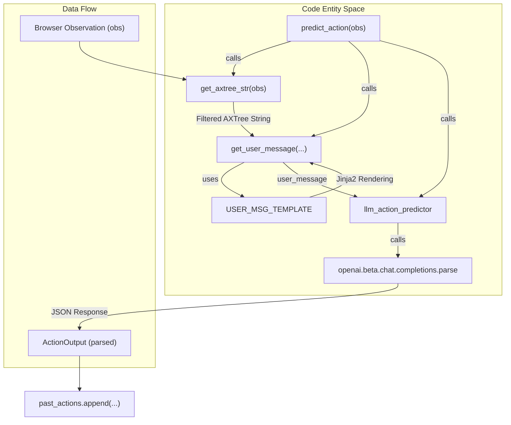
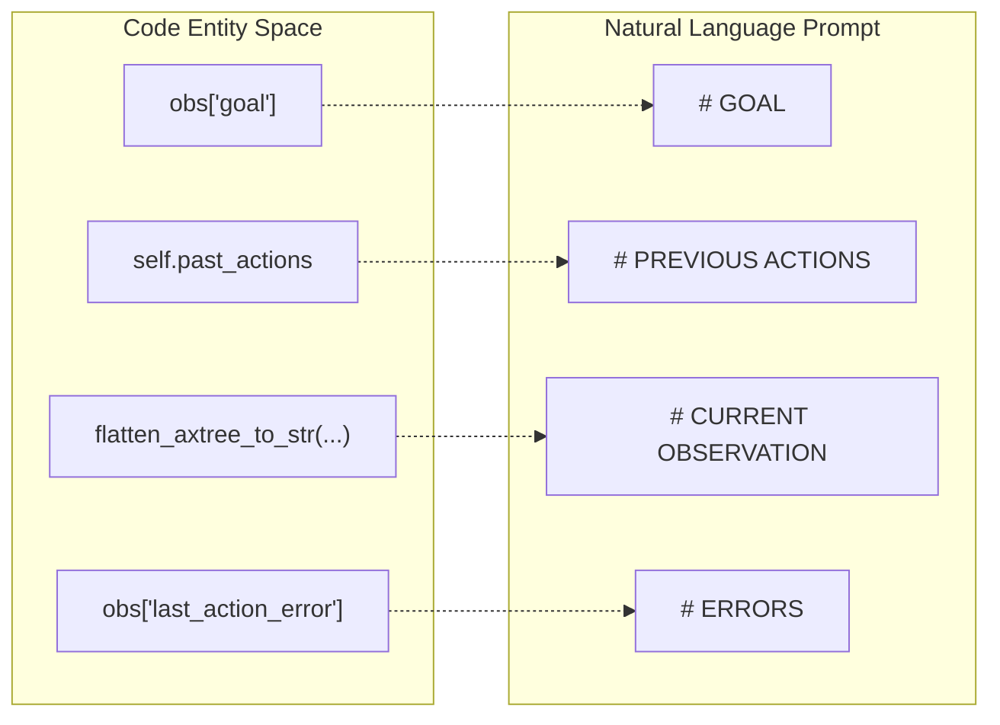

<!-- source: DeepWiki mcp.deepwiki.com · repo allenai/molmoweb · extra page GPTAxtreeAgent · fetched 2026-10-26 -->

# GPTAxtreeAgent

Relevant source files

The following files were used as context for generating this wiki page:

- [agent/actions.py](agent/actions.py)
- [agent/gpt_axtree_agent.py](agent/gpt_axtree_agent.py)

The `GPTAxtreeAgent` is an LLM-backed agent implementation that utilizes OpenAI's GPT models to perform web navigation tasks. It relies on a flattened Accessibility Tree (AXTree) representation of the webpage rather than visual screenshots. The agent leverages OpenAI's structured output capabilities to ensure that actions conform to the system's defined schemas.

### Core Implementation

The agent is defined in `agent/gpt_axtree_agent.py` and inherits from `AgentBase` [agent/gpt_axtree_agent.py:135-135](). It uses the `beta.chat.completions.parse` method from the OpenAI SDK to enforce a strict JSON response format based on the `AxtreeActionOutput` class [agent/gpt_axtree_agent.py:65-72]().

#### Model Selection and Configuration
The agent defaults to a model specified by the `GPT_AXTREE_MODEL` environment variable, which defaults to `gpt-5` (a placeholder for future-proofing or specific internal naming) [agent/gpt_axtree_agent.py:13-13](). It shares the same `SYSTEM_MESSAGE` as the `GeminiAxtreeAgent` to maintain consistency in behavior across different LLM backends [agent/gpt_axtree_agent.py:11-11]().

**Data Flow: From Observation to Action**

The following diagram illustrates how browser observations are processed into a structured GPT prompt and then parsed back into executable actions.

**GPTAxtreeAgent Prediction Loop**

Sources: [agent/gpt_axtree_agent.py:59-76](), [agent/gpt_axtree_agent.py:159-194]()

### AXTree Filtering Strategy

To manage the context window and focus the LLM on relevant interactive elements, `GPTAxtreeAgent` employs a specific filtering strategy when converting the raw AXTree object into a string. This is handled by the `get_axtree_str` helper function [agent/gpt_axtree_agent.py:79-88]().

| Parameter | Value | Description |
| :--- | :--- | :--- |
| `filter_visible_only` | `True` | Removes elements that are not rendered or hidden via CSS [agent/gpt_axtree_agent.py:84-84](). |
| `filter_with_bid_only` | `True` | Only includes elements that have been assigned a Backend ID (`bid`) by the system [agent/gpt_axtree_agent.py:85-85](). |
| `with_clickable` | `True` | Ensures elements identified as interactive are preserved [agent/gpt_axtree_agent.py:86-86](). |
| `skip_generic` | `True` | Removes generic containers (like `div` or `span` without roles) to reduce verbosity [agent/gpt_axtree_agent.py:87-87](). |
| `with_visible` | `False` | Disables explicit visibility flags in the output string to save tokens [agent/gpt_axtree_agent.py:83-83](). |

Sources: [agent/gpt_axtree_agent.py:79-88](), [utils/axtree/axtree.py:1-1]()

### Multi-Tab Awareness and Context

The agent is designed to handle browser environments with multiple open tabs. The `USER_MSG_TEMPLATE` and `get_user_message` function explicitly inject tab information into the prompt [agent/gpt_axtree_agent.py:25-53]().

*   **All Pages/Tabs**: Lists every open tab with its index, title, and URL by zipping `obs["open_pages_titles"]` and `obs["open_pages_urls"]` [agent/gpt_axtree_agent.py:39-42](), [agent/gpt_axtree_agent.py:116-118]().
*   **Active Page**: Specifically identifies which page the AXTree belongs to using `obs["active_page_index"]` [agent/gpt_axtree_agent.py:44-45](), [agent/gpt_axtree_agent.py:113-113]().
*   **Error Feedback Loop**: If a previous action failed, the error message is included in the next prompt [agent/gpt_axtree_agent.py:50-51](). The agent filters out standard `TimeoutError` messages to avoid cluttering the context with non-informative failures [agent/gpt_axtree_agent.py:105-108]().

**Entity Mapping: Prompt Components to Code Symbols**

Sources: [agent/gpt_axtree_agent.py:25-53](), [agent/gpt_axtree_agent.py:91-132]()

### Structured Output and Action Prediction

The agent uses `create_llm_action_predictor` to wrap the OpenAI client call [agent/gpt_axtree_agent.py:59-76](). 

1.  **Response Format**: It uses `AxtreeActionOutput` as the `response_format`. This class defines the schema for actions that use element IDs (`bid`) rather than raw pixel coordinates [agent/gpt_axtree_agent.py:60-60]().
2.  **Parsing**: The `_client.beta.chat.completions.parse` method automatically converts the LLM's JSON response into a Python object, which is then accessed via `message.parsed` [agent/gpt_axtree_agent.py:65-74]().
3.  **History Management**: After each prediction, the agent stores the `action_output`, a textual description of the action (via `action_output.describe`), and the raw model inputs for debugging and logging [agent/gpt_axtree_agent.py:181-192](). The history is limited to the last 10 actions in the prompt to stay within context limits [agent/gpt_axtree_agent.py:124-125]().

Sources: [agent/gpt_axtree_agent.py:59-76](), [agent/gpt_axtree_agent.py:181-194](), [agent/actions.py:1-1]()

---

