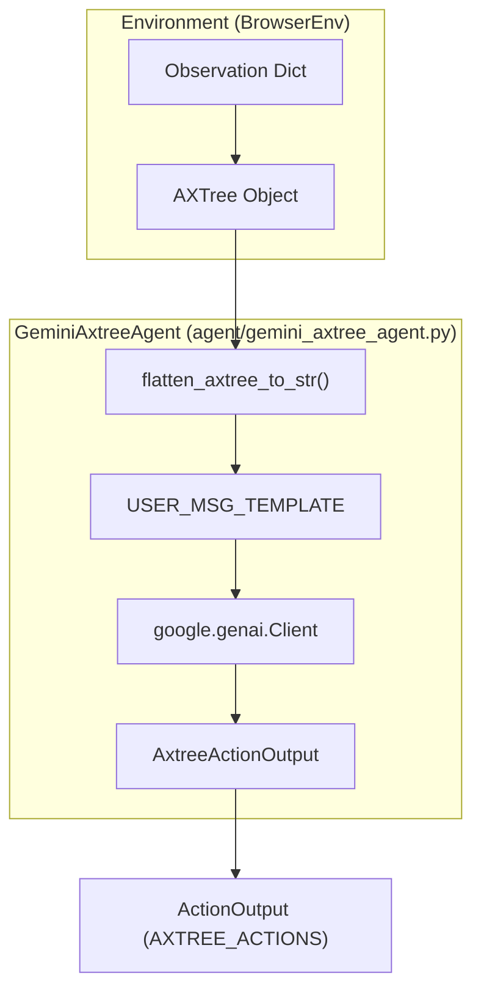
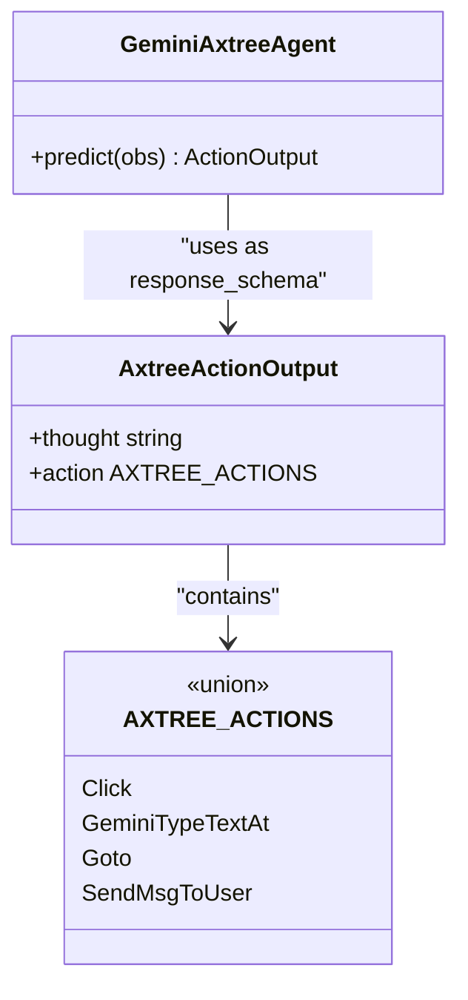

<!-- source: DeepWiki mcp.deepwiki.com · repo allenai/molmoweb · extra page GeminiAxtreeAgent · fetched 2026-10-26 -->

# GeminiAxtreeAgent

Relevant source files

The following files were used as context for generating this wiki page:

- [agent/actions.py](agent/actions.py)
- [agent/gemini_axtree_agent.py](agent/gemini_axtree_agent.py)

The `GeminiAxtreeAgent` is a specialized LLM-backed agent that utilizes Google's Gemini models to interact with web pages. Unlike the native multimodal agent, this agent relies on a flattened text representation of the Accessibility Tree (AXTree) rather than visual screenshots to understand page state. It employs a strict JSON response schema and a two-step termination protocol to ensure reliable task completion and structured data extraction.

### Implementation Overview

The agent is implemented in `agent/gemini_axtree_agent.py` and inherits from `AgentBase` [agent/gemini_axtree_agent.py:9-9](). It uses the `google-genai` SDK to communicate with Gemini models, specifically leveraging `response_schema` to enforce structured outputs that map directly to the system's action space.

#### Data Flow and Component Interaction

The following diagram illustrates how the `GeminiAxtreeAgent` processes environment observations and generates actions.

**GeminiAxtreeAgent Decision Loop**

**Sources:** [agent/gemini_axtree_agent.py:5-10](), [agent/gemini_axtree_agent.py:114-138]()

---

### System Message Design

The agent is governed by a comprehensive `SYSTEM_MESSAGE` [agent/gemini_axtree_agent.py:12-102]() that defines its persona as an intelligent web assistant. Key components of the system message include:

*   **AXTree Context:** Explains the hierarchical representation of the page using unique IDs called `bid` (backend IDs) [agent/gemini_axtree_agent.py:15-22]().
*   **Thought Constraints:** Explicitly forbids the model from mentioning implementation details like `bid`, DOM structure, or HTML tags in its `thought` field to keep reasoning high-level [agent/gemini_axtree_agent.py:24-30]().
*   **Navigation Guidelines:** Includes strict rules for `goto` actions, prohibiting the fabrication of URLs or query parameters [agent/gemini_axtree_agent.py:31-42]().
*   **Reasoning Requirements:** Mandates a dense 6-point reasoning process including Goal Decomposition, Progress Assessment, and Gap Analysis [agent/gemini_axtree_agent.py:84-100]().

**Sources:** [agent/gemini_axtree_agent.py:12-102]()

---

### AXTree Flattening and Prompting

The agent converts the complex accessibility tree into a string format that Gemini can process efficiently.

1.  **Flattening:** It calls `flatten_axtree_to_str` [agent/gemini_axtree_agent.py:5-5]() to transform the `axtree_object` from the observation into a text-based hierarchy.
2.  **Templating:** The `USER_MSG_TEMPLATE` [agent/gemini_axtree_agent.py:114-140]() assembles the final prompt containing:
    *   The user's goal.
    *   A history of `past_actions`.
    *   A list of all open tabs and the currently active page.
    *   The flattened AXTree string.

**Sources:** [agent/gemini_axtree_agent.py:5-5](), [agent/gemini_axtree_agent.py:114-140]()

---

### Structured Output and Actions

The agent uses a structured JSON response schema to ensure the model's output can be parsed into `AXTREE_ACTIONS`.

| Action Category | Supported Actions |
| :--- | :--- |
| **Element-based** | `click`, `type_text_at`, `hover`, `select_option` |
| **Coordinate-based** | `mouse_click`, `scroll_at` |
| **Navigation** | `goto`, `go_back`, `go_forward`, `page_focus` |
| **System** | `send_msg_to_user`, `noop` |

These actions are defined in `agent.actions.AXTREE_ACTIONS` [agent/gemini_axtree_agent.py:10-10](). The `AxtreeActionOutput` class [agent/actions.py:255-258]() is used as the `response_schema` to enforce that the model provides both a `thought` and a valid `action`.

**Gemini Action Mapping**

**Sources:** [agent/gemini_axtree_agent.py:8-10](), [agent/actions.py:255-258](), [agent/actions.py:241-252]()

---

### Termination Protocol

To ensure the agent successfully signals the end of a task and provides the requested information, it follows a strict two-step sequence:

1.  **Step 1: [ANSWER]**: The agent calls `send_msg_to_user(text='[ANSWER] <content>')` [agent/gemini_axtree_agent.py:67-70](). This step provides the final result to the user.
2.  **Step 2: [EXIT]**: In the subsequent turn, the agent must call `send_msg_to_user(text='[EXIT]')` [agent/gemini_axtree_agent.py:72-75]().

**Rules for Termination:**
*   The `[ANSWER]` and `[EXIT]` messages must never be combined in a single action [agent/gemini_axtree_agent.py:80-80]().
*   For non-textual tasks (e.g., "Navigate to Google"), the agent uses `[ANSWER] Done` [agent/gemini_axtree_agent.py:82-82]().
*   If an answer cannot be found, the agent should provide its best guess in the `[ANSWER]` message [agent/gemini_axtree_agent.py:81-81]().

**Sources:** [agent/gemini_axtree_agent.py:63-83]()

---

### Website-Specific Guidelines

The agent can be configured with a list of available websites via the `AVAILABLE_WEBSITES_TEMPLATE` [agent/gemini_axtree_agent.py:104-111](). This is used to inform the agent of specific URLs it is permitted to use, supporting the "Direct URL Navigation" guideline which prioritizes known URLs over search engine queries [agent/gemini_axtree_agent.py:33-42]().

**Key Constraints for URL Navigation:**
*   **NEVER** fabricate or guess URLs with paths or query parameters [agent/gemini_axtree_agent.py:35-35]().
*   Only use URLs explicitly visible on the page, provided in the task, or standard homepages [agent/gemini_axtree_agent.py:34-34]().
*   Navigate to base URLs first and then use site search for specific content [agent/gemini_axtree_agent.py:36-36]().

**Sources:** [agent/gemini_axtree_agent.py:33-42](), [agent/gemini_axtree_agent.py:104-111]()

---

