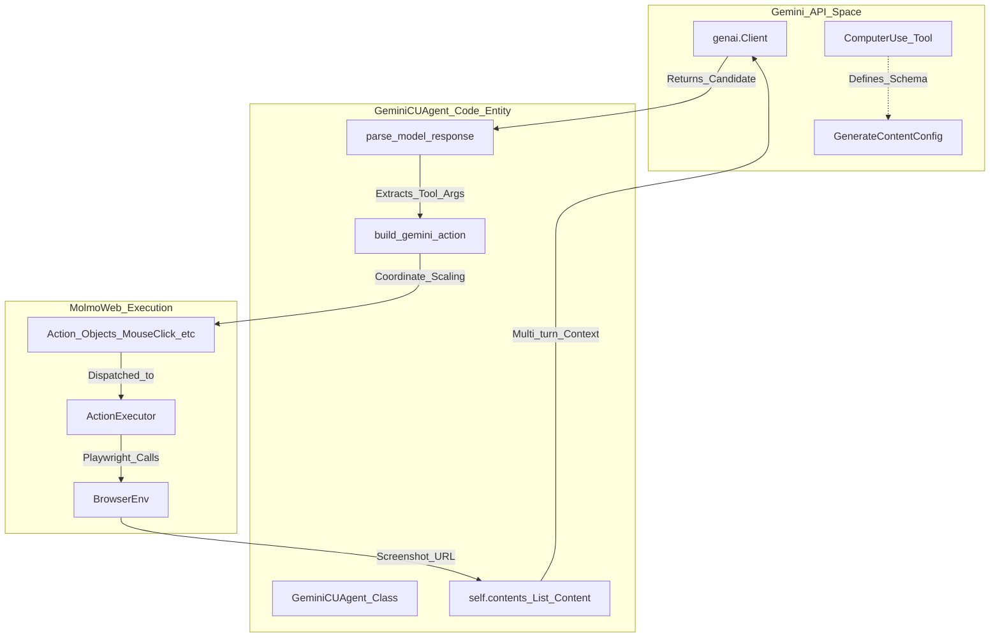
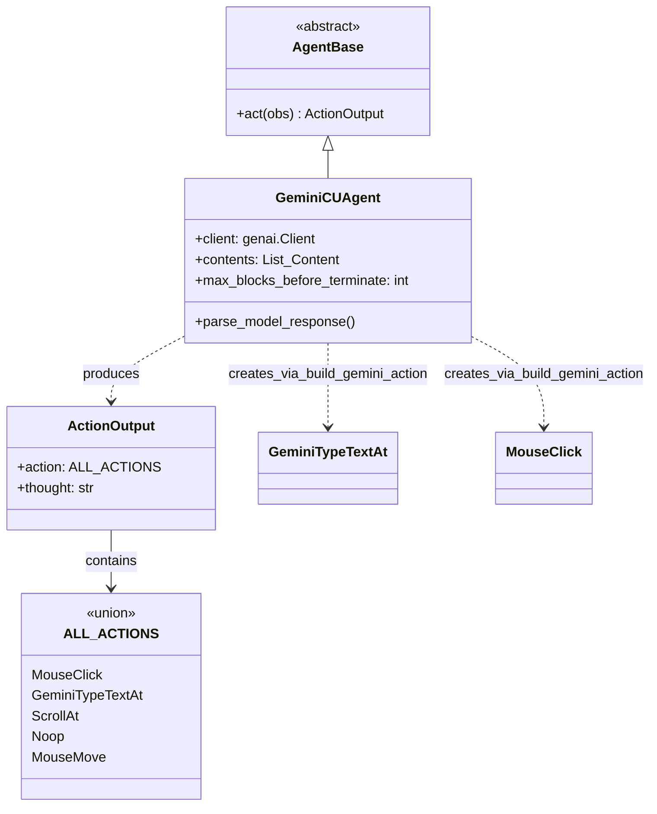

<!-- source: DeepWiki mcp.deepwiki.com · repo allenai/molmoweb · extra page GeminiCUAgent (Computer Use) · fetched 2026-10-26 -->

# GeminiCUAgent (Computer Use)

Relevant source files

The following files were used as context for generating this wiki page:

- [agent/actions.py](agent/actions.py)
- [agent/gemini_cua.py](agent/gemini_cua.py)

The `GeminiCUAgent` is a specialized agent implementation that leverages Google's Gemini "Computer Use" (CU) models (e.g., `gemini-2.5-computer-use-preview-10-2025`). Unlike other agents in MolmoWeb that rely on Accessibility Tree (AXTree) parsing, this agent interacts with the browser primarily through visual screenshots and a predefined toolset provided by the Gemini API. It handles coordinate scaling between Gemini's normalized 0-999 space and the browser's pixel space, manages multi-turn history using the `Content` and `Part` schema, and implements specific safety and termination protocols.

### Implementation Overview

The agent is defined in `agent/gemini_cua.py` and inherits from `AgentBase` [agent/gemini_cua.py:191-191](). It uses the `google-genai` SDK to communicate with the model and configures a `ComputerUse` tool environment specifically for the browser [agent/gemini_cua.py:208-212]().

#### Data Flow and Coordinate Scaling
Gemini's Computer Use model operates on a normalized coordinate system from 0 to 999 for both axes. The agent performs bidirectional conversion to map these to the actual pixel dimensions of the browser screenshot provided in the observation.

- **Scaling to Pixels**: The helper `_scale_1000_to_coord` converts a 0-999 value to a pixel value, clamped within the viewport to ensure actions remain within bounds [agent/gemini_cua.py:76-80]().
- **Scaling to Magnitude**: For relative movements like scrolling, `_scale_1000_to_px` provides a straight ratio conversion without clamping [agent/gemini_cua.py:71-73]().

#### Model-to-Action Translation
The model returns `function_call` objects which the agent parses into MolmoWeb's internal `Action` objects via `build_gemini_action` [agent/gemini_cua.py:108-108]().

| Gemini Function | MolmoWeb Action | Notes |
| :--- | :--- | :--- |
| `click_at` | `MouseClick` | Supports `left` button and `single` click [agent/gemini_cua.py:123-129](). |
| `double_click_at` | `MouseClick` | Configured with `click_type="double"` [agent/gemini_cua.py:131-137](). |
| `type_text_at` | `GeminiTypeTextAt` | Custom action that combines positioning and typing [agent/gemini_cua.py:139-146](). |
| `scroll_document` | `Scroll` | Full-page scrolls based on viewport height/width [agent/gemini_cua.py:148-157](). |
| `scroll_at` | `ScrollAt` | Targeted scroll at specific coordinates [agent/gemini_cua.py:159-173](). |
| `drag_and_drop` | `MouseDragAndDrop` | Maps `x/y` to `destination_x/y` [agent/gemini_cua.py:175-181](). |
| `wait_5_seconds` | `Noop` | Translated to a `Noop` with reason "loading" [agent/gemini_cua.py:114-115](). |
| `hover_at` | `MouseMove` | Translated to a simple mouse movement [agent/gemini_cua.py:183-187](). |
| `navigate` | `Goto` | Standard URL navigation [agent/gemini_cua.py:120-121](). |
| `go_back` | `BrowserNav` | Browser history navigation [agent/gemini_cua.py:117-118](). |

**Sources:** [agent/gemini_cua.py:71-189](), [agent/actions.py:9-22]()

---

### Agent Logic and Content Management

The `GeminiCUAgent` maintains a persistent `contents` list [agent/gemini_cua.py:216-216]() to track the conversation history. This is required for the Gemini API to understand the sequence of actions and their visual outcomes.

#### Content History Management
1. **Initial Turn**: The agent builds the first message containing the user's goal and the initial screenshot using `build_initial_content` [agent/gemini_cua.py:29-37]().
2. **Subsequent Turns**: After an action is executed, the result is appended as a `FunctionResponse`. This response includes the new screenshot and the current URL [agent/gemini_cua.py:39-68]().
3. **Safety Handling**: If the model provides a `safety_decision` in its function call arguments, the agent acknowledges this in the next response turn to satisfy the API's safety protocol [agent/gemini_cua.py:96-98](), [agent/gemini_cua.py:51-52]().

#### Termination Protocol
The agent terminates under three conditions:
1. **Answer/Exit**: If the model produces text without a function call, it is treated as a final answer wrapped in a `SendMsgToUser` action [agent/gemini_cua.py:102-103]().
2. **Block Count**: To prevent infinite loops or excessive API costs, the agent tracks `block_count`. If it exceeds `max_blocks_before_terminate` (default 10), the agent stops [agent/gemini_cua.py:197-197]().
3. **Manual Stop**: The model can explicitly signal completion via text, which `parse_model_response` captures as the `thought` [agent/gemini_cua.py:89-90]().

### System Interaction Diagram

The following diagram illustrates how the `GeminiCUAgent` bridges the gap between the Gemini API's "Computer Use" tool definitions and the MolmoWeb execution environment.

**Gemini Computer Use Data Flow**

**Sources:** [agent/gemini_cua.py:191-217](), [agent/gemini_cua.py:82-105](), [utils/envs/action_executor.py:1-20]()

---

### Class Structure and Key Methods

#### `GeminiCUAgent` Class
Defined in `agent/gemini_cua.py`, this class manages the lifecycle of a computer-use session.

| Method | Role |
| :--- | :--- |
| `__init__` | Initializes the `genai.Client`, configures the `ComputerUse` tool, and sets the `max_blocks_before_terminate` threshold [agent/gemini_cua.py:193-215](). |
| `parse_model_response` | Iterates through `candidate.content.parts` to extract `thought`, `function_call`, and `safety_decision` [agent/gemini_cua.py:82-105](). |
| `build_initial_content` | Formats the goal and first image into the Gemini `Content` schema [agent/gemini_cua.py:29-37](). |
| `build_function_response_content` | Wraps action results (screenshots, URLs, errors) into a `FunctionResponse` part for the next model turn [agent/gemini_cua.py:39-68](). |

#### Component Relationship Diagram

This diagram shows the relationship between the Gemini-specific response parsing and the standard MolmoWeb Action hierarchy.

**Action Mapping Architecture**

**Sources:** [agent/gemini_cua.py:191-217](), [agent/actions.py:9-22](), [agent/utils.py:23-23]()

### Technical Constraints
- **Model Version**: Specifically requires a model supporting the `computer_use` tool [agent/gemini_cua.py:195-195]().
- **Tool Exclusion**: By default, `open_web_browser`, `go_forward`, `search`, and `key_combination` are excluded from the predefined functions to rely on MolmoWeb's own navigation logic [agent/gemini_cua.py:201-203]().
- **Thinking Config**: The agent is configured with `include_thoughts=True` to capture the model's reasoning in the `thought` field of the `ActionOutput` [agent/gemini_cua.py:214-214]().
- **Coordinate Clamping**: Coordinates are clamped to `max(1.0, min(px, dim - 2.0))` to prevent clicking exactly on the edge of the viewport [agent/gemini_cua.py:79-79]().

**Sources:** [agent/gemini_cua.py:71-217]()

---

