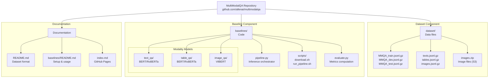
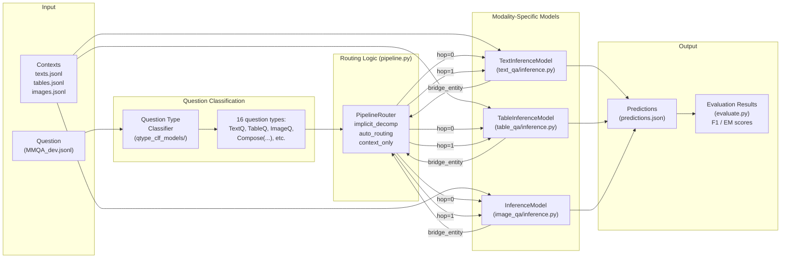
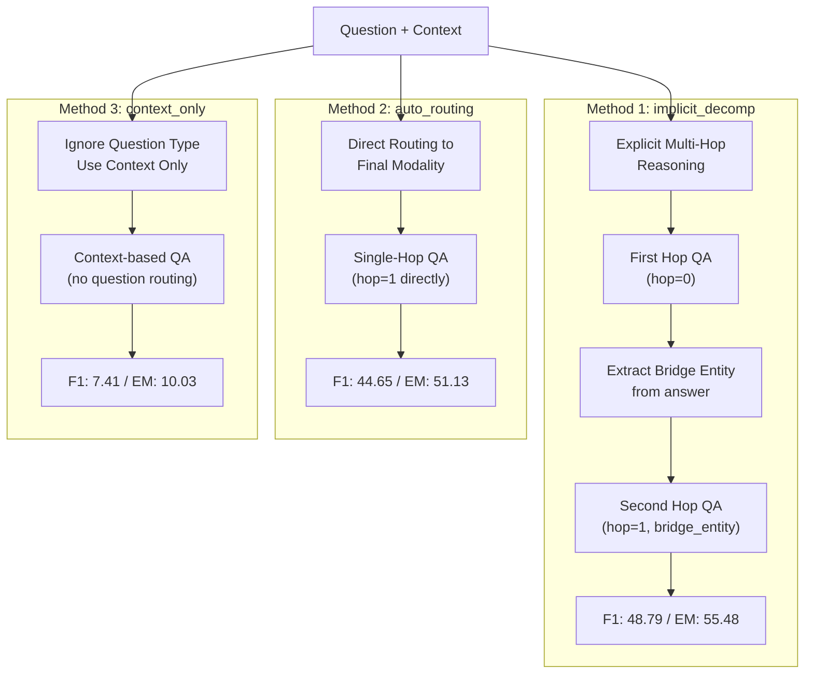

<!-- source: DeepWiki mcp.deepwiki.com · repo allenai/multimodalqa · page 1 Overview · fetched 2026-10-26 -->

# Overview

<details>
<summary>Relevant source files</summary>

The following files were used as context for generating this wiki page:

- [README.md](README.md)
- [_config.yml](_config.yml)
- [baselines/README.md](baselines/README.md)
- [index.md](index.md)

</details>


This document provides a high-level introduction to the MultiModalQA repository, explaining its purpose as a research framework for complex question answering that requires joint reasoning over text, tables, and images. The repository contains both the MultiModalQA dataset (29,918 examples) and baseline model implementations for the three modalities.

For detailed setup instructions, see [Getting Started](#2). For dataset format specifications, see [Dataset](#3). For implementation details of individual models, see [Baseline Models](#5).

## What is MultiModalQA?

MultiModalQA is a challenging question answering dataset and research framework published at ICLR 2021. The core research question is: **How can QA systems answer complex questions that require reasoning across multiple modalities—text paragraphs, structured tables, and images?**

**Key Characteristics:**

| Aspect | Details |
|--------|---------|
| **Dataset Size** | 29,918 examples (train/dev/test splits) |
| **Modalities** | Text paragraphs, tables, images |
| **Question Types** | 16 distinct types: single-hop and multi-hop (Compose, Intersect, Compare) |
| **Source** | Wikipedia pages with text, tables, and images |
| **Task** | Extractive QA with list-based answers |
| **Evaluation Metrics** | F1 score and Exact Match (EM) with list normalization |

**Example Question (Compose operation):**
```
Question: "What was the net worth of the LGBT billionaire who is 
           completely bald and wears thick glasses?"
- First hop: Image → identify person from visual features
- Second hop: Table → extract net worth from structured data
```

Sources: [index.md:1-37](), [README.md:1-6](), [baselines/README.md:1-3]()

## Repository Structure

The MultiModalQA repository is organized into two main components: the **dataset** and the **baselines** (inference and training code).



**Directory Layout:**

| Directory/File | Purpose |
|----------------|---------|
| `dataset/` | Contains all dataset files: questions, contexts (text/tables/images) |
| `baselines/` | Implementation of three baseline inference methods and model training |
| `baselines/pipeline.py` | Main inference orchestrator that routes questions to appropriate models |
| `baselines/text_qa/` | Text QA model (BERT/RoBERTa-based) for paragraph-based questions |
| `baselines/table_qa/` | Table QA model (BERT/RoBERTa-based) for structured data questions |
| `baselines/image_qa/` | Image QA model (VilBERT-based) for visual questions |
| `baselines/evaluate.py` | Evaluation metrics (F1, EM) with list normalization |
| `baselines/scripts/download.sh` | Downloads dataset, pre-trained models, and checkpoints |
| `baselines/scripts/run_pipeline.sh` | Runs all three baseline methods in parallel |

Sources: [README.md:15-21](), [baselines/README.md:1-53]()

## System Architecture: From Question to Answer

The MultiModalQA system follows a **modular pipeline architecture** where questions are classified by type, then routed to appropriate modality-specific models. For multi-hop questions, intermediate results (bridge entities) are passed between models.



**Key Code Components:**

| Component | File/Class | Role |
|-----------|------------|------|
| **Pipeline Orchestrator** | `baselines/pipeline.py` | Main entry point; loads models, processes examples, routes questions |
| **Question Type Classifier** | `downloads/checkpoints/qtype_clf_models/` | Predicts 1 of 16 question types to determine routing strategy |
| **Text QA Inference** | `baselines/text_qa/inference.py:TextInferenceModel` | Answers questions over text paragraphs using BERT/RoBERTa |
| **Table QA Inference** | `baselines/table_qa/inference.py:TableInferenceModel` | Answers questions over tables using linearized table representations |
| **Image QA Inference** | `baselines/image_qa/inference.py:InferenceModel` | Answers questions over images using VilBERT with pre-extracted features |
| **Evaluation** | `baselines/evaluate.py` | Computes F1 and EM metrics with list normalization |

Sources: [baselines/README.md:19-36](), [baselines/pipeline.py:1-500]() (entire file structure)

## Three Baseline Inference Methods

The repository implements three distinct inference methods that represent different strategies for handling multi-hop reasoning. These methods are controlled by the `--method` argument in `pipeline.py`.



**Performance Summary (Dev Set):**

| Method | Single-Modality F1/EM | Multi-Modality F1/EM | Overall F1/EM |
|--------|----------------------|---------------------|---------------|
| `context_only` | 7.94 / 10.73 | 6.63 / 9.00 | **7.41 / 10.03** |
| `auto_routing` | 51.68 / 58.48 | 34.18 / 40.18 | **44.65 / 51.13** |
| `implicit_decomp` | 51.60 / 58.35 | 44.59 / 51.19 | **48.79 / 55.48** |

The `implicit_decomp` method achieves the best performance by explicitly modeling multi-hop reasoning with bridge entity extraction, significantly outperforming `auto_routing` on multi-modality questions (+10.41 F1 points).

For detailed explanation of each method's implementation, see [Inference Methods](#4.2).

Sources: [baselines/README.md:38-49](), [baselines/pipeline.py:1-500]() (method routing logic)

## Training Infrastructure

Each modality-specific QA model is trained independently using its own training pipeline:

| Model | Training Entry Point | Key Components | Pre-trained Base |
|-------|---------------------|----------------|------------------|
| **Image QA** | `baselines/image_qa/main.py` | `VQADataset`, `VilbertForMQA`, two-stage training (frozen/unfrozen) | VilBERT pre-trained on Conceptual Captions |
| **Text QA** | `baselines/text_qa/` (see README) | BERT/RoBERTa fine-tuning on text paragraphs | Hugging Face transformers |
| **Table QA** | `baselines/table_qa/` (see README) | BERT/RoBERTa fine-tuning on linearized tables | Hugging Face transformers |

**Image QA Training (Most Complex):**

The image QA model requires a specialized conda environment (`multimodalqa_image`) with dependencies on APEX, VilBERT, and MaskRCNN. Training proceeds in two stages:
1. **Stage 1 (Frozen):** Train only QA heads for 25 epochs with lr=2e-5
2. **Stage 2 (Unfrozen):** Full end-to-end fine-tuning for 50 epochs with lr=2e-6

For detailed training instructions, see [Training Image QA Models](#7.1).

Sources: [baselines/README.md:50-53](), [baselines/image_qa/main.py:1-400]() (training logic)

## Research Context and Citations

MultiModalQA was published at ICLR 2021:

**Paper:** [MultiModalQA: Complex Question Answering over Text, Tables and Images](https://openreview.net/pdf?id=ee6W5UgQLa)  
**Authors:** Alon Talmor, Ori Yoran, Amnon Catav, Dan Lahav, Yizhong Wang, Akari Asai, Gabriel Ilharco, Hannaneh Hajishirzi, Jonathan Berant  
**Institution Collaboration:** Tel Aviv University, University of Washington, Allen Institute for AI

**BibTeX Citation:**
```bibtex
@inproceedings{talmor2021multimodalqa,
  title={MultiModalQA: complex question answering over text, tables and images},
  author={Alon Talmor and Ori Yoran and Amnon Catav and Dan Lahav and 
          Yizhong Wang and Akari Asai and Gabriel Ilharco and 
          Hannaneh Hajishirzi and Jonathan Berant},
  booktitle={International Conference on Learning Representations},
  year={2021},
  url={https://openreview.net/forum?id=ee6W5UgQLa}
}
```

**Public Resources:**
- **Dataset:** Available at [github.com/allenai/multimodalqa/tree/master/dataset](https://github.com/allenai/multimodalqa/tree/master/dataset)
- **Images:** Downloadable from [S3 bucket (images.zip)](https://multimodalqa-images.s3-us-west-2.amazonaws.com/final_dataset_images/final_dataset_images.zip)
- **Baseline Checkpoints:** Downloaded via `baselines/scripts/download.sh`
- **Website:** [allenai.github.io/multimodalqa](https://allenai.github.io/multimodalqa)

Sources: [index.md:20-31](), [README.md:1-7](), [_config.yml:1-3]()

## Getting Started

To begin using MultiModalQA:

1. **Setup Environment:** Follow instructions in [Installation and Environment Setup](#2.1)
2. **Download Data and Models:** Run `baselines/scripts/download.sh` to fetch dataset and checkpoints
3. **Run Inference:** Use `baselines/pipeline.py` or `baselines/scripts/run_pipeline.sh` to evaluate baselines
4. **Explore Dataset:** See [Dataset Format Specification](#3.1) for detailed format documentation
5. **Train Models:** See [Training Models](#7) for modality-specific training procedures

For a step-by-step tutorial, see [Quick Start Guide](#2.2).

Sources: [baselines/README.md:4-17]()

---

