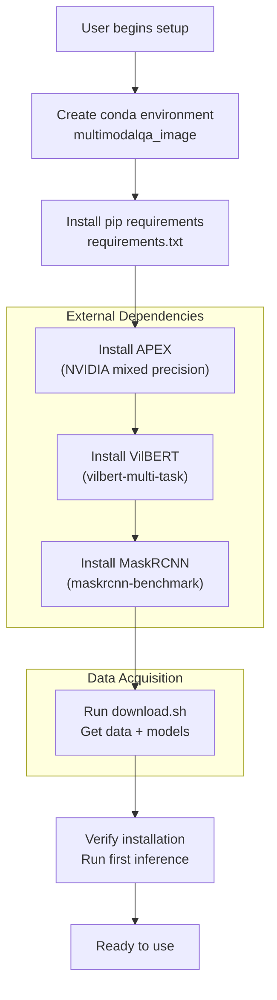
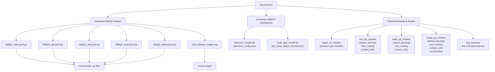
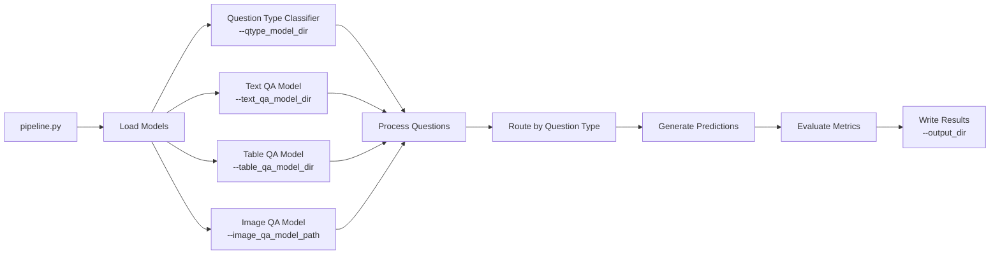

<!-- source: DeepWiki mcp.deepwiki.com · repo allenai/multimodalqa · page 2 Getting Started · fetched 2026-10-26 -->

# Getting Started

<details>
<summary>Relevant source files</summary>

The following files were used as context for generating this wiki page:

- [.gitignore](.gitignore)
- [baselines/README.md](baselines/README.md)
- [baselines/image_qa/environment.yml](baselines/image_qa/environment.yml)
- [baselines/scripts/download.sh](baselines/scripts/download.sh)

</details>


This page guides you through setting up the MultiModalQA baseline system, downloading required data and models, and running your first inference. By the end, you will have a working installation that can answer questions using text, table, and image modalities.

For detailed information about training new models, see [Training Models](#7). For understanding the dataset format, see [Dataset](#3). For in-depth explanation of the inference pipeline, see [Pipeline Implementation](#6.1).

## Prerequisites

The MultiModalQA baseline system has the following requirements:

| Component | Version | Notes |
|-----------|---------|-------|
| Python | 3.7+ | Python 3.8 recommended |
| PyTorch | 1.5.1 | Required for model inference |
| CUDA | 10.0+ | For GPU acceleration |
| Operating System | Linux | Tested on Linux environments |

**Hardware Requirements:**
- Minimum 16GB RAM
- GPU with 11GB+ VRAM (for image QA models)
- 50GB+ disk space for models and data

Sources: [baselines/README.md:5-6]()

## Installation Flow Overview



**Installation Flow Overview**

Sources: [baselines/README.md:4-10]()

## Step 1: Environment Setup

### Create Conda Environment

The repository provides a pre-configured conda environment specification:

```bash
conda env create -f baselines/image_qa/environment.yml
conda activate multimodalqa_image
```

This creates an environment named `multimodalqa_image` with Python 3.8, PyTorch 1.4.0, and CUDA 10.0 support.

Alternatively, create a virtual environment manually:

```bash
python -m venv mmqa_env
source mmqa_env/bin/activate
```

Sources: [baselines/image_qa/environment.yml:1-2](), [baselines/README.md:5-8]()

### Install Core Dependencies

Install the Python packages listed in `requirements.txt`:

```bash
pip install -r baselines/requirements.txt
```

This installs transformers, evaluation libraries, and other utilities needed for the baseline models.

Sources: [baselines/README.md:7-8]()

## Step 2: External Dependencies

The system requires three external libraries that must be installed separately:

### APEX (Mixed Precision Training)

```bash
git clone https://github.com/NVIDIA/apex
cd apex
pip install -v --no-cache-dir --global-option="--cpp_ext" --global-option="--cuda_ext" ./
```

APEX provides optimized kernels for mixed-precision training and inference.

### VilBERT Multi-Task

```bash
git clone https://github.com/facebookresearch/vilbert-multi-task.git
cd vilbert-multi-task
python setup.py develop
```

VilBERT is the backbone model for image QA. The multi-task version provides pre-trained weights for visual question answering.

### MaskRCNN Benchmark

```bash
git clone https://github.com/facebookresearch/maskrcnn-benchmark.git
cd maskrcnn-benchmark
python setup.py build develop
```

MaskRCNN extracts region features from images for the image QA model.

**Troubleshooting:** If you encounter `AT_CHECK` errors during MaskRCNN installation, this is a known issue with newer PyTorch versions. Replace `AT_CHECK` with `TORCH_CHECK` in the source files.

Sources: [baselines/README.md:9-10]()

## Step 3: Download Data and Models

### Download Script Overview



**Download Script Data Flow**

### Execute Download

Run the download script from the `baselines/` directory:

```bash
cd baselines
./scripts/download.sh
```

This script performs the following operations:

1. **Creates directory structure:**
   - `downloads/MMQA/` - Dataset files
   - `downloads/vilbert/` - VilBERT pre-trained models
   - `downloads/checkpoints/` - Baseline model checkpoints

2. **Downloads MMQA dataset** (~29K dev examples, training and test sets)
3. **Downloads VilBERT dependencies** (Detectron model, config files)
4. **Downloads baseline checkpoints** for all three methods:
   - `implicit_decomp` - Multi-hop reasoning
   - `auto_routing` - Single-hop routing
   - `context_only` - Context-based baseline

4. **Downloads pre-extracted image features** to avoid expensive feature extraction

The complete download is approximately 30-40GB.

Sources: [baselines/scripts/download.sh:1-27]()

### Directory Structure After Download

```
downloads/
├── MMQA/
│   ├── MMQA_train.jsonl
│   ├── MMQA_dev.jsonl
│   ├── MMQA_test.jsonl
│   ├── MMQA_texts.jsonl
│   ├── MMQA_tables.jsonl
│   └── final_dataset_images/
│       └── *.jpg
├── vilbert/
│   ├── detectron_model.pth
│   ├── detectron_config.yaml
│   ├── multi_task_model.bin
│   └── bert_base_6layer_6conect.json
└── checkpoints/
    ├── qtype_clf_models/
    ├── text_qa_models/
    │   ├── implicit_decomp/
    │   ├── auto_routing/
    │   └── context_only/
    ├── table_qa_models/
    │   ├── implicit_decomp/
    │   ├── auto_routing/
    │   └── context_only/
    ├── image_qa_models/
    │   ├── implicit_decomp/model.pt
    │   ├── auto_routing/model.pt
    │   ├── context_only/model.pt
    │   └── vocab.pickle
    └── img_features/
```

Sources: [baselines/scripts/download.sh:1-27](), [.gitignore:8-15]()

## Step 4: Run First Inference

### Basic Inference Command



**Pipeline Command Flow**

To run inference on the dev set using the `implicit_decomp` method:

```bash
cd baselines

python pipeline.py \
  --qtype_model_dir downloads/checkpoints/qtype_clf_models/ \
  --text_qa_model_dir downloads/checkpoints/text_qa_models/implicit_decomp/ \
  --table_qa_model_dir downloads/checkpoints/table_qa_models/implicit_decomp/ \
  --image_qa_model_path downloads/checkpoints/image_qa_models/implicit_decomp/model.pt \
  --image_qa_vocab downloads/checkpoints/image_qa_models/vocab.pickle \
  --image_features_dir downloads/checkpoints/img_features/ \
  --data_dir downloads/MMQA/ \
  --test_file MMQA_dev.jsonl \
  --output_dir output/results/implicit_decomp_dev/ \
  --do_lower_case \
  --method implicit_decomp
```

### Command Parameters Explained

| Parameter | Purpose | Example Value |
|-----------|---------|---------------|
| `--qtype_model_dir` | Path to question type classifier | `downloads/checkpoints/qtype_clf_models/` |
| `--text_qa_model_dir` | Path to text QA model checkpoint | `downloads/checkpoints/text_qa_models/implicit_decomp/` |
| `--table_qa_model_dir` | Path to table QA model checkpoint | `downloads/checkpoints/table_qa_models/implicit_decomp/` |
| `--image_qa_model_path` | Path to image QA model `.pt` file | `downloads/checkpoints/image_qa_models/implicit_decomp/model.pt` |
| `--image_qa_vocab` | Vocabulary file for image QA | `downloads/checkpoints/image_qa_models/vocab.pickle` |
| `--image_features_dir` | Pre-extracted image features | `downloads/checkpoints/img_features/` |
| `--data_dir` | Root directory for MMQA data | `downloads/MMQA/` |
| `--test_file` | Input file (relative to data_dir) | `MMQA_dev.jsonl` |
| `--output_dir` | Directory for predictions and metrics | `output/results/implicit_decomp_dev/` |
| `--method` | Inference method to use | `implicit_decomp`, `auto_routing`, or `context_only` |
| `--do_lower_case` | Lowercase text during tokenization | Flag (no value) |

Sources: [baselines/README.md:21-35]()

### Expected Output

The inference process will:

1. Load all four models (question type classifier, text QA, table QA, image QA)
2. Process each question in `MMQA_dev.jsonl`
3. Route questions to appropriate models based on question type
4. Generate predictions and write to `output/results/implicit_decomp_dev/`
5. Compute evaluation metrics (F1 and Exact Match scores)

**Console output:**
```
Loading question type classifier...
Loading text QA model...
Loading table QA model...
Loading image QA model...
Processing questions: 100%|████████| 29918/29918
Evaluating predictions...
Results:
  Single-Modality: F1 51.60 / EM 58.35
  Multi-Modality: F1 44.59 / EM 51.19
  All: F1 48.79 / EM 55.48
```

Sources: [baselines/README.md:42-48]()

## Step 5: Verify Installation

### Run All Baselines

To verify that all components work correctly, run the complete evaluation script:

```bash
cd baselines
./scripts/run_pipeline.sh
```

This script runs all three baseline methods in parallel on separate GPUs:
- GPU 0: `implicit_decomp`
- GPU 1: `auto_routing`
- GPU 2: `context_only`

Logs are written to `logs/` directory for each method.

Sources: [baselines/README.md:38-41]()

### Expected Baseline Performance

If your installation is correct, you should see the following F1 / EM scores on the dev set:

| Method | Single-Modality | Multi-Modality | All |
|--------|-----------------|----------------|-----|
| Context-only | 7.94 / 10.73 | 6.63 / 9.00 | 7.41 / 10.03 |
| AutoRouting | 51.68 / 58.48 | 34.18 / 40.18 | 44.65 / 51.13 |
| ImplicitDecomp | 51.60 / 58.35 | 44.59 / 51.19 | **48.79 / 55.48** |

The `implicit_decomp` method achieves the best performance by performing explicit multi-hop reasoning.

Sources: [baselines/README.md:42-48]()

## Test-Only Prediction

To generate predictions without gold answers (e.g., for test set submission):

```bash
python pipeline.py \
  --qtype_model_dir downloads/checkpoints/qtype_clf_models/ \
  --text_qa_model_dir downloads/checkpoints/text_qa_models/implicit_decomp/ \
  --table_qa_model_dir downloads/checkpoints/table_qa_models/implicit_decomp/ \
  --image_qa_model_path downloads/checkpoints/image_qa_models/implicit_decomp/model.pt \
  --image_qa_vocab downloads/checkpoints/image_qa_models/vocab.pickle \
  --image_features_dir downloads/checkpoints/img_features/ \
  --data_dir downloads/MMQA/ \
  --test_file MMQA_test.jsonl \
  --output_dir output/results/implicit_decomp_test/ \
  --do_lower_case \
  --method implicit_decomp \
  --predict_only
```

The `--predict_only` flag skips evaluation and only writes predictions to the output directory.

Sources: [baselines/README.md:36]()

## Common Issues and Solutions

### Issue: CUDA Out of Memory

**Symptom:** `RuntimeError: CUDA out of memory`

**Solution:** Reduce batch size in model configuration or use a GPU with more memory. The image QA model requires approximately 11GB VRAM.

### Issue: AT_CHECK Not Defined

**Symptom:** Compilation error when installing MaskRCNN

**Solution:** This is a compatibility issue with PyTorch 1.5+. Replace `AT_CHECK` with `TORCH_CHECK` in MaskRCNN source files or use PyTorch 1.4.

Sources: [baselines/README.md:10]()

### Issue: Missing Image Features

**Symptom:** `FileNotFoundError` when loading image features

**Solution:** Ensure `img_features.tar.gz` was downloaded and extracted correctly. The features should be in `downloads/checkpoints/img_features/`.

### Issue: Slow First Run

**Symptom:** First inference takes significantly longer than subsequent runs

**Explanation:** This is expected. The first run compiles CUDA kernels and caches them. Subsequent runs will be faster.

## Next Steps

Now that you have a working installation:

1. **Explore the dataset** - See [Dataset Format Specification](#3.1) to understand the data structure
2. **Understand inference methods** - Read [Inference Methods](#4.2) to learn about the three baseline approaches
3. **Run detailed evaluations** - See [Running Baseline Evaluations](#6.2) for more analysis options
4. **Train custom models** - Follow [Training Models](#7) to train your own models

For a quick overview of running predictions, see [Quick Start Guide](#2.2).

Sources: [baselines/README.md:1-52]()

---

