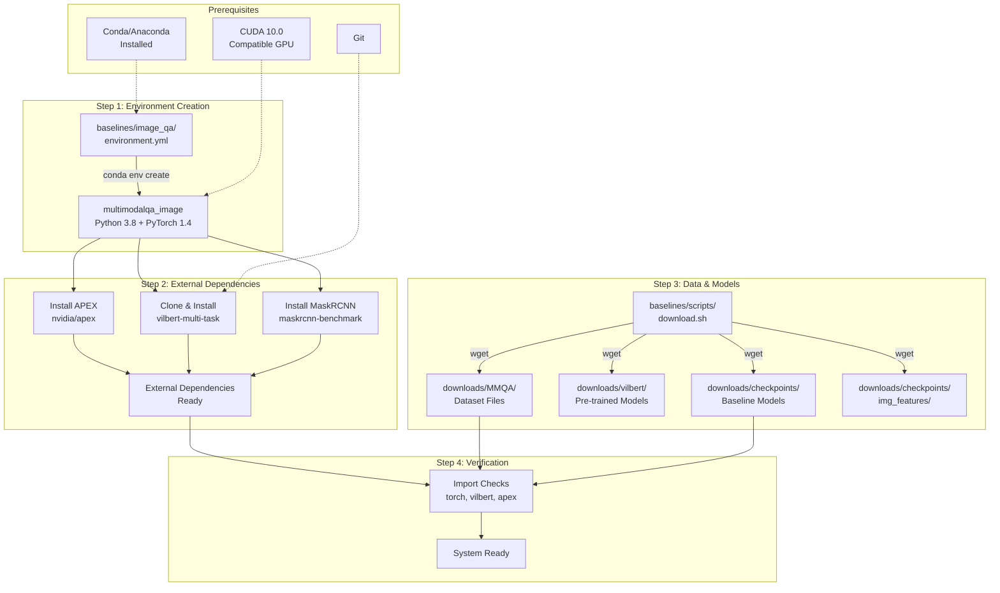
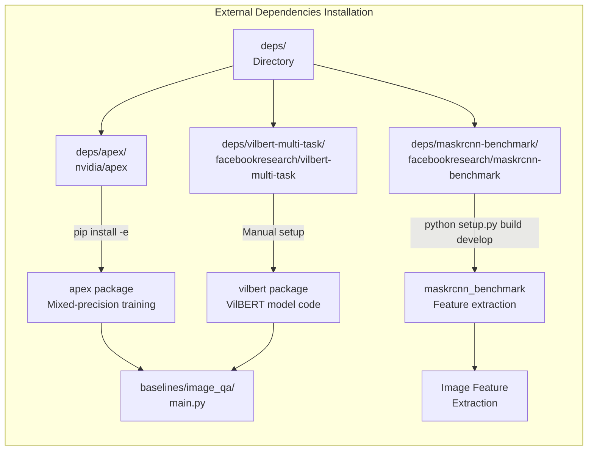

<!-- source: DeepWiki mcp.deepwiki.com · repo allenai/multimodalqa · page 2.1 Installation and Environment Setup · fetched 2026-10-26 -->

# Installation and Environment Setup

<details>
<summary>Relevant source files</summary>

The following files were used as context for generating this wiki page:

- [.gitignore](.gitignore)
- [baselines/image_qa/environment.yml](baselines/image_qa/environment.yml)
- [baselines/scripts/download.sh](baselines/scripts/download.sh)

</details>


## Purpose and Scope

This page provides detailed instructions for setting up the development and runtime environment for the MultiModalQA system. It covers conda environment creation, dependency installation, and downloading pre-trained models and datasets. 

For guidance on running inference after setup, see [Quick Start Guide](#2.2). For training new models, see [Training Models](#7).

---

## Overview

The MultiModalQA system requires a carefully configured environment due to its dependencies on specialized computer vision libraries (Detectron, VilBERT) and CUDA-accelerated PyTorch. The setup process consists of four major steps:

1. **Create conda environment** with Python 3.8 and PyTorch 1.4.0
2. **Install external dependencies** (APEX, VilBERT, MaskRCNN)
3. **Download datasets and models** using the provided script
4. **Verify installation** by checking key imports



**Sources:** [baselines/image_qa/environment.yml:1-173](), [baselines/scripts/download.sh:1-27]()

---

## Prerequisites

The following must be installed on your system before proceeding:

| Requirement | Version | Purpose |
|------------|---------|---------|
| **Anaconda/Miniconda** | Latest | Package and environment management |
| **CUDA Toolkit** | 10.0 | GPU acceleration for PyTorch |
| **NVIDIA Driver** | Compatible with CUDA 10.0 | GPU support |
| **Git** | Any recent version | Cloning external repositories |
| **GCC/G++** | 7.x or 8.x | Compiling C++ extensions (APEX, MaskRCNN) |
| **Disk Space** | ~50 GB | Dataset images, models, and features |

**GPU Requirements:** The image QA model requires a CUDA-capable GPU with at least 12GB VRAM for training, or 8GB for inference.

**Sources:** [baselines/image_qa/environment.yml:24]() (cudatoolkit), [baselines/image_qa/environment.yml:124]() (pytorch version)

---

## Step 1: Create Conda Environment

The primary conda environment is defined in [baselines/image_qa/environment.yml:1-173](). This environment is named `multimodalqa_image` and contains all core dependencies.

### Creating the Environment

```bash
# Navigate to the repository root
cd /path/to/multimodalqa

# Create the conda environment
conda env create -f baselines/image_qa/environment.yml

# Activate the environment
conda activate multimodalqa_image
```

### Key Dependencies Installed

The environment specification includes:

| Package | Version | Channel | Purpose |
|---------|---------|---------|---------|
| `python` | 3.8.10 | conda-forge | Base interpreter |
| `pytorch` | 1.4.0 | pytorch | Deep learning framework |
| `cudatoolkit` | 10.0.130 | pytorch | CUDA support |
| `torchvision` | 0.5.0 | pytorch | Vision utilities |
| `numpy` | 1.20.2 | anaconda | Numerical computing |
| `pillow` | 8.3.1 | anaconda | Image processing |
| `opencv` | 4.5.2 | conda-forge | Computer vision |
| `boto3` | 1.16.0 | anaconda | AWS S3 downloads |
| `tqdm` | 4.61.2 | conda-forge | Progress bars |

### Pip-Installed Packages

Additional packages installed via pip within the environment [baselines/image_qa/environment.yml:154-172]():

| Package | Version | Purpose |
|---------|---------|---------|
| `apex` | 0.1 | Mixed-precision training |
| `pytorch-transformers` | 1.0.0 | BERT/RoBERTa tokenizers |
| `pycocotools` | 2.0 | COCO dataset utilities |
| `tensorboardx` | 2.4 | Training visualization |
| `jsonlines` | 2.0.0 | JSONL file parsing |
| `yacs` | 0.1.8 | Configuration management |
| `easydict` | 1.9 | Dictionary utilities |

**Sources:** [baselines/image_qa/environment.yml:1-173]()

---

## Step 2: Install External Dependencies

The MultiModalQA system depends on three external repositories that must be cloned and installed separately. These are not available via conda or pip and require manual installation.



### Installing APEX

APEX provides mixed-precision training capabilities and is required for efficient image QA training.

```bash
# Navigate to deps directory
mkdir -p deps
cd deps

# Clone APEX repository
git clone https://github.com/NVIDIA/apex
cd apex

# Install with CUDA extensions
pip install -v --no-cache-dir --global-option="--cpp_ext" --global-option="--cuda_ext" ./

# Return to repo root
cd ../..
```

**Note:** APEX installation may take 10-15 minutes due to C++/CUDA compilation.

### Installing VilBERT Multi-Task

VilBERT provides the vision-language model architecture used by the image QA component.

```bash
# Navigate to deps directory
cd deps

# Clone VilBERT repository
git clone https://github.com/facebookresearch/vilbert-multi-task.git
cd vilbert-multi-task

# Install package
python setup.py develop

# Return to repo root
cd ../..
```

The VilBERT code will be importable as `vilbert` after installation.

### Installing MaskRCNN Benchmark

MaskRCNN Benchmark is used for image feature extraction (detecting objects and extracting visual features).

```bash
# Navigate to deps directory
cd deps

# Clone MaskRCNN repository
git clone https://github.com/facebookresearch/maskrcnn-benchmark.git
cd maskrcnn-benchmark

# Build and install
python setup.py build develop

# Return to repo root
cd ../..
```

**Troubleshooting:** If compilation fails, ensure:
- CUDA 10.0 is in your PATH: `export PATH=/usr/local/cuda-10.0/bin:$PATH`
- CUDA libraries are accessible: `export LD_LIBRARY_PATH=/usr/local/cuda-10.0/lib64:$LD_LIBRARY_PATH`
- GCC version is compatible (7.x or 8.x)

**Sources:** [baselines/image_qa/environment.yml:155]() (apex reference)

---

## Step 3: Download Models and Data

The [baselines/scripts/download.sh:1-27]() script automates downloading all required datasets, pre-trained models, and baseline checkpoints.

### Directory Structure After Download

```mermaid
graph TB
    ROOT["Repository Root"]
    
    ROOT --> DL["downloads/"]
    
    DL --> MMQA_DIR["downloads/MMQA/"]
    DL --> VILBERT_DIR["downloads/vilbert/"]
    DL --> CKPT_DIR["downloads/checkpoints/"]
    
    MMQA_DIR --> TRAIN["MMQA_train.jsonl<br/>Training examples"]
    MMQA_DIR --> DEV["MMQA_dev.jsonl<br/>29,918 dev examples"]
    MMQA_DIR --> TEST["MMQA_test.jsonl<br/>Test examples"]
    MMQA_DIR --> TEXTS["MMQA_texts.jsonl<br/>Text contexts"]
    MMQA_DIR --> TABLES["MMQA_tables.jsonl<br/>Table contexts"]
    MMQA_DIR --> IMGS["final_dataset_images/<br/>Image files"]
    
    VILBERT_DIR --> DET_MODEL["detectron_model.pth<br/>Object detector weights"]
    VILBERT_DIR --> DET_CFG["detectron_config.yaml<br/>Detector config"]
    VILBERT_DIR --> MULTI_MODEL["multi_task_model.bin<br/>Pre-trained VilBERT"]
    VILBERT_DIR --> BERT_CFG["bert_base_6layer_6conect.json<br/>Model architecture"]
    
    CKPT_DIR --> QTYPE["qtype_clf_models/<br/>Question type classifiers"]
    CKPT_DIR --> TXT_QA["text_qa_models/<br/>Text QA checkpoints"]
    CKPT_DIR --> TBL_QA["table_qa_models/<br/>Table QA checkpoints"]
    CKPT_DIR --> IMG_QA["image_qa_models/<br/>Image QA checkpoints"]
    CKPT_DIR --> IMG_FEAT["img_features/<br/>Pre-computed features"]
```



### Running the Download Script

```bash
# Make script executable
chmod +x baselines/scripts/download.sh

# Run download script (requires ~30 GB disk space)
cd baselines
./scripts/download.sh
cd ..
```

### Download Contents

The script performs the following operations [baselines/scripts/download.sh:1-27]():

1. **Dataset Files** [lines 1-9](): Downloads and extracts MMQA train/dev/test splits, text/table contexts, and images
   - Source: GitHub releases and S3 bucket
   - Total size: ~20 GB (mostly images)

2. **VilBERT Pre-trained Models** [lines 11-16](): Downloads Detectron object detector and multi-task VilBERT weights
   - Source: Facebook AI public files
   - Used for image feature extraction and model initialization

3. **Baseline Checkpoints** [lines 18-23](): Downloads trained models for all three modalities and question type classifier
   - Source: MultiModalQA S3 bucket
   - Organized by inference method (implicit_decomp, auto_routing, context_only)

4. **Pre-computed Image Features** [lines 25-26](): Downloads cached visual features for all dataset images
   - Source: MultiModalQA S3 bucket
   - Size: ~8 GB
   - Avoids expensive feature re-extraction during inference

**Sources:** [baselines/scripts/download.sh:1-27]()

---

## Step 4: Verify Installation

After completing the setup, verify that all components are correctly installed:

### Import Test

Create a test script `test_imports.py`:

```python
#!/usr/bin/env python
"""Verify all required packages can be imported."""

import sys

def test_imports():
    """Test importing critical dependencies."""
    errors = []
    
    # Core dependencies
    try:
        import torch
        print(f"✓ PyTorch {torch.__version__}")
        print(f"  CUDA available: {torch.cuda.is_available()}")
        if torch.cuda.is_available():
            print(f"  CUDA version: {torch.version.cuda}")
    except ImportError as e:
        errors.append(f"✗ PyTorch: {e}")
    
    # External dependencies
    try:
        import apex
        print("✓ APEX")
    except ImportError as e:
        errors.append(f"✗ APEX: {e}")
    
    try:
        import vilbert
        print("✓ VilBERT")
    except ImportError as e:
        errors.append(f"✗ VilBERT: {e}")
    
    try:
        import maskrcnn_benchmark
        print("✓ MaskRCNN Benchmark")
    except ImportError as e:
        errors.append(f"✗ MaskRCNN Benchmark: {e}")
    
    # Utility packages
    try:
        import jsonlines
        print("✓ jsonlines")
    except ImportError as e:
        errors.append(f"✗ jsonlines: {e}")
    
    if errors:
        print("\nErrors encountered:")
        for error in errors:
            print(error)
        sys.exit(1)
    else:
        print("\n✓ All imports successful!")

if __name__ == "__main__":
    test_imports()
```

Run the verification:

```bash
conda activate multimodalqa_image
python test_imports.py
```

### Directory Structure Verification

Check that downloaded files are in place:

```bash
# Verify dataset
ls downloads/MMQA/MMQA_dev.jsonl

# Verify VilBERT models
ls downloads/vilbert/multi_task_model.bin

# Verify baseline checkpoints
ls downloads/checkpoints/image_qa_models/

# Verify image features
ls downloads/checkpoints/img_features/
```

### Expected Output

A successful installation should show:

```
✓ PyTorch 1.4.0
  CUDA available: True
  CUDA version: 10.0
✓ APEX
✓ VilBERT
✓ MaskRCNN Benchmark
✓ jsonlines

✓ All imports successful!
```

**Sources:** [baselines/image_qa/environment.yml:1-173](), [baselines/scripts/download.sh:1-27]()

---

## Environment Variables

For proper operation, set the following environment variables in your shell configuration (`~/.bashrc` or `~/.zshrc`):

```bash
# CUDA paths (adjust version/path as needed)
export CUDA_HOME=/usr/local/cuda-10.0
export PATH=$CUDA_HOME/bin:$PATH
export LD_LIBRARY_PATH=$CUDA_HOME/lib64:$LD_LIBRARY_PATH

# Set cache directories (optional, for faster loading)
export HF_HOME=/path/to/cache/huggingface  # Hugging Face cache
export TORCH_HOME=/path/to/cache/torch     # PyTorch model cache
```

**Sources:** [baselines/image_qa/environment.yml:24]() (CUDA version requirement)

---

## Troubleshooting Common Issues

### CUDA Version Mismatch

**Problem:** `RuntimeError: CUDA error: no kernel image is available for execution on the device`

**Solution:** Ensure CUDA 10.0 is installed and PyTorch 1.4.0 was compiled for CUDA 10.0:
```bash
python -c "import torch; print(torch.version.cuda)"
# Should output: 10.0
```

### APEX Installation Failure

**Problem:** `error: command 'gcc' failed with exit status 1`

**Solution:** 
1. Check GCC version: `gcc --version` (should be 7.x or 8.x)
2. Try installation without CUDA extensions for CPU-only testing:
   ```bash
   pip install -v --no-cache-dir apex
   ```

### Out of Memory During Feature Extraction

**Problem:** `RuntimeError: CUDA out of memory`

**Solution:** Use pre-computed features from [baselines/scripts/download.sh:25-26]() instead of extracting features yourself. The download script provides these cached features.

### Missing Git LFS Files

**Problem:** Large files appear as pointer files after cloning

**Solution:** Install Git LFS and re-download:
```bash
git lfs install
git lfs pull
```

**Sources:** [baselines/image_qa/environment.yml:155]() (apex), [baselines/scripts/download.sh:25-26]() (pre-computed features)

---

## Next Steps

After completing the installation:

1. **Quick Start**: See [Quick Start Guide](#2.2) for running inference on sample questions
2. **Understanding the Dataset**: See [Dataset Format Specification](#3.1) to understand the data structure
3. **Running Baselines**: See [Running Baseline Evaluations](#6.2) to reproduce published results
4. **Training Models**: See [Training Image QA Models](#7.1) to train custom models

**Sources:** [baselines/image_qa/environment.yml:1-173](), [baselines/scripts/download.sh:1-27]()

---

