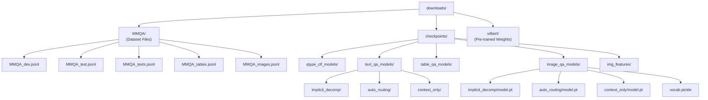
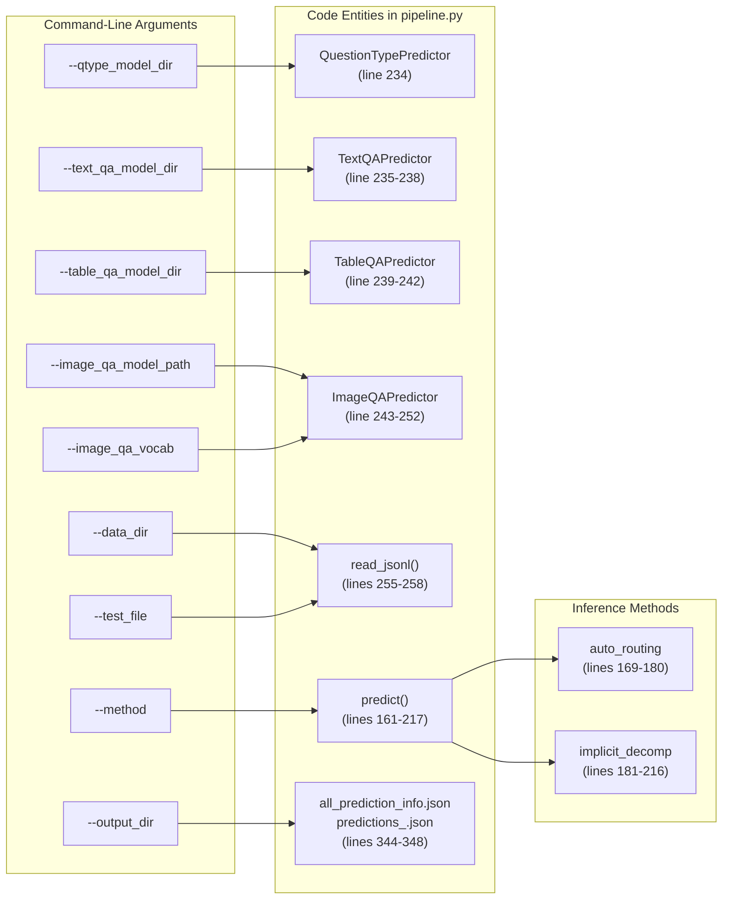
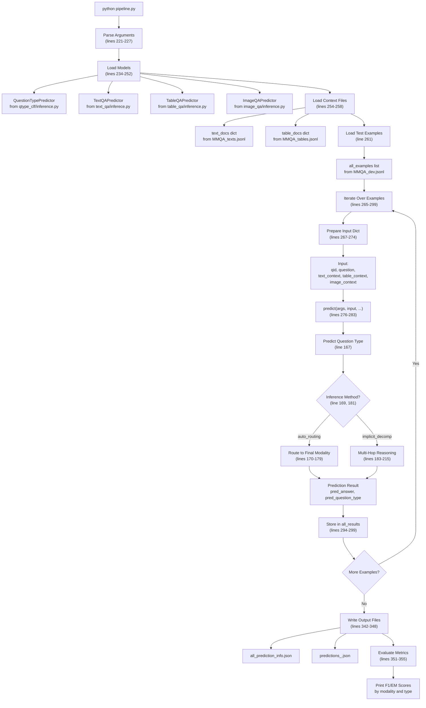
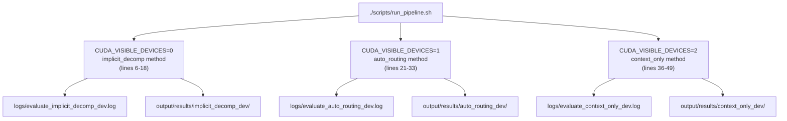
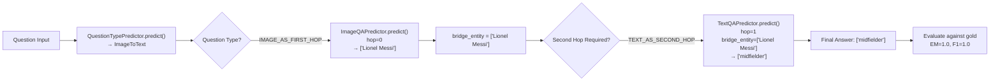

<!-- source: DeepWiki mcp.deepwiki.com · repo allenai/multimodalqa · page 2.2 Quick Start Guide · fetched 2026-10-26 -->

# Quick Start Guide

<details>
<summary>Relevant source files</summary>

The following files were used as context for generating this wiki page:

- [baselines/README.md](baselines/README.md)
- [baselines/pipeline.py](baselines/pipeline.py)
- [baselines/scripts/run_pipeline.sh](baselines/scripts/run_pipeline.sh)

</details>


This guide walks you through running your first inference with the MultiModalQA baseline models. By the end of this guide, you will have downloaded the necessary data and models, executed an inference command, and obtained predictions on a sample question from the development set.

**Scope**: This guide covers the minimal steps to run inference using pre-trained baseline models. For detailed installation instructions, see [Installation and Environment Setup](#2.1). For comprehensive documentation of the inference pipeline, see [Pipeline Implementation](#6.1). For training your own models, see [Training Models](#7).

---

## Prerequisites

Before proceeding, ensure you have:
- Completed the environment setup described in [Installation and Environment Setup](#2.1)
- Activated the appropriate conda environment (e.g., `multimodalqa_image`)
- Navigate to the `baselines/` directory in your terminal

Sources: [baselines/README.md:1-10]()

---

## Step 1: Download Data and Models

The repository provides a download script that fetches all required data and pre-trained model checkpoints. Execute the following command from the `baselines/` directory:

```bash
./scripts/download.sh
```

This script downloads the following components:

| Component | Location | Description |
|-----------|----------|-------------|
| **Dataset Files** | `downloads/MMQA/` | Contains `MMQA_dev.jsonl`, `MMQA_test.jsonl`, and context files (`MMQA_texts.jsonl`, `MMQA_tables.jsonl`, `MMQA_images.jsonl`) |
| **Question Type Classifier** | `downloads/checkpoints/qtype_clf_models/` | Pre-trained classifier for routing questions to appropriate modalities |
| **Text QA Models** | `downloads/checkpoints/text_qa_models/` | Separate checkpoints for `implicit_decomp/`, `auto_routing/`, and `context_only/` methods |
| **Table QA Models** | `downloads/checkpoints/table_qa_models/` | Separate checkpoints for each inference method |
| **Image QA Models** | `downloads/checkpoints/image_qa_models/` | Model checkpoints (`model.pt`) and vocabulary (`vocab.pickle`) for each method |
| **Pre-extracted Image Features** | `downloads/checkpoints/img_features/` | Cached Detectron features for all images to accelerate inference |
| **VilBERT Weights** | `downloads/vilbert/` | Pre-trained VilBERT model and configuration files |

### Download Directory Structure



Sources: [baselines/README.md:12-17]()

---

## Step 2: Run Your First Inference

Execute the following command to run inference using the **implicit_decomp** baseline on the development set:

```bash
python pipeline.py \
  --qtype_model_dir downloads/checkpoints/qtype_clf_models/ \
  --text_qa_model_dir downloads/checkpoints/text_qa_models/implicit_decomp/ \
  --table_qa_model_dir downloads/checkpoints/table_qa_models/implicit_decomp/ \
  --image_qa_model_path downloads/checkpoints/image_qa_models/implicit_decomp/model.pt \
  --image_qa_vocab downloads/checkpoints/image_qa_models/vocab.pickle \
  --image_features_dir downloads/checkpoints/img_features/ \
  --data_dir downloads/MMQA/ \
  --test_file MMQA_dev.jsonl \
  --output_dir output/results/implicit_decomp_dev/ \
  --do_lower_case \
  --method implicit_decomp
```

### Command Breakdown

The following diagram maps command-line arguments to their corresponding system components and code entities:



### Key Arguments Explained

| Argument | Purpose | Code Reference |
|----------|---------|----------------|
| `--qtype_model_dir` | Checkpoint directory for the question type classifier that routes questions to appropriate modalities | [pipeline.py:234]() |
| `--text_qa_model_dir` | Checkpoint for text-based QA (BERT/RoBERTa) | [pipeline.py:235-238]() |
| `--table_qa_model_dir` | Checkpoint for table-based QA (BERT/RoBERTa with table linearization) | [pipeline.py:239-242]() |
| `--image_qa_model_path` | Path to VilBERT model checkpoint for visual question answering | [pipeline.py:243-252]() |
| `--image_qa_vocab` | Vocabulary file for decoding image QA answers | [pipeline.py:247]() |
| `--image_features_dir` | Pre-extracted Detectron features to avoid online feature computation | [pipeline.py:250]() |
| `--data_dir` | Root directory containing all dataset files | [pipeline.py:255]() |
| `--test_file` | Which split to evaluate: `MMQA_dev.jsonl` or `MMQA_test.jsonl` | [pipeline.py:261]() |
| `--method` | Inference strategy: `implicit_decomp` or `auto_routing` | [pipeline.py:169-216]() |
| `--do_lower_case` | Enable for uncased BERT models (BERT-base), disable for cased models | [pipeline.py:237]() |

Sources: [baselines/README.md:21-36](), [baselines/pipeline.py:27-159]()

---

## Step 3: Understanding the Execution Flow

When you run `pipeline.py`, the system executes the following sequence:



Sources: [baselines/pipeline.py:220-356]()

---

## Step 4: Examining the Output

After execution completes, the system writes results to the specified `--output_dir`:

### Output Files

| File | Content | Purpose |
|------|---------|---------|
| `all_prediction_info.json` | Complete prediction details including intermediate hops, scores, and metadata | Detailed analysis of model behavior |
| `predictions_.json` | Simple mapping of question IDs to predicted answers | Direct evaluation against ground truth |

### Sample Output Structure

The `all_prediction_info.json` file contains entries like:

```json
{
  "qid_example": {
    "qid": "qid_example",
    "question": "What position does the person in the image play?",
    "pred_answer": ["goalkeeper"],
    "pred_question_type": "ImageToText",
    "pred_first_hop_answer": ["Player Name"],
    "pred_second_hop_answer": ["goalkeeper"],
    "gold_question_type": "ImageToText",
    "gold_answer": ["goalkeeper"],
    "em_score": 1.0,
    "f1_score": 1.0,
    "first_hop_em_score": 1.0,
    "first_hop_f1_score": 1.0
  }
}
```

Sources: [baselines/pipeline.py:294-348]()

### Evaluation Metrics

If running on the development set (not using `--predict_only`), the system automatically evaluates and prints metrics:

```
============== Evaluation ==============
F1: 48.79
EM: 55.48

By Modality:
  Single-Modality F1: 51.60 / EM: 58.35
  Multi-Modality  F1: 44.59 / EM: 51.19

By Question Type:
  TextQ         F1: XX.XX / EM: XX.XX
  TableQ        F1: XX.XX / EM: XX.XX
  ImageQ        F1: XX.XX / EM: XX.XX
  ...
```

Sources: [baselines/README.md:42-48](), [baselines/pipeline.py:351-355]()

---

## Step 5: Testing Different Inference Methods

The MultiModalQA system supports three inference methods. To test each method, modify the `--method` argument and the model checkpoint directories:

### Quick Comparison of Methods

| Method | Description | Command Modification | Expected Dev F1/EM |
|--------|-------------|----------------------|-------------------|
| **implicit_decomp** | Multi-hop reasoning with explicit bridge entity extraction | `--method implicit_decomp` <br/> Use `implicit_decomp/` model directories | 48.79 / 55.48 |
| **auto_routing** | Direct routing to final answer modality without decomposition | `--method auto_routing` <br/> Use `auto_routing/` model directories | 44.65 / 51.13 |
| **context_only** | Baseline that ignores questions entirely | `--method auto_routing --context_only` <br/> Use `context_only/` model directories | 7.41 / 10.03 |

### Running All Three Methods in Parallel

For comprehensive evaluation, use the provided batch script:

```bash
./scripts/run_pipeline.sh
```

This script executes all three baseline methods in parallel, each on a separate GPU (GPU 0, 1, 2). Logs are written to `logs/` directory:

- `logs/evaluate_implicit_decomp_dev.log`
- `logs/evaluate_auto_routing_dev.log`
- `logs/evaluate_context_only_dev.log`

#### Parallel Execution Flow



Sources: [baselines/scripts/run_pipeline.sh:1-50](), [baselines/README.md:38-48]()

---

## Example: Single Question Walkthrough

To understand the complete inference process, consider this example question from the development set:

**Question**: "What position does the person shown in the first image play?"  
**Question Type**: ImageToText (multi-hop Compose)  
**Gold Answer**: ["midfielder"]

### Processing with implicit_decomp Method



Sources: [baselines/pipeline.py:161-217]()

---

## Common Options and Variants

### Running on Test Set (Prediction Only)

To generate predictions without evaluation (for test set submission):

```bash
python pipeline.py \
  [... same arguments as above ...] \
  --test_file MMQA_test.jsonl \
  --predict_only
```

The `--predict_only` flag disables metric computation and only generates `predictions_.json` ([pipeline.py:112-115]()).

### Using Oracle Question Types

For debugging or upper-bound analysis, use gold question types instead of predictions:

```bash
python pipeline.py \
  [... same arguments as above ...] \
  --use_oracle_qtype
```

This bypasses the question type classifier and uses ground truth types from the dataset ([pipeline.py:102-105](), [pipeline.py:164-166]()).

### Custom Sequence Length Parameters

Adjust tokenization parameters for different hardware constraints:

| Parameter | Default | Description | Code Reference |
|-----------|---------|-------------|----------------|
| `--max_seq_length` | 384 | Maximum input sequence length after tokenization | [pipeline.py:122-126]() |
| `--doc_stride` | 128 | Stride for splitting long documents | [pipeline.py:129-133]() |
| `--max_query_length` | 100 | Maximum question length | [pipeline.py:135-139]() |
| `--max_answer_length` | 30 | Maximum generated answer length | [pipeline.py:148-152]() |

Sources: [baselines/pipeline.py:73-159]()

---

## Next Steps

After completing this quick start guide, you can:

1. **Explore the Full Pipeline**: See [Pipeline Implementation](#6.1) for detailed documentation of the inference orchestration logic
2. **Train Your Own Models**: Follow [Training Models](#7) to train custom models with your own data
3. **Understand the Dataset**: Read [Dataset Format Specification](#3.1) to learn about the data structure
4. **Deep Dive into Models**: See [Baseline Models](#5) for comprehensive documentation of each modality-specific model
5. **Customize Evaluation**: Refer to [Evaluation Metrics](#8.1) to understand how predictions are scored

For troubleshooting and additional configuration options, consult the individual model documentation:
- Image QA: [Image QA Model](#5.1)
- Table QA: [Table QA Model](#5.2)
- Text QA: [Text QA Model](#5.3)

Sources: [baselines/README.md:50-52]()

---

