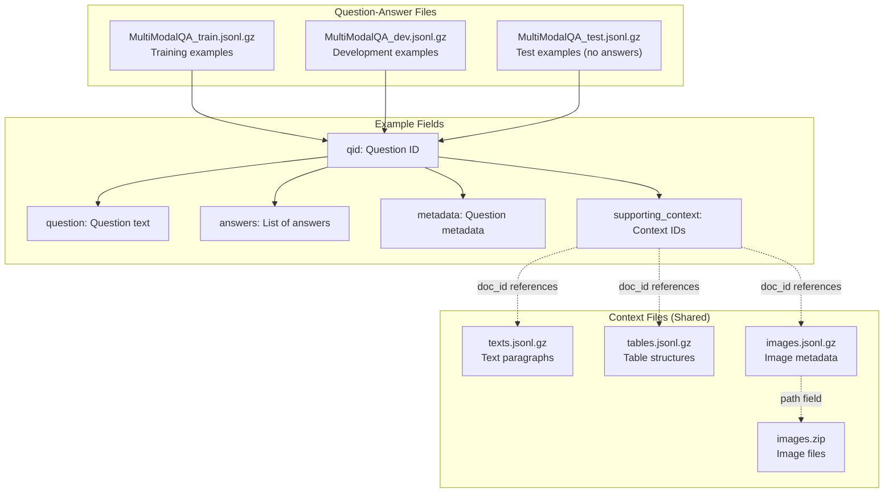
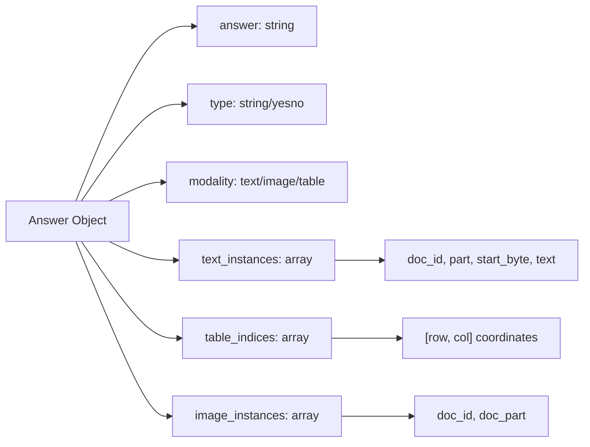
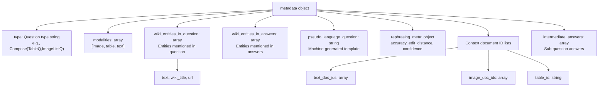
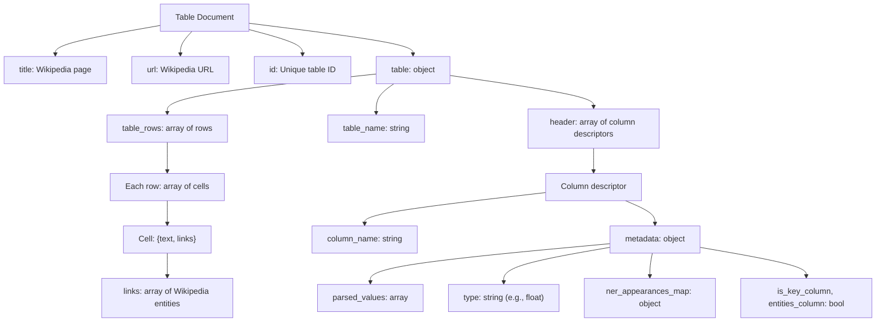
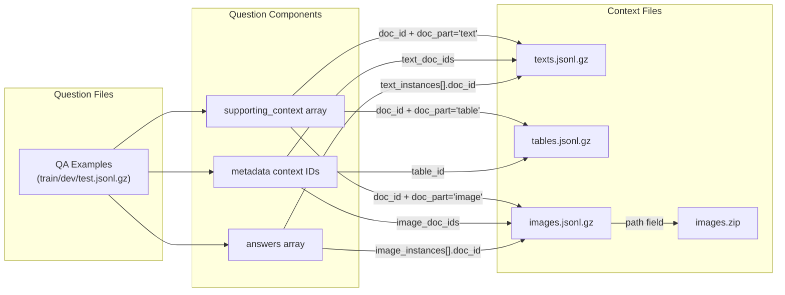

<!-- source: DeepWiki mcp.deepwiki.com · repo allenai/multimodalqa · page 3 Dataset · fetched 2026-10-26 -->

# Dataset

<details>
<summary>Relevant source files</summary>

The following files were used as context for generating this wiki page:

- [README.md](README.md)
- [dataset/MMQA_dev.jsonl.gz](dataset/MMQA_dev.jsonl.gz)
- [dataset/MMQA_images.jsonl.gz](dataset/MMQA_images.jsonl.gz)
- [dataset/MMQA_tables.jsonl.gz](dataset/MMQA_tables.jsonl.gz)

</details>


This document describes the MultiModalQA dataset, including its structure, file formats, and organization. The dataset consists of 29,918 examples requiring joint reasoning over text, tables, and images.

For detailed specifications of the JSONL file formats, see [Dataset Format Specification](#3.1). For information about question categorization, see [Question Types and Taxonomy](#3.2). For details on context file structures, see [Context Files and Structure](#3.3).

## Dataset Overview

The MultiModalQA dataset is organized into separate files for questions/answers and contextual evidence across three modalities. Each question is associated with a set of context documents (text paragraphs, tables, and/or images) that contain the information needed to answer it.

**Dataset Size:**
- Total examples: 29,918
- Split into train, dev, and test sets
- Context corpus: Shared across all splits

**Sources:** [README.md:1-22]()

## File Organization

The dataset is distributed as a collection of compressed JSONL files and an image archive.

### Dataset Files Structure



**Sources:** [README.md:15-22]()

## Core Data Structures

### Question-Answer Record

Each line in `MultiModalQA_train.jsonl.gz`, `MultiModalQA_dev.jsonl.gz`, or `MultiModalQA_test.jsonl.gz` represents a single question with the following structure:

| Field | Type | Description |
|-------|------|-------------|
| `qid` | string | Unique question identifier (e.g., `"5454c14ad01e722c2619b66778daa98b"`) |
| `question` | string | Natural language question text |
| `answers` | array | List of answer objects (empty in test set) |
| `metadata` | object | Question type, modalities, entities, intermediate answers |
| `supporting_context` | array | List of `{doc_id, doc_part}` objects pointing to context documents |

**Example:**
```json
{
  "qid": "5454c14ad01e722c2619b66778daa98b",
  "question": "who owns the rights to little shop of horrors?",
  "answers": ["answer1", "answer2"],
  "metadata": {},
  "supporting_context": [{
      "doc_id": "46ae2a8e7928ed5a8e5f9c59323e5e49",
      "doc_part": "table"
    },
    {
      "doc_id": "d57e56eff064047af5a6ef074a570956",
      "doc_part": "image"
    }]
}
```

**Sources:** [README.md:23-45]()

### Answer Object Structure

Each answer in the `answers` array contains provenance information linking it back to source documents:



| Field | Description |
|-------|-------------|
| `answer` | The answer string |
| `type` | Answer type: `"string"` or `"yesno"` |
| `modality` | Source modality: `"text"`, `"image"`, or `"table"` |
| `text_instances` | List of text paragraph locations containing this answer |
| `table_indices` | List of `[row, column]` coordinates in tables |
| `image_instances` | List of image document IDs containing this answer |

**Sources:** [README.md:47-68]()

### Metadata Structure

The `metadata` object provides rich annotations for each question:



**Key Metadata Fields:**
- `type`: Question type from 16-category taxonomy (e.g., `"Compose(TableQ,ImageListQ)"`)
- `modalities`: List of modalities required to answer (subset of `["text", "table", "image"]`)
- `intermediate_answers`: Ground truth for multi-hop sub-questions, enabling supervision for decomposition
- `pseudo_language_question`: Template-based question before human rephrasing
- Context ID lists: `text_doc_ids`, `image_doc_ids`, `table_id` point to relevant context documents (includes distractors)

**Sources:** [README.md:70-108]()

## Context File Formats

### Text Context Structure

Each line in `texts.jsonl.gz` represents a text paragraph:

| Field | Type | Description |
|-------|------|-------------|
| `title` | string | Wikipedia article title |
| `url` | string | Wikipedia article URL |
| `id` | string | Unique document ID (referenced in `supporting_context`) |
| `text` | string | Paragraph text content |

**Sources:** [README.md:171-181]()

### Table Context Structure

Each line in `tables.jsonl.gz` represents a table with the following hierarchy:



**Column Metadata** (in `header` array):
- `parsed_values`: Extracted numeric/date values
- `type`: Inferred data type (e.g., `"float"`, `"string"`)
- `ner_appearances_map`: Named entity counts (e.g., `{"DATE": 10}`)
- `is_key_column`: Whether this column contains primary keys
- `entities_column`: Whether this column contains entity references

**Sources:** [README.md:110-156]()

### Image Context Structure

Each line in `images.jsonl.gz` contains metadata for an image:

| Field | Type | Description |
|-------|------|-------------|
| `title` | string | Wikipedia article title |
| `url` | string | Wikipedia article URL |
| `id` | string | Unique image ID (referenced in `supporting_context`) |
| `path` | string | Filename in `images.zip` archive (e.g., `"Taipei.jpg"`) |

The actual image files are stored separately in `images.zip` and can be accessed using the `path` field.

**Sources:** [README.md:158-169]()

## Data Flow and References

The following diagram shows how different files reference each other:



**Key Reference Patterns:**

1. **supporting_context** → Context files: Uses `doc_id` + `doc_part` to identify specific documents
2. **metadata context IDs** → Context files: Lists all relevant context (including distractors)
3. **answer instances** → Context files: Pinpoints exact answer locations
4. **images.jsonl.gz** → **images.zip**: Uses `path` field to locate image files

**Sources:** [README.md:23-181]()

## Dataset Statistics

Based on the development set (`MMQA_dev.jsonl.gz`):
- **Total examples:** 29,918 (mentioned in overview)
- **Modalities:** Questions span single-modality and multi-modal reasoning
- **Question types:** 16 distinct categories (see [Question Types and Taxonomy](#3.2))
- **Context diversity:** Includes both supporting documents and distractor documents

**Sources:** [README.md:3]()

## Usage Notes

### Loading Data

All question and context files are gzip-compressed JSONL (JSON Lines) format. Each line is a valid JSON object:

```python
import gzip
import json

# Load questions
with gzip.open('dataset/MultiModalQA_dev.jsonl.gz', 'rt') as f:
    questions = [json.loads(line) for line in f]

# Load text contexts
with gzip.open('dataset/texts.jsonl.gz', 'rt') as f:
    texts = {json.loads(line)['id']: json.loads(line) for line in f}
```

### Test Set

The test set (`MultiModalQA_test.jsonl.gz`) follows the same format as train/dev but **excludes** the `answers` and `supporting_context` fields, as these are held out for evaluation purposes.

**Sources:** [README.md:44-45]()

### Context Resolution

To retrieve context for a question:

1. Use `metadata.text_doc_ids`, `metadata.table_id`, `metadata.image_doc_ids` to get all relevant context IDs
2. Look up these IDs in the corresponding context files (`texts.jsonl.gz`, `tables.jsonl.gz`, `images.jsonl.gz`)
3. For images, use the `path` field from `images.jsonl.gz` to extract files from `images.zip`

Note that the context ID lists include both **supporting documents** (containing answers) and **distractor documents** (not directly relevant). The `supporting_context` field in train/dev sets identifies which documents actually contain answers.

**Sources:** [README.md:70-108]()

## Additional Resources

- **Dataset download:** Available at https://multimodalqa-images.s3-us-west-2.amazonaws.com/final_dataset_images/final_dataset_images.zip (for images)
- **Paper:** "MultiModalQA: Complex Question Answering over Text, Tables and Images" (ICLR 2021)
- **Website:** https://allenai.github.io/multimodalqa/

For training and inference procedures using this dataset, see [Running Inference](#6) and [Training Models](#7).

**Sources:** [README.md:5-6](), [README.md:21]()

---

