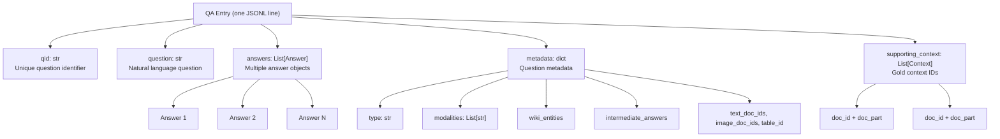
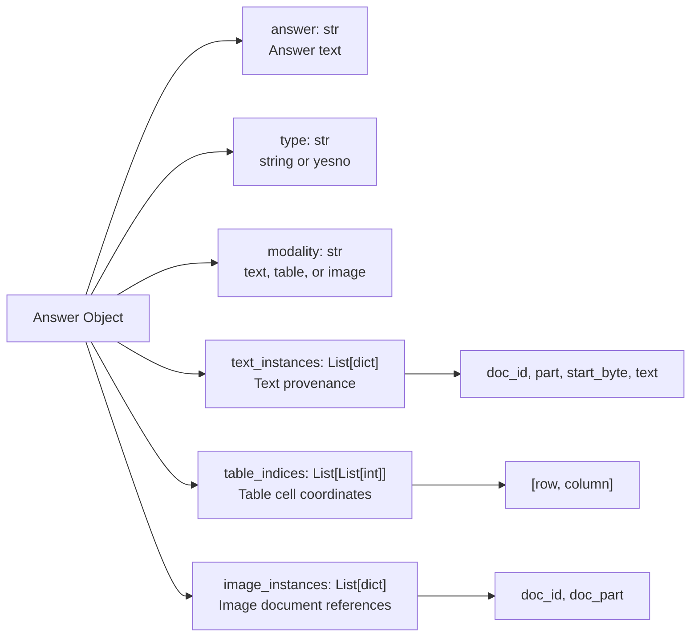
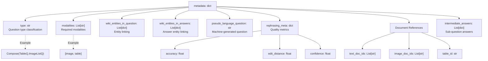
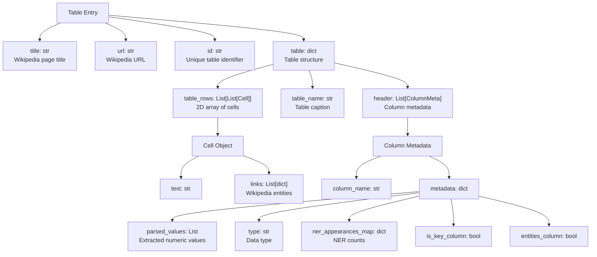
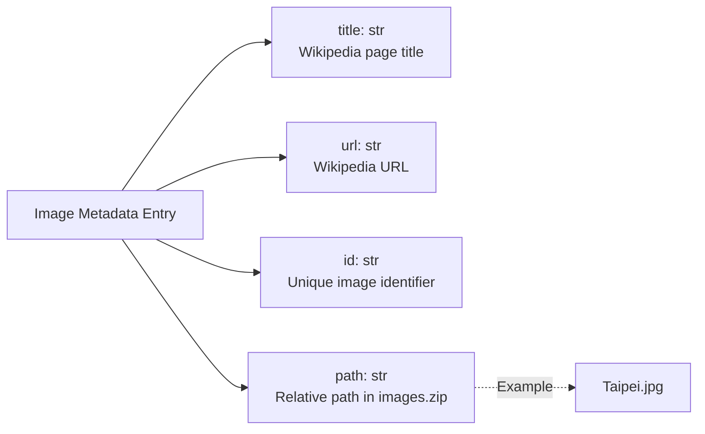
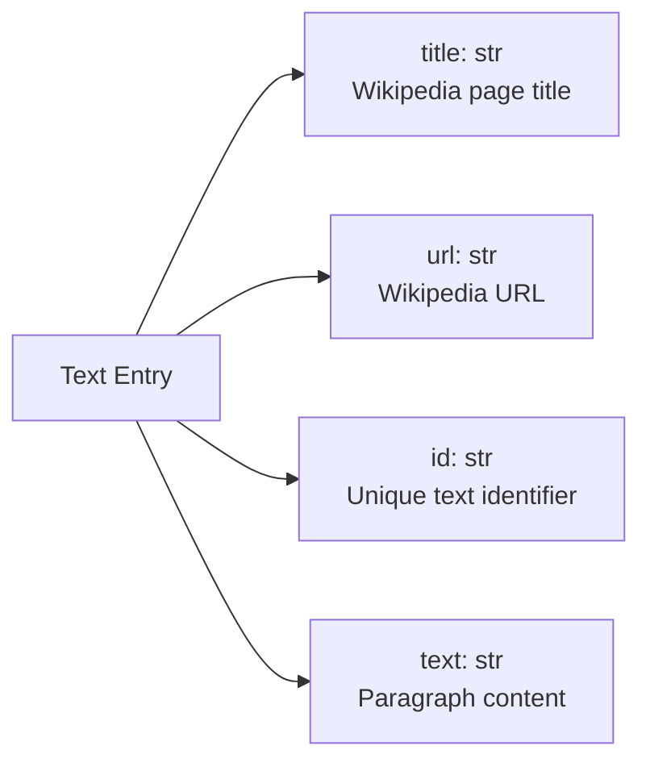
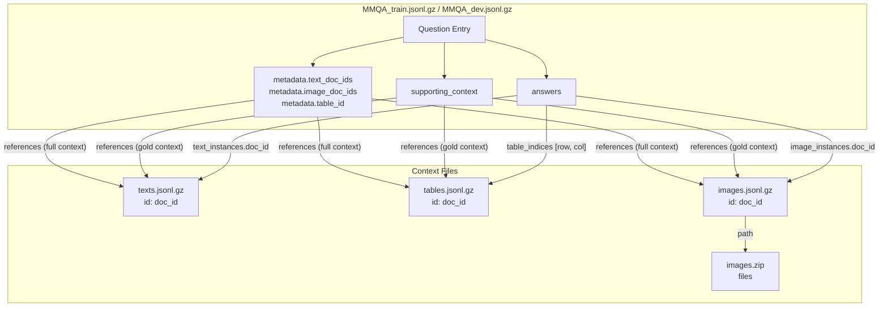
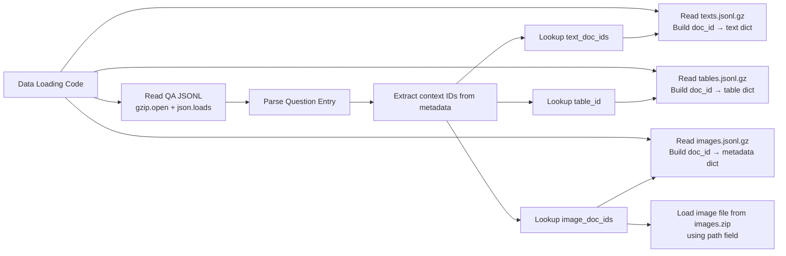

<!-- source: DeepWiki mcp.deepwiki.com · repo allenai/multimodalqa · page 3.1 Dataset Format Specification · fetched 2026-10-26 -->

# Dataset Format Specification

<details>
<summary>Relevant source files</summary>

The following files were used as context for generating this wiki page:

- [README.md](README.md)

</details>


## Purpose and Scope

This document provides detailed specifications for all JSONL file formats in the MultiModalQA dataset. It describes the structure of question files, answer annotations, metadata fields, and multi-modal context files (text, tables, images). This page focuses on the low-level data format and field definitions.

For information about the question type taxonomy and classification, see [Question Types and Taxonomy](#3.2). For details about how context files are organized and accessed, see [Context Files and Structure](#3.3).

## Dataset Files Overview

The MultiModalQA dataset consists of five primary file types, all in compressed JSONL format (`.jsonl.gz`), plus a separate image archive:

| File Name | Content | Entries | Purpose |
|-----------|---------|---------|---------|
| `MMQA_train.jsonl.gz` | Training questions and answers | - | Training data with full annotations |
| `MMQA_dev.jsonl.gz` | Development questions and answers | 29,918 | Validation data with full annotations |
| `MMQA_test.jsonl.gz` | Test questions (answers withheld) | - | Evaluation data without answers or supporting context |
| `texts.jsonl.gz` | Text paragraph contexts | - | Wikipedia text paragraphs |
| `tables.jsonl.gz` | Table contexts | - | Wikipedia tables with structured data |
| `images.jsonl.gz` | Image metadata | - | Metadata linking to image files |
| `images.zip` | Image files | - | Actual image files referenced by metadata |

**Sources:** [README.md:17-21]()

## QA Files Structure

### Top-Level Question Object

Each line in `MMQA_train.jsonl.gz` and `MMQA_dev.jsonl.gz` represents a single question-answer pair with associated metadata and context references.



**Field Definitions:**

| Field | Type | Description | Example |
|-------|------|-------------|---------|
| `qid` | `str` | Unique hexadecimal question identifier | `"5454c14ad01e722c2619b66778daa98b"` |
| `question` | `str` | Natural language question text | `"who owns the rights to little shop of horrors?"` |
| `answers` | `List[dict]` | List of answer objects (format described below) | See Answer Format section |
| `metadata` | `dict` | Question metadata including type, entities, and context references | See Metadata Format section |
| `supporting_context` | `List[dict]` | Gold-standard context documents containing answers | `[{"doc_id": "...", "doc_part": "table"}]` |

**Test Set Differences:** `MMQA_test.jsonl.gz` omits the `answers` and `supporting_context` fields, containing only `qid`, `question`, and `metadata`.

**Sources:** [README.md:23-45]()

### Answer Format

Each answer in the `answers` list contains detailed provenance information linking the answer string to specific locations in the context documents.



**Field Definitions:**

| Field | Type | Description | Values |
|-------|------|-------------|--------|
| `answer` | `str` | The answer text string | Any string value |
| `type` | `str` | Answer type classification | `"string"` or `"yesno"` |
| `modality` | `str` | Source modality of the answer | `"text"`, `"table"`, or `"image"` |
| `text_instances` | `List[dict]` | Text document locations containing this answer | `[{"doc_id": str, "part": "text", "start_byte": int, "text": str}]` |
| `table_indices` | `List[List[int]]` | Table cell coordinates as `[row, column]` pairs | `[[5, 2], [6, 2]]` |
| `image_instances` | `List[dict]` | Image document references | `[{"doc_id": str, "doc_part": "image"}]` |

**Sources:** [README.md:47-68]()

### Metadata Format

The metadata object provides rich annotations about the question, including its type, required modalities, entity linking, and full context document sets.



**Field Definitions:**

| Field | Type | Description | Example |
|-------|------|-------------|---------|
| `type` | `str` | Question type from taxonomy (see [#3.2](#3.2)) | `"Compose(TableQ,ImageListQ)"`, `"TextQ"`, `"Intersect(TableQ,ImageListQ,ImageQ)"` |
| `modalities` | `List[str]` | Modalities required to answer the question | `["image", "table"]`, `["text"]` |
| `wiki_entities_in_question` | `List[dict]` | Wikipedia entities mentioned in the question | `[{"text": str, "wiki_title": str, "url": str}]` |
| `wiki_entities_in_answers` | `List[dict]` | Wikipedia entities in the answers | Same structure as above |
| `pseudo_language_question` | `str` | Machine-generated question template before human rephrasing | `"In [Members] of [LGBT billionaires] what was..."` |
| `rephrasing_meta` | `dict` | Quality metrics for human rephrasing | `{"accuracy": float, "edit_distance": float, "confidence": float}` |
| `text_doc_ids` | `List[str]` | List of text document IDs in full context (including distractors) | `["498369348c988d866b5fac0add45bac5", ...]` |
| `image_doc_ids` | `List[str]` | List of image document IDs in full context | `["89c1b7c3c061cc80bb98d99cbbec50dd", ...]` |
| `table_id` | `str` | Table document ID (typically one table per question) | `"46ae2a8e7928ed5a8e5f9c59323e5e49"` |
| `intermediate_answers` | `List[dict]` | Answers to sub-questions for multi-hop questions | Each entry follows the single answer format |

**Sources:** [README.md:70-108]()

## Context File Formats

### Table Format (`tables.jsonl.gz`)

Each line represents a single table extracted from Wikipedia, with structured row-column data and rich metadata for each column.



**Key Structure Components:**

**Table Object:**
- `title` (str): Wikipedia page title
- `url` (str): Full Wikipedia URL
- `id` (str): Unique hexadecimal identifier
- `table` (dict): Main table structure containing:
  - `table_rows`: 2D array where each row is a list of cell objects
  - `table_name`: Table caption or title
  - `header`: List of column metadata objects

**Cell Object:**
- `text` (str): Cell content as string
- `links` (List[dict]): Wikipedia entity links in the cell, each with:
  - `text`: Anchor text
  - `wiki_title`: Wikipedia page title
  - `url`: Full Wikipedia URL

**Column Metadata:**
- `column_name` (str): Column header text
- `metadata` (dict): Rich parsing information:
  - `parsed_values`: Extracted numeric or date values
  - `type`: Data type (`"float"`, `"date"`, etc.)
  - `num_of_links`: Count of Wikipedia links in column
  - `ner_appearances_map`: Named entity types and counts (e.g., `{"DATE": 10, "CARDINAL": 1}`)
  - `is_key_column`: Boolean indicating if this is a key/identifier column
  - `entities_column`: Boolean indicating if column contains primarily entities

**Sources:** [README.md:110-156]()

### Image Metadata Format (`images.jsonl.gz`)

Each line contains metadata for a single image, with a `path` field pointing to the actual image file in `images.zip`.



**Field Definitions:**

| Field | Type | Description | Example |
|-------|------|-------------|---------|
| `title` | `str` | Wikipedia page title where image appears | `"Taipei"` |
| `url` | `str` | Full Wikipedia page URL | `"https://en.wikipedia.org/wiki/Taipei"` |
| `id` | `str` | Unique hexadecimal image identifier | `"632ea110be92836441adfb3167edf8ff"` |
| `path` | `str` | Relative path to image file within `images.zip` | `"Taipei.jpg"` |

**Important:** The actual image files must be downloaded separately from the [images.zip archive](https://multimodalqa-images.s3-us-west-2.amazonaws.com/final_dataset_images/final_dataset_images.zip). The `path` field provides the lookup key within this archive.

**Sources:** [README.md:158-169]()

### Text Format (`texts.jsonl.gz`)

Each line represents a single text paragraph extracted from Wikipedia.



**Field Definitions:**

| Field | Type | Description | Example |
|-------|------|-------------|---------|
| `title` | `str` | Wikipedia page title where paragraph appears | `"The Legend of Korra (video game)"` |
| `url` | `str` | Full Wikipedia page URL | `"https://en.wikipedia.org/wiki/The_Legend_of_Korra_(video_game)"` |
| `id` | `str` | Unique hexadecimal text identifier | `"16c61fe756817f0b35df9717fae1000e"` |
| `text` | `str` | Full paragraph text content | `"Over three years after its release, the game..."` |

**Sources:** [README.md:171-181]()

## Cross-Reference Structure

The following diagram illustrates how question files reference context files through document IDs, and how answers contain provenance information pointing back to specific locations in the contexts.



**Key Relationships:**

1. **Full Context Set**: `metadata.{text_doc_ids, image_doc_ids, table_id}` lists all context documents provided to the model, including both gold contexts (containing answers) and distractor documents.

2. **Gold Context Set**: `supporting_context` lists only the document IDs that contain answers or intermediate answers, with `doc_part` indicating the modality (`"text"`, `"table"`, or `"image"`).

3. **Answer Provenance**: Each answer object contains modality-specific fields (`text_instances`, `table_indices`, `image_instances`) that precisely locate the answer within the context documents:
   - **Text**: `doc_id` + `start_byte` offset + extracted `text` span
   - **Table**: `doc_id` (via `metadata.table_id`) + `[row, column]` indices
   - **Image**: `doc_id` only (no sub-image localization)

4. **Image File Resolution**: Image metadata entries provide a `path` field that maps to filenames in the separate `images.zip` archive.

**Sources:** [README.md:15-182]()

## Example: Complete Question Entry

Below is a complete example showing all fields for a multi-hop Compose question:

```json
{
  "qid": "5454c14ad01e722c2619b66778daa98b",
  "question": "who owns the rights to little shop of horrors?",
  "answers": [
    {
      "answer": "Warner Bros.",
      "type": "string",
      "modality": "table",
      "text_instances": [],
      "table_indices": [[5, 2]],
      "image_instances": []
    },
    {
      "answer": "Warner Brothers",
      "type": "string",
      "modality": "table",
      "text_instances": [],
      "table_indices": [[5, 2]],
      "image_instances": []
    }
  ],
  "metadata": {
    "type": "Compose(TableQ,ImageListQ)",
    "modalities": ["image", "table"],
    "wiki_entities_in_question": [
      {
        "text": "Domenico Dolce",
        "wiki_title": "Domenico Dolce",
        "url": "https://en.wikipedia.org/wiki/Domenico_Dolce"
      }
    ],
    "wiki_entities_in_answers": [],
    "pseudo_language_question": "In [Members] of [LGBT billionaires] what was the [Net worth USDbn](s) when the [Name] {is completely bald and wears thick glasses?}",
    "rephrasing_meta": {
      "accuracy": 1.0,
      "edit_distance": 0.502092050209205,
      "confidence": 0.7807520791930855
    },
    "image_doc_ids": [
      "89c1b7c3c061cc80bb98d99cbbec50dd",
      "0f3858e2186b2030b77c759fc727e20b"
    ],
    "text_doc_ids": [
      "498369348c988d866b5fac0add45bac5",
      "57686242cf542e30cbad13037017b478"
    ],
    "intermediate_answers": [
      {
        "answer": "intermediate_answer_text",
        "type": "string",
        "modality": "table",
        "text_instances": [],
        "table_indices": [[3, 1]],
        "image_instances": []
      }
    ],
    "table_id": "46ae2a8e7928ed5a8e5f9c59323e5e49"
  },
  "supporting_context": [
    {
      "doc_id": "46ae2a8e7928ed5a8e5f9c59323e5e49",
      "doc_part": "table"
    },
    {
      "doc_id": "d57e56eff064047af5a6ef074a570956",
      "doc_part": "image"
    }
  ]
}
```

**Sources:** [README.md:27-108]()

## Data Loading Patterns

The following diagram shows typical access patterns when loading the dataset in code:



**Implementation Notes:**

1. **JSONL Reading**: Each file uses line-delimited JSON with gzip compression. Standard pattern:
   ```python
   with gzip.open('file.jsonl.gz', 'rt') as f:
       for line in f:
           entry = json.loads(line)
   ```

2. **ID-Based Lookups**: Context files are typically loaded into dictionaries keyed by `id` for O(1) lookups during question processing.

3. **Image Loading**: Images require a two-step process:
   - Read `images.jsonl.gz` to get metadata and `path`
   - Extract the file from `images.zip` using the `path` field

4. **Distractor Handling**: The full context set (`metadata.{text_doc_ids, image_doc_ids, table_id}`) includes both gold contexts (listed in `supporting_context`) and distractor documents. Models must discriminate between them.

**Sources:** [README.md:15-182]()

---

