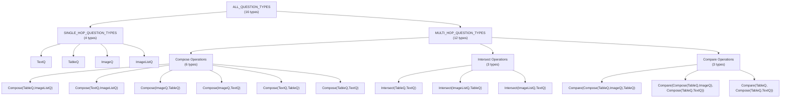
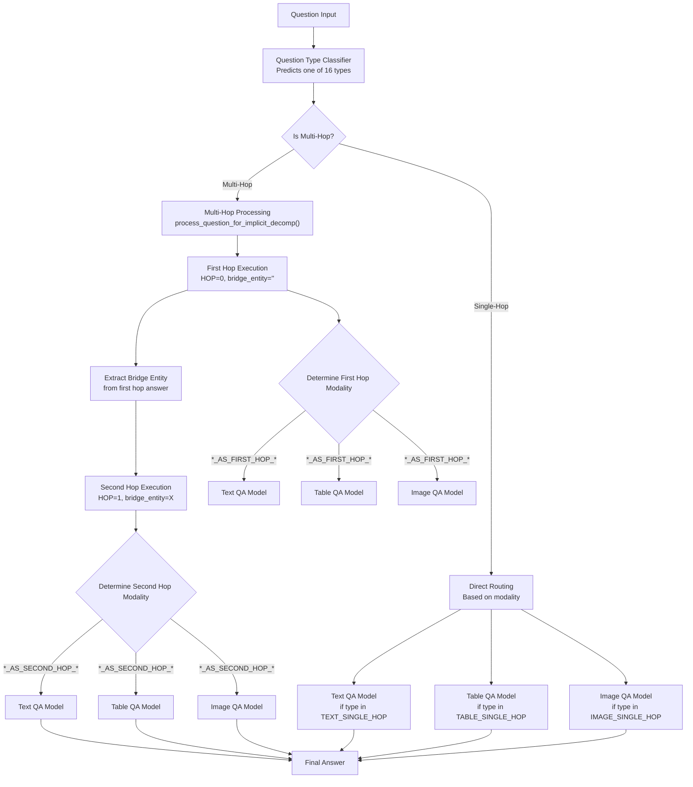

<!-- source: DeepWiki mcp.deepwiki.com · repo allenai/multimodalqa · page 3.2 Question Types and Taxonomy · fetched 2026-10-26 -->

# Question Types and Taxonomy

<details>
<summary>Relevant source files</summary>

The following files were used as context for generating this wiki page:

- [README.md](README.md)
- [baselines/common_utils.py](baselines/common_utils.py)

</details>


This document provides a comprehensive specification of the MultiModalQA question type taxonomy, which forms the foundation for question routing and multi-hop reasoning in the inference pipeline. The taxonomy consists of 16 distinct question types that categorize questions based on their complexity (single-hop vs. multi-hop) and the reasoning operations required (Compose, Intersect, Compare).

For information on how question type classification is performed to determine which type a question belongs to, see [Question Type Classification](#4.1). For details on how question types are used in the inference pipeline to route questions to appropriate models, see [Inference Methods](#4.2).

## Overview of the Taxonomy

The MultiModalQA dataset defines 16 question types stored in the `ALL_QUESTION_TYPES` constant. These types are structured hierarchically based on:

1. **Complexity**: Single-hop (4 types) vs. Multi-hop (12 types)
2. **Modality**: Text, Table, Image, or combinations thereof
3. **Operation**: Direct lookup, Compose, Intersect, or Compare

The complete list of question types is defined in [baselines/common_utils.py:4-21]():

```python
ALL_QUESTION_TYPES = [
    'TextQ',
    'TableQ',
    'ImageQ',
    'ImageListQ',
    'Compose(TableQ,ImageListQ)',
    'Compose(TextQ,ImageListQ)',
    'Compose(ImageQ,TableQ)',
    'Compose(ImageQ,TextQ)',
    'Compose(TextQ,TableQ)',
    'Compose(TableQ,TextQ)',
    'Intersect(TableQ,TextQ)',
    'Intersect(ImageListQ,TableQ)',
    'Intersect(ImageListQ,TextQ)',
    'Compare(Compose(TableQ,ImageQ),TableQ)',
    'Compare(Compose(TableQ,ImageQ),Compose(TableQ,TextQ))',
    'Compare(TableQ,Compose(TableQ,TextQ))',
]
```

Each question in the dataset includes its type in the metadata field, as shown in [README.md:78]():

```json
{
    "type": "Compose(TableQ,ImageListQ)",
    "modalities": ["image", "table"],
    ...
}
```

**Sources**: [baselines/common_utils.py:4-21](), [README.md:78]()

## Question Type Hierarchy

The following diagram illustrates how the 16 question types are organized hierarchically:



**Sources**: [baselines/common_utils.py:4-21](), [baselines/common_utils.py:81-93]()

## Single-Hop Question Types

Single-hop questions require reasoning over a single modality to produce the final answer. These are the simplest question types and serve as building blocks for more complex multi-hop questions.

| Question Type | Modality | Description | Example |
|---------------|----------|-------------|---------|
| `TextQ` | Text | Answer found directly in text paragraphs | "What is the capital of France?" |
| `TableQ` | Table | Answer found directly in table cells | "What was the GDP in 2020?" |
| `ImageQ` | Image | Answer found in a single image | "What color is the car?" |
| `ImageListQ` | Image | Answer is a list extracted from multiple images | "List all logos visible in the images" |

The constants defining single-hop types are:
- Text: [baselines/common_utils.py:23-25]()
- Table: [baselines/common_utils.py:39-41]()
- Image: [baselines/common_utils.py:55-58]()

These types are aggregated in `SINGLE_HOP_QUESTION_TYPES` at [baselines/common_utils.py:81-83]().

**Sources**: [baselines/common_utils.py:23-25](), [baselines/common_utils.py:39-41](), [baselines/common_utils.py:55-58](), [baselines/common_utils.py:81-83]()

## Multi-Hop Question Types

Multi-hop questions require reasoning across multiple steps and potentially multiple modalities. The dataset contains 12 multi-hop question types organized into three categories of reasoning operations.

### Compose Operations

Compose questions require sequential reasoning where the answer to the first hop (sub-question) serves as a "bridge entity" that is used to answer the second hop. The syntax `Compose(FirstHopType, SecondHopType)` indicates the modality sequence.

| Question Type | First Hop | Second Hop | Description |
|---------------|-----------|------------|-------------|
| `Compose(TableQ,ImageListQ)` | Table | Image | Extract entity from table, then find related images |
| `Compose(TextQ,ImageListQ)` | Text | Image | Extract entity from text, then find related images |
| `Compose(ImageQ,TableQ)` | Image | Table | Extract entity from image, then query table |
| `Compose(ImageQ,TextQ)` | Image | Text | Extract entity from image, then query text |
| `Compose(TextQ,TableQ)` | Text | Table | Extract entity from text, then query table |
| `Compose(TableQ,TextQ)` | Table | Text | Extract entity from table, then query text |

The system processes bridge entities using the `process_question_for_implicit_decomp` function at [baselines/common_utils.py:96-103](), which augments questions with hop information and bridge entities:

```python
def process_question_for_implicit_decomp(question, question_type, hop=0, bridge_entity='', sep_token='[SEP]'):
    if isinstance(bridge_entity, list) or isinstance(bridge_entity, set):
        bridge_entity = "; ".join(bridge_entity)
    return (
        f'{question_type} {sep_token} '
        f'HOP={hop} {sep_token} '
        f'{bridge_entity} {sep_token} '
        f'{question}')
```

**Sources**: [baselines/common_utils.py:9-14](), [baselines/common_utils.py:96-103]()

### Intersect Operations

Intersect questions require finding the intersection of two sets, where each set is obtained by reasoning over a different modality.

| Question Type | Description | Example Pattern |
|---------------|-------------|-----------------|
| `Intersect(TableQ,TextQ)` | Find entities that appear in both table results and text results | "Which athletes mentioned in the text also appear in the medals table?" |
| `Intersect(ImageListQ,TableQ)` | Find entities that appear in both image results and table results | "Which countries with flags shown also have GDP > $1T in the table?" |
| `Intersect(ImageListQ,TextQ)` | Find entities that appear in both image results and text results | "Which people in photos are also mentioned in the biography?" |

**Sources**: [baselines/common_utils.py:15-17]()

### Compare Operations

Compare questions involve comparing values or attributes obtained through multi-hop reasoning. These are the most complex question types.

| Question Type | Description |
|---------------|-------------|
| `Compare(Compose(TableQ,ImageQ),TableQ)` | Compare an image attribute (obtained via table→image composition) with a table value |
| `Compare(Compose(TableQ,ImageQ),Compose(TableQ,TextQ))` | Compare an image attribute with a text attribute, both obtained compositionally |
| `Compare(TableQ,Compose(TableQ,TextQ))` | Compare a direct table value with a text attribute obtained via table→text composition |

**Sources**: [baselines/common_utils.py:18-20]()

## Hop-Based Categorization

For routing and processing, question types are further categorized by which modality is used at each hop position. This categorization is critical for the inference pipeline to determine which model to invoke at each reasoning step.

### Modality-Specific Hop Categorization

The following diagram maps question types to their first and second hop modalities:

```mermaid
graph TB
    subgraph "Text Modality Routing"
        TEXT_SINGLE["TEXT_SINGLE_HOP_QUESTION_TYPES<br/>TextQ"]
        TEXT_FIRST["TEXT_AS_FIRST_HOP_QUESTION_TYPES<br/>5 types"]
        TEXT_SECOND["TEXT_AS_SECOND_HOP_QUESTION_TYPES<br/>3 types"]
    end
    
    subgraph "Table Modality Routing"
        TABLE_SINGLE["TABLE_SINGLE_HOP_QUESTION_TYPES<br/>TableQ"]
        TABLE_FIRST["TABLE_AS_FIRST_HOP_QUESTION_TYPES<br/>2 types"]
        TABLE_SECOND["TABLE_AS_SECOND_HOP_QUESTION_TYPES<br/>6 types"]
    end
    
    subgraph "Image Modality Routing"
        IMAGE_SINGLE["IMAGE_SINGLE_HOP_QUESTION_TYPES<br/>ImageQ, ImageListQ"]
        IMAGE_FIRST["IMAGE_AS_FIRST_HOP_QUESTION_TYPES<br/>5 types"]
        IMAGE_SECOND["IMAGE_AS_SECOND_HOP_QUESTION_TYPES<br/>3 types"]
    end
    
    TEXT_FIRST -.->|"provides bridge entity"| TEXT_SECOND
    TEXT_FIRST -.->|"provides bridge entity"| TABLE_SECOND
    TEXT_FIRST -.->|"provides bridge entity"| IMAGE_SECOND
    
    TABLE_FIRST -.->|"provides bridge entity"| TEXT_SECOND
    TABLE_FIRST -.->|"provides bridge entity"| TABLE_SECOND
    TABLE_FIRST -.->|"provides bridge entity"| IMAGE_SECOND
    
    IMAGE_FIRST -.->|"provides bridge entity"| TEXT_SECOND
    IMAGE_FIRST -.->|"provides bridge entity"| TABLE_SECOND
    IMAGE_FIRST -.->|"provides bridge entity"| IMAGE_SECOND
```



### Text Modality Categorization

Text-based question types are categorized as follows:

- **Single-hop**: [baselines/common_utils.py:23-25]()
  - `TextQ`

- **First-hop** (5 types): [baselines/common_utils.py:26-32]()
  - `Compare(TableQ,Compose(TableQ,TextQ))`
  - `Compose(ImageQ,TextQ)`
  - `Compose(TableQ,TextQ)`
  - `Intersect(TableQ,TextQ)`
  - `Intersect(ImageListQ,TextQ)`

- **Second-hop** (3 types): [baselines/common_utils.py:33-37]()
  - `Compare(Compose(TableQ,ImageQ),Compose(TableQ,TextQ))`
  - `Compose(TextQ,ImageListQ)`
  - `Compose(TextQ,TableQ)`

### Table Modality Categorization

Table-based question types are categorized as follows:

- **Single-hop**: [baselines/common_utils.py:39-41]()
  - `TableQ`

- **First-hop** (2 types): [baselines/common_utils.py:42-45]()
  - `Compose(ImageQ,TableQ)`
  - `Compose(TextQ,TableQ)`

- **Second-hop** (6 types): [baselines/common_utils.py:46-53]()
  - `Compare(Compose(TableQ,ImageQ),TableQ)`
  - `Compare(TableQ,Compose(TableQ,TextQ))`
  - `Compose(TableQ,ImageListQ)`
  - `Compose(TableQ,TextQ)`
  - `Intersect(ImageListQ,TableQ)`
  - `Intersect(TableQ,TextQ)`

### Image Modality Categorization

Image-based question types are categorized as follows:

- **Single-hop**: [baselines/common_utils.py:55-58]()
  - `ImageQ`
  - `ImageListQ`

- **First-hop** (5 types): [baselines/common_utils.py:59-65]()
  - `Compare(Compose(TableQ,ImageQ),Compose(TableQ,TextQ))`
  - `Compare(Compose(TableQ,ImageQ),TableQ)`
  - `Compose(TableQ,ImageListQ)`
  - `Compose(TextQ,ImageListQ)`
  - `Intersect(ImageListQ,TableQ)`

- **Second-hop** (3 types): [baselines/common_utils.py:66-70]()
  - `Compose(ImageQ,TableQ)`
  - `Compose(ImageQ,TextQ)`
  - `Intersect(ImageListQ,TextQ)`

**Sources**: [baselines/common_utils.py:23-70]()

## Taxonomy Consistency Guarantees

The codebase includes assertions to ensure the taxonomy is mathematically consistent and complete. These assertions verify:

1. **Complete Coverage**: Every question type appears in exactly one single-hop or second-hop list
   - [baselines/common_utils.py:74-76]()

2. **No Overlap**: Single-hop and second-hop lists are mutually exclusive per modality
   - [baselines/common_utils.py:77-79]()

3. **First-Hop Consistency**: The union of all first-hop types equals the set of all multi-hop types
   - [baselines/common_utils.py:90-91]()

4. **Complete Taxonomy**: Single-hop + multi-hop types = all question types
   - [baselines/common_utils.py:93]()

These assertions run at import time, ensuring that any modifications to the taxonomy maintain mathematical consistency.

**Sources**: [baselines/common_utils.py:74-93]()

## Question Type Processing for Inference

The following diagram illustrates how question types are processed during inference to route questions and handle multi-hop reasoning:



The `process_question_for_implicit_decomp` function augments questions with structured information for multi-hop processing:

**Input**:
- `question`: Original question text
- `question_type`: One of the 16 types from `ALL_QUESTION_TYPES`
- `hop`: 0 for first hop, 1 for second hop
- `bridge_entity`: Empty string for first hop, extracted entity for second hop
- `sep_token`: Separator token (typically `[SEP]` for BERT-based models)

**Output Format**:
```
{question_type} [SEP] HOP={hop} [SEP] {bridge_entity} [SEP] {question}
```

**Example**:
For a `Compose(TableQ,ImageListQ)` question at the second hop with bridge entity "Elon Musk":
```
Compose(TableQ,ImageListQ) [SEP] HOP=1 [SEP] Elon Musk [SEP] What companies are shown in the images?
```

This structured format allows modality-specific models to understand:
1. What type of question is being asked
2. Which hop is currently being processed
3. What bridge entity (if any) should constrain the reasoning

**Sources**: [baselines/common_utils.py:96-103]()

## Taxonomy Usage in Dataset

Each question in the MultiModalQA dataset includes its type in the metadata, along with intermediate answers for multi-hop questions. The metadata structure from [README.md:76-107]():

```json
{
    "type": "Compose(TableQ,ImageListQ)",
    "modalities": ["image", "table"],
    "intermediate_answers": ["single_answer_format(1)", "single_answer_format(2)"]
}
```

The `intermediate_answers` field provides supervision for multi-hop training by specifying:
1. The answer to the first hop (bridge entity)
2. The answer to the second hop (final answer)

This enables training models to perform implicit decomposition, where the model learns to internally decompose multi-hop questions without explicit supervision at inference time.

**Sources**: [README.md:76-107]()

## Summary Table

| Category | Count | Code Constant | Purpose |
|----------|-------|---------------|---------|
| **All Types** | 16 | `ALL_QUESTION_TYPES` | Complete taxonomy |
| **Single-Hop** | 4 | `SINGLE_HOP_QUESTION_TYPES` | Direct answer questions |
| **Multi-Hop** | 12 | `MULTI_HOP_QUESTION_TYPES` | Compositional reasoning questions |
| **Compose** | 6 | Subset of multi-hop | Sequential reasoning with bridge entities |
| **Intersect** | 3 | Subset of multi-hop | Set intersection operations |
| **Compare** | 3 | Subset of multi-hop | Comparative reasoning |
| **Text Single** | 1 | `TEXT_SINGLE_HOP_QUESTION_TYPES` | Text-only single-hop |
| **Text First Hop** | 5 | `TEXT_AS_FIRST_HOP_QUESTION_TYPES` | Text as first step |
| **Text Second Hop** | 3 | `TEXT_AS_SECOND_HOP_QUESTION_TYPES` | Text as second step |
| **Table Single** | 1 | `TABLE_SINGLE_HOP_QUESTION_TYPES` | Table-only single-hop |
| **Table First Hop** | 2 | `TABLE_AS_FIRST_HOP_QUESTION_TYPES` | Table as first step |
| **Table Second Hop** | 6 | `TABLE_AS_SECOND_HOP_QUESTION_TYPES` | Table as second step |
| **Image Single** | 2 | `IMAGE_SINGLE_HOP_QUESTION_TYPES` | Image-only single-hop |
| **Image First Hop** | 5 | `IMAGE_AS_FIRST_HOP_QUESTION_TYPES` | Image as first step |
| **Image Second Hop** | 3 | `IMAGE_AS_SECOND_HOP_QUESTION_TYPES` | Image as second step |

**Sources**: [baselines/common_utils.py:4-93]()

---

