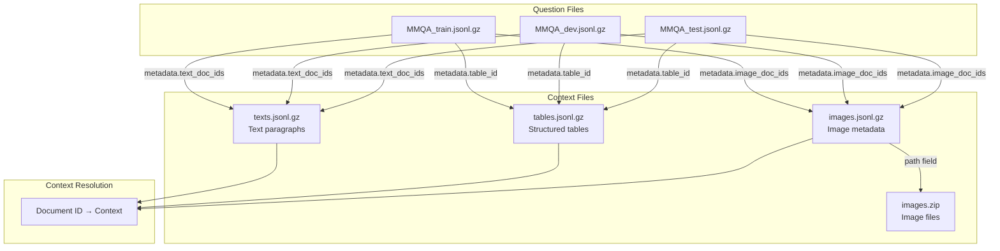
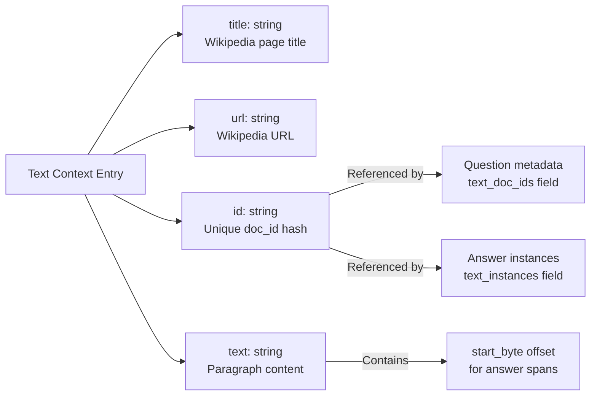
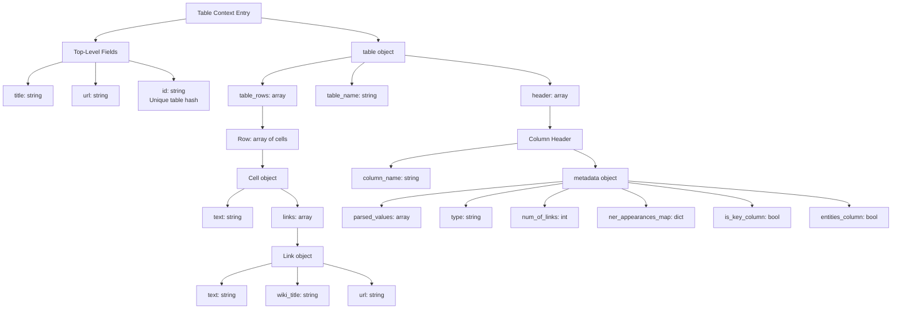
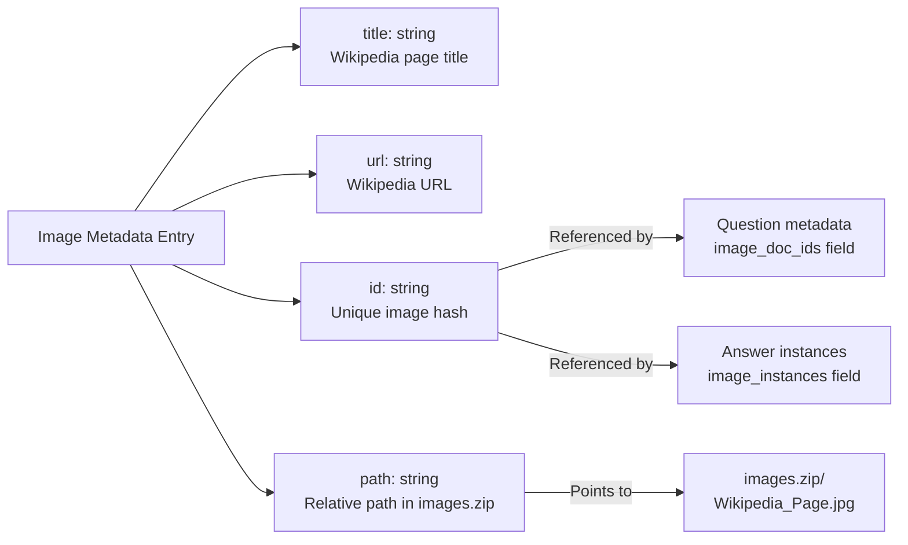
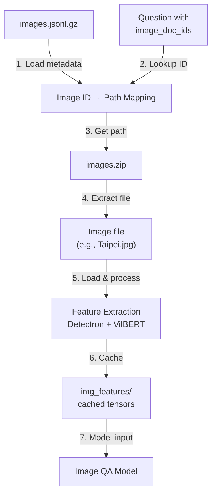
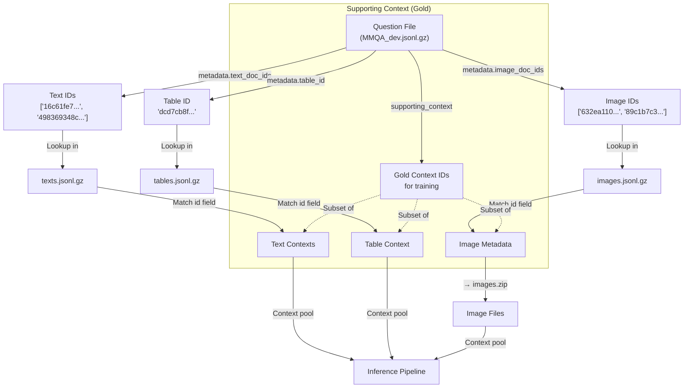

<!-- source: DeepWiki mcp.deepwiki.com · repo allenai/multimodalqa · page 3.3 Context Files and Structure · fetched 2026-10-26 -->

# Context Files and Structure

<details>
<summary>Relevant source files</summary>

The following files were used as context for generating this wiki page:

- [README.md](README.md)
- [dataset/MMQA_images.jsonl.gz](dataset/MMQA_images.jsonl.gz)
- [dataset/MMQA_tables.jsonl.gz](dataset/MMQA_tables.jsonl.gz)

</details>


## Purpose and Scope

This document describes the structure and format of the context files that provide the multi-modal evidence documents for questions in the MultiModalQA dataset. These files contain the text paragraphs, structured tables, and image metadata that models must reason over to answer questions. This page focuses on the context file formats; for information about question formats and metadata, see [Dataset Format Specification](#3.1), and for how contexts are processed during inference, see [Pipeline Implementation](#6.1).

## Overview of Context Files

The MultiModalQA dataset provides three types of context documents, each stored in separate JSONL files within the [dataset/](https://github.com/allenai/multimodalqa/tree/master/dataset) directory:

| File | Format | Purpose | Size |
|------|--------|---------|------|
| `texts.jsonl.gz` | JSONL (gzipped) | Text paragraph contexts from Wikipedia | Multiple paragraphs per article |
| `tables.jsonl.gz` | JSONL (gzipped) | Structured table data from Wikipedia | Multiple tables per article |
| `images.jsonl.gz` | JSONL (gzipped) | Image metadata with file paths | Metadata only |
| `images.zip` | ZIP archive | Actual image files | ~4GB of JPG/PNG files |

Each context document has a unique `id` field that is referenced by questions in `MMQA_train.jsonl.gz`, `MMQA_dev.jsonl.gz`, and `MMQA_test.jsonl.gz` through the `metadata` field (via `text_doc_ids`, `table_id`, or `image_doc_ids`) and the `supporting_context` field.

**Context Files Organization**



Sources: [README.md:17-21]()

## Text Context Format

Each line in `texts.jsonl.gz` represents a single text paragraph extracted from Wikipedia. Text contexts are the simplest modality, containing raw text with associated metadata.

**Structure of a Text Context Entry**



**Field Specifications**

| Field | Type | Description |
|-------|------|-------------|
| `title` | string | The title of the Wikipedia page from which the text was extracted |
| `url` | string | Full Wikipedia URL (e.g., `https://en.wikipedia.org/wiki/Taipei`) |
| `id` | string | Unique MD5 hash identifier for this text paragraph |
| `text` | string | The actual paragraph text content |

**Example Text Context**

```json
{
  "title": "The Legend of Korra (video game)",
  "url": "https://en.wikipedia.org/wiki/The_Legend_of_Korra_(video_game)",
  "id": "16c61fe756817f0b35df9717fae1000e",
  "text": "Over three years after its release, the game was removed from sale on all digital storefronts on December 21, 2017."
}
```

**Text Context Usage**

Text contexts are referenced in two ways:
1. **Question Metadata**: The `metadata.text_doc_ids` field lists all text document IDs that form the context pool for a question
2. **Answer Instances**: The `text_instances` field in answers provides `doc_id`, `start_byte`, and the exact answer text span

Sources: [README.md:171-181]()

## Table Context Format

Each line in `tables.jsonl.gz` represents a single structured table from Wikipedia. Tables are the most complex context type, containing structured data with header metadata, cell-level Wikipedia entity links, and parsed value types.

**Table Context Structure**



**Top-Level Fields**

| Field | Type | Description |
|-------|------|-------------|
| `title` | string | Wikipedia page title |
| `url` | string | Wikipedia URL |
| `id` | string | Unique MD5 hash for this table |
| `table` | object | Contains the table structure |

**Table Object Fields**

| Field | Type | Description |
|-------|------|-------------|
| `table_rows` | array | List of rows, each row is a list of cell objects |
| `table_name` | string | Name/caption of the table (e.g., "Electoral history") |
| `header` | array | Column header definitions with parsing metadata |

**Cell Structure**

Each cell in `table_rows` contains:
- `text`: The cell's text content
- `links`: Array of Wikipedia entity links found in the cell

**Header Metadata**

Each column header in the `header` array provides:
- `column_name`: Name of the column
- `metadata`: Rich metadata including:
  - `parsed_values`: List of parsed numeric or date values
  - `type`: Data type detected (e.g., "float", "string", "date")
  - `num_of_links`: Count of Wikipedia links in this column
  - `ner_appearances_map`: Dictionary of NER types (e.g., "DATE", "CARDINAL") to counts
  - `is_key_column`: Boolean indicating if this is a key/identifier column
  - `entities_column`: Boolean indicating if this column contains entity references

**Example Table Context**

```json
{
  "title": "Dutch Ruppersberger",
  "url": "https://en.wikipedia.org/wiki/Dutch_Ruppersberger",
  "id": "dcd7cb8f23737c6f38519c3770a6606f",
  "table": {
    "table_rows": [
      [
        {
          "text": "Baltimore County Executive",
          "links": [
            {
              "text": "Baltimore County Executive",
              "wiki_title": "Baltimore County Executive",
              "url": "https://en.wikipedia.org/wiki/Baltimore_County_Executive"
            }
          ]
        }
      ]
    ],
    "table_name": "Electoral history",
    "header": [
      {
        "column_name": "Year",
        "metadata": {
          "parsed_values": [1994.0, 1998.0],
          "type": "float",
          "num_of_links": 9,
          "ner_appearances_map": {
            "DATE": 10,
            "CARDINAL": 1
          },
          "is_key_column": true,
          "entities_column": true
        }
      }
    ]
  }
}
```

**Table Reference in Questions**

Tables are referenced via `metadata.table_id` in question files. The `table_indices` field in answers specifies exact cell locations as `[row_index, column_index]` pairs.

Sources: [README.md:110-156]()

## Image Context Format

Images are handled through two separate files: `images.jsonl.gz` contains metadata, while `images.zip` contains the actual image files. This separation allows for efficient metadata processing without loading large image files.

**Image Metadata Structure**



**Image Metadata Fields**

| Field | Type | Description |
|-------|------|-------------|
| `title` | string | Wikipedia page title where the image appears |
| `url` | string | Wikipedia URL |
| `id` | string | Unique MD5 hash for this image |
| `path` | string | Relative path to the image file within `images.zip` |

**Example Image Metadata**

```json
{
  "title": "Taipei",
  "url": "https://en.wikipedia.org/wiki/Taipei",
  "id": "632ea110be92836441adfb3167edf8ff",
  "path": "Taipei.jpg"
}
```

**Image Files Archive**

The `images.zip` file can be downloaded from:
```
https://multimodalqa-images.s3-us-west-2.amazonaws.com/final_dataset_images/final_dataset_images.zip
```

This archive contains approximately 4GB of image files in JPG and PNG formats. The `path` field in `images.jsonl.gz` corresponds to the file path within this archive.

**Image Processing Workflow**



**Image Reference in Questions**

Images are referenced via `metadata.image_doc_ids` in question files. Unlike text and tables, image answers in `image_instances` only provide the `doc_id` and `doc_part`, not specific regions or coordinates.

Sources: [README.md:158-169](), [README.md:21]()

## Context ID Resolution

All context files use MD5 hash identifiers to uniquely identify documents. These IDs enable efficient lookup and cross-referencing between questions and contexts.

**Context ID Mapping Flow**



**ID Resolution Example**

For a question with this metadata:
```json
{
  "text_doc_ids": ["498369348c988d866b5fac0add45bac5", "57686242cf542e30cbad13037017b478"],
  "table_id": "46ae2a8e7928ed5a8e5f9c59323e5e49",
  "image_doc_ids": ["89c1b7c3c061cc80bb98d99cbbec50dd", "0f3858e2186b2030b77c759fc727e20b"]
}
```

The system resolves these IDs by:
1. Loading all context JSONL files into memory or creating an index
2. Building a dictionary mapping `id` → context object
3. Looking up each ID to retrieve the full context
4. Providing these contexts to the appropriate QA models

**Supporting Context vs. Full Context Pool**

Questions provide two types of context references:

| Field | Purpose | Training Use | Inference Use |
|-------|---------|--------------|---------------|
| `metadata.*_doc_ids` | Full context pool (includes distractors) | Background contexts | All available contexts |
| `supporting_context` | Gold-labeled contexts containing answers | Supervision signal | Not available at test time |

The `supporting_context` field lists only the contexts that actually contain answer spans or intermediate answers, making it useful for training models to identify relevant contexts. During inference, models must consider the entire context pool from `metadata.*_doc_ids`.

**Context Caching Strategy**

For efficient processing, the codebase implements context caching:
- **Text/Table**: Typically loaded on-demand from JSONL files during inference
- **Images**: Pre-extracted visual features are cached in `img_features/` directory to avoid repeated feature extraction
- **Feature Extraction**: Uses Detectron for object detection and VilBERT for visual encoding (see [Image QA Dataset Preparation](#5.1.1))

Sources: [README.md:72-107](), [README.md:26-46]()

## File Location and Access

All context files are located in the `dataset/` directory of the repository and can be accessed through the download script.

**Directory Structure**

```
dataset/
├── MMQA_train.jsonl.gz          # Training questions
├── MMQA_dev.jsonl.gz            # Development questions
├── MMQA_test.jsonl.gz           # Test questions
├── texts.jsonl.gz               # Text contexts
├── tables.jsonl.gz              # Table contexts
└── images.jsonl.gz              # Image metadata

downloads/
└── images/                       # Extracted from images.zip
    ├── Taipei.jpg
    ├── Dutch_Ruppersberger.jpg
    └── ...
```

**Loading Context Files in Code**

Context files are typically loaded using utility functions that read JSONL files line-by-line and build ID-to-context mappings. The common pattern is:

```python
# Example loading pattern (not actual code, just illustration)
contexts = {}
for line in gzip.open('dataset/texts.jsonl.gz'):
    obj = json.loads(line)
    contexts[obj['id']] = obj
```

For specific implementations of context loading during inference, see [Pipeline Implementation](#6.1). For how images are processed into features, see [Image QA Dataset Preparation](#5.1.1).

Sources: [README.md:17-21]()

---

