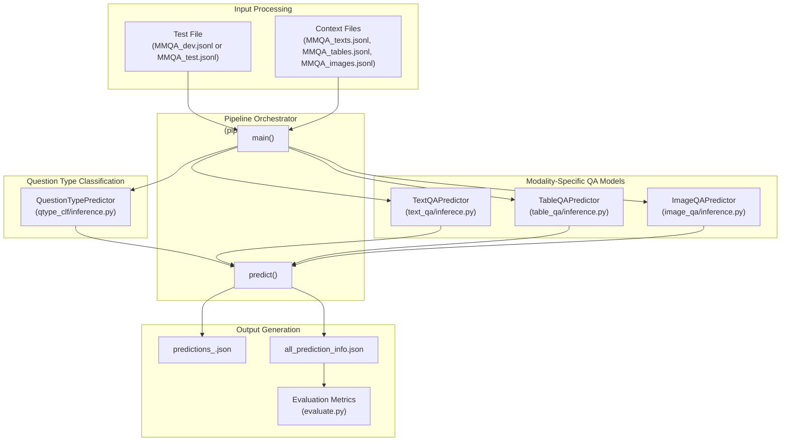
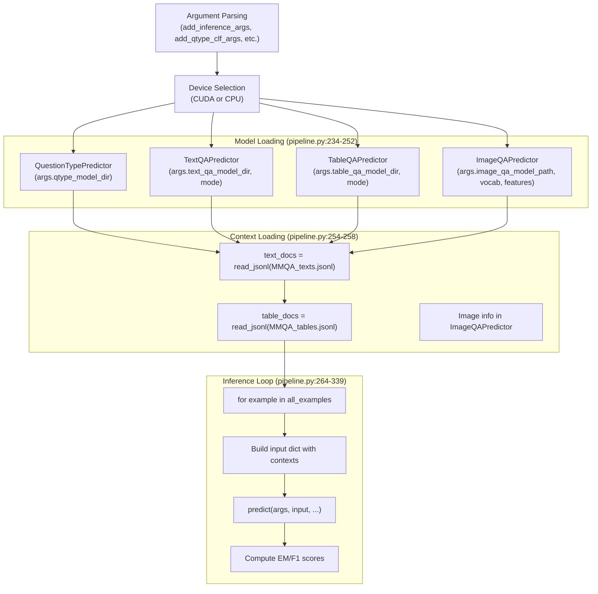
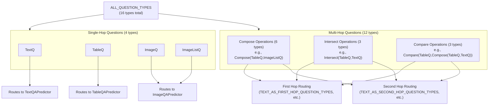
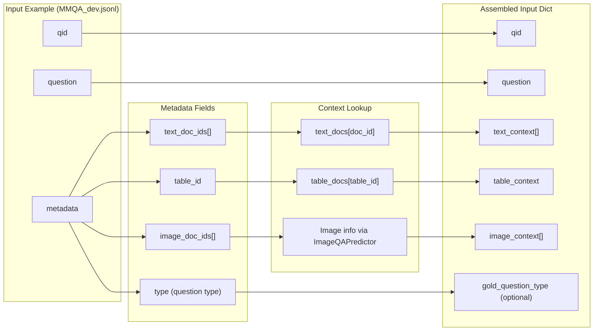
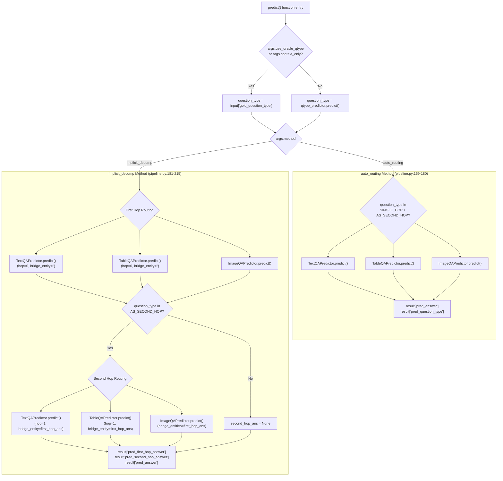
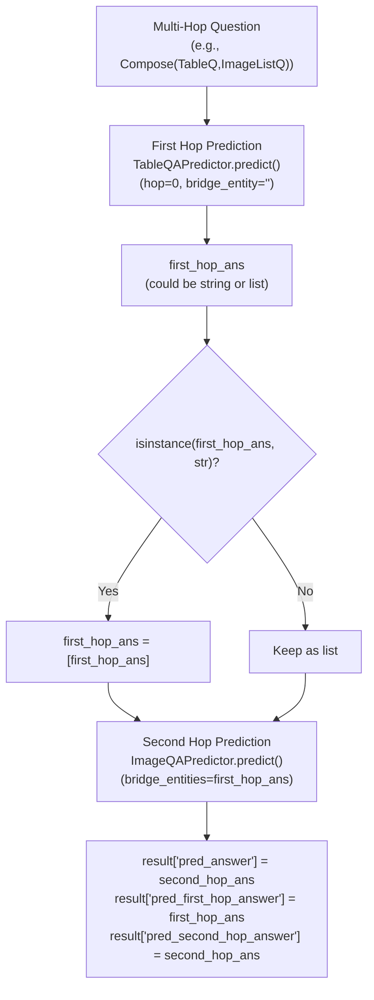
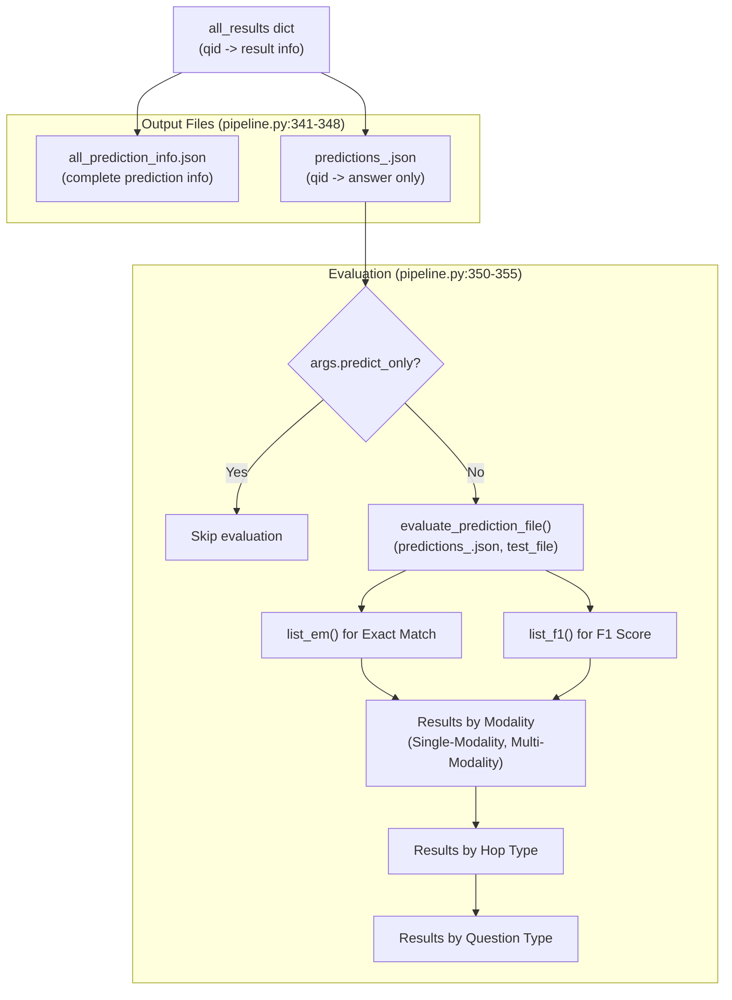
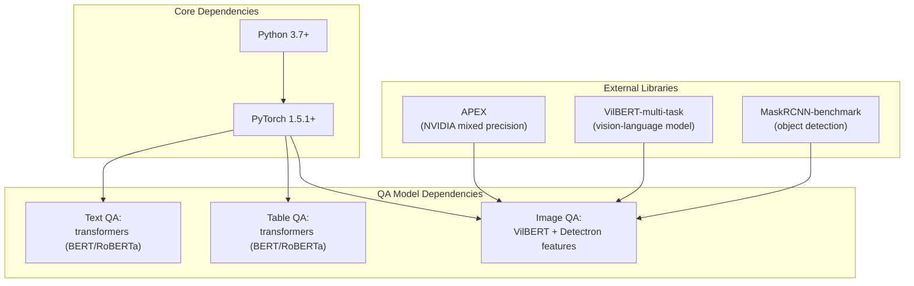

<!-- source: DeepWiki mcp.deepwiki.com · repo allenai/multimodalqa · page 4 System Architecture · fetched 2026-10-26 -->

# System Architecture

<details>
<summary>Relevant source files</summary>

The following files were used as context for generating this wiki page:

- [baselines/README.md](baselines/README.md)
- [baselines/common_utils.py](baselines/common_utils.py)
- [baselines/pipeline.py](baselines/pipeline.py)

</details>


## Purpose and Scope

This document describes the high-level architecture of the MultiModalQA baseline system, including its major components, data flow, and how they interact during inference. For detailed information about the question type classification module, see [Question Type Classification](#4.1). For in-depth explanations of the three inference methods (`implicit_decomp`, `auto_routing`, `context_only`), see [Inference Methods](#4.2). For specifics on individual QA models, see [Baseline Models](#5).

## Overall System Architecture

The MultiModalQA baseline system consists of five primary components that work together to answer complex multi-modal questions:



**Sources:** [baselines/pipeline.py:1-360](), [baselines/README.md:1-53]()

### Component Summary

| Component | Class Name | File Path | Responsibility |
|-----------|-----------|-----------|----------------|
| Pipeline Orchestrator | `main()`, `predict()` | `pipeline.py` | Coordinates all models, routes questions, handles multi-hop reasoning |
| Question Type Classifier | `QuestionTypePredictor` | `qtype_clf/inference.py` | Predicts question type from 16 categories |
| Text QA Model | `TextQAPredictor` | `text_qa/inferece.py` | Answers questions over text paragraphs |
| Table QA Model | `TableQAPredictor` | `table_qa/inference.py` | Answers questions over structured tables |
| Image QA Model | `ImageQAPredictor` | `image_qa/inference.py` | Answers questions over images |
| Evaluation | `list_em()`, `list_f1()`, `evaluate_prediction_file()` | `evaluate.py` | Computes F1 and Exact Match metrics |

**Sources:** [baselines/pipeline.py:14-17](), [baselines/pipeline.py:220-356]()

## Component Initialization and Dependencies

The system initialization follows a specific sequence in the `main()` function:



**Sources:** [baselines/pipeline.py:220-260](), [baselines/pipeline.py:264-339]()

### Key Initialization Parameters

The system requires several model checkpoints and configuration parameters:

| Parameter | Purpose | Example Value |
|-----------|---------|---------------|
| `--qtype_model_dir` | Question type classifier checkpoint | `downloads/checkpoints/qtype_clf_models/` |
| `--text_qa_model_dir` | Text QA model checkpoint | `downloads/checkpoints/text_qa_models/implicit_decomp/` |
| `--table_qa_model_dir` | Table QA model checkpoint | `downloads/checkpoints/table_qa_models/implicit_decomp/` |
| `--image_qa_model_path` | Image QA model checkpoint file | `downloads/checkpoints/image_qa_models/implicit_decomp/model.pt` |
| `--image_qa_vocab` | Vocabulary for answer generation | `downloads/checkpoints/image_qa_models/vocab.pickle` |
| `--image_features_dir` | Pre-computed image features | `downloads/checkpoints/img_features/` |
| `--method` | Inference method | `implicit_decomp` or `auto_routing` |

**Sources:** [baselines/pipeline.py:27-71](), [baselines/README.md:21-36]()

## Question Type Taxonomy and Routing

The system defines 16 distinct question types that drive the routing logic:



**Sources:** [baselines/common_utils.py:4-94]()

### Question Type Constants

The system defines several constant lists in `common_utils.py` to categorize question types:

| Constant | Purpose | Example Types |
|----------|---------|---------------|
| `TEXT_SINGLE_HOP_QUESTION_TYPES` | Single-hop text questions | `['TextQ']` |
| `TEXT_AS_FIRST_HOP_QUESTION_TYPES` | Text as first hop in multi-hop | `['Compose(ImageQ,TextQ)', ...]` |
| `TEXT_AS_SECOND_HOP_QUESTION_TYPES` | Text as second hop in multi-hop | `['Compose(TextQ,ImageListQ)', ...]` |
| `TABLE_SINGLE_HOP_QUESTION_TYPES` | Single-hop table questions | `['TableQ']` |
| `TABLE_AS_FIRST_HOP_QUESTION_TYPES` | Table as first hop in multi-hop | `['Compose(ImageQ,TableQ)', ...]` |
| `TABLE_AS_SECOND_HOP_QUESTION_TYPES` | Table as second hop in multi-hop | `['Compose(TableQ,ImageListQ)', ...]` |
| `IMAGE_SINGLE_HOP_QUESTION_TYPES` | Single-hop image questions | `['ImageQ', 'ImageListQ']` |
| `IMAGE_AS_FIRST_HOP_QUESTION_TYPES` | Image as first hop in multi-hop | `['Compose(TableQ,ImageListQ)', ...]` |
| `IMAGE_AS_SECOND_HOP_QUESTION_TYPES` | Image as second hop in multi-hop | `['Compose(ImageQ,TableQ)', ...]` |

**Sources:** [baselines/common_utils.py:23-94]()

## Data Flow Through the System

### Input Processing and Context Assembly

The pipeline assembles multi-modal contexts for each question:



**Sources:** [baselines/pipeline.py:265-274]()

### Prediction Flow in the `predict()` Function

The core prediction logic routes questions based on their type and the selected inference method:



**Sources:** [baselines/pipeline.py:161-217]()

## Inference Method Architecture Overview

The system supports three inference methods, each with different routing strategies:

| Method | Description | Multi-Hop Handling | Use Case |
|--------|-------------|-------------------|----------|
| `implicit_decomp` | Performs explicit two-hop reasoning with bridge entities | Predicts both first and second hop modalities, passes first hop answer as bridge entity to second hop | Best performance baseline (F1: 48.79) |
| `auto_routing` | Routes directly to final answer modality | Ignores intermediate hops, predicts only final answer modality | Simpler baseline (F1: 44.65) |
| `context_only` | Ignores question text completely | Uses only context information | Lower bound baseline (F1: 7.41) |

**Sources:** [baselines/pipeline.py:92-100](), [baselines/README.md:42-48]()

### Method Selection Impact on Model Initialization

The selected method affects how models are initialized:

```python
# Text QA model mode based on method
text_qa_predictor = TextQAPredictor(
    args.text_qa_model_dir, args.do_lower_case, device,
    mode="implicit_decomp" if args.method == "implicit_decomp" else "base"
)

# Table QA model mode based on method
table_qa_predictor = TableQAPredictor(
    args.table_qa_model_dir, device,
    mode="implicit_decomp" if args.method == "implicit_decomp" else "base"
)

# Image QA model mode includes context_only option
image_qa_predictor = ImageQAPredictor(
    checkpoint_path=args.image_qa_model_path,
    vilbert_dir=args.vilbert_dir,
    img_info_path=os.path.join(args.data_dir, "MMQA_images.jsonl"),
    vocab_path=args.image_qa_vocab,
    device=device,
    mode="context_only" if args.context_only else args.method,
    img_features_dir=args.image_features_dir,
    use_distractors=True
)
```

**Sources:** [baselines/pipeline.py:235-252]()

## Multi-Hop Reasoning with Bridge Entities

For multi-hop questions using `implicit_decomp`, the system extracts a bridge entity from the first hop and passes it to the second hop:



**Sources:** [baselines/pipeline.py:194-214]()

### Question Processing for Bridge Entities

The `process_question_for_implicit_decomp()` function formats questions with bridge entity information:

```python
def process_question_for_implicit_decomp(question, question_type, hop=0, bridge_entity='', sep_token='[SEP]'):
    if isinstance(bridge_entity, list) or isinstance(bridge_entity, set):
        bridge_entity = "; ".join(bridge_entity)
    return (
        f'{question_type} {sep_token} '
        f'HOP={hop} {sep_token} '
        f'{bridge_entity} {sep_token} '
        f'{question}')
```

This formatted question is passed to the QA models, which have been trained to handle this format. The bridge entity provides context from the first hop to inform the second hop prediction.

**Sources:** [baselines/common_utils.py:96-103]()

## Output Generation and Evaluation

The system produces two output files and optionally evaluates metrics:



**Sources:** [baselines/pipeline.py:341-356]()

### Result Dictionary Structure

Each prediction result contains the following fields:

| Field | Description | Present When |
|-------|-------------|--------------|
| `qid` | Question ID | Always |
| `question` | Question text | Always |
| `pred_answer` | Predicted answer | Always |
| `pred_question_type` | Predicted question type | Always |
| `pred_first_hop_answer` | First hop answer | `implicit_decomp` only |
| `pred_second_hop_answer` | Second hop answer | `implicit_decomp` only |
| `gold_question_type` | Ground truth question type | When not `--predict_only` |
| `gold_answer` | Ground truth answer | When not `--predict_only` |
| `em_score` | Exact match score | When not `--predict_only` |
| `f1_score` | F1 score | When not `--predict_only` |
| `first_hop_em_score` | First hop exact match | When not `--predict_only` and `implicit_decomp` |
| `first_hop_f1_score` | First hop F1 score | When not `--predict_only` and `implicit_decomp` |

**Sources:** [baselines/pipeline.py:294-339]()

## Code Entry Points

The main entry points for running the system:

### Command-Line Interface

The primary entry point is `pipeline.py:main()`:

```bash
python pipeline.py \
  --qtype_model_dir downloads/checkpoints/qtype_clf_models/ \
  --text_qa_model_dir downloads/checkpoints/text_qa_models/implicit_decomp/ \
  --table_qa_model_dir downloads/checkpoints/table_qa_models/implicit_decomp/ \
  --image_qa_model_path downloads/checkpoints/image_qa_models/implicit_decomp/model.pt \
  --image_qa_vocab downloads/checkpoints/image_qa_models/vocab.pickle \
  --image_features_dir downloads/checkpoints/img_features/ \
  --data_dir downloads/MMQA/ \
  --test_file MMQA_dev.jsonl \
  --output_dir output/results/implicit_decomp_dev/ \
  --do_lower_case \
  --method implicit_decomp
```

**Sources:** [baselines/README.md:21-35]()

### Batch Evaluation Script

For parallel evaluation of all methods, use `run_pipeline.sh`:

```bash
./scripts/run_pipeline.sh
```

This script runs three instances in parallel on different GPUs:
- GPU 0: `implicit_decomp` method
- GPU 1: `auto_routing` method
- GPU 2: `context_only` method

**Sources:** [baselines/README.md:38-41]()

## System Dependencies

The architecture requires several external dependencies:



**Sources:** [baselines/README.md:4-10]()

---

