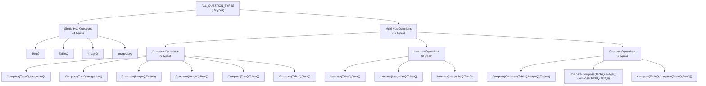
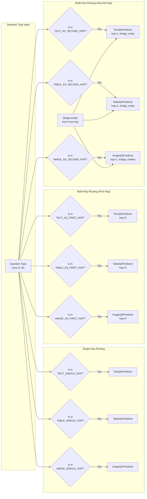
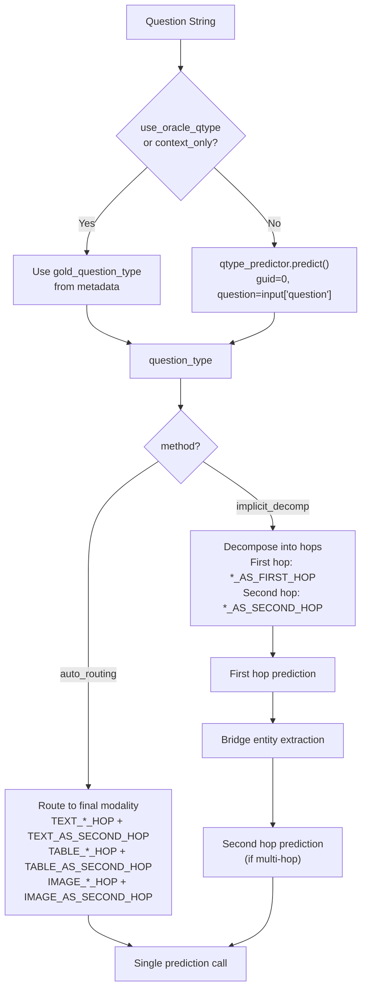
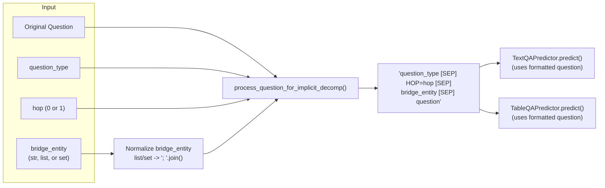

<!-- source: DeepWiki mcp.deepwiki.com · repo allenai/multimodalqa · page 4.1 Question Type Classification · fetched 2026-10-26 -->

# Question Type Classification

<details>
<summary>Relevant source files</summary>

The following files were used as context for generating this wiki page:

- [baselines/common_utils.py](baselines/common_utils.py)
- [baselines/pipeline.py](baselines/pipeline.py)

</details>


## Purpose and Scope

Question Type Classification is the first step in the MultiModalQA inference pipeline. It predicts which of 16 predefined question types a given question belongs to, and this prediction directly determines how the question is routed through the modality-specific QA models. This page documents the question type taxonomy, the classification system, and how type predictions drive routing decisions.

For details on the question type taxonomy from a dataset perspective, see [Question Types and Taxonomy](#3.2). For information on how the three inference methods use question types differently, see [Inference Methods](#4.2). For the complete pipeline orchestration, see [Pipeline Implementation](#6.1).

---

## Question Type Taxonomy

The MultiModalQA system defines 16 distinct question types, divided into single-hop and multi-hop categories. These types are defined in [baselines/common_utils.py:4-21]().

### Complete Type Listing

| Category | Question Type | Description |
|----------|---------------|-------------|
| **Single-Hop** | `TextQ` | Answer from text context only |
| | `TableQ` | Answer from table context only |
| | `ImageQ` | Answer from a single image |
| | `ImageListQ` | Answer from multiple images |
| **Compose** | `Compose(TableQ,ImageListQ)` | First hop: table, second hop: images |
| | `Compose(TextQ,ImageListQ)` | First hop: text, second hop: images |
| | `Compose(ImageQ,TableQ)` | First hop: image, second hop: table |
| | `Compose(ImageQ,TextQ)` | First hop: image, second hop: text |
| | `Compose(TextQ,TableQ)` | First hop: text, second hop: table |
| | `Compose(TableQ,TextQ)` | First hop: table, second hop: text |
| **Intersect** | `Intersect(TableQ,TextQ)` | Find intersection of table and text answers |
| | `Intersect(ImageListQ,TableQ)` | Find intersection of image list and table answers |
| | `Intersect(ImageListQ,TextQ)` | Find intersection of image list and text answers |
| **Compare** | `Compare(Compose(TableQ,ImageQ),TableQ)` | Compare two reasoning chains |
| | `Compare(Compose(TableQ,ImageQ),Compose(TableQ,TextQ))` | Compare two composition chains |
| | `Compare(TableQ,Compose(TableQ,TextQ))` | Compare table result with composition |

**Diagram: Question Type Hierarchy**



**Sources:** [baselines/common_utils.py:4-21](), [baselines/common_utils.py:81-93]()

---

## Routing Constants and Modality Assignment

The system organizes question types into routing groups based on which modality handles which reasoning hop. These constants are critical for determining which QA model to invoke at each step.

### Modality-Specific Groupings

**Text QA Routing Groups** ([baselines/common_utils.py:23-37]()):
- `TEXT_SINGLE_HOP_QUESTION_TYPES`: Questions answered by text QA as single-hop
  - `TextQ`
- `TEXT_AS_FIRST_HOP_QUESTION_TYPES`: Questions where text QA handles the first hop
  - `Compare(TableQ,Compose(TableQ,TextQ))`, `Compose(ImageQ,TextQ)`, `Compose(TableQ,TextQ)`, `Intersect(TableQ,TextQ)`, `Intersect(ImageListQ,TextQ)`
- `TEXT_AS_SECOND_HOP_QUESTION_TYPES`: Questions where text QA handles the second hop
  - `Compare(Compose(TableQ,ImageQ),Compose(TableQ,TextQ))`, `Compose(TextQ,ImageListQ)`, `Compose(TextQ,TableQ)`

**Table QA Routing Groups** ([baselines/common_utils.py:39-53]()):
- `TABLE_SINGLE_HOP_QUESTION_TYPES`: `TableQ`
- `TABLE_AS_FIRST_HOP_QUESTION_TYPES`: `Compose(ImageQ,TableQ)`, `Compose(TextQ,TableQ)`
- `TABLE_AS_SECOND_HOP_QUESTION_TYPES`: 6 types including `Compose(TableQ,ImageListQ)`, `Compose(TableQ,TextQ)`, various `Intersect` and `Compare` operations

**Image QA Routing Groups** ([baselines/common_utils.py:55-70]()):
- `IMAGE_SINGLE_HOP_QUESTION_TYPES`: `ImageQ`, `ImageListQ`
- `IMAGE_AS_FIRST_HOP_QUESTION_TYPES`: 5 types including `Compose(TableQ,ImageListQ)`, `Compose(TextQ,ImageListQ)`, and `Compare` operations
- `IMAGE_AS_SECOND_HOP_QUESTION_TYPES`: `Compose(ImageQ,TableQ)`, `Compose(ImageQ,TextQ)`, `Intersect(ImageListQ,TextQ)`

**Diagram: Routing Group Assignment**



**Sources:** [baselines/common_utils.py:23-70](), [baselines/pipeline.py:183-216]()

### Assertion Checks

The system validates that the routing groups are correctly partitioned ([baselines/common_utils.py:74-93]()):
- Every question type appears in exactly one single-hop or second-hop category per modality
- All multi-hop questions appear in exactly one first-hop category
- The union of single-hop and multi-hop types equals all 16 types

---

## Question Type Prediction

The question type classifier is a BERT-based model that predicts one of the 16 question types from the input question string.

### QuestionTypePredictor Class

The classifier is instantiated from the `QuestionClassificationInferenceModel` class located in `qtype_clf/inference.py` ([baselines/pipeline.py:14](), [baselines/pipeline.py:234]()):

```
qtype_predictor = QuestionTypePredictor(args.qtype_model_dir, device)
```

**Key Parameters:**
- `qtype_model_dir`: Path to the trained classifier checkpoint
- `device`: PyTorch device (CPU or CUDA)

### Prediction Flow

**Diagram: Question Type Prediction in Pipeline**



**Sources:** [baselines/pipeline.py:161-217]()

### Oracle Question Types

For debugging and upper-bound analysis, the system supports using ground truth question types via the `--use_oracle_qtype` flag ([baselines/pipeline.py:102-105](), [baselines/pipeline.py:164-167]()):

```
if args.use_oracle_qtype or args.context_only:
    question_type = input["gold_question_type"]
else:
    question_type = qtype_predictor.predict(guid=0, question=input["question"])
```

This bypasses the classifier and uses the type from `example["metadata"]["type"]`, allowing evaluation of downstream QA models independent of classification errors.

**Sources:** [baselines/pipeline.py:102-107](), [baselines/pipeline.py:164-167](), [baselines/pipeline.py:273]()

---

## Question Formatting for Implicit Decomposition

When using the `implicit_decomp` inference method, questions are augmented with metadata to provide explicit guidance to the QA models about the reasoning structure.

### Format Specification

The `process_question_for_implicit_decomp` function ([baselines/common_utils.py:96-103]()) formats questions as:

```
<question_type> [SEP] HOP=<hop> [SEP] <bridge_entity> [SEP] <question>
```

**Components:**
- `question_type`: One of the 16 type strings (e.g., `"Compose(TableQ,TextQ)"`)
- `[SEP]`: Separator token (typically `"[SEP]"` for BERT-based models)
- `HOP=<hop>`: Hop position (`0` for first hop or single-hop, `1` for second hop)
- `bridge_entity`: Entities from first hop answer (empty string for first hop, semicolon-separated list for second hop)
- `question`: Original question text

### Example Formatting

For a question `"Who directed the movie that won Best Picture?"` of type `Compose(TableQ,TextQ)`:

**First Hop (Table):**
```
Compose(TableQ,TextQ) [SEP] HOP=0 [SEP]  [SEP] Who directed the movie that won Best Picture?
```

**Second Hop (Text, after extracting "Parasite" from table):**
```
Compose(TableQ,TextQ) [SEP] HOP=1 [SEP] Parasite [SEP] Who directed the movie that won Best Picture?
```

### Bridge Entity Handling

The function normalizes bridge entities from various formats ([baselines/common_utils.py:96-99]()):
- If `bridge_entity` is a list or set, joins with `"; "`
- Ensures consistent string representation for downstream models

**Diagram: Question Formatting Pipeline**



**Sources:** [baselines/common_utils.py:96-103]()

---

## Integration with Inference Methods

The question type classification integrates differently with the two main inference methods.

### Auto-Routing Method

In `auto_routing` mode ([baselines/pipeline.py:169-180]()), the question type directly determines which single QA model to invoke:

```
if question_type in TEXT_SINGLE_HOP_QUESTION_TYPES + TEXT_AS_SECOND_HOP_QUESTION_TYPES:
    pred_ans = text_qa_predictor.predict(args, input["question"], input["text_context"])
elif question_type in TABLE_SINGLE_HOP_QUESTION_TYPES + TABLE_AS_SECOND_HOP_QUESTION_TYPES:
    pred_ans = table_qa_predictor.predict(args, input["question"], input["table_context"])
elif question_type in IMAGE_SINGLE_HOP_QUESTION_TYPES + IMAGE_AS_SECOND_HOP_QUESTION_TYPES:
    pred_ans = image_qa_predictor.predict(...)
```

The key insight: **types are grouped by the modality that produces the final answer**, ignoring intermediate reasoning steps.

### Implicit Decomposition Method

In `implicit_decomp` mode ([baselines/pipeline.py:181-216]()), the question type drives a multi-step process:

1. **First Hop:** Route based on `*_AS_FIRST_HOP_QUESTION_TYPES` constants
2. **Extract Bridge Entity:** Use first hop answer as bridge entity
3. **Second Hop (if multi-hop):** Route based on `*_AS_SECOND_HOP_QUESTION_TYPES` constants, passing bridge entity

**Comparison Table:**

| Aspect | auto_routing | implicit_decomp |
|--------|--------------|-----------------|
| **Type Grouping** | By final answer modality | By hop-specific modality |
| **Prediction Calls** | 1 per question | 1-2 per question (depends on single/multi-hop) |
| **Question Format** | Original question | Augmented with type, hop, bridge entity |
| **Bridge Entity** | Not used | Passed from first to second hop |
| **Type Constants Used** | `*_SINGLE_HOP` + `*_AS_SECOND_HOP` | All three: `*_SINGLE_HOP`, `*_AS_FIRST_HOP`, `*_AS_SECOND_HOP` |

**Sources:** [baselines/pipeline.py:169-216]()

---

## Context-Only Baseline

The `context_only` baseline uses question types but ignores the actual question text ([baselines/pipeline.py:107-110](), [baselines/pipeline.py:269]()):

```
input = {
    "question": example["question"] if not args.context_only else "",
    ...
}
```

This tests whether models can answer questions using only the context (text, tables, images) without the question itself. The question type is still used for routing, but the question string is replaced with an empty string. This baseline achieved F1: 7.41 / EM: 10.03 in the paper, establishing a lower bound.

**Sources:** [baselines/pipeline.py:107-110](), [baselines/pipeline.py:164-167](), [baselines/pipeline.py:269]()

---

## Summary

Question Type Classification serves as the control mechanism for the entire MultiModalQA inference pipeline:

1. **Taxonomy:** 16 question types organized by complexity (single/multi-hop) and operations (Compose, Intersect, Compare)
2. **Routing:** Type-to-modality mappings defined via constants in [baselines/common_utils.py:23-70]()
3. **Prediction:** `QuestionTypePredictor` classifies questions; oracle mode available for debugging
4. **Formatting:** Questions augmented with type, hop, and bridge entity for `implicit_decomp` method
5. **Integration:** Different routing logic for `auto_routing` vs `implicit_decomp` methods

The classification accuracy directly impacts overall system performance, as misclassifications cascade into incorrect model routing and answer extraction.

---

