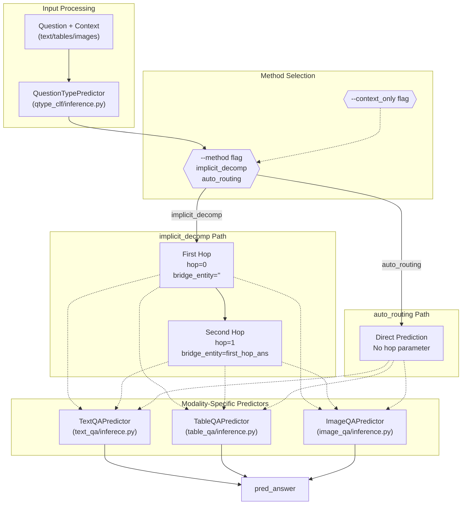
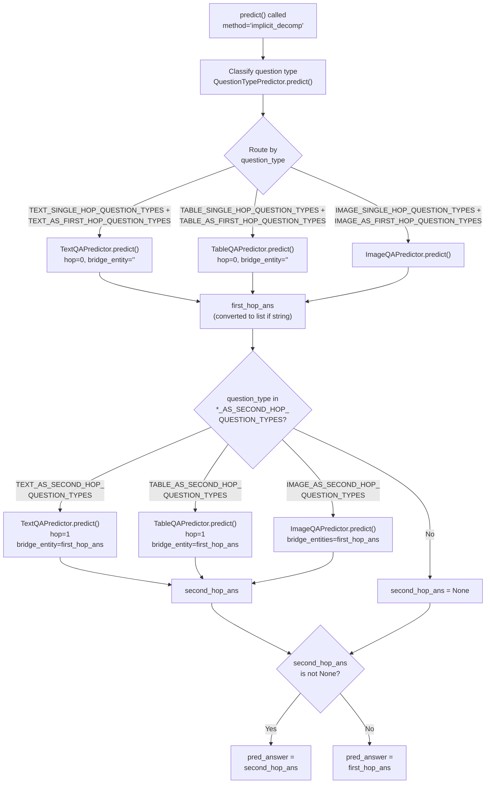
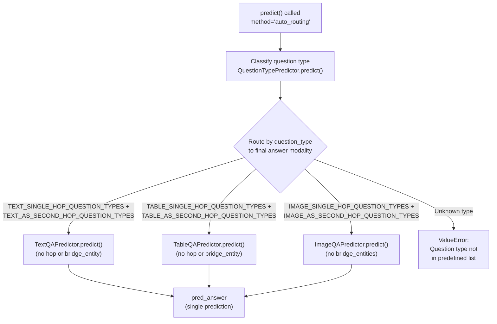
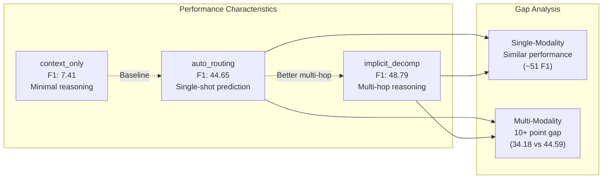
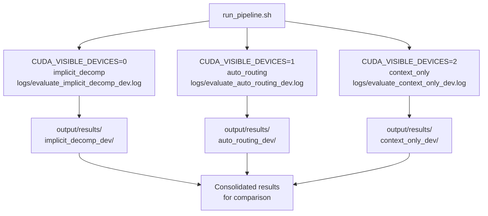

<!-- source: DeepWiki mcp.deepwiki.com · repo allenai/multimodalqa · page 4.2 Inference Methods · fetched 2026-10-26 -->

# Inference Methods

<details>
<summary>Relevant source files</summary>

The following files were used as context for generating this wiki page:

- [baselines/README.md](baselines/README.md)
- [baselines/pipeline.py](baselines/pipeline.py)
- [baselines/scripts/run_pipeline.sh](baselines/scripts/run_pipeline.sh)

</details>


## Purpose and Scope

This document describes the three inference methods supported by the MultiModalQA system for answering complex multi-modal questions. These methods define different strategies for routing questions to modality-specific QA models and handling multi-hop reasoning.

- For information about the individual modality-specific QA models used by these methods, see [Baseline Models](#5)
- For details on question type classification that drives routing decisions, see [Question Type Classification](#4.1)
- For practical instructions on running inference, see [Pipeline Implementation](#6.1)

The three methods are:
1. **implicit_decomp**: Multi-hop reasoning with explicit bridge entity extraction
2. **auto_routing**: Direct routing to final answer modality
3. **context_only**: Baseline that ignores question text

---

## Method Comparison Overview

The following table summarizes the key characteristics and performance of each method:

| Method | Strategy | Multi-Hop Support | Dev F1 / EM | Use Case |
|--------|----------|-------------------|-------------|----------|
| **implicit_decomp** | Decompose into first and second hop, route each separately | Yes (explicit bridge entities) | 48.79 / 55.48 | Best performance, handles complex reasoning |
| **auto_routing** | Route directly to final answer modality | No (single-shot prediction) | 44.65 / 51.13 | Simpler, faster inference |
| **context_only** | Ignore question, answer from context only | No | 7.41 / 10.03 | Lower bound baseline |

**Sources:** [baselines/README.md:42-48](), [baselines/pipeline.py:92-109]()

---

## Architecture Overview



**Diagram: High-level inference architecture showing method selection and routing**

**Sources:** [baselines/pipeline.py:161-217](), [baselines/pipeline.py:234-252]()

---

## implicit_decomp Method

### Strategy

The `implicit_decomp` method decomposes multi-hop questions into sequential reasoning steps. It first answers the initial question (first hop), extracts bridge entities from the answer, and then uses those entities to constrain the second reasoning step.

### Control Flow



**Diagram: implicit_decomp method control flow**

### Implementation Details

The core logic is implemented in the `predict()` function when `args.method == "implicit_decomp"`:

**First Hop Processing** [baselines/pipeline.py:183-193]():
- Routes based on question type using constants from `common_utils`:
  - `TEXT_AS_FIRST_HOP_QUESTION_TYPES`: Routes to `text_qa_predictor.predict()` with `hop=0`
  - `TABLE_AS_FIRST_HOP_QUESTION_TYPES`: Routes to `table_qa_predictor.predict()` with `hop=0`
  - `IMAGE_AS_FIRST_HOP_QUESTION_TYPES`: Routes to `image_qa_predictor.predict()`
- All predictors are called with `bridge_entity=""` (empty string) for the first hop
- Returns `first_hop_ans`

**Answer Normalization** [baselines/pipeline.py:196-197]():
- Converts string answers to lists for consistency
- Second hop models expect list inputs for bridge entities

**Second Hop Processing** [baselines/pipeline.py:200-210]():
- Only executed if question type is in `*_AS_SECOND_HOP_QUESTION_TYPES` constants
- Routes to appropriate modality with:
  - `hop=1` parameter (text and table models)
  - `bridge_entity=first_hop_ans` (text and table models)
  - `bridge_entities=first_hop_ans` (image model, note plural form)
- Returns `second_hop_ans` or `None` if not a multi-hop question

**Final Result** [baselines/pipeline.py:212-215]():
- Returns `second_hop_ans` if it exists, otherwise `first_hop_ans`
- Stores both intermediate and final answers in result dictionary

### Model Mode Configuration

The modality-specific predictors must be initialized with `mode="implicit_decomp"` to support hop-based reasoning:

```python
text_qa_predictor = TextQAPredictor(
    model_dir, do_lower_case, device,
    mode="implicit_decomp"
)
table_qa_predictor = TableQAPredictor(
    model_dir, device,
    mode="implicit_decomp"
)
image_qa_predictor = ImageQAPredictor(
    checkpoint_path, vilbert_dir, img_info_path, vocab_path, device,
    mode="implicit_decomp", ...
)
```

**Sources:** [baselines/pipeline.py:235-250]()

---

## auto_routing Method

### Strategy

The `auto_routing` method directly routes questions to the modality that will provide the final answer, without explicit multi-hop decomposition. It relies on question type classification to determine which modality to query.

### Control Flow



**Diagram: auto_routing method control flow**

### Implementation Details

The `auto_routing` method is simpler than `implicit_decomp`, implemented in [baselines/pipeline.py:169-180]():

**Routing Logic**:
- Combines single-hop and second-hop question types for each modality
- Routes to **text** if question type is in:
  - `TEXT_SINGLE_HOP_QUESTION_TYPES` + `TEXT_AS_SECOND_HOP_QUESTION_TYPES`
- Routes to **table** if question type is in:
  - `TABLE_SINGLE_HOP_QUESTION_TYPES` + `TABLE_AS_SECOND_HOP_QUESTION_TYPES`
- Routes to **image** if question type is in:
  - `IMAGE_SINGLE_HOP_QUESTION_TYPES` + `IMAGE_AS_SECOND_HOP_QUESTION_TYPES`

**Key Differences from implicit_decomp**:
- No `hop` parameter passed to text/table predictors
- No `bridge_entity` parameter passed to text/table predictors
- No `bridge_entities` parameter passed to image predictor
- Single prediction call per question
- No intermediate answer storage

### Model Mode Configuration

Models initialized with `mode="base"` for auto_routing:

```python
text_qa_predictor = TextQAPredictor(
    model_dir, do_lower_case, device,
    mode="base"  # Not "implicit_decomp"
)
table_qa_predictor = TableQAPredictor(
    model_dir, device,
    mode="base"  # Not "implicit_decomp"
)
image_qa_predictor = ImageQAPredictor(
    checkpoint_path, vilbert_dir, img_info_path, vocab_path, device,
    mode="auto_routing", ...
)
```

**Sources:** [baselines/pipeline.py:169-180](), [baselines/pipeline.py:235-250]()

---

## context_only Baseline

### Strategy

The `context_only` baseline is a lower-bound experiment that answers questions based purely on context, ignoring the question text entirely. This helps measure how much information can be extracted from context alone without understanding the question.

### Implementation

The `context_only` baseline is implemented as a modified version of `auto_routing`:

**Key Modifications** [baselines/pipeline.py:108-109](), [baselines/pipeline.py:269]():
1. Question text is replaced with empty string: `question="" if args.context_only else example["question"]`
2. Forces use of oracle (gold) question type: `question_type = input["gold_question_type"]` when `args.context_only` is True
3. Image QA predictor uses special mode: `mode="context_only"`

**Command-Line Configuration** [baselines/scripts/run_pipeline.sh:35-49]():
```bash
python pipeline.py \
  ... \
  --method auto_routing \
  --context_only \
  ...
```

Note: Even though `--method` is set to `auto_routing`, the `--context_only` flag modifies behavior significantly.

### Rationale

This baseline serves several purposes:
- **Lower bound**: Establishes minimum expected performance (F1: 7.41 / EM: 10.03)
- **Context analysis**: Reveals how much information is contained in context distributions
- **Model validation**: Confirms models actually use question text rather than memorizing context patterns

**Sources:** [baselines/pipeline.py:108-109](), [baselines/pipeline.py:164-165](), [baselines/pipeline.py:249](), [baselines/pipeline.py:269](), [baselines/scripts/run_pipeline.sh:35-49]()

---

## Configuration and Usage

### Command-Line Arguments

The inference method is selected via the `--method` argument:

| Argument | Type | Choices | Default | Description |
|----------|------|---------|---------|-------------|
| `--method` | string | `["auto_routing", "implicit_decomp"]` | `"implicit_decomp"` | Inference method selection |
| `--context_only` | flag | - | False | Enable context-only baseline mode |
| `--use_oracle_qtype` | flag | - | False | Use gold question types instead of predictions |
| `--predict_only` | flag | - | False | Skip evaluation, only generate predictions |

**Sources:** [baselines/pipeline.py:92-115]()

### Example Usage

**implicit_decomp method:**
```bash
python pipeline.py \
  --qtype_model_dir downloads/checkpoints/qtype_clf_models/ \
  --text_qa_model_dir downloads/checkpoints/text_qa_models/implicit_decomp/ \
  --table_qa_model_dir downloads/checkpoints/table_qa_models/implicit_decomp/ \
  --image_qa_model_path downloads/checkpoints/image_qa_models/implicit_decomp/model.pt \
  --image_qa_vocab downloads/checkpoints/image_qa_models/vocab.pickle \
  --image_features_dir downloads/checkpoints/img_features/ \
  --data_dir downloads/MMQA/ \
  --test_file MMQA_dev.jsonl \
  --output_dir output/results/implicit_decomp_dev/ \
  --do_lower_case \
  --method implicit_decomp
```

**auto_routing method:**
```bash
python pipeline.py \
  ... \
  --text_qa_model_dir downloads/checkpoints/text_qa_models/auto_routing/ \
  --table_qa_model_dir downloads/checkpoints/table_qa_models/auto_routing/ \
  --image_qa_model_path downloads/checkpoints/image_qa_models/auto_routing/model.pt \
  ... \
  --method auto_routing
```

**context_only baseline:**
```bash
python pipeline.py \
  ... \
  --text_qa_model_dir downloads/checkpoints/text_qa_models/context_only/ \
  --table_qa_model_dir downloads/checkpoints/table_qa_models/context_only/ \
  --image_qa_model_path downloads/checkpoints/image_qa_models/context_only/model.pt \
  ... \
  --method auto_routing \
  --context_only
```

**Sources:** [baselines/README.md:21-35](), [baselines/scripts/run_pipeline.sh:5-49]()

---

## Performance Analysis

### Overall Results

Results on the dev set across all question types:

| Method | Single-Modality F1 / EM | Multi-Modality F1 / EM | Overall F1 / EM |
|--------|------------------------|------------------------|-----------------|
| **context_only** | 7.94 / 10.73 | 6.63 / 9.00 | 7.41 / 10.03 |
| **auto_routing** | 51.68 / 58.48 | 34.18 / 40.18 | 44.65 / 51.13 |
| **implicit_decomp** | 51.60 / 58.35 | 44.59 / 51.19 | **48.79 / 55.48** |

**Sources:** [baselines/README.md:42-48]()

### Key Observations



**Diagram: Performance comparison and gaps between methods**

1. **Single-Modality Questions**: `implicit_decomp` and `auto_routing` perform similarly (~51 F1), as most single-modality questions don't benefit from explicit decomposition.

2. **Multi-Modality Questions**: `implicit_decomp` significantly outperforms `auto_routing` (44.59 vs 34.18 F1), demonstrating the value of explicit bridge entity extraction for complex reasoning.

3. **Context-Only Baseline**: Very low performance (7.41 F1) confirms that question understanding is critical for the task.

4. **Overall Performance**: `implicit_decomp` achieves best results (48.79 F1) due to its superior handling of multi-modal, multi-hop questions.

**Sources:** [baselines/README.md:42-48]()

---

## Question Type Routing Tables

### implicit_decomp Routing

**First Hop:**

| Modality | Question Types | Predictor | Parameters |
|----------|----------------|-----------|------------|
| Text | `TEXT_SINGLE_HOP_QUESTION_TYPES`<br/>`TEXT_AS_FIRST_HOP_QUESTION_TYPES` | `TextQAPredictor.predict()` | `hop=0, bridge_entity=""` |
| Table | `TABLE_SINGLE_HOP_QUESTION_TYPES`<br/>`TABLE_AS_FIRST_HOP_QUESTION_TYPES` | `TableQAPredictor.predict()` | `hop=0, bridge_entity=""` |
| Image | `IMAGE_SINGLE_HOP_QUESTION_TYPES`<br/>`IMAGE_AS_FIRST_HOP_QUESTION_TYPES` | `ImageQAPredictor.predict()` | (no hop parameter) |

**Second Hop (if applicable):**

| Modality | Question Types | Predictor | Parameters |
|----------|----------------|-----------|------------|
| Text | `TEXT_AS_SECOND_HOP_QUESTION_TYPES` | `TextQAPredictor.predict()` | `hop=1, bridge_entity=first_hop_ans` |
| Table | `TABLE_AS_SECOND_HOP_QUESTION_TYPES` | `TableQAPredictor.predict()` | `hop=1, bridge_entity=first_hop_ans` |
| Image | `IMAGE_AS_SECOND_HOP_QUESTION_TYPES` | `ImageQAPredictor.predict()` | `bridge_entities=first_hop_ans` |

### auto_routing Routing

| Modality | Question Types | Predictor | Parameters |
|----------|----------------|-----------|------------|
| Text | `TEXT_SINGLE_HOP_QUESTION_TYPES` +<br/>`TEXT_AS_SECOND_HOP_QUESTION_TYPES` | `TextQAPredictor.predict()` | (default, no hop/bridge) |
| Table | `TABLE_SINGLE_HOP_QUESTION_TYPES` +<br/>`TABLE_AS_SECOND_HOP_QUESTION_TYPES` | `TableQAPredictor.predict()` | (default, no hop/bridge) |
| Image | `IMAGE_SINGLE_HOP_QUESTION_TYPES` +<br/>`IMAGE_AS_SECOND_HOP_QUESTION_TYPES` | `ImageQAPredictor.predict()` | (default, no bridge) |

**Sources:** [baselines/pipeline.py:18-22](), [baselines/pipeline.py:169-216]()

---

## Parallel Evaluation Workflow

The `run_pipeline.sh` script runs all three methods in parallel on different GPUs:



**Diagram: Parallel evaluation workflow with GPU allocation**

Each process:
1. Runs inference on `MMQA_dev.jsonl`
2. Writes predictions to separate output directories
3. Logs to separate log files in `logs/`
4. Runs in background with `&` operator

**Sources:** [baselines/scripts/run_pipeline.sh:1-49]()

---

