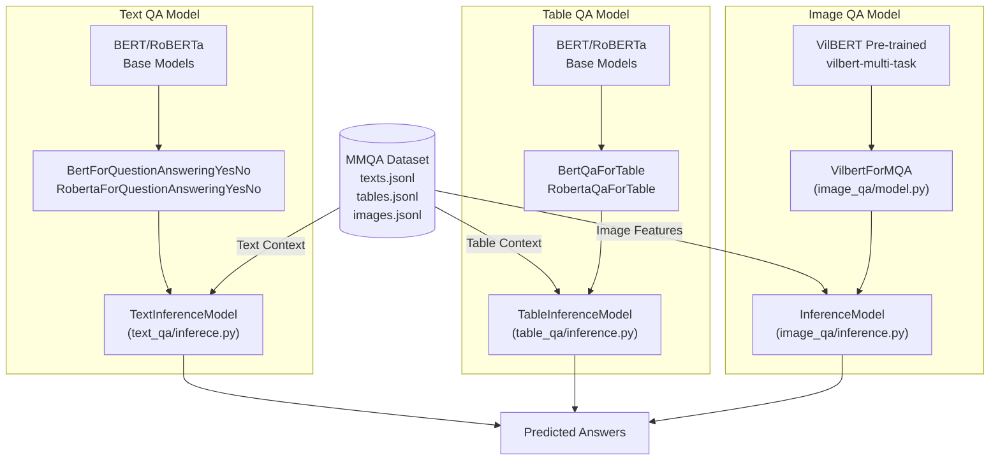
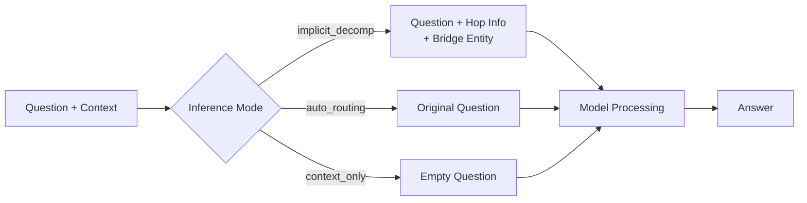
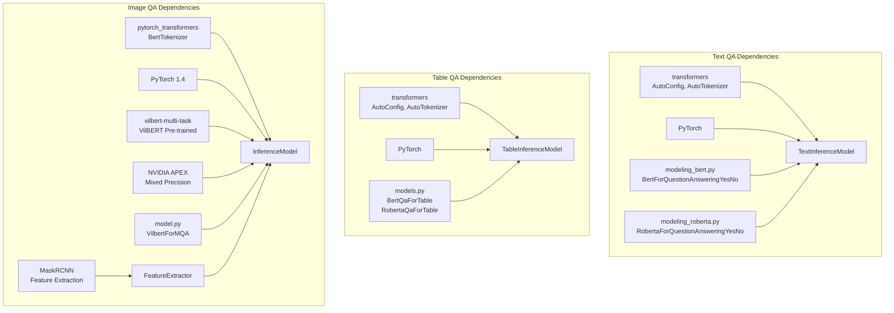

<!-- source: DeepWiki mcp.deepwiki.com · repo allenai/multimodalqa · page 5 Baseline Models · fetched 2026-10-26 -->

# Baseline Models

<details>
<summary>Relevant source files</summary>

The following files were used as context for generating this wiki page:

- [baselines/README.md](baselines/README.md)
- [baselines/image_qa/inference.py](baselines/image_qa/inference.py)
- [baselines/table_qa/inference.py](baselines/table_qa/inference.py)
- [baselines/text_qa/inferece.py](baselines/text_qa/inferece.py)

</details>


## Purpose and Scope

This document provides an overview of the three modality-specific baseline QA models that power the MultiModalQA system. These models handle questions over text, tables, and images respectively, and serve as the core components for answering different types of questions in the pipeline.

For detailed documentation on each specific model, see:
- Image QA Model implementation: [5.1](#5.1)
- Table QA Model implementation: [5.2](#5.2)
- Text QA Model implementation: [5.3](#5.3)

For information about how these models are orchestrated in the inference pipeline, see [6.1](#6.1).

---

## Overview

The MultiModalQA baseline system consists of three independently trained, modality-specific QA models. Each model is responsible for answering questions over a specific type of context (text paragraphs, structured tables, or images), and they can be combined to handle complex multi-hop questions that span multiple modalities.

**Sources:** [baselines/README.md:1-53]()

---

## Model Architecture Overview

The following diagram shows the three baseline models and their underlying architectures:



**Sources:** [baselines/README.md:1-53](), [baselines/text_qa/inferece.py:48-70](), [baselines/table_qa/inference.py:14-32](), [baselines/image_qa/inference.py:161-196]()

---

## Model Implementations and Class Hierarchy

The following table summarizes the key classes for each baseline model:

| Modality | Inference Class | Model Class | Base Architecture | Source File |
|----------|----------------|-------------|-------------------|-------------|
| Text | `TextInferenceModel` | `BertForQuestionAnsweringYesNo`<br/>`RobertaForQuestionAnsweringYesNo` | BERT/RoBERTa | `text_qa/inferece.py:48` |
| Table | `TableInferenceModel` | `BertQaForTable`<br/>`RobertaQaForTable` | BERT/RoBERTa | `table_qa/inference.py:14` |
| Image | `InferenceModel` | `VilbertForMQA` | VilBERT | `image_qa/inference.py:161` |

**Sources:** [baselines/text_qa/inferece.py:48-70](), [baselines/table_qa/inference.py:14-32](), [baselines/image_qa/inference.py:161-196]()

---

## Inference Modes

All three baseline models support three distinct inference modes that control how questions and context are processed:



### Mode Descriptions

| Mode | Question Processing | Use Case | Text QA | Table QA | Image QA |
|------|---------------------|----------|---------|----------|----------|
| `implicit_decomp` | Augments question with hop number and bridge entity | Multi-hop reasoning with explicit decomposition | [text_qa/inferece.py:88-90]() | [table_qa/inference.py:44-47]() | [image_qa/inference.py:165]() |
| `auto_routing` | Uses original question unchanged | Direct routing to final answer modality | [text_qa/inferece.py:66]() | [table_qa/inference.py:30]() | [image_qa/inference.py:165]() |
| `context_only` | Sets question to empty string | Baseline that only uses context without question | [text_qa/inferece.py:91-92]() | [table_qa/inference.py:48-49]() | [image_qa/inference.py:165]() |

**Sources:** [baselines/text_qa/inferece.py:84-93](), [baselines/table_qa/inference.py:33-50](), [baselines/image_qa/inference.py:161-166]()

---

## Model Initialization and Loading

The following diagram shows how each model is initialized and loaded from checkpoints:

```mermaid
graph TD
    subgraph "Text QA Initialization"
        TEXT_DIR["Model Directory<br/>downloads/checkpoints/text_qa_models/"]
        TEXT_DIR --> TEXT_CONFIG["AutoConfig.from_pretrained"]
        TEXT_DIR --> TEXT_TOK["AutoTokenizer.from_pretrained"]
        TEXT_DIR --> TEXT_MODEL_LOAD["Load BertForQuestionAnsweringYesNo<br/>or RobertaForQuestionAnsweringYesNo"]
        TEXT_CONFIG --> TEXT_INST["TextInferenceModel Instance"]
        TEXT_TOK --> TEXT_INST
        TEXT_MODEL_LOAD --> TEXT_INST
    end
    
    subgraph "Table QA Initialization"
        TABLE_DIR["Model Directory<br/>downloads/checkpoints/table_qa_models/"]
        TABLE_DIR --> TABLE_CONFIG["AutoConfig.from_pretrained"]
        TABLE_DIR --> TABLE_TOK["AutoTokenizer.from_pretrained"]
        TABLE_DIR --> TABLE_MODEL_LOAD["Load BertQaForTable<br/>or RobertaQaForTable"]
        TABLE_CONFIG --> TABLE_INST["TableInferenceModel Instance"]
        TABLE_TOK --> TABLE_INST
        TABLE_MODEL_LOAD --> TABLE_INST
    end
    
    subgraph "Image QA Initialization"
        IMAGE_CKPT["Checkpoint Path<br/>downloads/checkpoints/image_qa_models/model.pt"]
        VILBERT_DIR["VilBERT Directory<br/>vilbert-multi-task"]
        VOCAB["Vocab Pickle<br/>vocab.pickle"]
        
        VILBERT_DIR --> IMAGE_CONFIG["get_config"]
        VILBERT_DIR --> IMAGE_BASE["Load multi_task_model.bin"]
        VOCAB --> IMAGE_VOCAB["Load idx2answer, answer2idx"]
        IMAGE_BASE --> IMAGE_MODEL_INIT["Initialize VilbertForMQA"]
        IMAGE_CONFIG --> IMAGE_MODEL_INIT
        IMAGE_VOCAB --> IMAGE_MODEL_INIT
        IMAGE_CKPT --> IMAGE_MODEL_LOAD["Load state_dict"]
        IMAGE_MODEL_INIT --> IMAGE_MODEL_LOAD
        IMAGE_MODEL_LOAD --> IMAGE_INST["InferenceModel Instance"]
    end
```



**Sources:** [baselines/text_qa/inferece.py:48-69](), [baselines/table_qa/inference.py:14-31](), [baselines/image_qa/inference.py:161-196]()

---

## Prediction Interface

Each model provides a `predict()` method with modality-specific parameters:

### Text QA Model

```python
TextInferenceModel.predict(
    args,                    # Configuration arguments
    question,                # Question string
    paragraphs,              # List of text paragraphs
    example_idx=0,           # Example ID
    question_type=None,      # Question type for decomposition
    hop=0,                   # Hop number (0 or 1)
    bridge_entity='',        # Bridge entity for multi-hop
    n_best_num=1             # Number of best predictions
)
```

**Sources:** [baselines/text_qa/inferece.py:84-179]()

### Table QA Model

```python
TableInferenceModel.predict(
    args,                    # Configuration arguments
    question,                # Question string
    table,                   # Table data (dict or JSON string)
    question_type=None,      # Question type for decomposition
    hop=None,                # Hop number
    bridge_entity=None       # Bridge entity for multi-hop
)
```

**Sources:** [baselines/table_qa/inference.py:33-108]()

### Image QA Model

```python
InferenceModel.predict(
    question,                # Question string
    img_ids_or_paths,        # List of image IDs or file paths
    question_type,           # Question type (required)
    bridge_entities=None     # List of bridge entities for multi-hop
)
```

**Sources:** [baselines/image_qa/inference.py:197-232]()

---

## Baseline Performance

The following table shows the performance of each baseline method on the dev set:

| Method | Single-Modality F1/EM | Multi-Modality F1/EM | Overall F1/EM |
|--------|------------------------|----------------------|---------------|
| Context-only | 7.94 / 10.73 | 6.63 / 9.00 | 7.41 / 10.03 |
| AutoRouting | 51.68 / 58.48 | 34.18 / 40.18 | 44.65 / 51.13 |
| ImplicitDecomp | 51.60 / 58.35 | 44.59 / 51.19 | **48.79 / 55.48** |

The `implicit_decomp` method achieves the best overall performance by explicitly modeling multi-hop reasoning with bridge entities. The `context_only` baseline serves as a lower bound, demonstrating that question understanding is critical for good performance.

**Sources:** [baselines/README.md:42-48]()

---

## Model Checkpoint Organization

The baseline models are organized in the following directory structure:

```
downloads/checkpoints/
├── qtype_clf_models/           # Question type classifier models
├── text_qa_models/
│   ├── implicit_decomp/        # Text QA model for implicit_decomp
│   ├── auto_routing/           # Text QA model for auto_routing  
│   └── context_only/           # Text QA model for context_only
├── table_qa_models/
│   ├── implicit_decomp/        # Table QA model for implicit_decomp
│   ├── auto_routing/           # Table QA model for auto_routing
│   └── context_only/           # Table QA model for context_only
└── image_qa_models/
    ├── implicit_decomp/        # Contains model.pt
    ├── auto_routing/           # Contains model.pt
    ├── context_only/           # Contains model.pt
    └── vocab.pickle            # Shared vocabulary for image QA
```

Each method (implicit_decomp, auto_routing, context_only) has separately trained models for each modality, enabling direct comparison of the different reasoning strategies.

**Sources:** [baselines/README.md:12-35]()

---

## Model Dependencies and External Libraries

The following diagram shows the external dependencies required by each model:



**Note:** The image QA model has the most complex dependency requirements, including external repositories for VilBERT, APEX, and MaskRCNN. See [2.1](#2.1) for detailed installation instructions.

**Sources:** [baselines/README.md:4-10](), [baselines/text_qa/inferece.py:1-26](), [baselines/table_qa/inference.py:1-12](), [baselines/image_qa/inference.py:1-18]()

---

## Training and Evaluation

The three baseline models are trained independently. To train new models:

- **Image QA Training:** See [7.1](#7.1) for detailed training instructions using `image_qa/main.py`
- **Text QA Training:** Refer to the README in `text_qa/` directory
- **Table QA Training:** Refer to the README in `table_qa/` directory

For running inference and evaluation on the dev/test sets, see [6](#6).

**Sources:** [baselines/README.md:50-53]()

---

