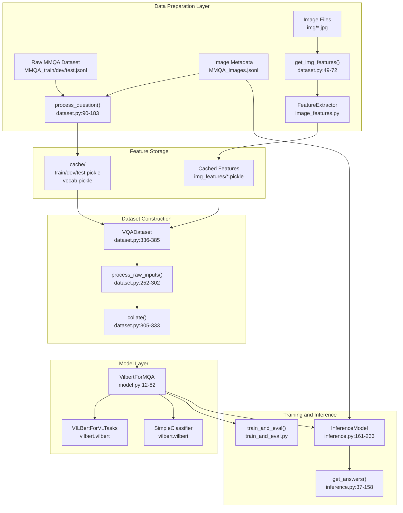
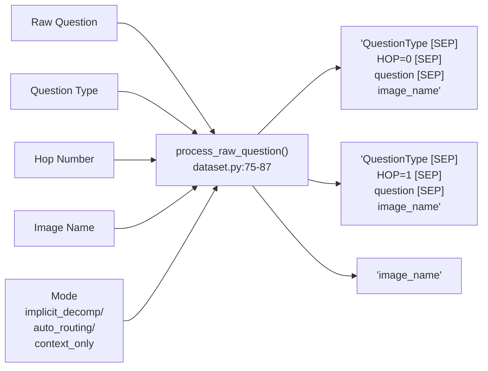
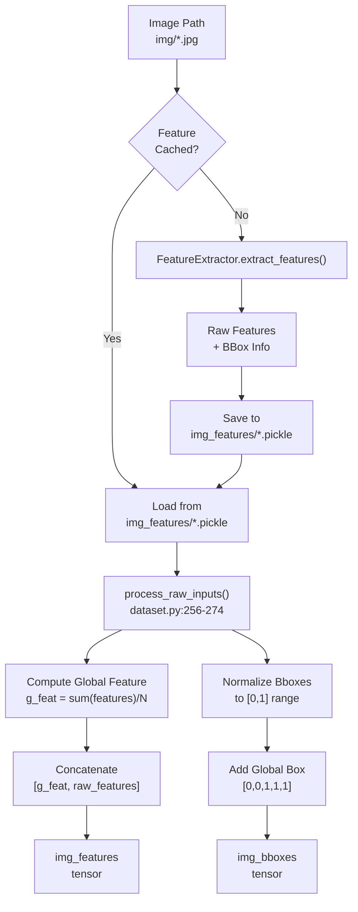
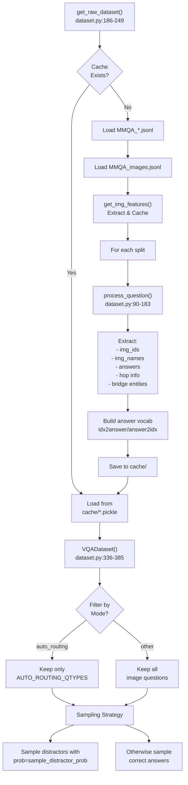

<!-- source: DeepWiki mcp.deepwiki.com · repo allenai/multimodalqa · page 5.1 Image QA Model · fetched 2026-10-26 -->

# Image QA Model

<details>
<summary>Relevant source files</summary>

The following files were used as context for generating this wiki page:

- [baselines/image_qa/README.md](baselines/image_qa/README.md)
- [baselines/image_qa/dataset.py](baselines/image_qa/dataset.py)
- [baselines/image_qa/inference.py](baselines/image_qa/inference.py)
- [baselines/image_qa/main.py](baselines/image_qa/main.py)
- [baselines/image_qa/model.py](baselines/image_qa/model.py)

</details>


## Purpose and Scope

The Image QA Model is a VilBERT-based vision-language model that answers questions about images in the MultiModalQA dataset. This document provides a comprehensive overview of the image QA system, including its architecture, question processing strategies, feature extraction pipeline, and integration with the multi-hop reasoning framework.

For detailed information on specific aspects:
- Dataset preparation and feature extraction: see [Image QA Dataset Preparation](#5.1.1)
- Model architecture details: see [Image QA Model Architecture](#5.1.2)
- Training procedures: see [Image QA Training](#5.1.3)
- Inference implementation: see [Image QA Inference](#5.1.4)

For the table and text QA models, see [Table QA Model](#5.2) and [Text QA Model](#5.3).

**Sources:** [baselines/image_qa/README.md:1-23](), [baselines/image_qa/dataset.py:1-389](), [baselines/image_qa/inference.py:1-253]()

## System Overview

The Image QA Model handles all image-related questions in the MultiModalQA system, including both single-hop questions (e.g., `ImageQ`, `ImageListQ`) and image components of multi-hop questions (e.g., `Compose(ImageQ,TextQ)`, `Intersect(ImageListQ,TextQ)`). The model is built on VilBERT, a pre-trained vision-language model that jointly encodes images and text through co-attention mechanisms.

The system operates in three distinct modes:
- **implicit_decomp**: Performs multi-hop reasoning with explicit bridge entities
- **auto_routing**: Routes directly to the final answer modality without decomposition
- **context_only**: Uses only image context, ignoring the question text

**Sources:** [baselines/image_qa/dataset.py:44-44](), [baselines/image_qa/inference.py:161-166](), [baselines/image_qa/main.py:48-99]()

## Core Components and Architecture



**Diagram: Image QA System Architecture with Code Entities**

**Sources:** [baselines/image_qa/dataset.py:49-249](), [baselines/image_qa/model.py:12-82](), [baselines/image_qa/inference.py:161-233]()

## Question Processing Modes

The image QA system supports three distinct operational modes that determine how questions are processed and how context is used:

| Mode | Question Format | Use Case | Performance |
|------|----------------|----------|-------------|
| `implicit_decomp` | Includes question type, hop number, question text, and image name | Multi-hop reasoning with bridge entities | Best (F1: 48.79) |
| `auto_routing` | Includes question type, hop number, question text, and image name | Direct routing to final modality | Good (F1: 44.65) |
| `context_only` | Only image name, ignores question text | Baseline for context-only predictions | Weak (F1: 7.41) |

The mode is set during dataset construction and affects question formatting through `process_raw_question()`:



**Diagram: Question Processing Mode Flow**

**Sources:** [baselines/image_qa/dataset.py:75-87](), [baselines/image_qa/main.py:225-229]()

## Image Feature Extraction and Caching

Image features are pre-extracted using Detectron-based feature extraction and cached to disk to avoid repeated computation during training and inference. The caching mechanism significantly improves training efficiency.



**Diagram: Image Feature Extraction and Processing Pipeline**

The feature extraction process in `get_img_features()` [baselines/image_qa/dataset.py:49-72]() creates a `FeatureExtractor` instance and processes each image:

1. Checks if features are already cached in `img_features/` directory
2. If not cached, extracts features using Detectron-based feature extractor
3. Saves features as pickle files for future use
4. Returns mapping from image IDs to feature file paths

During data loading, `process_raw_inputs()` [baselines/image_qa/dataset.py:252-302]() loads the cached features and performs additional processing:

1. Computes global image feature by averaging all region features
2. Normalizes bounding boxes to [0,1] range relative to image dimensions
3. Adds area information as the 5th coordinate
4. Prepends global feature and global bounding box [0,0,1,1,1]

**Sources:** [baselines/image_qa/dataset.py:49-72](), [baselines/image_qa/dataset.py:256-274](), [baselines/image_qa/image_features.py]()

## Answer Type Handling

The image QA model handles three distinct answer types, each requiring different prediction strategies:

### Vocabulary-Based Answers

For question types `ImageQ`, `Compose(ImageQ,TextQ)`, and `Compose(ImageQ,TableQ)`, answers are drawn from a fixed vocabulary. The model predicts the specific answer string (e.g., "eagle", "red", "3").

**Processing Logic:**
- During training: One image contains the correct answer, others marked as `<DISTRACTOR>`
- During inference: Model identifies the image least likely to be a distractor, then selects the highest-scoring answer from the vocabulary (excluding special tokens)

### Binary Image Selection

For question types like `ImageListQ` and `Compare(Compose(TableQ,ImageQ),TableQ)`, answers indicate whether each image is relevant (`<IS_ANSWER>`) or not (`<IS_NOT_ANSWER>`).

**Processing Logic:**
- During training: Each image labeled with appropriate binary token
- During inference: Compare logits for `<IS_ANSWER>` vs `<IS_NOT_ANSWER>` for each image

### Multi-Answer Selection

For question types like `Intersect(ImageListQ,TextQ)`, multiple images may be correct answers.

**Processing Logic:**
- Model assigns binary labels to all candidate images
- Returns all images where `logit[IS_ANSWER] > logit[IS_NOT_ANSWER]`

The logic is implemented in `get_answers()` [baselines/image_qa/inference.py:37-158]():

**Sources:** [baselines/image_qa/dataset.py:35-43](), [baselines/image_qa/inference.py:37-158](), [baselines/image_qa/dataset.py:98-154]()

## Dataset Construction Pipeline



**Diagram: Dataset Construction and Caching Flow**

The `process_question()` function [baselines/image_qa/dataset.py:90-183]() extracts structured information from raw data:

1. Identifies image IDs from metadata
2. Determines question type and hop number
3. For questions with answers:
   - For vocab-based questions: Creates answer list with distractors
   - For binary questions: Creates binary labels (`IS_ANSWER`/`IS_NOT_ANSWER`)
4. Extracts bridge entities for multi-hop questions
5. Returns structured dict with all necessary fields

The `VQADataset` class [baselines/image_qa/dataset.py:336-385]() handles sampling during training:

- In `auto_routing` mode: Filters to keep only `AUTO_ROUTING_QTYPES`
- In other modes: Keeps all image-related questions
- Sampling strategy: With probability `sample_distractor_prob`, samples a distractor image; otherwise samples a correct answer image
- This encourages the model to learn both positive and negative examples

**Sources:** [baselines/image_qa/dataset.py:186-249](), [baselines/image_qa/dataset.py:90-183](), [baselines/image_qa/dataset.py:336-385]()

## Multi-Hop Question Handling

The image QA model supports multi-hop questions where images serve as the second hop after text or table reasoning. The system identifies these questions and processes bridge entities accordingly.

**Question Types with Image as Second Hop:**
- `Compose(ImageQ,TableQ)`: Table → Image
- `Compose(ImageQ,TextQ)`: Text → Image  
- `Intersect(ImageListQ,TextQ)`: Text → ImageList

The hop detection logic [baselines/image_qa/dataset.py:156-171]():

```python
if question_type in IMAGE_AS_SECOND_HOP_QUESTION_TYPES:
    hop = 1
    # Extract golden bridge entities from supporting context
    if question_type in ['Compose(ImageQ,TableQ)', 'Compose(ImageQ,TextQ)']:
        golden_bridge_entities = [img_ids[0]]
    elif question_type in ['Intersect(ImageListQ,TextQ)']:
        golden_bridge_entities = [doc['doc_id'] for doc in supporting_context if doc['doc_part'] == 'image']
        golden_bridge_entities = [image_docs[img_id]['title'] for img_id in golden_bridge_entities]
else:
    hop = 0
    golden_bridge_entities = []
```

During inference [baselines/image_qa/inference.py:59-62](), bridge entities filter which images to consider:

```python
if question_type in IMAGE_AS_SECOND_HOP_QUESTION_TYPES and mode not in ['auto_routing', 'context_only']:
    assert bridge_entities is not None
    bad_indexes = [idx for idx, img_name in enumerate(img_names) if img_name not in bridge_entities]
```

This ensures the model only evaluates images that match the bridge entities predicted by the first-hop model, maintaining the multi-hop reasoning chain.

**Sources:** [baselines/image_qa/dataset.py:156-171](), [baselines/image_qa/inference.py:37-62](), [baselines/common_utils.py]()

## Distractor Handling

Distractor images are irrelevant images included in the context to test the model's ability to identify the correct image among multiple candidates. The system provides flexible distractor handling:

**During Training:**
- Dataset samples distractors with probability `sample_distractor_prob` (default: 0.3)
- Distractor images labeled with special token `<DISTRACTOR>`
- Ensures model learns to distinguish relevant from irrelevant images

**During Inference:**

The `use_distractors` parameter in `InferenceModel` [baselines/image_qa/inference.py:161-166]() controls behavior:

| `use_distractors` | Behavior | Use Case |
|-------------------|----------|----------|
| `True` | Evaluates all images including distractors | Full evaluation matching training conditions |
| `False` | Filters out distractor images before evaluation | Testing with only relevant images |

For vocab-based questions with distractors, the prediction logic [baselines/image_qa/inference.py:128-138]():

1. Computes probability of each image being a distractor
2. Selects image with minimum distractor probability
3. From that image, selects highest-scoring answer (excluding special tokens)

This two-stage process ensures the model first identifies the relevant image, then extracts the answer from it.

**Sources:** [baselines/image_qa/dataset.py:31-43](), [baselines/image_qa/dataset.py:337-379](), [baselines/image_qa/inference.py:37-158]()

## Key Constants and Special Tokens

The image QA system uses several special tokens and predefined question type sets:

```python
# Special Tokens (dataset.py:31-33)
DISTRACTOR_TOK = '<DISTRACTOR>'
IS_ANSWER_TOK = '<IS_ANSWER>'
IS_NOT_ANSWER_TOK = '<IS_NOT_ANSWER>'

# Question Type Categories (dataset.py:35-44)
QUESTION_TYPES_WITH_SINGLE_CORRECT_ANS = [
    'Compare(Compose(TableQ,ImageQ),Compose(TableQ,TextQ))',
    'Compare(Compose(TableQ,ImageQ),TableQ)'
]

QUESTIONS_WITH_VOCAB_ANSWERS = [
    'Compose(ImageQ,TextQ)',
    'ImageQ',
    'Compose(ImageQ,TableQ)'
]

AUTO_ROUTING_QTYPES = IMAGE_SINGLE_HOP_QUESTION_TYPES + IMAGE_AS_SECOND_HOP_QUESTION_TYPES
```

These constants determine:
- How answers are formatted during dataset construction
- Which prediction strategy to use during inference
- Which questions to include in each training mode

**Sources:** [baselines/image_qa/dataset.py:31-44](), [baselines/common_utils.py]()

## Integration with Pipeline

The image QA model integrates with the overall MultiModalQA pipeline through the `InferenceModel` class [baselines/image_qa/inference.py:161-233]():

**Initialization:**
```python
model = InferenceModel(
    checkpoint_path,      # Path to trained model weights
    vilbert_dir,          # Directory with VilBERT config and pretrained weights
    img_info_path,        # Path to MMQA_images.jsonl
    vocab_path,           # Path to cached vocab (idx2answer/answer2idx)
    device,               # PyTorch device
    mode,                 # One of: implicit_decomp, auto_routing, context_only
    img_features_dir,     # Directory with cached image features
    use_distractors       # Whether to use distractor images
)
```

**Prediction Interface:**
```python
predictions = model.predict(
    question,             # Question text
    img_ids_or_paths,     # List of image IDs or paths
    question_type,        # Question type string
    bridge_entities       # Optional: bridge entities for multi-hop (list)
)
```

The predict method:
1. Loads image features (from cache or extracts on-the-fly)
2. Formats question according to mode
3. Processes all candidate images through the model
4. Applies appropriate prediction strategy based on question type
5. Returns list of predicted answers

**Sources:** [baselines/image_qa/inference.py:161-233](), [baselines/image_qa/inference.py:197-232]()

## File Structure Summary

| File | Purpose | Key Components |
|------|---------|----------------|
| `dataset.py` | Dataset preparation and loading | `get_raw_dataset()`, `process_question()`, `VQADataset`, `process_raw_inputs()`, `collate()` |
| `inference.py` | Inference implementation | `InferenceModel`, `get_answers()`, prediction logic for different question types |
| `model.py` | Model architecture | `VilbertForMQA`, `get_config()`, freeze/unfreeze methods |
| `main.py` | Training orchestration | `parse_args()`, `analyse()`, training loop execution |
| `train_and_eval.py` | Training procedures | `train_and_eval()`, optimizer setup, two-stage training |
| `image_features.py` | Feature extraction | `FeatureExtractor`, Detectron integration |

**Sources:** [baselines/image_qa/dataset.py:1-389](), [baselines/image_qa/inference.py:1-253](), [baselines/image_qa/model.py:1-128](), [baselines/image_qa/main.py:1-278]()

---

