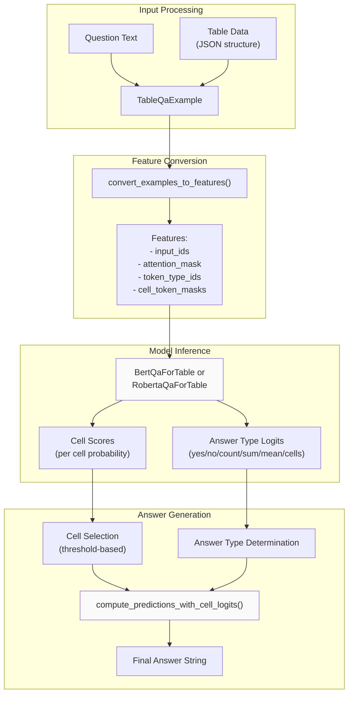
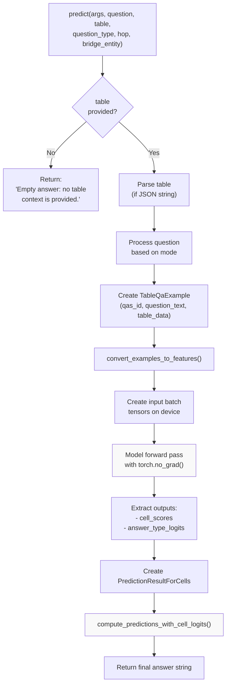
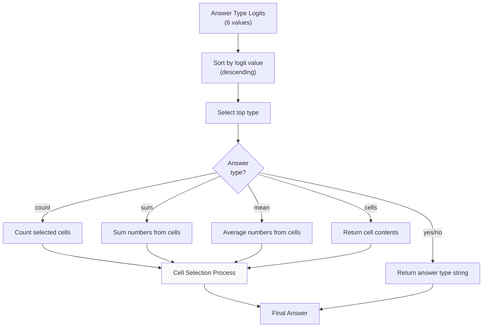
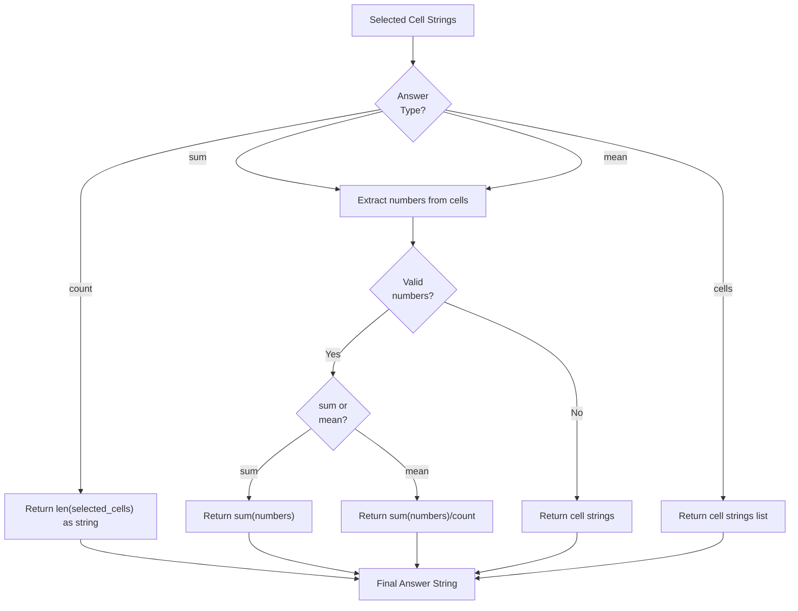

<!-- source: DeepWiki mcp.deepwiki.com · repo allenai/multimodalqa · page 5.2 Table QA Model · fetched 2026-10-26 -->

# Table QA Model

<details>
<summary>Relevant source files</summary>

The following files were used as context for generating this wiki page:

- [baselines/table_qa/inference.py](baselines/table_qa/inference.py)
- [baselines/table_qa/table_qa_utils.py](baselines/table_qa/table_qa_utils.py)

</details>


## Purpose and Scope

This document describes the **Table QA Model**, a BERT/RoBERTa-based baseline model that answers questions over structured tabular data. The model is designed to select relevant cells from tables and determine the appropriate answer type (span selection, counting, aggregation, or yes/no classification).

For information about the Image QA model, see [Image QA Model](#5.1). For Text QA model details, see [Text QA Model](#5.3). For the complete inference pipeline that orchestrates these models, see [Pipeline Implementation](#6.1).

## Model Architecture Overview

The Table QA model is built on pre-trained transformer models (BERT or RoBERTa) fine-tuned for table-based question answering. Unlike span-based QA models that predict start/end positions, this model:

1. **Assigns scores to individual table cells** - Each cell receives a probability score indicating its relevance to the answer
2. **Predicts answer type** - Classifies the answer into one of several types: cell selection, count, sum, mean, yes, or no
3. **Computes the final answer** - Based on the answer type and selected cells, produces the final answer string



**Diagram: Table QA Prediction Pipeline**

Sources: [baselines/table_qa/inference.py:33-108](), [baselines/table_qa/table_qa_utils.py:17-104]()

## TableInferenceModel Class

The `TableInferenceModel` class in [baselines/table_qa/inference.py:14-108]() provides the main interface for table-based question answering.

### Initialization

```python
TableInferenceModel(model_dir, device=None, mode="base")
```

**Parameters:**
- `model_dir`: Directory containing the pre-trained model checkpoint
- `device`: PyTorch device (defaults to CPU if not specified)
- `mode`: Operational mode - must be one of `'base'`, `'implicit_decomp'`, or `'context_only'`

The initialization [baselines/table_qa/inference.py:15-31]():
1. Loads model configuration using `AutoConfig`
2. Loads tokenizer using `AutoTokenizer`
3. Instantiates the appropriate model (`BertQaForTable` or `RobertaQaForTable`) based on model type
4. Moves model to specified device and sets to evaluation mode

Sources: [baselines/table_qa/inference.py:14-31]()

### Operational Modes

The model supports three distinct operational modes that modify how questions are processed:

| Mode | Description | Question Processing |
|------|-------------|---------------------|
| `base` | Standard question answering | Question text used as-is |
| `implicit_decomp` | Multi-hop reasoning with bridge entities | Prepends hop information and bridge entity to question using `process_question_for_implicit_decomp()` |
| `context_only` | Context-based answering only | Question text replaced with empty string |

**Mode Selection Logic** [baselines/table_qa/inference.py:44-49]():
```python
if self.mode == "implicit_decomp":
    question = process_question_for_implicit_decomp(
        question, question_type, hop, bridge_entity, sep_token=self.tokenizer.sep_token
    )
elif self.mode == "context_only":
    question = ""
```

The `implicit_decomp` mode is critical for multi-hop reasoning (see [Inference Methods](#4.2)), where the model needs to answer follow-up questions conditioned on bridge entities extracted from previous hops.

Sources: [baselines/table_qa/inference.py:30-49]()

## Prediction Pipeline

The `predict()` method [baselines/table_qa/inference.py:33-108]() orchestrates the complete prediction process:



**Diagram: predict() Method Flow**

### Key Steps

**1. Input Validation and Parsing** [baselines/table_qa/inference.py:34-42]()
- Checks if table context is provided
- Parses table from JSON string if necessary
- Returns error message if parsing fails

**2. Question Processing** [baselines/table_qa/inference.py:44-49]()
- Applies mode-specific transformations to the question
- For `implicit_decomp`: adds hop and bridge entity information
- For `context_only`: replaces question with empty string

**3. Feature Conversion** [baselines/table_qa/inference.py:51-61]()
- Creates `TableQaExample` with unique ID, question, and table data
- Converts example to features using `convert_examples_to_features()`
- Key parameters:
  - `max_seq_length`: Maximum input length (default: 384)
  - `doc_stride`: Stride for splitting long documents (default: 128)
  - `max_query_length`: Maximum question length (default: 64)

**4. Model Inference** [baselines/table_qa/inference.py:63-82]()
- Prepares input tensors: `input_ids`, `attention_mask`, `token_type_ids`, `cell_token_masks`
- Removes `token_type_ids` for models that don't use them (RoBERTa, XLM, etc.)
- Executes forward pass within `torch.no_grad()` context

**5. Output Processing** [baselines/table_qa/inference.py:84-99]()
- Extracts cell scores and answer type logits from model outputs
- Truncates cell scores to match the number of valid cell spans
- Creates `PredictionResultForCells` objects

**6. Final Answer Computation** [baselines/table_qa/inference.py:101-108]()
- Calls `compute_predictions_with_cell_logits()` to generate final answer
- Returns answer string indexed by question ID

Sources: [baselines/table_qa/inference.py:33-108]()

## Answer Type Prediction

The model predicts one of several answer types based on the nature of the question and expected answer format. The answer type determines how the final answer is computed from selected cells.

### Answer Type Categories

The model supports the following answer types defined in `ans_type2id_map` [baselines/table_qa/data_reader.py]():

| Answer Type | ID | Description | Example |
|-------------|----|-----------| ---------|
| `yes` | 0 | Boolean affirmative | "yes" |
| `no` | 1 | Boolean negative | "no" |
| `count` | 2 | Count of selected cells | "3" |
| `sum` | 3 | Sum of numeric values | "125.5" |
| `mean` | 4 | Average of numeric values | "41.83" |
| `cells` | 5 | Direct cell content(s) | ["New York", "Boston"] |

### Answer Type Selection Logic

The `compute_predictions_with_cell_logits()` function [baselines/table_qa/table_qa_utils.py:17-104]() determines the answer type:



**Diagram: Answer Type Determination and Processing**

**Implementation Details** [baselines/table_qa/table_qa_utils.py:43-54]():
1. Collects answer type logits from all features
2. Sorts by logit value (highest first)
3. Selects the type with the highest score as `pred_ans_type`
4. For `yes`/`no` types, returns the type string directly
5. For other types, proceeds to cell selection and aggregation

Sources: [baselines/table_qa/table_qa_utils.py:43-54]()

## Cell Selection and Answer Computation

For non-boolean answer types, the model must select relevant cells from the table and compute the final answer based on the answer type.

### Cell Selection Process

**Cell Score Collection** [baselines/table_qa/table_qa_utils.py:56-66]():
- Iterates through all features and collects cell scores
- Maps feature cell indices to original table positions using `feature.cell_to_orig_pos_map`
- Skips invalid positions (marked as `(-1, -1)`)
- Associates each cell string with its probability score

**Threshold-Based Selection** [baselines/table_qa/table_qa_utils.py:69-73]():
```python
selected_cell_strings = \
    [cell_string for cell_string, prob in cell_string_and_probs 
     if prob >= cell_selection_thresh]
if not selected_cell_strings:
    cell_string_and_probs.sort(key=lambda x: x[1], reverse=True)
    selected_cell_strings = [cell_string_and_probs[0][0]]
```

- Default threshold: `cell_selection_thresh = 0.5`
- Fallback: If no cells meet threshold, select the single highest-scoring cell

Sources: [baselines/table_qa/table_qa_utils.py:56-73]()

### Answer Computation by Type

The final answer computation depends on the predicted answer type:



**Diagram: Answer Computation Logic by Type**

**Count Answer** [baselines/table_qa/table_qa_utils.py:75-76]():
```python
if pred_ans_type == "count":
    final_answer = str(len(selected_cell_strings))
```
Simply counts the number of selected cells.

**Sum/Mean Answers** [baselines/table_qa/table_qa_utils.py:77-87]():
1. Extracts numbers from each selected cell using `extract_numbers_from_str()` from [common_utils.py]()
2. Keeps only cells containing exactly one number
3. Computes sum or mean of the extracted numbers
4. Fallback: If no valid numbers found, returns cell strings

**Cell Content Answers** [baselines/table_qa/table_qa_utils.py:88-89]():
Returns the list of selected cell strings directly.

Sources: [baselines/table_qa/table_qa_utils.py:75-90]()

## Model Variants

The system supports two transformer architectures:

| Model Type | Class Name | Token Type IDs |
|------------|-----------|----------------|
| BERT | `BertQaForTable` | Required |
| RoBERTa | `RobertaQaForTable` | Not used |

**Model Selection Logic** [baselines/table_qa/inference.py:18-23]():
```python
if self.config.model_type == "bert":
    self.model = BertForQuestionAnswering.from_pretrained(model_dir)
elif self.config.model_type == "roberta":
    self.model = RobertaForQuestionAnswering.from_pretrained(model_dir)
else:
    raise ValueError(f"Unsupported model type: {self.config.model_type}")
```

Both models are imported from [baselines/table_qa/models.py]() and fine-tuned specifically for table QA with cell-level scoring capabilities.

Sources: [baselines/table_qa/inference.py:6-8, 18-23]()

## Command-Line Interface

The module provides a standalone inference script [baselines/table_qa/inference.py:111-156]() for testing the model:

### Arguments

| Argument | Default | Description |
|----------|---------|-------------|
| `--model_dir` | Required | Directory with model checkpoints |
| `--input` | Required | Input JSONL file with questions and tables |
| `--do_lower_case` | True | Whether to lowercase input text |
| `--max_seq_length` | 384 | Maximum total input sequence length |
| `--doc_stride` | 128 | Stride for splitting long documents |
| `--max_query_length` | 64 | Maximum question length in tokens |
| `--max_answer_length` | 30 | Maximum answer length |
| `--no_cuda` | False | Disable CUDA usage |

### Usage Example

```bash
python baselines/table_qa/inference.py \
    --model_dir downloads/checkpoints/table_qa_models/implicit_decomp \
    --input MMQA_dev.jsonl \
    --max_seq_length 384
```

The script [baselines/table_qa/inference.py:137-152]():
1. Loads the model from the specified directory
2. Reads examples from the input JSONL file
3. Extracts table data from `context.documents[0].table`
4. For each question, predicts an answer
5. Prints predicted and ground truth answers for comparison

Sources: [baselines/table_qa/inference.py:111-156]()

## Integration with Pipeline

The Table QA model is integrated into the complete inference pipeline [pipeline.py]() as one of three modality-specific models. The pipeline:

1. Uses the question type classifier to determine routing
2. For table-related questions (`TableQ` or multi-hop with table modality), invokes `TableInferenceModel.predict()`
3. Passes the appropriate mode (`implicit_decomp`, `auto_routing`, or `context_only`)
4. For multi-hop questions, provides bridge entities extracted from the first hop

For details on how the pipeline orchestrates table QA with other models, see [Pipeline Implementation](#6.1).

## Prediction Output Format

### PredictionResultForCells

The intermediate prediction result [baselines/table_qa/table_qa_utils.py:10-14]() contains:

```python
class PredictionResultForCells:
    unique_id          # Feature unique identifier
    cell_scores        # List of probabilities (one per cell)
    answer_type_logits # List of 6 logits (one per answer type)
```

### Final Prediction Dictionary

The `compute_predictions_with_cell_logits()` function returns an `OrderedDict` mapping question IDs to final answers [baselines/table_qa/table_qa_utils.py:93-94]():
- Key: `qas_id` (question identifier)
- Value: Final answer (string or list of strings)

### Detailed Prediction Information

When an output file is specified, the function also writes a `.info.json` file [baselines/table_qa/table_qa_utils.py:100-102]() containing:
- `answer_type_preds`: Sorted list of (answer_type, logit) tuples
- `cell_probs`: Sorted list of (cell_string, probability) tuples
- `final_answer`: The computed final answer

This detailed information is useful for debugging and analysis of model behavior.

Sources: [baselines/table_qa/table_qa_utils.py:10-14, 36-102]()

## Key Design Decisions

### Cell-Level Scoring vs. Span Prediction

Unlike standard extractive QA models that predict start/end token positions, the Table QA model assigns scores to entire table cells. This design choice:
- Better handles structured tabular data where answers often correspond to complete cells
- Enables aggregation operations (count, sum, mean) over multiple cells
- Simplifies handling of multi-cell answers (e.g., lists)

### Multiple Answer Types

Supporting multiple answer types (yes/no, count, aggregation, cells) allows the model to handle diverse question types that require different answer formats. This is particularly important for questions like:
- "How many countries are listed?" → count
- "What is the total population?" → sum
- "What cities are in the table?" → cells
- "Is the capital Rome?" → yes/no

### Threshold-Based Cell Selection

The use of a probability threshold (`cell_selection_thresh = 0.5`) with a fallback to the top cell ensures the model always produces an answer while allowing multiple cells when appropriate. This approach balances precision and recall.

Sources: [baselines/table_qa/table_qa_utils.py:22, 69-73]()

---

