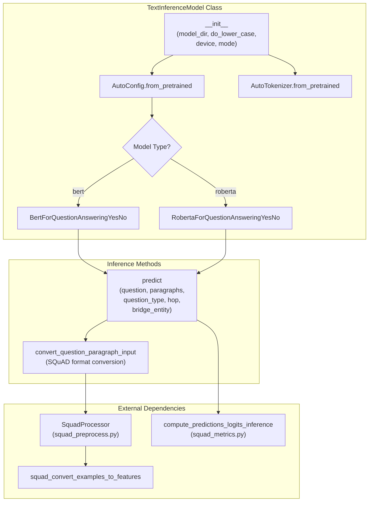
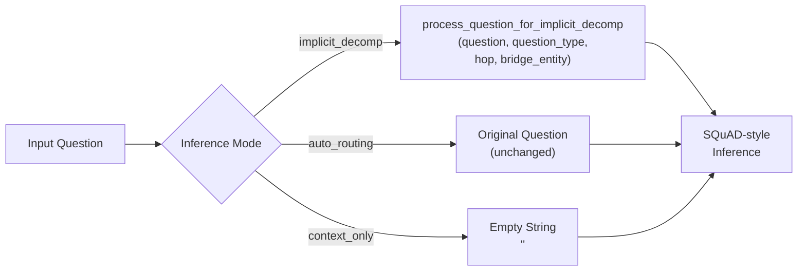
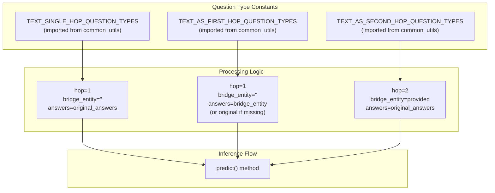
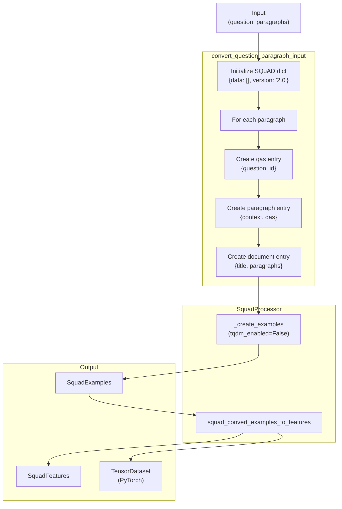
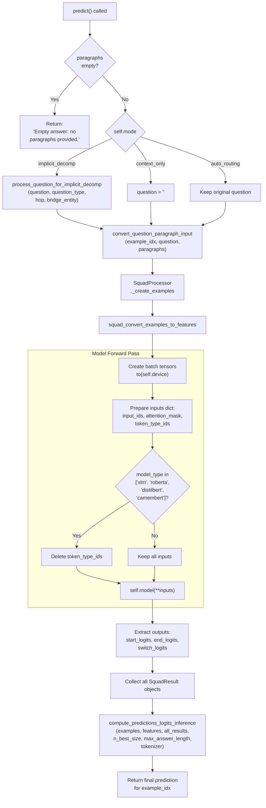
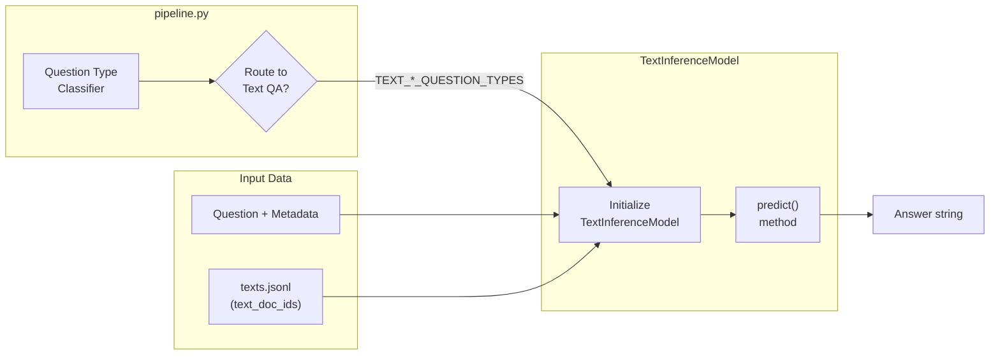

<!-- source: DeepWiki mcp.deepwiki.com · repo allenai/multimodalqa · page 5.3 Text QA Model · fetched 2026-10-26 -->

# Text QA Model

<details>
<summary>Relevant source files</summary>

The following files were used as context for generating this wiki page:

- [baselines/text_qa/inferece.py](baselines/text_qa/inferece.py)

</details>


## Purpose and Scope

This document describes the text-based question answering model used in the MultiModalQA system. The Text QA Model is a BERT/RoBERTa-based extractive QA system that answers questions by identifying relevant spans within text paragraphs. It handles single-hop text questions and serves as both the first and second hop in multi-hop text reasoning chains.

For documentation on table-based QA, see [Table QA Model](#5.2). For image-based QA, see [Image QA Model](#5.1). For information on how these models are orchestrated in the inference pipeline, see [Pipeline Implementation](#6.1).

---

## Model Architecture

The Text QA Model is implemented in the `TextInferenceModel` class, which wraps pre-trained BERT or RoBERTa models fine-tuned for extractive question answering with yes/no support.

### Core Components



**Sources:** [baselines/text_qa/inferece.py:48-69]()

The model supports two architectures:
- **BertForQuestionAnsweringYesNo**: BERT variant with yes/no classification capability
- **RobertaForQuestionAnsweringYesNo**: RoBERTa variant with yes/no classification capability

Both architectures extend standard question answering models to output three types of logits:
1. `start_logits`: probability distribution over start positions
2. `end_logits`: probability distribution over end positions  
3. `switch_logits`: yes/no classification logits (referred to as "switch" in the code)

**Sources:** [baselines/text_qa/inferece.py:13-14, 54-62]()

---

## Inference Modes

The Text QA Model operates in three distinct modes that control how questions are processed:

| Mode | Question Processing | Use Case |
|------|---------------------|----------|
| `implicit_decomp` | Applies `process_question_for_implicit_decomp` with question_type, hop, and bridge_entity | Multi-hop reasoning with explicit decomposition |
| `auto_routing` | Uses original question unchanged | Direct single-hop answering |
| `context_only` | Sets question to empty string | Baseline that relies only on context |



**Sources:** [baselines/text_qa/inferece.py:88-92]()

The mode is specified during model initialization and determines the behavior throughout the inference lifecycle. The `implicit_decomp` mode enables the model to handle multi-hop questions by reformulating them based on hop position and bridge entities extracted from previous reasoning steps.

---

## Question Type Handling

The Text QA Model handles three categories of question types based on their position in the reasoning chain:

### Question Type Categories



**Sources:** [baselines/text_qa/inferece.py:1, 199-209]()

### Hop-Based Processing

| Question Type | Hop Number | Bridge Entity | Expected Output |
|---------------|------------|---------------|-----------------|
| TEXT_SINGLE_HOP | 1 | Empty | Final answer |
| TEXT_AS_FIRST_HOP | 1 | Empty | Bridge entity for next hop |
| TEXT_AS_SECOND_HOP | 2 | Provided from first hop | Final answer |

The `load_input_examples` function [baselines/text_qa/inferece.py:182-212]() parses the input data and categorizes each question according to these types, extracting the appropriate metadata for downstream processing.

---

## Data Processing Pipeline

The Text QA Model transforms input questions and paragraphs into SQuAD-format data structures for standardized processing.

### Format Conversion



**Sources:** [baselines/text_qa/inferece.py:71-108]()

The `convert_question_paragraph_input` method [baselines/text_qa/inferece.py:71-82]() creates a data structure compatible with SQuAD v2.0 format:

```python
# Structure created by convert_question_paragraph_input
{
    'version': '2.0',
    'data': [
        {
            'title': 'dummy_title',
            'paragraphs': [
                {
                    'context': paragraph_text,
                    'qas': [
                        {
                            'question': question_text,
                            'id': example_id
                        }
                    ]
                }
            ]
        }
    ]
}
```

### Tokenization Parameters

The conversion to features uses the following parameters:

| Parameter | Default | Purpose |
|-----------|---------|---------|
| `max_seq_length` | 384 | Maximum total input length after tokenization |
| `doc_stride` | 128 | Stride for sliding window when splitting long documents |
| `max_query_length` | 64 | Maximum tokens for the question |
| `is_training` | False | Inference mode (no labels) |
| `return_dataset` | "pt" | Return PyTorch tensors |

**Sources:** [baselines/text_qa/inferece.py:99-107, 222-229]()

---

## Prediction Workflow

The `predict` method orchestrates the complete inference pipeline from question to answer.

### Inference Pipeline



**Sources:** [baselines/text_qa/inferece.py:84-179]()

### Model Output Processing

The model forward pass produces outputs that are processed differently depending on the model architecture:

**Standard Models (BERT, RoBERTa):**
```
outputs = (start_logits, end_logits, switch_logits)
```

**Advanced Models (XLNet, XLM):**
```
outputs = (start_logits, start_top_index, end_logits, switch_logits, 
           end_top_index, cls_logits)
```

**Sources:** [baselines/text_qa/inferece.py:126-159]()

The outputs are converted to `SquadResult` objects [baselines/text_qa/inferece.py:29-30, 144-158]() which contain:
- `unique_id`: identifies the feature
- `start_logits`: span start probabilities
- `end_logits`: span end probabilities  
- `switch_logits`: yes/no classification logits

These results are passed to `compute_predictions_logits_inference` [baselines/text_qa/inferece.py:162-175]() which:
1. Selects top-k span predictions
2. Filters by answer length constraints
3. Normalizes text according to tokenization
4. Returns the highest-scoring prediction

---

## Configuration and Hyperparameters

### Model Initialization Parameters

| Parameter | Type | Purpose |
|-----------|------|---------|
| `model_dir` | str | Path to pre-trained model checkpoint |
| `do_lower_case` | bool | Whether to lowercase input (True for uncased models) |
| `device` | torch.device | CPU or CUDA device for inference |
| `mode` | str | One of: implicit_decomp, auto_routing, context_only |

**Sources:** [baselines/text_qa/inferece.py:48-69]()

### Inference Parameters

The following parameters control the inference behavior:

```python
# Default values from argument parser
max_seq_length = 384       # Maximum input length
doc_stride = 128           # Sliding window stride
max_query_length = 64      # Maximum question length
n_best_size = 20          # Number of candidate predictions
max_answer_length = 30     # Maximum answer span length
eval_batch_size = 8       # Batch size (not used in TextInferenceModel)
```

**Sources:** [baselines/text_qa/inferece.py:222-237]()

These parameters balance between:
- **Accuracy**: Longer sequences and more candidates improve coverage
- **Efficiency**: Shorter sequences and fewer candidates reduce computation
- **Applicability**: Answer length limits prevent unreasonable spans

The `doc_stride` parameter is particularly important for handling long documents. When a document exceeds `max_seq_length`, it's split into overlapping chunks with stride `doc_stride`, ensuring that potential answer spans near chunk boundaries aren't missed.

---

## Integration with Pipeline

The Text QA Model is instantiated and called by the main inference pipeline [pipeline.py]() based on question type routing.

### Integration Points



The pipeline calls the Text QA Model when:
1. Question type is in `TEXT_SINGLE_HOP_QUESTION_TYPES`
2. First hop modality is text (`TEXT_AS_FIRST_HOP_QUESTION_TYPES`)
3. Second hop modality is text (`TEXT_AS_SECOND_HOP_QUESTION_TYPES`)

**Sources:** [baselines/text_qa/inferece.py:1, 199-211]()

### Multi-Hop Example Flow

For a two-hop question requiring text reasoning at both hops:

1. **First Hop**: Question type classified as `TEXT_AS_FIRST_HOP_*`
   - `predict()` called with `hop=0`, `bridge_entity=''`
   - Returns bridge entity (intermediate answer)

2. **Second Hop**: Question type indicates `TEXT_AS_SECOND_HOP_*`
   - `predict()` called with `hop=1`, `bridge_entity=<first_hop_result>`
   - Question reformulated by `process_question_for_implicit_decomp`
   - Returns final answer

**Sources:** [baselines/text_qa/inferece.py:203-209]()

---

## Standalone Usage

The module can be run standalone for batch inference using the command-line interface.

### Command-Line Interface

```bash
python baselines/text_qa/inferece.py \
    --input_file <path/to/input.jsonl> \
    --reader_path <path/to/model/checkpoint> \
    --model_type bert \
    --mode implicit_decomp \
    --do_lower_case \
    --max_seq_length 384 \
    --doc_stride 128 \
    --max_query_length 64 \
    --n_best_size 20 \
    --max_answer_length 30
```

### Input Format

The `load_input_examples` function [baselines/text_qa/inferece.py:182-212]() expects JSONL input with the following structure:

```json
{
  "context": {
    "documents": [
      {"id": "doc_id", "text": "paragraph content"}
    ]
  },
  "qas": [
    {
      "qid": "unique_question_id",
      "question": "What is the answer?",
      "answers": ["answer1", "answer2"],
      "metadata": {
        "type": "Compose(Text,Text)",
        "text_doc_ids": ["doc_id1", "doc_id2"],
        "bridge_entity": "intermediate entity"
      }
    }
  ]
}
```

### Output Format

Predictions are saved to `reader_predicted_results.json` as a dictionary mapping question IDs to predicted answers:

```json
{
  "q_id_1": "predicted answer text",
  "q_id_2": "another answer",
  ...
}
```

**Sources:** [baselines/text_qa/inferece.py:278-297]()

---

## Error Handling

The model includes basic validation:

1. **Empty Paragraphs**: Returns `"Empty answer: no paragraphs are provided."` if the input paragraph list is empty [baselines/text_qa/inferece.py:85-86]()

2. **Unsupported Model Type**: Raises `ValueError` if the config specifies a model type other than "bert" or "roberta" [baselines/text_qa/inferece.py:60-62]()

3. **Skipped Questions**: Questions not matching any of the three question type categories are skipped with a printed warning [baselines/text_qa/inferece.py:211]()

---

## Model Dependencies

The Text QA Model relies on several external modules:

| Module | Purpose | Source |
|--------|---------|--------|
| `transformers` | BERT/RoBERTa models, tokenizers, optimizers | HuggingFace |
| `modeling_bert.BertForQuestionAnsweringYesNo` | Custom BERT variant | Local implementation |
| `modeling_roberta.RobertaForQuestionAnsweringYesNo` | Custom RoBERTa variant | Local implementation |
| `squad_preprocess` | SQuAD data processing utilities | Local module |
| `squad_metrics` | Answer extraction from logits | Local module |
| `common_utils` | Question type constants and processing | Local module |

**Sources:** [baselines/text_qa/inferece.py:1-26]()

The custom BERT and RoBERTa models extend the standard Transformers implementations to support yes/no classification through the `switch_logits` output, enabling the model to handle boolean questions in addition to extractive span selection.

---

