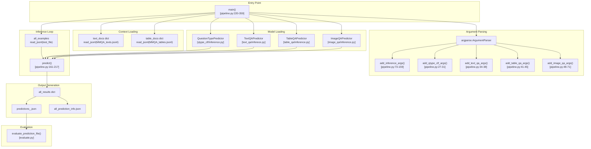
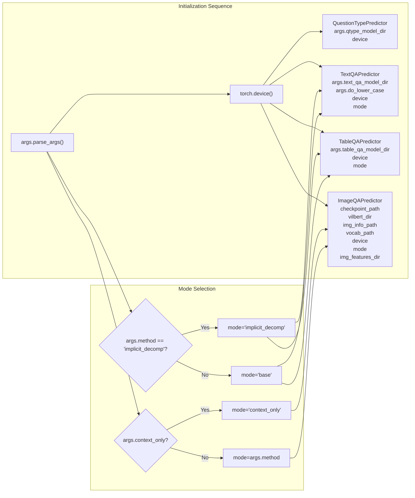
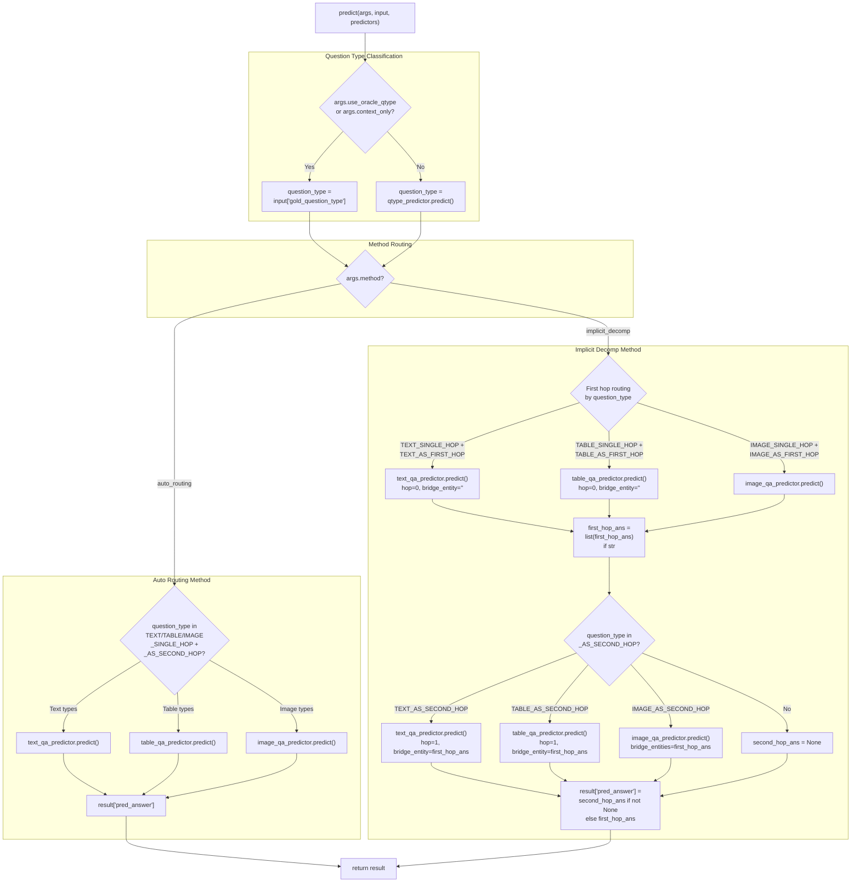
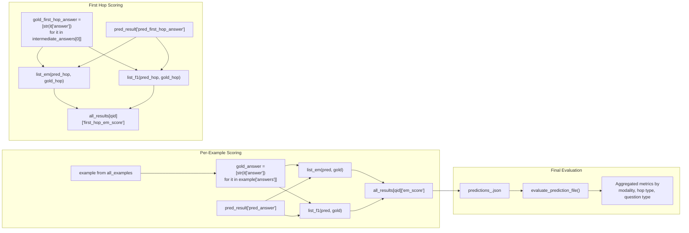

<!-- source: DeepWiki mcp.deepwiki.com · repo allenai/multimodalqa · page 6 Running Inference · fetched 2026-10-26 -->

# Running Inference

<details>
<summary>Relevant source files</summary>

The following files were used as context for generating this wiki page:

- [baselines/README.md](baselines/README.md)
- [baselines/pipeline.py](baselines/pipeline.py)
- [baselines/scripts/run_pipeline.sh](baselines/scripts/run_pipeline.sh)

</details>


## Purpose and Scope

This page provides a practical guide to running inference on the MultiModalQA dataset using the baseline models. It covers the command-line interface, the pipeline orchestration logic, and how to execute evaluations on the dev or test sets.

For detailed information about individual modality-specific QA models, see [Baseline Models](#5). For training these models, see [Training Models](#7). For understanding the evaluation metrics, see [Evaluation](#8). For implementation details of the pipeline orchestrator, see [Pipeline Implementation](#6.1), and for running baseline evaluations in parallel, see [Running Baseline Evaluations](#6.2).

---

## Overview

The inference system in MultiModalQA is centered around the `pipeline.py` script, which orchestrates the complete question-answering workflow. The pipeline loads all modality-specific models, classifies incoming questions by type, routes them to appropriate models, and optionally performs multi-hop reasoning with bridge entity extraction.

The system supports three distinct inference methods, each corresponding to a different baseline approach described in the ICLR 2021 paper:

| Method | Description | Dev F1 / EM |
|--------|-------------|-------------|
| `implicit_decomp` | Multi-hop reasoning with explicit hop modeling | 48.79 / 55.48 |
| `auto_routing` | Direct routing to final answer modality | 44.65 / 51.13 |
| `context_only` | Context-only baseline (ignores question) | 7.41 / 10.03 |

**Sources:** [baselines/README.md:1-53](), [baselines/scripts/run_pipeline.sh:1-50]()

---

## Basic Inference Command

The simplest way to run inference is to execute `pipeline.py` with the required arguments. Here is the command structure for evaluating the `implicit_decomp` method on the dev set:

```bash
python pipeline.py \
  --qtype_model_dir downloads/checkpoints/qtype_clf_models/ \
  --text_qa_model_dir downloads/checkpoints/text_qa_models/implicit_decomp/ \
  --table_qa_model_dir downloads/checkpoints/table_qa_models/implicit_decomp/ \
  --image_qa_model_path downloads/checkpoints/image_qa_models/implicit_decomp/model.pt \
  --image_qa_vocab downloads/checkpoints/image_qa_models/vocab.pickle \
  --image_features_dir downloads/checkpoints/img_features/ \
  --data_dir downloads/MMQA/ \
  --test_file MMQA_dev.jsonl \
  --output_dir output/results/implicit_decomp_dev/ \
  --do_lower_case \
  --method implicit_decomp
```

**Sources:** [baselines/README.md:19-35](), [baselines/pipeline.py:1-360]()

---

## Pipeline Architecture

The following diagram illustrates the complete architecture of the inference pipeline, showing how code components interact:



**Sources:** [baselines/pipeline.py:220-359]()

---

## Command-Line Arguments

The `pipeline.py` script accepts numerous command-line arguments organized into several categories:

### Model Checkpoint Arguments

| Argument | Description | Required |
|----------|-------------|----------|
| `--qtype_model_dir` | Directory containing question type classifier checkpoint | Yes |
| `--text_qa_model_dir` | Directory containing text QA model checkpoint | Yes |
| `--table_qa_model_dir` | Directory containing table QA model checkpoint | Yes |
| `--image_qa_model_path` | Path to image QA model checkpoint file | Yes |
| `--image_qa_vocab` | Path to vocabulary file for image QA answer generation | Yes |
| `--image_features_dir` | Directory containing pre-extracted image features | Conditional* |
| `--raw_image_dir` | Directory containing raw images (if features not pre-extracted) | Conditional* |
| `--vilbert_dir` | Directory containing VilBERT pre-trained weights and config | No (default: `downloads/vilbert/`) |

*Either `--image_features_dir` or `--raw_image_dir` must be provided.

### Data and Output Arguments

| Argument | Description | Required |
|----------|-------------|----------|
| `--data_dir` | Directory containing MMQA dataset files | Yes |
| `--test_file` | Which file to evaluate (e.g., `MMQA_dev.jsonl` or `MMQA_test.jsonl`) | No (default: `MMQA_dev.jsonl`) |
| `--output_dir` | Directory to save predictions and results | Yes |

### Inference Configuration Arguments

| Argument | Description | Default |
|----------|-------------|---------|
| `--method` | Inference method: `auto_routing` or `implicit_decomp` | `implicit_decomp` |
| `--use_oracle_qtype` | Use gold question type (for oracle experiments) | False |
| `--context_only` | Ignore question text (for context-only baseline) | False |
| `--predict_only` | Skip evaluation (for test set prediction) | False |
| `--do_lower_case` | Lowercase input text (for uncased models) | False |

### Text/Table QA Parameters

| Argument | Description | Default |
|----------|-------------|---------|
| `--max_seq_length` | Maximum sequence length after tokenization | 384 |
| `--doc_stride` | Stride for splitting long documents | 128 |
| `--max_query_length` | Maximum question length in tokens | 100 |
| `--n_best_size` | Number of n-best predictions to consider | 20 |
| `--max_answer_length` | Maximum answer length | 30 |

### Hardware Arguments

| Argument | Description | Default |
|----------|-------------|---------|
| `--no_cuda` | Disable CUDA even if available | False |

**Sources:** [baselines/pipeline.py:73-159](), [baselines/README.md:19-36]()

---

## Model Initialization

The pipeline initializes four distinct models during startup. The initialization sequence is shown in the following diagram:



Each predictor is instantiated with method-specific configuration:

1. **QuestionTypePredictor**: Loads from `qtype_model_dir` without method-specific configuration
2. **TextQAPredictor**: Mode is `"implicit_decomp"` if `args.method == "implicit_decomp"`, otherwise `"base"`
3. **TableQAPredictor**: Mode selection follows the same logic as TextQAPredictor
4. **ImageQAPredictor**: Mode is `"context_only"` if `args.context_only` is True, otherwise uses `args.method`

The `mode` parameter controls how each model processes questions, particularly for multi-hop reasoning scenarios where bridge entities need to be incorporated.

**Sources:** [baselines/pipeline.py:233-252]()

---

## Prediction Workflow

The core prediction logic is implemented in the `predict()` function at [baselines/pipeline.py:161-217](). The workflow differs based on the selected inference method:

### Prediction Flow Diagram



### Auto Routing Method

In the `auto_routing` method, the question is routed directly to the modality that will produce the final answer:

1. Question type is predicted or loaded from gold labels
2. Type is checked against `TEXT_SINGLE_HOP_QUESTION_TYPES + TEXT_AS_SECOND_HOP_QUESTION_TYPES`, `TABLE_SINGLE_HOP_QUESTION_TYPES + TABLE_AS_SECOND_HOP_QUESTION_TYPES`, or `IMAGE_SINGLE_HOP_QUESTION_TYPES + IMAGE_AS_SECOND_HOP_QUESTION_TYPES`
3. Appropriate predictor's `predict()` method is called with the question and context
4. Result includes `pred_answer` and `pred_question_type`

**Sources:** [baselines/pipeline.py:169-180]()

### Implicit Decomposition Method

In the `implicit_decomp` method, multi-hop questions are decomposed into sequential reasoning steps:

1. **First Hop**: Question type determines which modality handles the first hop
   - Text, table, or image predictor is called with `hop=0` and `bridge_entity=""`
   - Result is converted to a list if it's a string
2. **Second Hop** (if applicable): If question type is in `*_AS_SECOND_HOP_QUESTION_TYPES`:
   - Appropriate second-hop predictor is called with `hop=1` and `bridge_entity=first_hop_ans`
   - For image QA, the parameter is `bridge_entities` instead of `bridge_entity`
3. **Final Answer**: `second_hop_ans` if it exists, otherwise `first_hop_ans`
4. Result includes `pred_first_hop_answer`, `pred_second_hop_answer`, `pred_answer`, and `pred_question_type`

**Sources:** [baselines/pipeline.py:181-216]()

---

## Input Preparation

Before calling the `predict()` function, the main loop prepares an input dictionary for each example:

```python
input = {
    "qid": example["qid"],
    "question": example["question"] if not args.context_only else "",
    "text_context": [text_docs[doc_id]["text"] for doc_id in example["metadata"]["text_doc_ids"]],
    "table_context": table_docs[example["metadata"]["table_id"]]["table"],
    "image_context": example["metadata"]["image_doc_ids"],
    "gold_question_type": example["metadata"]["type"] if args.use_oracle_qtype or args.context_only else None
}
```

Key aspects:
- **Question blanking**: If `context_only` is True, question is set to empty string
- **Text context**: List of text paragraphs retrieved by IDs
- **Table context**: Single table retrieved by ID
- **Image context**: List of image document IDs (not the actual images)
- **Gold question type**: Only included for oracle or context-only modes

**Sources:** [baselines/pipeline.py:267-274]()

---

## Output Files

The pipeline generates two JSON files in the specified output directory:

### 1. all_prediction_info.json

Comprehensive per-example results containing:

| Field | Description | Present When |
|-------|-------------|--------------|
| `qid` | Question ID | Always |
| `question` | Question text | Always |
| `pred_answer` | Predicted answer | Always |
| `pred_question_type` | Predicted question type | Always |
| `pred_first_hop_answer` | First hop prediction | `implicit_decomp` only |
| `pred_second_hop_answer` | Second hop prediction | `implicit_decomp` only |
| `gold_question_type` | Ground truth question type | If not `predict_only` |
| `gold_first_hop_modality` | Gold first hop modality | If not `predict_only` |
| `gold_first_hop_answer` | Gold first hop answer | If not `predict_only` |
| `gold_answer` | Ground truth answer | If not `predict_only` |
| `first_hop_em_score` | First hop exact match | If not `predict_only` |
| `first_hop_f1_score` | First hop F1 score | If not `predict_only` |
| `em_score` | Final answer exact match | If not `predict_only` |
| `f1_score` | Final answer F1 score | If not `predict_only` |

**Sources:** [baselines/pipeline.py:294-339](), [baselines/pipeline.py:344-345]()

### 2. predictions_.json

Simple mapping of question IDs to predicted answers:

```json
{
  "qid1": "answer1",
  "qid2": ["answer2a", "answer2b"],
  ...
}
```

This file is used for evaluation with the `evaluate_prediction_file()` function.

**Sources:** [baselines/pipeline.py:346-348]()

---

## Evaluation During Inference

If `--predict_only` is not specified, the pipeline computes evaluation metrics for each example during inference:



The `list_em()` and `list_f1()` functions handle list-based answers with proper normalization. After all examples are processed, `evaluate_prediction_file()` aggregates the results and prints detailed breakdowns.

**Sources:** [baselines/pipeline.py:300-339](), [baselines/pipeline.py:350-355]()

---

## Error Handling

The pipeline includes exception handling to ensure that prediction failures for individual examples don't crash the entire run:

```python
try:
    pred_result = predict(...)
except Exception as e:
    print("==" * 10)
    print("Error message:")
    print(e)
    print(f"Question id: {qid}")
    pred_result = {
        "pred_answer": "Error in prediction",
        "pred_question_type": None
    }
```

Errors are logged to stdout with the question ID, and a default error result is stored. This allows the pipeline to continue processing remaining examples.

**Sources:** [baselines/pipeline.py:275-292]()

---

## Running Predictions on Test Set

To generate predictions for the test set without evaluation metrics (since test labels are not publicly available), use the `--predict_only` flag:

```bash
python pipeline.py \
  --qtype_model_dir downloads/checkpoints/qtype_clf_models/ \
  --text_qa_model_dir downloads/checkpoints/text_qa_models/implicit_decomp/ \
  --table_qa_model_dir downloads/checkpoints/table_qa_models/implicit_decomp/ \
  --image_qa_model_path downloads/checkpoints/image_qa_models/implicit_decomp/model.pt \
  --image_qa_vocab downloads/checkpoints/image_qa_models/vocab.pickle \
  --image_features_dir downloads/checkpoints/img_features/ \
  --data_dir downloads/MMQA/ \
  --test_file MMQA_test.jsonl \
  --output_dir output/results/implicit_decomp_test/ \
  --do_lower_case \
  --method implicit_decomp \
  --predict_only
```

With this flag, the pipeline will:
1. Skip all metric computation logic
2. Only generate `predictions_.json` and `all_prediction_info.json`
3. Omit gold labels and scores from output files
4. Not call `evaluate_prediction_file()`

**Sources:** [baselines/README.md:36](), [baselines/pipeline.py:113-115](), [baselines/pipeline.py:300-355]()

---

## Oracle Experiments

For diagnostic purposes, you can run the pipeline with oracle question types using `--use_oracle_qtype`:

```bash
python pipeline.py \
  ... \
  --use_oracle_qtype
```

This bypasses the question type classifier and uses ground truth types from `example["metadata"]["type"]`. This is useful for:
- Measuring the upper bound performance if question type classification were perfect
- Debugging individual modality-specific QA models
- Understanding the impact of question type classification errors

**Sources:** [baselines/pipeline.py:102-105](), [baselines/pipeline.py:164-167]()

---

## Context-Only Baseline

The context-only baseline is a special mode that ignores the question entirely:

```bash
python pipeline.py \
  ... \
  --context_only \
  --method auto_routing
```

When `--context_only` is True:
1. Questions are replaced with empty strings in the input
2. Gold question types are always used (oracle mode is forced)
3. Image QA predictor is initialized with `mode="context_only"`

This baseline measures how much can be answered from context alone without reading the question, serving as a lower bound for model performance.

**Sources:** [baselines/pipeline.py:107-110](), [baselines/pipeline.py:269](), [baselines/pipeline.py:249](), [baselines/scripts/run_pipeline.sh:35-49]()

---

