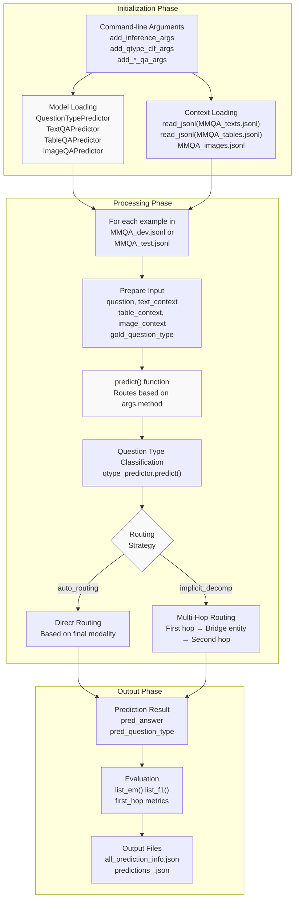
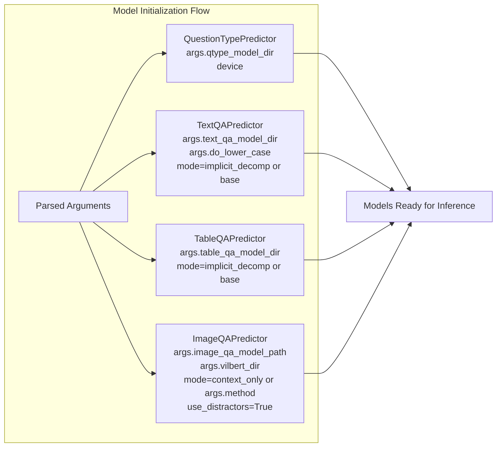
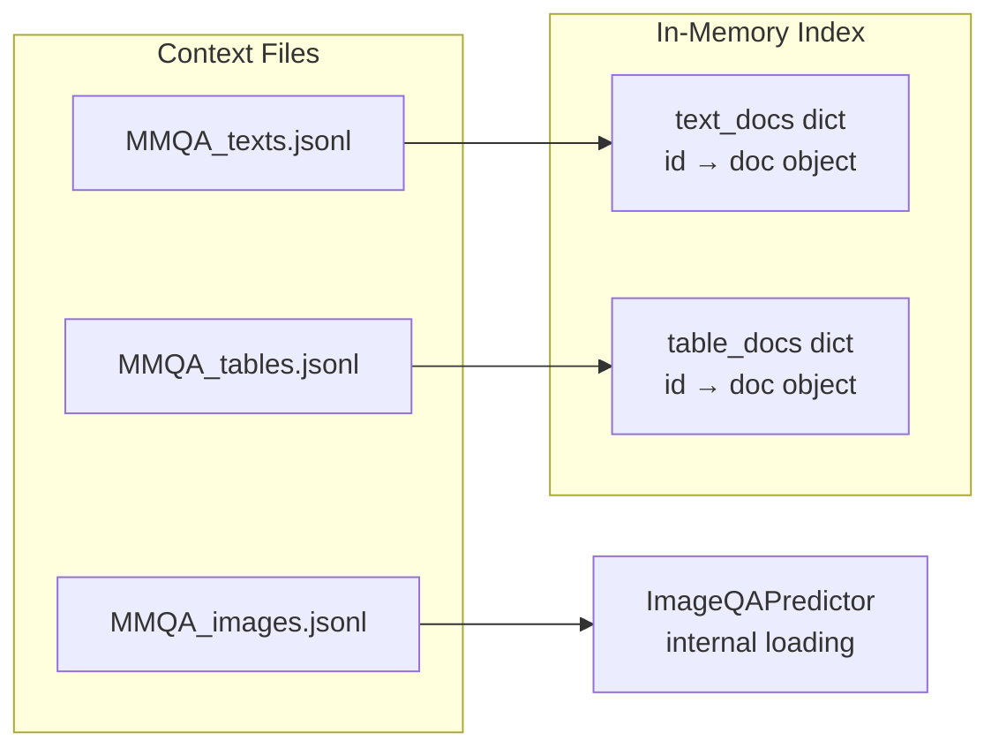
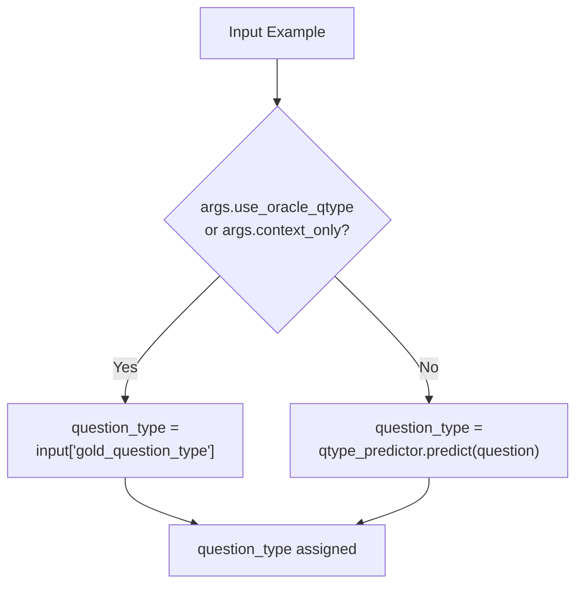
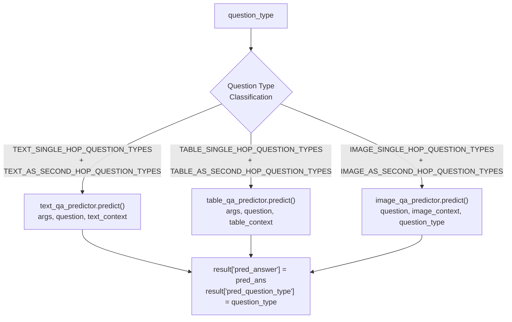
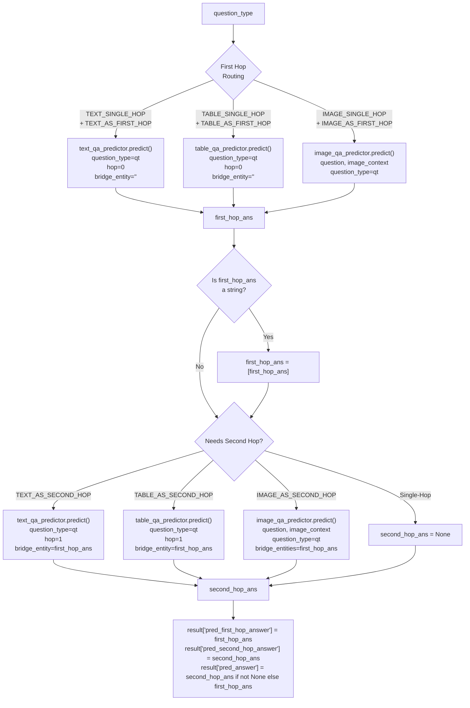
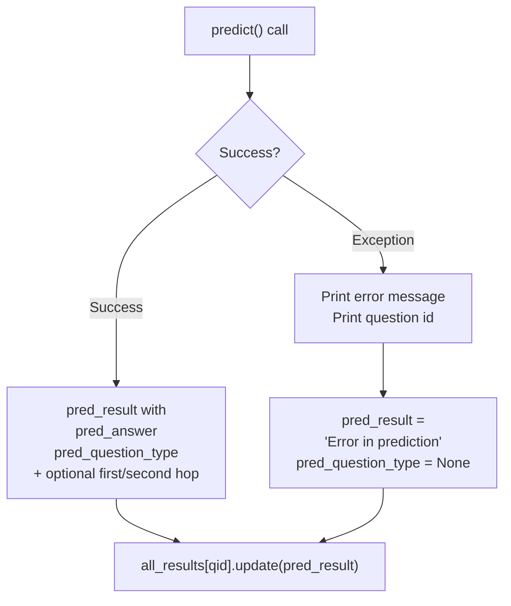
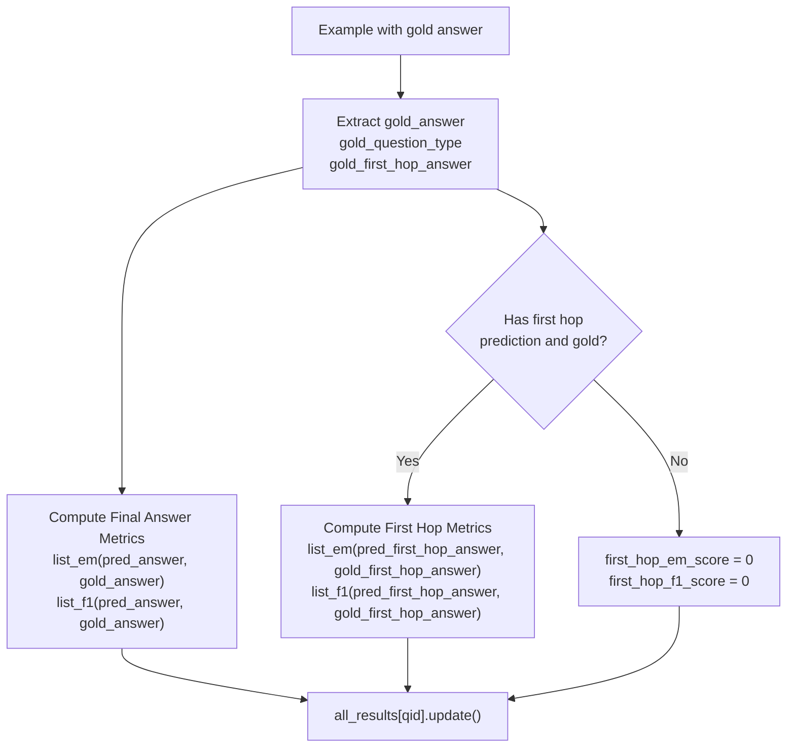
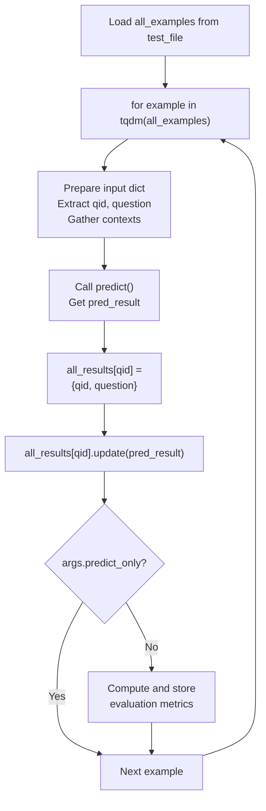

<!-- source: DeepWiki mcp.deepwiki.com · repo allenai/multimodalqa · page 6.1 Pipeline Implementation · fetched 2026-10-26 -->

# Pipeline Implementation

<details>
<summary>Relevant source files</summary>

The following files were used as context for generating this wiki page:

- [baselines/pipeline.py](baselines/pipeline.py)

</details>


## Purpose and Scope

This document provides a detailed technical explanation of the inference pipeline orchestrator implemented in `pipeline.py`. This script coordinates all baseline models (question type classifier, text QA, table QA, and image QA) to process MultiModalQA examples and generate predictions. It handles model loading, context preparation, question routing, multi-hop reasoning with bridge entities, and evaluation.

For information about the three inference methods supported by the pipeline, see [Inference Methods](#4.2). For guidance on running the pipeline script with specific configurations, see [Running Baseline Evaluations](#6.2). For details about individual model implementations, see [Baseline Models](#5).

---

## Pipeline Architecture Overview

The pipeline acts as the central orchestrator that connects all system components. It follows a sequential processing flow: load models → load contexts → classify questions → route to appropriate models → generate predictions → evaluate results.



**Sources:** [baselines/pipeline.py:1-359]()

---

## Command-Line Argument Configuration

The pipeline requires configuration for each model type through dedicated argument functions. These functions define required checkpoints, paths, and inference parameters.

### Argument Groups

| Function | Purpose | Key Arguments |
|----------|---------|---------------|
| `add_inference_args()` | General inference settings | `--data_dir`, `--test_file`, `--output_dir`, `--method` |
| `add_qtype_clf_args()` | Question type classifier | `--qtype_model_dir` |
| `add_text_qa_args()` | Text QA model | `--text_qa_model_dir` |
| `add_table_qa_args()` | Table QA model | `--table_qa_model_dir` |
| `add_image_qa_args()` | Image QA model | `--image_qa_model_path`, `--image_qa_vocab`, `--image_features_dir`, `--vilbert_dir` |

### Key Inference Parameters

The `add_inference_args()` function [baselines/pipeline.py:73-159]() defines critical parameters:

- **`--method`**: Selects inference strategy (`auto_routing` or `implicit_decomp`)
- **`--use_oracle_qtype`**: Uses ground truth question types for ablation studies
- **`--context_only`**: Sets questions to empty strings for the context-only baseline
- **`--predict_only`**: Disables evaluation (for test set inference)
- **`--max_seq_length`**: Maximum sequence length for text/table models (default: 384)
- **`--max_answer_length`**: Maximum generated answer length (default: 30)
- **`--n_best_size`**: Number of candidate answers to consider (default: 20)

**Sources:** [baselines/pipeline.py:27-159]()

---

## Model Initialization

The `main()` function [baselines/pipeline.py:220-232]() initializes all four models with their respective configurations. Each model is instantiated with mode-specific settings based on the selected inference method.



### Mode Configuration

The `mode` parameter passed to each QA model determines its operational behavior:

- **Text/Table QA Models** [baselines/pipeline.py:235-242]():
  - `mode="implicit_decomp"` when `args.method == "implicit_decomp"`
  - `mode="base"` otherwise
  - This controls whether models accept `hop` and `bridge_entity` parameters

- **Image QA Model** [baselines/pipeline.py:243-252]():
  - `mode="context_only"` when `args.context_only == True`
  - Otherwise uses `args.method` value directly
  - Special handling for `use_distractors=True` to include distractor images

**Sources:** [baselines/pipeline.py:233-252]()

---

## Context Loading and Input Preparation

The pipeline loads all multi-modal contexts into memory before processing examples. This design choice optimizes performance by avoiding repeated file I/O.

### Context Loading

[baselines/pipeline.py:254-261]() loads and indexes context documents:



The text and table contexts are loaded using `read_jsonl()` and indexed by their `id` field. Image contexts are handled differently—the `ImageQAPredictor` loads `MMQA_images.jsonl` internally during initialization [baselines/pipeline.py:246]().

### Input Preparation

For each example [baselines/pipeline.py:265-274](), the pipeline constructs an input dictionary:

```python
input = {
    "qid": example["qid"],
    "question": example["question"] if not args.context_only else "",
    "text_context": [text_docs[doc_id]["text"] for doc_id in example["metadata"]["text_doc_ids"]],
    "table_context": table_docs[example["metadata"]["table_id"]]["table"],
    "image_context": example["metadata"]["image_doc_ids"],
    "gold_question_type": example["metadata"]["type"] if args.use_oracle_qtype or args.context_only else None
}
```

**Key design decisions:**
- **Text contexts** are retrieved as a list of paragraphs using document IDs
- **Table context** is retrieved as the raw table structure using a single table ID
- **Image context** passes only the image IDs (not features), as the `ImageQAPredictor` handles feature loading
- **Question nullification** for `context_only` mode happens here

**Sources:** [baselines/pipeline.py:254-274]()

---

## Question Type Classification

The pipeline determines how to route questions based on predicted or oracle question types. This classification drives all downstream routing decisions.

### Classification Logic

[baselines/pipeline.py:161-168]():



The `qtype_predictor.predict()` method (from `QuestionClassificationInferenceModel`) returns one of 16 question types defined in the taxonomy. See [Question Types and Taxonomy](#3.2) for the complete type hierarchy.

**Sources:** [baselines/pipeline.py:161-168]()

---

## Routing Logic and Prediction

The `predict()` function [baselines/pipeline.py:161-217]() implements two distinct routing strategies based on `args.method`.

### Auto-Routing Method

The `auto_routing` method [baselines/pipeline.py:169-180]() directly routes to the final answer modality without decomposition:



**Routing constants** used are imported from `common_utils` [baselines/pipeline.py:18-22]():
- `TEXT_SINGLE_HOP_QUESTION_TYPES`, `TEXT_AS_SECOND_HOP_QUESTION_TYPES`
- `TABLE_SINGLE_HOP_QUESTION_TYPES`, `TABLE_AS_SECOND_HOP_QUESTION_TYPES`
- `IMAGE_SINGLE_HOP_QUESTION_TYPES`, `IMAGE_AS_SECOND_HOP_QUESTION_TYPES`

This method treats all questions as if they require only a single model call, routing based on where the final answer is expected to come from.

**Sources:** [baselines/pipeline.py:169-180]()

---

### Implicit Decomposition Method

The `implicit_decomp` method [baselines/pipeline.py:181-216]() performs explicit multi-hop reasoning with bridge entity extraction:



**Key implementation details:**

1. **First Hop** [baselines/pipeline.py:183-193](): All question types route through first hop logic, with `hop=0` and empty `bridge_entity`

2. **String to List Conversion** [baselines/pipeline.py:195-197](): Text QA models may return strings, but second hop models expect lists

3. **Second Hop Conditional** [baselines/pipeline.py:199-210](): Only questions with `_AS_SECOND_HOP` types trigger second hop inference, with `hop=1` and `bridge_entity=first_hop_ans`

4. **Final Answer Selection** [baselines/pipeline.py:214](): Uses `second_hop_ans` if available, otherwise falls back to `first_hop_ans`

**Sources:** [baselines/pipeline.py:181-216]()

---

## Bridge Entity Handling

Bridge entities connect multi-hop reasoning steps. The first hop prediction becomes the input to the second hop through the `bridge_entity` parameter.

### Bridge Entity Flow

| Hop | Parameter Name | Value | Purpose |
|-----|----------------|-------|---------|
| First (hop=0) | `bridge_entity` | `""` (empty) | No filtering needed |
| Second (hop=1) | `bridge_entity` | `first_hop_ans` (list) | Filter contexts to those mentioning bridge entities |

The text and table QA models use the `bridge_entity` parameter to filter contexts. For example, if the first hop predicts `["John Smith"]`, the second hop text QA model will only consider paragraphs that mention "John Smith".

The image QA model uses a different parameter name (`bridge_entities` instead of `bridge_entity`) [baselines/pipeline.py:208]() but serves the same purpose—filtering candidate images to those whose captions mention the bridge entities.

**Sources:** [baselines/pipeline.py:183-210]()

---

## Error Handling and Robustness

The pipeline includes error handling to ensure processing continues even when individual predictions fail.

### Try-Except Block

[baselines/pipeline.py:275-292]():



When an error occurs:
1. The error message is printed [baselines/pipeline.py:285-288]()
2. The question ID is logged
3. A fallback result is created with `"Error in prediction"` as the answer
4. Processing continues with the next example

This design ensures that a failure in one example doesn't halt the entire evaluation run.

**Sources:** [baselines/pipeline.py:275-292]()

---

## Output Generation and Evaluation

The pipeline produces two output files and optionally runs evaluation metrics.

### Output Files

[baselines/pipeline.py:341-348]():

1. **`all_prediction_info.json`**: Complete results including predictions, gold answers, and metrics for each question
   - Contains: `qid`, `question`, `pred_answer`, `pred_question_type`, `gold_answer`, `em_score`, `f1_score`, etc.
   
2. **`predictions_.json`**: Simple mapping of `qid` to `pred_answer` for submission or further analysis

### Evaluation Metrics

When `--predict_only` is not set, the pipeline computes evaluation metrics [baselines/pipeline.py:300-339]():



**Metadata extraction** [baselines/pipeline.py:307-319]():
- Determines `gold_first_hop_modality` from question type constants
- Extracts intermediate answers from `example["metadata"]["intermediate_answers"]`
- Handles cases where intermediate answers are not available

**Metric functions** from `evaluate` module [baselines/pipeline.py:24]():
- `list_em()`: Computes exact match score for list-valued answers
- `list_f1()`: Computes F1 score for list-valued answers
- See [Evaluation Metrics](#8.1) for implementation details

**Final evaluation** [baselines/pipeline.py:350-355]() calls `evaluate_prediction_file()` to generate aggregate metrics by question type, modality, and hop configuration.

**Sources:** [baselines/pipeline.py:300-355]()

---

## Processing Loop Structure

The main processing loop [baselines/pipeline.py:264-299]() iterates through all examples with progress tracking:



The `tqdm` progress bar [baselines/pipeline.py:265]() provides real-time feedback on processing speed and estimated completion time.

**Sources:** [baselines/pipeline.py:264-299]()

---

## Special Modes and Ablations

The pipeline supports several special modes for ablation studies and analysis.

### Oracle Question Type Mode

When `--use_oracle_qtype` is set [baselines/pipeline.py:102-105](), the pipeline uses ground truth question types instead of predictions. This ablation isolates question type classification errors from downstream QA model errors.

### Context-Only Mode

When `--context_only` is set [baselines/pipeline.py:107-110](), questions are replaced with empty strings [baselines/pipeline.py:269](). This baseline tests whether models can answer questions using only context information without understanding the question itself. This mode also forces `use_oracle_qtype=True` internally [baselines/pipeline.py:164]() since question type cannot be predicted from an empty question.

### Predict-Only Mode

When `--predict_only` is set [baselines/pipeline.py:112-115](), the pipeline skips evaluation and only generates predictions. This is used for test set inference where gold answers are not available.

**Sources:** [baselines/pipeline.py:102-115, 164, 269, 300]()

---

## Integration with Model Interfaces

The pipeline relies on standardized interfaces for each model type:

| Model | Class | Module | Predict Method Signature |
|-------|-------|--------|-------------------------|
| Question Type Classifier | `QuestionClassificationInferenceModel` | `qtype_clf.inference` | `predict(guid, question)` |
| Text QA | `TextInferenceModel` | `text_qa.inferece` | `predict(args, question, context, question_type, hop, bridge_entity)` |
| Table QA | `TableInferenceModel` | `table_qa.inference` | `predict(args, question, context, question_type, hop, bridge_entity)` |
| Image QA | `InferenceModel` | `image_qa.inference` | `predict(question, image_ids, question_type, bridge_entities)` |

**Import statements** [baselines/pipeline.py:14-17]():
```python
from qtype_clf.inference import QuestionClassificationInferenceModel as QuestionTypePredictor
from text_qa.inferece import TextInferenceModel as TextQAPredictor
from table_qa.inference import TableInferenceModel as TableQAPredictor
from image_qa.inference import InferenceModel as ImageQAPredictor
```

Note: The text QA module has a typo in the filename (`inferece` instead of `inference`) [baselines/pipeline.py:15]().

**Sources:** [baselines/pipeline.py:14-17]()

---

## Summary

The `pipeline.py` script serves as the central orchestration layer for the MultiModalQA system:

1. **Initialization**: Loads four models with mode-specific configurations
2. **Context Loading**: Indexes all text, table, and image contexts in memory
3. **Question Classification**: Predicts or uses oracle question types
4. **Routing**: Implements two strategies (auto_routing and implicit_decomp)
5. **Multi-Hop Reasoning**: Handles bridge entity extraction and second hop inference
6. **Error Handling**: Gracefully handles failures without stopping the pipeline
7. **Output Generation**: Creates detailed prediction files and aggregate metrics
8. **Evaluation**: Computes F1 and EM scores by question type and modality

The pipeline's modular design allows easy switching between inference methods and supports ablation studies through special modes like oracle question types and context-only baselines.

**Sources:** [baselines/pipeline.py:1-359]()

---

